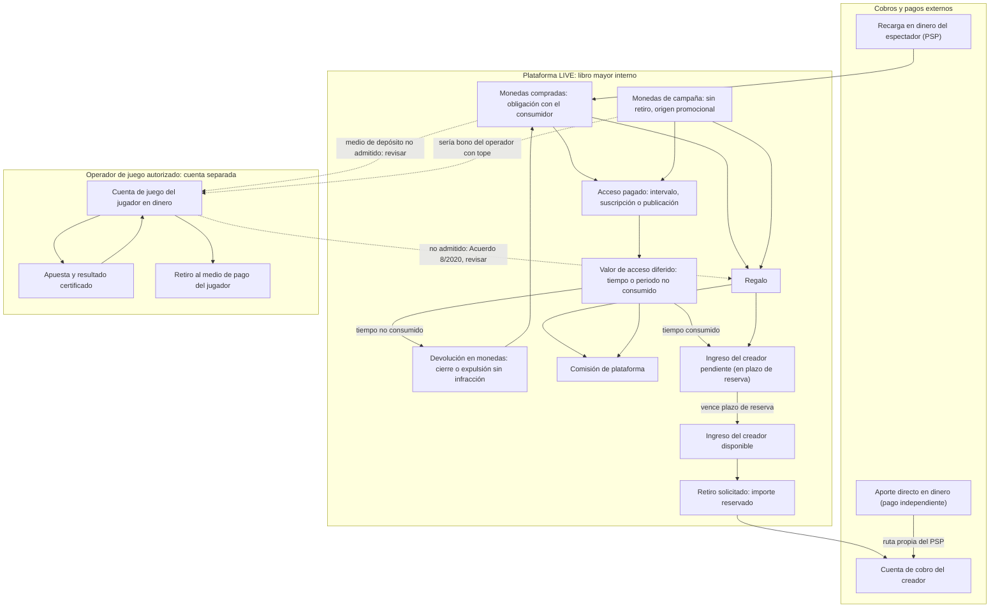

# LIVE-001-resultado-v1.0 — Viabilidad del piloto LIVE

| Campo | Valor |
| --- | --- |
| Encargo | LIVE-001 — Investigación de viabilidad — v1.0 |
| Base de requisitos | Proyecto LIVE, definición v0.33 |
| Fecha real de investigación | 10 de octubre de 2026 (todas las consultas se hicieron ese día) |
| Ámbito principal | Colombia: recargas, retiros, casino y campañas en Bogotá y Medellín. Residencia de creadores: Colombia, Estados Unidos, España y Venezuela |
| Naturaleza | Documentación para revisión. No es asesoría jurídica, contable ni financiera. No se contactó a ninguna entidad ni proveedor, no se abrieron cuentas y no se movió dinero |

---

## 0. Cómo leer este informe

### 0.1 Limitación de acceso a fuentes (afecta a todo el informe)

La política de red del contenedor donde se ejecutó la investigación **bloqueó la navegación directa**. Por ejemplo, `www.coljuegos.gov.co` devolvió `CONNECT 403 (connect_rejected)` y la herramienta de lectura de páginas falló por resolución de nombres. Solo se pudo usar un **buscador web** que devuelve título, URL y extractos o resúmenes indexados de cada página.

Consecuencias:

- **No se leyó el texto completo de ninguna norma, contrato ni política.** Toda cita procede de extractos indexados (en el anexo: «EI»).
- Una conclusión se marca **[EP]** solo cuando el extracto procede de la fuente primaria o de una compilación oficial (normogramas de entidades públicas, sitio del proveedor). Si procede de prensa, blogs o agregadores, se indica «secundaria».
- Antes de tomar una decisión deben leerse literalmente las fuentes críticas **F03, F05, F09, F10–F14** (juego) y **F25–F36** (pagos).
- Para que una siguiente investigación pueda leer los textos completos, hay que ampliar el acceso de red del entorno (Network access en la configuración del entorno cloud) o añadir a la lista permitida al menos `coljuegos.gov.co`, `funcionpublica.gov.co`, `suin-juriscol.gov.co`, `normograma.*.gov.co` y los dominios de los proveedores.

### 0.2 Etiquetas

| Etiqueta | Significado |
| --- | --- |
| **[RC]** | Requisito confirmado: procede del encargo o de la base v0.33 |
| **[EP]** | Evidencia pública: respaldada por una fuente aplicable, citada (ver anexo) |
| **[PR]** | Propuesta de este informe, no aprobada |
| **[CC]** | Confirmación contractual pendiente: requiere aceptación escrita, contrato o documentación privada del proveedor |
| **[RP]** | Revisión profesional pendiente: interpretación o trámite que debe validar un profesional |
| **[NC]** | No comprobado: información insuficiente, inaccesible o contradictoria |

Estados de viabilidad: **Respaldado**, **Condicionado**, **Incompatible según la fuente** y **No comprobado**. Estos estados no sustituyen un contrato ni un dictamen profesional. Que algo sea viable técnicamente no prueba que un proveedor lo vaya a admitir.

---

## 1. Conclusión ejecutiva

### 1.1 Respuesta a las cinco preguntas del encargo

**1. ¿Existe una ruta legal, contractual y financiera para todo el circuito en Colombia?**
Con la evidencia obtenida, **no se encontró ninguna ruta que acredite el modelo completo de v0.33**. El obstáculo no es tecnológico ni el costo del video. Está en la combinación de tres requisitos confirmados [RC]:

- casino con dinero real desde el lanzamiento;
- uso de las ganancias de juego para regalar o comprar acceso y contenido que acaban en retiros bancarios de terceros (los creadores);
- sin retiro bancario al propio jugador.

| Hallazgo | Etiquetas |
| --- | --- |
| En Colombia, el juego por internet solo puede operarlo una persona jurídica con **contrato de concesión** de Coljuegos. | [EP F01, F02] |
| Operar sin autorización encaja en el delito de ejercicio ilícito de actividad monopolística (art. 312 del Código Penal). | [EP F18] |
| El reglamento vigente (Acuerdo 8 de 2020) **prohíbe transferir saldos entre cuentas de juego de distintos jugadores** (art. 1.5.9). | [EP F03, EI] |
| El mismo acuerdo obliga al operador a **transferir el saldo de la cuenta de juego al medio de pago que solicite el jugador**. | [EP F03, EI] |
| No se halló ninguna figura que permita convertir saldo de juego en regalos o compras a favor de otra persona. | [NC] → [RP] |
| Prohibir el retiro al jugador choca con su derecho a solicitar la transferencia de su saldo. | **Incompatible según la fuente**, pendiente de lectura textual [RP] |

**2. ¿Qué entidades podrían cubrir cada tramo?**
Hay candidatos documentados para tramos aislados. **Ninguno acepta públicamente la combinación** de contenido adulto, juego, regalos y retiros de creadores (sección 5).

- Stripe, Payoneer y Wise excluyen el contenido adulto y el juego, y Bold excluye el contenido adulto [EP F28, F29, F34, F35].
- Nuvei y dLocal tienen presencia documentada en juego licenciado colombiano y en PSE [EP F32, F33]. No hay evidencia de que acepten contenido adulto [NC].
- Los adquirentes especializados en adulto (CCBill, Segpay, Verotel, Epoch) son candidatos para la parte adulta. No consta públicamente su cobertura de Colombia, COP o PSE, ni su postura sobre el juego [NC/CC].

**3. ¿Es viable el multistream desde un solo celular?**
**Parcialmente.**

| Capacidad | Estado |
| --- | --- |
| Emisión de video: un celular envía una sola señal a nuestro servidor y este la redistribuye por RTMP a los destinos que den clave a la cuenta del creador | Condicionado [PR] |
| Chat y regalos de TikTok, Bigo y BuzzCast | **No se encontró API oficial** [NC]. Para TikTok solo hay librerías no oficiales de ingeniería inversa, que no se presentan como ruta autorizada [F46] |
| Conformidad de contenido con los destinos | TikTok y Bigo prohíben la desnudez y el contenido sexual y restringen la promoción de juego [EP secundaria F48, F50] |
| Consultar apps externas desde el mismo teléfono mientras se emite | En Android, Chrome suspende la cámara cuando la página queda oculta [EP secundaria F52], así que hacerlo corta la emisión web. La multiventana está por probar (LIVE-002) |
| Cierre externo | Solo se puede verificar **que dejamos de enviar**, no que el destino haya finalizado el directo [PR] |

**4. ¿Qué infraestructura y capital necesita el piloto?**
El video es asumible: unos **US$1.100–1.700 al mes** con un servicio administrado en el escenario de 12 h/día a ocupación máxima, y menos si se aloja por cuenta propia (sección 7). Lo que supera la referencia de US$3.000 es lo siguiente:

- **Moderación en tiempo real** que exigen las redes de tarjetas para el contenido adulto: unas 2–4 personas equivalentes.
- **Fondos que respaldan obligaciones**: monedas no consumidas, saldos de creadores y reservas del procesador.
- **Asesoría legal.**
- **Cualquier ruta de casino.** La ruta A exige, además del 15 % de los ingresos brutos menos premios, un pago fijo de **811 SMMLV por año de operación** [EP F03]. En 2026 equivale a **COP 1.419.983.955**, unos US$438.000 a TRM 3.238,88, es decir, ≈ US$36.500/mes. A eso se suman patrimonio y garantías cuyos importes no se pudieron comprobar [NC].

**5. ¿Qué decidir y probar primero?**
Las ocho preguntas de la sección 10 y tres pruebas pequeñas antes de escribir código de dinero:

1. Un paquete de consulta jurídica con preguntas cerradas (LIVE-005).
2. Un cuestionario escrito a proveedores de pago y verificación (LIVE-006).
3. Una prueba de captura y redistribución en Android (LIVE-002).

### 1.2 Ruta mejor respaldada (Propuesta, cambia requisitos)

**[PR]** Separar el producto en tres dominios sin vasos comunicantes de saldo:

| Dominio | Qué incluye |
| --- | --- |
| **Plataforma de directos y contenido adulto** | Monedas de consumo, regalos, salas por intervalos, perfiles y retiros de creadores |
| **Casino de un operador autorizado** (ruta B) **o propio** (ruta A) | Cuenta de juego en dinero, apuestas, premios y **retiro al jugador permitido**. Sin uso de ganancias para regalos ni contenido |
| **Aportes directos** | Pago independiente con su propio proveedor y liquidación al creador |

Esta ruta **cambia tres requisitos confirmados**: ganancias usables en regalos y contenido, ausencia de retiro al jugador y casino integrado con las mismas monedas. El usuario debe decidirlo. Posponer el casino o sustituirlo por puntos ficticios también cambia el producto [RC]. No se encontró ninguna alternativa respaldada que conserve el casino tal como está definido.

### 1.3 Condiciones para avanzar

1. Dictamen escrito sobre las preguntas de LIVE-005: Coljuegos, Superintendencia Financiera, tributario, datos y menores, publicidad, y creadores anfitriones en España y EE. UU. [RP]
2. Respuestas escritas de al menos tres proveedores de cobro y dos de pago a creadores sobre la combinación concreta [CC].
3. Decisión sobre las preguntas de la sección 10.
4. LIVE-002 en un teléfono Android real.

### 1.4 Nivel de evidencia

| Ámbito | Nivel |
| --- | --- |
| Normas de juego | Medio-bajo: extractos indexados de compilaciones oficiales, sin texto completo |
| Régimen tributario del juego en 2026 | Bajo (inestable) |
| Políticas de proveedores de pago | Bajo-medio |
| Precios publicados de infraestructura | Medio |
| Capacidades de los destinos externos | Bajo: no hay documentación oficial de chat ni regalos |

---

## 2. Matriz de viabilidad por componente

| # | Componente | Estado | Evidencia | Responsable (propuesto) | Decisión o prueba necesaria | Depende de |
| --- | --- | --- | --- | --- | --- | --- |
| 1 | Casino con dinero real desde el lanzamiento [RC] | **Condicionado**: solo con concesión propia (A) o mediante un operador autorizado (B) | F01–F03, F18 | Concesionario | Elegir ruta (P1, P2); dictamen | Capital o contrato |
| 2 | Ganancias de juego usadas para regalos, intervalos, publicaciones y suscripciones [RC] | **Incompatible según la fuente** (art. 1.5.9 y régimen de retiros del Acuerdo 8/2020), pendiente de lectura textual | F03 (EI) | Abogado de juego | Confirmar o descartar; rediseñar | 1 |
| 3 | Sin retiro bancario del jugador [RC] | **Incompatible según la fuente** bajo concesión: el jugador puede pedir la transferencia de su saldo | F03 (EI) | Abogado de juego | Ídem | 1 |
| 4 | Monedas compradas usadas para apostar [RC] | **No comprobado**; probable conflicto con los medios de pago admitidos para la cuenta de juego | F04 (EI), F01 | Abogado de juego | Dictamen | 1 |
| 5 | Monedas de campaña usadas para apostar [RC] | **Condicionado**: equivalen a bonos que otorga el operador, con tope regulado | F03, F09 (secundaria) | Operador | P7 | 1, 13 |
| 6 | Anfitrión remunerado con un % de lo apostado [RC] | **No comprobado** | F10, F11, F76–F78 | Operador y abogado | Dictamen; contrato | 1 |
| 7 | Contenido sexual explícito entre adultos [RC] | **Condicionado** a controles de menores, consentimiento y moderación | F20–F22, F25 | LIVE | Controles y proveedor de pago | 8, 23 |
| 8 | Recargas de monedas en Colombia [RC] | **No comprobado**: ningún proveedor confirmado | F28–F33 | Proveedor de pagos (PSP) | Cuestionario (LIVE-006) | 7 |
| 9 | Retiros a creadores residentes en CO, US, ES y VE [RC] | **Condicionado** en CO, US y ES; **No comprobado** en VE | F34–F41 | LIVE y PSP | Cuestionario; revisión fiscal | 8 |
| 10 | Aportes directos con pago independiente [RC] | **No comprobado** | F25, F28–F36 | PSP | Cuestionario | 8 |
| 11 | Salas por intervalos: pausas, 1 minuto de reconexión, devolución en monedas [RC] | **Respaldado técnicamente** [PR]. Protección al consumidor: **Condicionado** | F42 | LIVE | LIVE-003 | Libro mayor |
| 12 | Perfiles con suscripción o compra solo con saldo interno [RC] | **Respaldado técnicamente**; consumo: **Condicionado** | F42 | LIVE | LIVE-004 | Libro mayor |
| 13 | Campaña QR con pago en dinero o monedas [RC] | **Condicionado**: permisos de publicidad exterior y monedas con uso en casino | F79–F83, F09 | LIVE | Permisos; P7 | 5 |
| 14 | Prueba de cartel en vivo continua [RC] | **Respaldado técnicamente** [PR]; privacidad de terceros: **Condicionado** | F43, F83 | LIVE | Prueba en LIVE-002 | 15 |
| 15 | Emisión web desde Android | **Condicionado**: exige página en primer plano | F52, F53, F55 | LIVE | LIVE-002 | — |
| 16 | Video a TikTok y Bigo (BuzzCast) | **Condicionado** según la cuenta en TikTok y Bigo; **No comprobado** en BuzzCast | F45, F49, F51 | Creador y LIVE | Verificar claves por cuenta | 15 |
| 17 | Chat externo en nuestro panel | **No comprobado**: sin API oficial | F46, F47 | — | Convenio o descartar | — |
| 18 | Regalos externos en nuestro panel | **No comprobado** | F46 | — | Ídem | — |
| 19 | Cierre externo verificado antes del modo exclusivo [RC] | **Condicionado**: solo se puede verificar que nuestra salida terminó | [PR] | LIVE | LIVE-002 | 16 |
| 20 | Verificación de edad del espectador en el registro [RC] | **Condicionado** a proveedor y método (Ley 2489/2025, Decreto 769/2026) | F22, F67–F71 | LIVE y proveedor KYC | Elegir método | — |
| 21 | Verificación de creadores y de toda persona que aparezca | **Condicionado** | F25 | LIVE | Proceso documentado | 20 |
| 22 | Notificaciones de navegador o celular [RC] | **Respaldado** en Android/Chrome; en iPhone solo con la web añadida a la pantalla de inicio | F54 | LIVE | Prueba | — |
| 23 | Administración y reportes por una sola persona [RC] | **Incompatible según la fuente** con el monitoreo en tiempo real que exige Mastercard para directos adultos cuando hay emisiones sin cobertura humana disponible ([CC] si el monitoreo automatizado basta) | F25 | Persona promotora | P5 | 7 |
| 24 | App posterior en tiendas | **Incompatible según la fuente** para contenido explícito (Google Play, Apple). **Condicionado** para juego licenciado separado | F72–F75 | — | Definir el alcance de la app | 1 |

---

## 3. Operador propio (A) frente a integración con operador autorizado (B)

| Responsabilidad | Ruta A: operadora propia con concesión | Ruta B: integración con un operador autorizado |
| --- | --- | --- |
| Contrata con el jugador | La operadora LIVE (persona jurídica concesionaria) [EP F02] | El operador autorizado. LIVE no puede ser contraparte del juego sin concesión [EP F02, F18] |
| Vende las monedas | LIVE vende monedas de consumo. La cuenta de juego es aparte, en dinero o créditos del reglamento [RP] | LIVE vende monedas de consumo. El operador recibe depósitos en dinero en su propia cuenta de juego |
| Custodia fondos y saldos | LIVE: saldos de consumo y cuentas de juego, con garantías de pago de premios y devolución de fondos [EP F01] | Cada parte custodia lo suyo. **No hay saldo común** [PR] |
| Ejecuta apuestas | Plataforma y juegos certificados por un laboratorio acreditado ante Coljuegos [EP F06, F19] | Plataforma del operador |
| Reconoce premios | LIVE, con un retorno al jugador mínimo del 83 % [EP F03] | El operador |
| Remunera a los creadores | LIVE, por regalos y contenido del dominio de consumo | LIVE, por regalos y contenido. El operador no interviene |
| Remunera a los anfitriones | LIVE, como gasto de comunicación comercial. El % de lo apostado no está comprobado [NC/RP] | El operador a LIVE o al creador mediante acuerdo de afiliación o comunicación comercial [CC]. Fórmula sobre lo apostado no comprobada |
| Paga retiros | LIVE: retiros del jugador al medio de pago que solicite [EP F03] y retiros de creadores | Operador (jugadores) y LIVE (creadores) |
| Atiende disputas | LIVE (juego y consumo) | Operador (juego) y LIVE (consumo) |
| Obligaciones regulatorias | Derechos de explotación, gastos de administración, requerimientos técnicos, SIPLAFT, publicidad, retención sobre premios, régimen tributario del juego [EP F03, F06, F10, F12–F15] | Del operador. LIVE asume las obligaciones de comunicación comercial que le apliquen [EP F10] y las del negocio adulto |
| Cobertura del circuito v0.33 | **No cubre** ganancias → regalos ni prohibición de retiro (sección 1.1). Solo cubre el casino separado | **No cubre** esos mismos movimientos. Cubre el casino separado si el operador acepta el acuerdo |
| Entrada económica | 811 SMMLV por año (COP 1.419.983.955 en 2026) [EP F03], 15 % de ingresos brutos menos premios [EP F03], 1 % de gastos de administración sobre los derechos [EP secundaria], patrimonio y garantías [NC], certificación [CC], plataforma [CC] | Sin licencia propia. Costo de integración y reparto: pendiente de cotización [CC] |
| Confirmaciones pendientes | Texto vigente de la Res. 20161200025334 y sus modificaciones (patrimonio y garantías), costo de laboratorio, compatibilidad de una marca adulta con la concesión [RP] | Que exista un operador dispuesto, que se pueda asociar su casino a una marca adulta, marca blanca o dominio (no se halló evidencia [NC]), y el modelo de remuneración admisible [CC/RP] |

Observaciones:

- **El régimen tributario del juego en línea en 2026 es inestable.** La Corte Constitucional declaró inexequible el IVA del 19 % del Decreto 1474 de 2025 (abril de 2026) [EP secundaria F13]. Después se expidió el Decreto Legislativo 0240 de 2026, con un impuesto al consumo del 16 % sobre ingresos brutos de juego. No se pudo confirmar si sigue vigente ni su control constitucional [NC F14].
- La retención en la fuente sobre premios es del 20 % cuando el premio supera 48 UVT, es decir, COP 2.513.952 con la UVT de 2026 (COP 52.374, fuente secundaria) [EP F15, RP].
- **Una marca blanca, un proveedor de juegos o la licencia de otro no cubren a LIVE por sí solos.** No se encontró evidencia pública de marcas blancas ni de cesión de contratos de concesión [NC]. Los operadores deben usar dominio .co y figurar en la lista oficial, que tenía **15 operadores** en 2026 [EP F08].

---

## 4. Dinero y saldos

### 4.1 Diagrama (Propuesta de separación; las líneas discontinuas son movimientos no admitidos o por revisar)



### 4.2 Conceptos que no deben mezclarse

| Concepto | Definición propuesta [PR] | Por qué importa |
| --- | --- | --- |
| **Regalo** | Transferencia de monedas de consumo de un espectador a un creador, sin contraprestación de acceso | Genera ingreso del creador y comisión. Es el principal vector de salida de valor (sección 4.6) |
| **Acceso pagado** (intervalo, suscripción, publicación) | Compra de un servicio digital con monedas: derecho de acceso con condiciones | Se reconoce a medida que se consume. Afecta derecho de retracto, reversión y devoluciones [EP F42, RP] |
| **Ganancias de juego** | Premio reconocido por el operador en la cuenta de juego del jugador | Régimen de juego: retiros, retención, SIPLAFT. No es saldo de consumo [EP F03, F12, F15] |
| **Aporte directo** | Pago en dinero de un tercero a favor de un creador mediante un cobro independiente | Requiere su propio PSP. Puede considerarse recaudo a nombre de terceros [RP F39] |
| **Remuneración publicitaria** | Pago por una tarea aprobada más un bono por captación, en dinero o en monedas | Es un pago por servicios y genera una obligación económica también en monedas. Si las monedas sirven para apostar, se acerca a un bono de juego [RP F09] |
| **Ingreso pagable del creador** | Parte de regalos y accesos ya consumidos que, pasado el plazo de reserva, puede retirarse | Debe respaldarse con caja. Las solicitudes diarias no implican liquidación diaria [RC] |
| **Comisión de plataforma** | Parte retenida por LIVE | Distinta del costo del procesador, los impuestos y las retenciones [RC] |

### 4.3 Recorridos económicos

| # | Recorrido | Titularidad | Obligaciones pendientes | Comisiones y costos | Reservas | Liquidación | Reversos | Estado |
| --- | --- | --- | --- | --- | --- | --- | --- | --- |
| 1 | Dinero → recarga → monedas → regalo → ingreso → retiro → banco | Espectador (monedas no usadas), creador (ingreso), LIVE (comisión) | Monedas vivas e ingresos pendientes | Procesador [CC], impuestos [RP], costo del retiro [CC] | Plazo de reserva antes de que el ingreso esté disponible [PR], reserva del procesador [CC] | Lotes de pago a creadores. La solicitud diaria no garantiza el pago diario [RC] | Contracargo o reversión después del regalo: recuperar del ingreso pendiente o asumir la pérdida [PR] | Condicionado (PSP no confirmado) |
| 2 | Dinero o monedas → apuesta → ganancia → regalo o compra → ingreso → banco | Jugador (cuenta de juego en el operador) | Saldo de juego retirable a petición del jugador [EP F03] | Derechos de explotación e impuestos del juego [EP F03, F13, F14] | Garantía de pago de premios [EP F01, monto NC] | Del operador al medio de pago del jugador | — | **Incompatible según la fuente** en el tramo ganancia → regalo o compra; depósito con monedas: NC |
| 3 | Aporte directo → comisión y costos → banco del creador | Pagador y creador | Fondos en tránsito del PSP | Procesador y comisión LIVE [CC] | Del PSP [CC] | Según el PSP; no inmediata [RC] | Contracargo contra el creador o LIVE según contrato [CC] | No comprobado |
| 4 | Tarea publicitaria y bono → dinero o monedas → usos internos | Participante | Pago base y bono aprobados; monedas promocionales vivas | Transferencia o costo de las monedas [PR] | Fondo de campaña prepagado [PR] | Dinero: transferencia. Monedas: crédito interno | Rechazo de tarea o captación fraudulenta: anular el crédito no usado [PR] | Condicionado; el uso en casino no está comprobado |
| 5 | Regalo que habilita un intervalo → consumo → pausa y reanudación → cierre o expulsión → devolución | Espectador (tiempo no consumido) y creador (tiempo consumido) | Valor diferido del tiempo restante y crédito excedente | Comisión sobre lo consumido [PR] | Tiempo no consumido diferido, no pagable al creador [PR] | Reconocimiento progresivo | Cierre: devolver el tiempo pagado restante en monedas [RC]. Expulsión: devolver salvo infracción comprobada por la plataforma; durante la revisión, el valor queda retenido [RC + PR] | Respaldado técnicamente |

### 4.4 Registros necesarios para evitar doble gasto y doble conteo [PR]

1. **Libro mayor de partida doble, solo de anexión.** Cada operación genera asientos que suman cero entre cuentas: monedas del espectador, valor diferido, ingreso pendiente, disponible y reservado del creador, comisión, obligación de devolución y retención en revisión. Nunca se edita un saldo directamente.
2. **Lotes de monedas con origen:** comprada, promocional o devuelta, con su fecha y su referencia de cobro. El consumo sigue una regla fija (por ejemplo, primero la más antigua). La devolución vuelve al lote de origen. El origen promocional nunca se vuelve retirable para el participante [RC].
3. **Clave de idempotencia** por evento externo (confirmación del PSP, webhook, latido de presencia) y por acción del usuario (regalo, renovación, retiro). Un reintento no duplica débitos ni extensiones [RC].
4. **Máquina de estados por derecho de acceso** (intervalo, suscripción, compra) con reloj del servidor: activo, en pausa, expirado, devuelto o en revisión. La pausa por salida del espectador y por desconexión del creador (1 minuto) la decide el servidor [RC]. El reloj del dispositivo solo representa el estado.
5. **Reserva del importe al solicitar un retiro** (disponible → reservado) y un único lote de pago por solicitud. Conciliación diaria contra el extracto del PSP.
6. **Regalos de popularidad:** contar solo los regalos firmes (sin reversión ni disputa abierta) en la ventana elegida. Excluir devoluciones y créditos de intervalo vencidos que se conviertan en regalo, si así se decide [PR]. Los regalos externos no entran [RC].
7. **Vínculo de identidades:** documento, dispositivo, medio de pago y cuenta de cobro, para detectar cuentas relacionadas (sección 4.6).

### 4.5 Ejemplos numéricos ficticios (no fijan precios, equivalencias ni porcentajes)

> **Ficticio.** Unidad monetaria ficticia (UMF). Equivalencia ilustrativa: 1 moneda = 1 UMF. Reparto ilustrativo de un regalo: 50 % para el creador y 50 % para la plataforma. Costo ilustrativo del procesador: 5 UMF. **Ninguna de estas cifras es una propuesta de negocio.**

**Ejemplo 1: recarga, regalo, retiro y contracargo**

| Paso | Caja | Monedas vivas (obligación) | Creador pendiente → disponible → reservado | Comisión neta de LIVE |
| --- | --- | --- | --- | --- |
| Recarga de 100 UMF; el procesador cobra 5 | 95 | 100 | 0 | −5 |
| Regalo de 60 monedas | 95 | 40 | 30 pendiente | 25 (30 − 5) |
| Fin del plazo de reserva | 95 | 40 | 30 disponible | 25 |
| Solicitud de retiro | 95 | 40 | 30 reservado | 25 |
| Pago enviado | 65 | 40 | 0 | 25 |

En cada paso: caja = monedas vivas + saldo del creador + comisión neta (95 = 40 + 30 + 25; 65 = 40 + 0 + 25).

**Contracargo de los 100 UMF después del pago al creador:**

- caja −100 (más la tarifa de disputa);
- se anulan las 40 monedas vivas;
- quedan 30 UMF ya pagados al creador que solo se recuperan de ingresos futuros si el contrato con el creador lo permite [PR, CC].

Esto justifica el plazo de reserva y un fondo de contracargos.

**Ejemplo 2: intervalo, cierre y expulsión (modo suma)**

Datos: intervalo de 5 minutos con precio de 100 monedas.

- **Espectador A** paga 100 monedas compradas. Consume 2 minutos, sale 3 minutos (contador en pausa [RC]) y regresa. El creador se desconecta y no vuelve en 1 minuto [RC]: cierre.
  - Reconocimiento progresivo: 100 × 2/5 = 40 monedas consumidas, repartidas según la regla ficticia (20 creador / 20 plataforma).
  - No consumidas: 100 × 3/5 = **60 monedas devueltas** al lote «comprada» [RC].
  - Como esas 60 nunca llegaron a reconocerse, la devolución queda **financiada entre plataforma y creador en proporción a lo que cada uno habría recibido** (30/30 con la regla ficticia). Es una fórmula candidata [PR]. No implica un 50/50 acordado [RC].
- **Espectador B** aporta 160. Se cubre 1 intervalo y quedan 60 de crédito excedente. Al cierre, el crédito vence y **permanece como regalo** [RC]: se reconoce entonces como regalo, no se devuelve.
- **Espectador C** aporta 40 y el intervalo vence sin completarse. Los 40 **permanecen como regalo** y no dan acceso [RC].
- **Espectador D** es expulsado con 3 minutos pagados restantes. Las 60 monedas pasan a «retenido en revisión».
  - Si la plataforma **no comprueba la infracción**: se devuelven 60.
  - Si la comprueba tras revisar las pruebas: no se devuelven [RC]. A quién se acreditan es una regla pendiente; no se extiende automáticamente la regla de cierre [RC].

### 4.6 Riesgos de salida de valor y controles [PR]

| Riesgo | Ejemplo | Control propuesto | Límite |
| --- | --- | --- | --- |
| Autorregalo o autocompra | Una persona con cuenta de espectador y de creador se regala a sí misma | Bloqueo por identidad verificada, dispositivo y medio de pago | No impide la colusión entre personas distintas |
| Regalos circulares | A regala a B y B regala a A | Grafo de transferencias y límites por par y por ventana; revisión antes del retiro | Falsos positivos |
| Creador como salida de valor de un jugador | Un jugador gana y lo «cobra» regalándolo a un creador cómplice que lo retira | **Separar dominios (sección 1.2)**: las ganancias no pueden regalarse. Sin esa separación, ningún control sustituye la autorización del circuito | Es el riesgo central de lavado. Exige SIPLAFT si hay juego [EP F12] |
| Monedas de campaña convertidas en dinero | Participante y creador cómplices | Monedas promocionales no regalables a cuentas vinculadas; tope de uso | Reduce, no elimina |
| Anfitrión que apuesta en su propia sala | Infla su remuneración | Excluir las apuestas propias y las de cuentas vinculadas [RC v0.33] | Depende de la ruta de casino |

Los controles **no vuelven admisible** un movimiento que la norma no permita. Separar saldos es una propuesta de diseño, no una autorización.

---

## 5. Proveedores, cobertura de creadores y destinos externos

### 5.1 Matriz de proveedores por tramo

| Tramo | Proveedor | Contenido adulto | Casino | Combinación solicitada | País y monedas | Recargas, saldos, aportes y pagos | Precio | Reservas y contracargos | Evidencia | Confirmación pendiente |
| --- | --- | --- | --- | --- | --- | --- | --- | --- | --- | --- |
| Cobro local CO | Bold | **Prohibido** («páginas de contenido pornográfico o videochats para adultos») | NC | No | CO, COP | — | — | — | F29 [EP] | — |
| Cobro local CO | Wompi (Bancolombia) | NC: el reglamento prohíbe «actividades ilícitas o restringidas» sin mostrar la lista en el extracto | NC | NC | CO, COP | Recaudo | Pendiente de cotización | NC | F30 [EP, EI] | Lista completa de actividades restringidas [CC] |
| Cobro local CO | PayU Latam | NC: tabla regional antigua (unos 2.400 días) | Listado como categoría restringida o prohibida, columna CO no visible | NC | CO, COP | Recaudo | Pendiente | NC | F31 [EP, EI, antigua] | Política vigente [CC] |
| Cobro local CO | Mercado Pago | NC | NC | NC | CO | — | — | — | Prensa [NC] | Política vigente [CC] |
| Cobro de juego CO | Nuvei | NC | **Sí, con operador licenciado** (Wplay, 2020) | No comprobada | CO; PSE, Efecty, tarjetas | Depósitos de juego | Pendiente | PSE no admite reembolso por ese conector (fuente secundaria) | F32 [EP, 2020] | Adulto; vigencia [CC] |
| Cobro CO | dLocal | NC | Presencia en iGaming (secundaria) | NC | CO; PSE | Cobros y pagos | Pendiente | NC | F33 [EP, marketing] | Política de uso [CC] |
| Adquirente especializado en adulto | CCBill, Segpay, Verotel, Epoch | **Sí** (sector adulto, secundaria) | NC | NC | NC para CO/COP/PSE | Tarjetas internacionales | Pendiente | Exigencias de Mastercard (sección 6) | F25, guías secundarias | Merchant colombiano o extranjero, COP, juego, regalos y pagos a creadores [CC] |
| Plataforma global | Stripe | **No** («no puede trabajar con negocios que vendan contenido o servicios para adultos») | Requiere aprobación previa o está prohibido | No | — | — | — | — | F28 [EP] | — |
| Pago a creadores | Payoneer | **No** (servicios y contenido adulto) | **No** (juegos de azar, sorteos) | No | — | — | — | — | F34 [EP] | — |
| Pago a creadores | Wise | **No** (contenido adulto no admitido; AUP del 25-03-2026) | Bajo su discreción | No | — | — | — | — | F35 [EP] | — |
| Pago a creadores | PayPal | Adulto digital (VOD, webcam) es actividad restringida | Requiere aprobación previa por escrito | No | — | — | — | — | F36 [EP, regional] | — |
| Pago a creadores | Paxum | Orientado a industrias de alto riesgo, adulto incluido (secundaria) | NC | NC | SWIFT; local según país [NC] | Pagos | ≈ US$5 por retiro (secundaria antigua) [NC] | NC | F37 [secundaria] | CO, US, ES, VE y entidad pagadora [CC] |
| Pago a creadores | Tipalti, Trolley | NC (lista no visible) | NC | NC | — | — | — | — | F37b [EI] | [CC] |
| Pago local CO | Banco colombiano de la operadora vía ACH o Bre-B | NC: aceptación de un cliente adulto y de juego por el banco (SARLAFT) | NC | NC | CO, COP | Transferencias. Bre-B opera desde octubre de 2025; la normativa de dispersiones empresariales estaba anunciada sin confirmar | Tarifas bancarias, pendiente | — | F40 [EP secundaria] | Vinculación bancaria [CC] |
| Verificación de edad e identidad | Veriff | NC | NC | — | Global | KYC | US$0,80 / 1,39 / 1,89 por verificación; mínimos de US$49 / 99 / 209 al mes (secundaria) | — | F67 | Admisión del sector [CC] |
| Verificación | Sumsub | NC | Sector juego (secundaria) | NC | Global | KYC | US$1,35–1,85 por verificación (secundaria, junio de 2026) | — | F68 | [CC] |
| Verificación | Didit | NC | NC | NC | Cédula colombiana (según el proveedor) | KYC y estimación de edad | 500 verificaciones gratis al mes por función; estimación de edad a US$0,10 (docs del proveedor, contradictorias) | — | F69 | [CC] |
| Verificación | Yoti | Usada en sitios de edad restringida (white paper) | NC | NC | Global | Estimación de edad | Bajo cotización | — | F71 | [CC] |
| Verificación CO | Truora (TruIdentidad contra la Registraduría) | NC | NC | NC | CO | Validación documental | Bajo cotización; acceso aprobado por ventas | — | F70 [EP] | [CC] |
| Video administrado | Cloudflare Stream | Los términos definen como ilícito el CSAM y otros, **no el contenido adulto legal**; tampoco lo autorizan expresamente | — | — | Global | Ingesta, entrega, grabación | US$1 por cada 1.000 minutos entregados; US$5 por cada 1.000 minutos almacenados; ingesta gratis | — | F56, F57 [EP] | Aceptación del contenido explícito [CC]; costo de las salidas RTMP (simulcast) [NC] |
| Video administrado | Amazon IVS | NC (la AUP de AWS no se leyó) | — | — | Global | Canales de baja latencia | Entrada: US$0,20 (Basic) a 2,00 (Standard) por hora; salida HD ≈ US$0,072 por hora-espectador (Norteamérica, secundaria) | — | F58 | [CC] |
| Video administrado | LiveKit Cloud | NC | — | — | Global | WebRTC, egress RTMP | US$0,0004–0,0005 por minuto de participante sobre lo incluido; datos US$0,10–0,12/GB sobre lo incluido | — | F59 [EP] | Cuota del plan y aceptación [CC] |
| Alojamiento propio | NovoServe | **Permitido** el contenido adulto legal en servidores dedicados | — | — | NL | Servidores no medidos | Pendiente de cotización | — | F60 [EP] | — |
| Alojamiento propio | DigitalOcean | **A discreción** del proveedor (cláusula citada en su foro) | — | — | Global | Servidores | Transferencia excedente ≈ US$0,01/GiB (secundaria) | — | F61 | [CC] |
| Alojamiento propio | Hetzner | **Prohibido** (ToS 8.2, citado por su personal) | — | — | — | — | — | — | F62 [secundaria] | — |
| Moderación con IA | Hive | NC | — | — | Global | Imagen o fotograma | US$3 por cada 1.000 solicitudes; CSAM y video bajo cotización | — | F65 [EP] | [CC] |
| CSAM | Herramienta de Cloudflare | Aplica a imágenes en caché de Cloudflare | — | — | Global | Coincidencia de hashes | Gratis | — | F64 [EP] | Alcance para video [NC] |
| Casino: plataforma y juegos | Proveedores registrados ante Coljuegos; laboratorios GLI, BMM y SIQ (secundaria) | — | Sí, con certificación | — | CO | — | Pendiente | — | F19 | Selección de plataforma [CC] |

Conclusión de la matriz:

- **No hay ningún candidato público** para la combinación completa.
- La ruta menos incierta separa tres cosas:
  - adquirente especializado en adulto para monedas de consumo y aportes directos [CC];
  - PSP colombiano solo para el casino del operador, si existe [CC];
  - pago a creadores mediante transferencia desde cuentas propias de la operadora (CO) o Paxum u otro especialista (US, ES) [CC].
- La asignación de **MCC** a monedas que sirvan para apostar y para contenido adulto a la vez probablemente obliga a separar comercios. Las fuentes secundarias indican que toda transacción de juego se codifica como 7995 y que el registro de comercios de alto riesgo es obligatorio [NC/CC F26, F27].

### 5.2 Cobertura de pagos a creadores por país de residencia

Se distinguen la **residencia** del creador, su **nacionalidad**, el **país de su cuenta de cobro** y el **país de la operadora** (pendiente [RC]). Ninguna de estas dimensiones decide por sí sola el territorio del casino [RC].

| Residencia | Rutas candidatas | Restricciones identificadas | Fiscal y regulatorio | Estado |
| --- | --- | --- | --- | --- |
| **Colombia** | Transferencia ACH o Bre-B desde la cuenta colombiana de la operadora (si es colombiana) [CC]; Paxum [NC] | Payoneer y Wise excluyen el adulto [EP F34, F35]; Bold no cobra adulto [EP F29] | Retención en la fuente si la operadora es colombiana [RP]; facturación del creador [RP] | Condicionado |
| **Estados Unidos** | ACH o wire desde una cuenta en USD que acepte el sector [CC]; Paxum [NC] | Ídem; PayPal restringe el adulto [EP F36] | Formularios W-8/W-9 [RP]. Si actúa como anfitrión de casino ante público de EE. UU., hay riesgo por la UIGEA y leyes estatales [EP F78, RP] | Condicionado (pagos); anfitrión: No comprobado |
| **España** | SEPA desde una cuenta en EUR de una entidad que acepte el sector [CC] | Wise y Payoneer excluyen el adulto [EP] | La DGOJ sancionó en abril de 2026 la promoción de operadores sin licencia en España como **infracción grave** de la Ley 13/2011 [EP F77]. Un creador residente en España que anime un casino no licenciado allí ante público español corre ese riesgo. El Tribunal Supremo anuló en 2024 parte del RD 958/2020 sobre redes sociales, aunque parte sigue vigente por otra ley [EP F76] | Condicionado (pagos); anfitrión: alto riesgo [RP] |
| **Venezuela** | Transferencia internacional [NC]; Airtm, Zinli o cripto [NC, no evaluado] | Payoneer y Wise excluyen el adulto. Las sanciones de EE. UU. (EO 13884) bloquean al Gobierno de Venezuela, no a particulares (fuentes de 2019) [NC]. Es probable que los proveedores con nexo en EE. UU. apliquen restricciones adicionales [NC] | Régimen cambiario y fiscal venezolano no investigado [NC] | **No comprobado**. Se propone aplazar [PR] |

### 5.3 Capacidades de los destinos externos

| Destino | Capacidad | API, SDK o protocolo oficial | Acceso o programa | Elegibilidad de cuenta o región | Condiciones de contenido | Respaldo | Estado |
| --- | --- | --- | --- | --- | --- | --- | --- |
| TikTok LIVE | Emitir video | Clave RTMP generada en LIVE Center o LIVE Studio (Studio solo en Windows) | Permiso de la cuenta, distinto del permiso de LIVE móvil | Sin criterios oficiales publicados. Guías de terceros: unos 1.000 seguidores, 18+ y buen historial; varía por región | Prohíbe desnudez y contenido sexual. Restringe juego; la publicidad de juego exige licencia y mercado | F45 (secundaria), F48 | **Condicionado** por cuenta |
| TikTok LIVE | Recibir chat | Ninguna encontrada; los alcances públicos de la API no incluyen eventos LIVE | — | — | — | F46, F47 | **No comprobado** (sin ruta oficial) |
| TikTok LIVE | Recibir regalos | Ninguna encontrada; solo librerías no oficiales | — | — | — | F46 | **No comprobado** |
| TikTok LIVE | Finalizar | Cortar nuestra salida RTMP. No hay API para confirmar el fin en destino | — | — | — | [PR] | **Condicionado**: solo se verifica nuestro lado |
| Bigo Live | Emitir video | Guía oficial de PC: Streamer, Connector y OBS (base v0.33). Claves desde el Personal Center (secundaria) | NC | NC | Prohíbe desnudez (secundaria). Indonesia lo advirtió por juego y pornografía | F49, F50 | **Condicionado** / NC para móvil |
| Bigo Live | Chat | Ninguna encontrada | — | — | — | — | **No comprobado** |
| Bigo Live | Regalos | Ninguna encontrada | — | — | — | — | **No comprobado** |
| Bigo Live | Finalizar | Cortar nuestra salida | — | — | — | [PR] | Condicionado (nuestro lado) |
| BuzzCast | Emitir video | No se halló ninguna evidencia de ingesta externa. Existe una web app (fase 1, comunicado de prensa) | — | — | Clasificación 16+ (RuStore); normas no localizadas | F51 | **No comprobado** |
| BuzzCast | Chat | — | — | — | — | — | **No comprobado** |
| BuzzCast | Regalos | — | — | — | — | — | **No comprobado** |
| BuzzCast | Finalizar | — | — | — | — | — | **No comprobado** |

Precisiones:

- **Una clave RTMP no da acceso a chat ni a regalos.** Una integración basada en scraping o en extraer credenciales **no** es una ruta autorizada y no se propone.
- Aunque el contenido emitido fuera solo la parte pública, **mostrar enlaces, QR o invitaciones** hacia una plataforma adulta con casino es una conducta de riesgo bajo las normas de TikTok sobre redirección y juego [EP secundaria F48]. Es una incompatibilidad de política probable que la cuenta de cada creador asumiría [RP].

---

## 6. Arquitectura conceptual del piloto [PR]

### 6.1 Componentes propuestos (no aprobados)

| Componente | Propuesta | Motivo | Límites |
| --- | --- | --- | --- |
| Captura del creador | Web móvil (PWA) en Chrome para Android con `getUserMedia`, envío por **WebRTC con WHIP** (RFC 9725) y Screen Wake Lock | Un solo celular, sin computador y sin tienda [RC] | La cámara se suspende con la página oculta y a los ~15 s de bloquear la pantalla [EP secundaria F52]. El creador no puede abrir otras apps sin cortar la emisión (multiventana por probar) |
| Alternativa de cliente | APK Android propia fuera de Google Play, con servicio en primer plano | Mantiene la cámara con overlays | **Cambia el canal** (ni web ni tienda); exige confianza del usuario en un APK |
| Servidor de medios | SFU o servidor de medios de código abierto en un proveedor que admita adultos (F60), o servicio administrado con aceptación escrita [CC] | Redistribuir una sola señal a espectadores y destinos | Operación y seguridad a cargo de una persona (sección 8) |
| Entrega a espectadores | WebRTC (baja latencia) o LL-HLS por CDN | Los 50 espectadores totales caben en un único servidor | — |
| Salidas externas | Un proceso de egress RTMP por destino y creador, aislado de la sala exclusiva | Hasta 15 salidas en el escenario máximo | Solo donde haya clave [RC, F45] |
| Backend | API, PostgreSQL (libro mayor, búsqueda de texto, cercanía por geohash o PostGIS) y cola de trabajos | Escala del piloto | Las recomendaciones por reglas no garantizan una personalización satisfactoria [RC v0.33] |
| Relojes de intervalos | Servidor con latidos de presencia (heartbeats); temporizador de reconexión de 1 minuto en el servidor | Consistencia ante reintentos y varios dispositivos | Hay que definir la detección de salida (LIVE-003) |
| Contenido exclusivo | Almacenamiento de objetos con URL firmadas y caducas y marca de agua por espectador | Disuasión y trazabilidad | **No impide** capturas con otra cámara ni grabación de pantalla [RC] |
| Notificaciones | Web Push (VAPID) | Canal elegido [RC] | En iPhone solo con la web añadida a la pantalla de inicio y permiso tras un gesto del usuario [EP F54] |
| KYC y edad | Proveedor externo; estado guardado como «verificado», no como imágenes del documento | Ley 2489 y Decreto 769; Mastercard | Datos biométricos sensibles: autorización explícita [EP F43] |
| Moderación | IA por fotogramas, cola humana, botón de corte del directo y registro de auditoría | Exigencias de Mastercard y Ley 679 | Ver la brecha de personal (sección 8) |
| Casino | Ruta B: enlace o integración con la plataforma del operador, **sin cartera común**. Ruta A: plataforma certificada | Separación de dominios | Lo que el operador permita [CC] |

### 6.2 Transición de público a sala exclusiva [RC + PR]

1. El creador pulsa «pasar a exclusivo». La interfaz muestra el estado de cada salida externa.
2. El servidor **detiene cada proceso de egress** y **verifica localmente**:
   - el proceso terminó;
   - el socket RTMP está cerrado;
   - no se envían bytes después del instante T.

   Se registra T por destino.
3. **«Cerrado» se define como «LIVE ya no envía tramas a ese destino desde T»**. Es verificable. Que el directo haya **finalizado en el destino** no se puede verificar sin API [NC]. El destino puede conservar un búfer público anterior a T.
4. Solo entonces se habilita la ruta del video hacia la sala exclusiva. Debe ser una sala o pista distinta a la que **ningún egress esté suscrito por diseño**.
5. Si algún egress no se detiene o su estado es desconocido, la transición queda pendiente con dos opciones: reintentar o finalizar el directo de forma segura [RC v0.33].
6. No hay reanudación automática de las salidas externas [RC].

### 6.3 Pendiente de probar en Android (LIVE-002)

- Permisos de cámara y micrófono.
- Página en primer plano y Wake Lock.
- Multiventana con la app de cada destino (¿sigue la captura?).
- Llamadas entrantes.
- Cambio de red Wi-Fi ↔ 4G.
- Pérdida de red y 1 minuto de reconexión.
- Bitrate sostenido (supuesto: 2,5 Mbps).
- Latencia de extremo a extremo.
- Temperatura y batería en 60 y 120 minutos.
- Uso del panel en la misma pantalla.
- Disponibilidad real de la clave RTMP en cuentas candidatas de TikTok y Bigo.
- Para BuzzCast, cualquier mecanismo de ingesta externa.

iPhone queda fuera hasta que se defina [RC].

### 6.4 Casino: responsabilidades técnicas

| Aspecto | Responsabilidad |
| --- | --- |
| Motor de juego, generador aleatorio y resultados | Proveedor certificado por un laboratorio acreditado ante Coljuegos [EP F19] |
| Requerimientos técnicos | Conexión con el sistema de inspección de Coljuegos, conservación de datos, límites, autoexclusión y validación anual de datos del jugador [EP F06, versión por confirmar] |
| Retorno al jugador | Mínimo del 83 % [EP F03] |
| «Juegos rápidos» | El Acuerdo 01 de 2026 amplía los juegos de premio inmediato (tipo Crash o Mines) [EP secundaria F07]. «Dados» debe encajar en una categoría autorizada [RP] |

LIVE no debe diseñar algoritmos de apuestas [RC]. El anfitrión no controla resultados [RC v0.33].

### 6.5 Dependencias fundamentales

```
Decisión de casino (P1/P2) ─┬─> dictamen jurídico (LIVE-005) ─┬─> diseño del libro mayor (LIVE-007)
                            │                                  └─> app de tienda futura
Proveedores de pago (LIVE-006) ─> recargas, retiros y aportes ─> LIVE-003 y LIVE-004 (reglas)
LIVE-002 (Android y destinos) ─> multistream, prueba de cartel, costos de video reales
Personal de moderación (P5) ─> horas de directo admisibles ─> escenarios de costo
```

---

## 7. Costos y ahorro

### 7.1 Supuestos de carga (editables; no son previsiones)

Supuestos de cálculo:

- Bitrate de **2,5 Mbps** por señal (720p30 con audio).
- Conversión: **1 Mbps durante 1 h = 0,45 GB**, así que 2,5 Mbps durante 1 h = **1,125 GB** (decimal).
- Variante baja de 1,5 Mbps = 0,675 GB/h.
- Los 50 espectadores son **totales**, no por creador [RC].

| Magnitud | Fórmula | 12 h × 30 d (máximo) | 24 h × 30 d (máximo) | Ocupación media (supuesto: 10 h/d, 2 creadores, 15 espectadores) |
| --- | --- | --- | --- | --- |
| Horas de creador | creadores × h/d × días | 1.800 | 3.600 | 600 |
| Horas de espectador | espectadores × h/d × días | 18.000 | 36.000 | 4.500 |
| Minutos de espectador | horas × 60 | 1.080.000 | 2.160.000 | 270.000 |
| Ingesta (GB) | h creador × 1,125 | 2.025 | 4.050 | 675 |
| Salida interna a 2,5 Mbps (GB) | h espectador × 1,125 | 20.250 | 40.500 | 5.063 |
| Salida interna a 1,5 Mbps (GB) | h espectador × 0,675 | 12.150 | 24.300 | 3.038 |
| Horas de salida externa | h creador × 3 destinos (× 50 % del tiempo en la media) | 5.400 | 10.800 | 900 |
| Salida externa (GB) | h salida × 1,125 | 6.075 | 12.150 | 1.013 |
| Pico en el servidor | (5 + 50 + 15) × 2,5 Mbps | 175 Mbps | 175 Mbps | ≈ 50 Mbps |
| Horas de cobertura con algún directo | h/d × días | 360 | 720 | 300 |

**Cargas aparte, sin cifra confirmada:**

- **Jugadores sin video**: tráfico de API; su capacidad depende de la ruta de casino.
- **Pruebas de cartel**: supuesto ilustrativo de 20 tareas de 2 h a 0,8 Mbps = 40 h × 0,36 GB = 14,4 GB/mes.
- **Audiencias externas**: no cuentan para los 50 [RC].

### 7.2 Inversión inicial

| Concepto | Moneda y unidad | Cifra o estado | Fuente o supuesto | No incluye |
| --- | --- | --- | --- | --- |
| Constitución de una SAS en Colombia | COP | Tasas registrales < 500.000; con asesoría completa, 2,5–5 millones (secundaria). Impuesto de registro ≈ 0,6–0,7 % del capital (secundaria) | F85 [RP] | Capital social, contabilidad recurrente |
| Asesoría legal inicial (juego, SFC y pagos, tributario, datos y menores, publicidad; España y EE. UU. para anfitriones) | — | **Pendiente de cotización** | — | Litigios, trámites |
| Ruta A: derechos fijos anuales | COP por año | **811 SMMLV = 1.419.983.955** (2026), pagaderos en los primeros 20 días hábiles de cada año de operación | F03 [EP], F16 | El 15 % sobre ingresos, garantías y patrimonio |
| Ruta A: patrimonio y garantías (pago de premios y devolución de fondos) | — | **No comprobado** (Res. 20161200025334 y modificaciones no leídas) | F05 | — |
| Ruta A: certificación de laboratorio y plataforma | — | Pendiente de cotización [CC] | F06, F19 | — |
| Ruta B: integración con operador | — | Pendiente de cotización [CC] | — | — |
| Desarrollo con asistencia de Claude | — | Fuera del alcance del cálculo | — | — |

### 7.3 Gasto mensual por escenario (US$, sin impuestos ni conversión cambiaria)

| Partida | Tarifa y fuente | Fórmula | 12 h máx. | 24 h máx. | Media | Qué no incluye |
| --- | --- | --- | --- | --- | --- | --- |
| Video, opción 1: Cloudflare Stream | US$1/1.000 min entregados; ingesta gratis (F56) | min espectador / 1.000 × 1 | 1.080 | 2.160 | 270 | Simulcast RTMP [NC]; aceptación del contenido [CC] |
| Video, opción 2: Amazon IVS Basic | US$0,20/h de entrada + ≈ 0,072/h-espectador HD (Norteamérica, secundaria, F58) | h creador × 0,20 + h espectador × 0,072 | 1.656 | 3.312 | 444 | Transcodificación (Basic no genera renditions); tarifas de Sudamérica [NC]; aceptación [CC] |
| Video, opción 3: LiveKit Cloud (sobre lo incluido en Scale) | US$0,10/GB y US$0,0004/min sobre lo incluido (F59) | (GB − 3.000) × 0,10 + excedente de min × 0,0004 | ≥ 1.725 | ≥ 4.100 | ≥ 206 | Cuota del plan [NC]; egress RTMP [NC] |
| Video, opción 4: alojamiento propio | NovoServe (pendiente de cotización) o DigitalOcean ≈ US$0,01/GiB excedente (secundaria) | (salida interna + externa) GB en GiB × 0,01 | ≈ 245 | ≈ 490 | ≈ 58 | Servidores y CPU de transcodificación (pendiente); operación |
| Grabaciones opcionales | Cloudflare US$5/1.000 min almacenados, o R2 US$0,015/GB-mes (secundaria) | Supuesto: 10 % de h creador grabadas | 54 (CF) o 3 (R2), **acumulativo cada mes** | 108 o 6 | 18 o 1 | Entrega de las grabaciones |
| Medios de perfil | R2 US$0,015/GB-mes | Supuesto: 50 GB | ≈ 1 | ≈ 1 | ≈ 1 | Entrega (depende de las compras) |
| KYC de espectadores | Veriff Essential US$0,80 (mín. US$49); Sumsub US$1,35; Didit US$0,10 por estimación de edad | Supuesto: 1.000 verificaciones/mes | 800 / 1.350 / 100 | Ídem | Ídem | KYC reforzado de creadores; reintentos |
| Moderación con IA | Hive US$3/1.000 fotogramas (F65) | h creador × fotogramas/h × 0,003 (1 cada 30 s = 120/h; 1 cada 10 s = 360/h) | 648 – 1.944 | 1.296 – 3.888 | 216 – 648 | CSAM y video bajo cotización |
| Moderación humana en tiempo real | Costo laboral hipotético: SMMLV × 1,5 + auxilio de transporte = COP 2.875.453 ≈ US$888 por persona-mes (**hipótesis, no cotización**) | horas de cobertura / 182 h (42 h × 52 / 12) × 888 | ≈ 1.756 (1,98 personas) | ≈ 3.512 (3,96 personas) | ≈ 1.463 (1,65 personas) | Recargos nocturnos y dominicales (90 % desde julio de 2026, F84); supervisión |
| Servidores de aplicación y base de datos | Supuesto con precios secundarios de DigitalOcean (F61) | 2 servidores + PostgreSQL administrado | ≈ 100–200 | ≈ 100–200 | ≈ 100–200 | Copias externas; WAF |
| Notificaciones Web Push | Sin tarifa por mensaje conocida [NC] | — | ≈ 0 | ≈ 0 | ≈ 0 | Servicio de terceros si se usa |
| Procesamiento de pagos | Pendiente de cotización [CC] | % × volumen | — | — | — | — |
| Ruta A: derechos fijos | 811 SMMLV / 12 | — | **≈ 36.535** | ≈ 36.535 | ≈ 36.535 | 15 % de los ingresos de juego |

### 7.4 Fondos que respaldan obligaciones (no son gasto)

| Fondo | Fórmula propuesta [PR] | Liquidez y recuperabilidad |
| --- | --- | --- |
| Monedas compradas no consumidas | Σ monedas vivas × valor de devolución unitario | Debe estar en caja. Disminuye al consumirse |
| Valor de acceso diferido y retenido en revisión | Σ tiempo no consumido × precio / duración | Se libera al consumirse o devolverse |
| Saldos de creadores (pendiente, disponible, reservado) | 100 % | Se paga a los creadores |
| Reserva de contracargos y reversiones (Ley 1480, art. 51) | % de las ventas de los últimos N días (por calibrar con el PSP) | Recuperable si no hay disputas |
| Reserva rodante del procesador | Pendiente de cotización [CC] | Retenida por el PSP durante un plazo contractual |
| Fondo de campaña | Σ tareas aceptadas × pago base + capturas esperadas × bono. Las monedas también cuentan como obligación | Prepagado por campaña |
| Ruta A: cuentas de juego y garantías | 100 % de los saldos de jugadores + garantías [NC] | Saldos de terceros |

### 7.5 Rutas de ahorro con resultado comparable

| Opción | Conserva | Cambia o limita | Dependencia operativa | Costo relativo |
| --- | --- | --- | --- | --- |
| Alojamiento propio en un proveedor que admite adultos | Calidad y latencia | Nada del producto | **Alta** para una sola persona (parches, caídas, seguridad) | El más bajo en video |
| Cloudflare Stream | Calidad y simplicidad | Aceptación del contenido por confirmar | Baja | Medio |
| Bitrate de 1,5 Mbps | Funcionalidad | Calidad visual | Baja | −40 % en salida autoalojada |
| Didit en vez de Veriff o Sumsub | Verificación de edad | Cobertura y respaldo por confirmar | Media | Muy bajo |
| Muestreo de IA cada 30 s | Detección automática | Menor sensibilidad | Baja | −67 % frente a 10 s |
| Reducir directos simultáneos u horas a la disponibilidad humana | Moderación efectiva | **Cambia** el requisito de más de 8 h y hasta 5 simultáneos [RC] | — | Ahorra personal |
| Aplazar a creadores residentes en Venezuela | Resto del piloto | **Cambia** la cobertura de países [RC] | — | Ahorra el análisis de pagos |

### 7.6 Qué cubre la referencia de US$3.000 al mes

Suma de partidas por escenario (supuestos de la sección 7.3):

- **Media, sin moderación humana:** video Cloudflare (270) + KYC Veriff (800) + IA a 30 s (216) + servidores (150) ≈ **US$1.436**. Con moderación humana (1.463) ≈ **US$2.899**, al límite.
- **12 h máximo:** 1.080 + 800 + 648 + 150 ≈ **US$2.678 sin moderación humana**. Con ella ≈ **US$4.434**.
- **24 h máximo:** ≈ **US$7.920** con moderación humana.

Quedan **fuera** de la referencia:

- procesamiento de pagos, asesoría legal y fondos de obligaciones (sección 7.4);
- campañas;
- **cualquier ruta de casino** (la A supera la referencia unas 12 veces solo con los derechos fijos).

No se ajustaron cifras para que cuadren con la referencia. Tampoco se cuentan ingresos futuros.

---

## 8. Operación por una persona, controles y campañas

### 8.1 Carga estimada (volúmenes y minutos son supuestos editables)

| Tarea | Volumen mensual supuesto | Min/caso | Horas/mes |
| --- | --- | --- | --- |
| **Monitoreo en tiempo real de directos** (exigido por Mastercard para adultos [EP F25]) | Cobertura de 300 (media), 360 (12 h) o 720 (24 h) h | — | **300 / 360 / 720** |
| Revisión previa de publicaciones (exigida por Mastercard) | 450 elementos (5 creadores × 3/día) | 1,5 | 11,3 |
| Alta de creadores (identidad, consentimiento, contrato) | 3 | 60 | 3 |
| Verificación de otras personas que aparecen | 10 | 15 | 2,5 |
| Revisión manual de KYC de espectadores (10 % de 1.000) | 100 | 3 | 5 |
| Reportes de usuarios (1 por cada 100 h de espectador, escenario de 12 h) | 180 | 5 | 15 |
| Expulsiones con devolución en disputa | 10 | 15 | 2,5 |
| Tickets y chat de soporte | 60 | 8 | 8 |
| Solicitudes de retiro (diarias, 5 creadores) | 150 | 3 | 7,5 |
| Conciliación diaria del libro mayor con el PSP | 30 | 20 | 10 |
| Campaña: adhesivos (prueba fotográfica) | 200 | 2 | 6,7 |
| Campaña: prenda | 60 | 5 | 5 |
| Campaña: cartel (alertas de continuidad y muestreo) | 20 tareas de 2 h | 12 | 4 |
| Validación de bonos de captación | 100 | 2 | 3,3 |
| Incidentes graves (CSAM, amenazas) y denuncias | 1 | 60 | 1 |
| **Total sin monitoreo en tiempo real** | | | **≈ 85** |
| **Total con monitoreo** | | | **≈ 385 / 445 / 805** |

Las horas de servicio no equivalen a horas de atención de la persona promotora. Sus horas disponibles **no se conocen** [RC] y aquí no se presumen. Una jornada legal completa en 2026 es de 42 h semanales (≈ 182 h/mes) [EP F84].

### 8.2 Brecha y opciones

**La brecha mínima es de unas 200 h/mes en la media**, incluso si la persona trabajara a tiempo completo. En 24 h llega a unas 620 h.

| Opción | Efecto en el producto | Costo |
| --- | --- | --- |
| Moderadores externos por turnos (personal o servicio) | Conserva todo | Sección 7.3 (≈ US$1.460–3.510, hipótesis) |
| Monitoreo automatizado con IA, corte automático y escalado humano | Conserva todo **si** el adquirente acepta que el monitoreo en tiempo real no sea humano [CC] | Sección 7.3 (IA) |
| Limitar los directos a las horas con cobertura humana disponible | **Cambia** el requisito de más de 8 h y de 5 simultáneos [RC] | Bajo |
| Un solo directo simultáneo en horas sin cobertura | **Cambia** la concurrencia | Bajo |

### 8.3 Chat de soporte según disponibilidad [RC + PR]

- Indicador manual «atención humana disponible / no disponible», que activa la persona promotora.
- Fuera de atención: respuesta automática con el plazo objetivo y **conversión automática en ticket**.
- Categorías urgentes (pagos fallidos, seguridad de la cuenta, menores o contenido ilícito) con prioridad y aviso.
- Preguntas frecuentes integradas. No se promete una atención inmediata permanente.

### 8.4 Controles prioritarios

| Ámbito | Control | Base |
| --- | --- | --- |
| Menores y CSAM | Verificación de edad de todos los roles. Prohibición de alojar material sexual cuando haya indicios de minoría de edad. Denuncia ante las autoridades (Te Protejo, CAI Virtual). Coincidencia de hashes | Ley 679, arts. 7–8 [EP F20]; Decreto 1524/2002 [EP F21]; F24, F64 |
| Edad en el registro | «Mecanismo efectivo» acorde al riesgo y con minimización de datos | Ley 2489/2025 y Decreto 769/2026 [EP secundaria F22] |
| Consentimiento | Contrato escrito con cada creador. Consentimiento escrito de cada persona que aparezca, también en directo | Mastercard [EP F25] |
| Datos personales | Política de tratamiento. Autorización previa, expresa e informada; **explícita** para datos de vida sexual y biométricos. Transferencias internacionales solo a países adecuados (la lista de la SIC de 2017 incluye EE. UU. y España) o con excepción. RNBD si los activos superan 100.000 UVT (≈ COP 5.237 millones en 2026) | Ley 1581, arts. 5, 6 y 26 [EP F43]; Circular SIC 005/2017 |
| Consumo | Información clara del costo. Renovación automática con autorización explícita y cancelación visible. Retracto (Ley 1480, art. 47; en comercio electrónico, devolución en un máximo de 15 días calendario según la Ley 2439/2024) y reversión del pago (art. 51), con revisión de su aplicación a monedas y accesos consumidos [RP] | F42 [EP] |
| Juego responsable (si hay casino) | Límites, autoexclusión, prohibición a menores, SIPLAFT y reporte a la UIAF | F06, F12 [EP] |
| Pagos y fraude | 3DS, límites por cuenta nueva, plazo de reserva de ingresos, vínculo de identidades, conciliación diaria y doble aprobación de retiros grandes | [PR] |
| Administración | Mínimo privilegio, registro inmutable de acciones, doble factor y copias cifradas | [PR] |
| Revisión de infracciones para negar devoluciones | Expediente con pruebas (fragmento de chat y video si se graba), decisión motivada de la plataforma, plazo de revisión y saldo retenido mientras tanto | [RC + PR] |

### 8.5 Campañas físicas con QR

| Formato | Marco identificado | Riesgo y estado |
| --- | --- | --- |
| **Adhesivos** | La Ley 140/1994 no admite publicidad exterior visual en espacio público salvo excepciones y exige consentimiento del propietario en predios privados [EP F79]. Bogotá: Decretos 959/2000 y 506/2003 [EP F80]. La Ley 1801, art. 140, num. 12, sanciona fijar propaganda o pancartas sin permiso [EP F81] | En espacio público: **probablemente sancionable**. En propiedad privada: con autorización escrita del propietario [RP] |
| **Prenda** | No se encontró una norma específica sobre publicidad portada por personas [NC] | Riesgo menor, no comprobado [RP] |
| **Cartel** | Puede encuadrar como «pancarta» sin permiso (art. 140 num. 12) [RP]. Medellín: registro de publicidad exterior y publicidad transitoria con 15 días hábiles de trámite [EP F82]. Vigencia del Decreto 1683/2003 [NC] | Requiere consulta local [RP] |
| **Contenido del material** | Público general, incluidos menores. Si anuncia juego, se aplican las reglas de comunicación comercial (Res. 19054/2023, parcialmente suspendida en 2026) [EP F10, F11] | **Propuesta:** material neutro, sin imágenes sexuales ni de casino; la verificación de edad ocurre en el registro [PR] |

Condiciones de participación propuestas [PR]:

- Solo mayores de edad.
- Contrato de prestación de servicios.
- Información previa de que el **costo de materiales y de datos móviles** no se reembolsa [RC para materiales].
- Pago base y bono con criterios publicados.

Atribución y fraude:

- QR único por tarea.
- Un escaneo no es una captación [RC].
- Unicidad por identidad verificada.
- Detección de capturas propias o simuladas.
- Geocerca y marcas de tiempo, que son señales y no prueba.

**Remuneración en monedas usables en el casino:** se aproxima a un bono de juego, que solo puede otorgar el operador y está topado (Res. 20250022644, secundaria) [RP]. **Propuesta:** dinero, o monedas sin uso en el casino. Esto cambia un requisito confirmado.

### 8.6 Prueba de cartel en vivo continua [RC]

Se separan cuatro decisiones:

1. **Transmisión.** Es la misma captura web a baja tasa (supuesto: 0,8 Mbps = 0,36 GB/h para el participante).
2. **Verificación automática de continuidad** [PR]:
   - latido cada 5 s;
   - fotograma fresco;
   - QR visible, muestreado cada 30 s;
   - geocerca cada minuto;
   - cada hueco superior a X s se marca y se aplica la regla de interrupciones, que está pendiente.
3. **Grabación** (opcional). Si se graba, con conservación corta hasta el pago y la ventana de disputa. Costo ilustrativo: 20 tareas × 2 h = 2.400 min ≈ US$12/mes en Cloudflare.
4. **Revisión humana** solo de los tramos marcados, más una muestra.

La continuidad **se mantiene durante toda la tarea**; no se sustituye por pruebas puntuales [RC].

Las imágenes de transeúntes son datos personales: hay que minimizar el encuadre, limitar el acceso y conservar poco tiempo [EP F43, F83, RP].

### 8.7 App de tienda posterior

| Tienda | Contenido explícito | Juego con dinero real | Pagos digitales |
| --- | --- | --- | --- |
| **Google Play** | Prohíbe el contenido sexual explícito [EP F73] | Admite apps de juego con dinero real en Colombia con licencia y solicitud aprobada (lista de 2025, secundaria) [EP F72] | Exige su facturación para bienes digitales, con excepciones [EP F74] |
| **Apple** | Prohíbe el material abiertamente sexual (1.1.4) [EP F75] | Exige licencia y restricción geográfica | No admite compra in-app de crédito para juego con dinero real (texto antiguo; verificar la 5.3 vigente) [NC] |

Una app compatible sería **otro producto**: directos sin contenido explícito y sin casino, o una app de casino del operador. No basta con ocultar funciones ni con enlazar al mismo servicio [RC].

---

## 9. Bloqueos y dudas, por prioridad

| # | Bloqueo | Tipo | Fuente | Qué lo resolvería |
| --- | --- | --- | --- | --- |
| 1 | Las ganancias de juego no pueden convertirse en regalos ni compras que paguen a terceros | **Incompatibilidad documentada** (pendiente de lectura textual) | F03 | Rediseño P1 o dictamen contrario |
| 2 | El jugador tiene derecho a retirar su saldo bajo concesión | **Incompatibilidad documentada** (ídem) | F03 | Ídem |
| 3 | Casino sin concesión: ilegal | **Incompatibilidad documentada** | F02, F18 | Ruta A o B |
| 4 | Entrada de la ruta A: 811 SMMLV al año más garantías y patrimonio desconocidos | Evidencia y cotización pendientes | F03, F05 | Capital (P2) y lectura de la Res. 2016/2020/2023 |
| 5 | Ningún proveedor público acepta adulto + juego + regalos + retiros | Confirmación contractual pendiente | F25–F37 | LIVE-006 |
| 6 | Monitoreo en tiempo real frente a una sola persona administradora | **Incompatibilidad documentada** con el requisito de administración única en horas sin cobertura | F25 | P5 |
| 7 | Chat y regalos externos sin API oficial | Evidencia pendiente (y posible convenio) | F46, F47 | Convenio o descartar (P4) |
| 8 | Normas de TikTok y Bigo sobre contenido sexual, juego y redirección | Probable incompatibilidad de política | F48, F50 | Emitir solo contenido conforme y sin promoción (P4) |
| 9 | Remuneración del anfitrión por % de lo apostado; anfitriones en ES y US | Revisión profesional pendiente | F10, F76–F78 | Dictamen |
| 10 | Monedas de campaña usables en el casino | Revisión profesional pendiente | F09 | P7 |
| 11 | Régimen tributario del juego en línea (IVA caído; impuesto al consumo del 16 % de estado incierto) | Evidencia pendiente | F13, F14 | Dictamen tributario |
| 12 | Monedas como prepago y pagos a creadores frente a la regulación de captación, pagos de bajo valor y recaudo para terceros | Revisión profesional pendiente | F38, F39 | Dictamen SFC |
| 13 | Permisos de publicidad exterior por formato y ciudad | Revisión profesional pendiente | F79–F82 | Consulta municipal |
| 14 | Pagos a creadores residentes en Venezuela | No comprobado | F41 | Aplazar o investigar |
| 15 | Captura web en Android con la página oculta | Prueba pendiente | F52 | LIVE-002 |

---

## 10. Preguntas de decisión (máximo 8)

| # | Pregunta | Decisión que habilita |
| --- | --- | --- |
| **P1** | ¿Acepta separar el casino en una cuenta de juego en dinero, con **retiro al jugador permitido** y **sin usar ganancias para regalos, intervalos, publicaciones ni suscripciones**? ¿O prefiere posponer el casino o hacerlo social sin valor? | Elegir la arquitectura de saldos y la ruta legal; desbloquea LIVE-007 |
| **P2** | ¿Hay capital para la ruta A (≥ 811 SMMLV al año más garantías, patrimonio y certificación), o se descarta y se busca solo la ruta B? | Plan financiero; si se elige B, búsqueda de operador |
| **P3** | ¿El contenido explícito y cualquier oferta de juego compartirán marca, dominio y sociedad, o se separan? | Admisión por adquirentes y operador; app futura |
| **P4** | ¿Acepta un multistream solo de video donde el destino dé clave, sin chat ni regalos externos integrados (salvo convenio), y sin promocionar LIVE dentro de los destinos? | Alcance de LIVE-002 y del panel |
| **P5** | ¿Se financia la moderación en tiempo real (externa o automatizada con aceptación del adquirente), o se reducen horas o concurrencia del piloto? | Costo mensual y cumplimiento de Mastercard |
| **P6** | ¿País de constitución de la operadora para el negocio adulto, y mercado de espectadores (solo Colombia con bloqueo geográfico, u otros)? | Fiscalidad, datos, leyes de verificación de edad y PSP |
| **P7** | ¿Remuneración de campaña solo en dinero, o en monedas **sin** uso en el casino? | Riesgo de bonos de juego; diseño de lotes |
| **P8** | ¿Piloto con creadores de Colombia, España y EE. UU., aplazando Venezuela, y sin función de anfitrión de casino para residentes en España y EE. UU. hasta tener dictamen? | Rutas de pago y riesgo de publicidad de juego |

Las dudas de detalle están en el Anexo A.

---

## 11. Próximos encargos pequeños (no ejecutados)

| ID | Objetivo | Depende de | Criterio de aceptación |
| --- | --- | --- | --- |
| **LIVE-002** | Prueba de concepto de captura web en Android → servidor → espectadores internos y salida RTMP a destinos con clave. Comprobación de claves por cuenta real (TikTok, Bigo, BuzzCast) y prueba de multiventana | P4 | Matriz por destino (video, chat, regalos, cierre) con evidencia reproducible. 60 y 120 minutos en al menos 2 teléfonos identificados. Registro de temperatura, batería, latencia y reconexión de 1 minuto. Demostración de que **no salen tramas después de T** al pasar a exclusivo. Sin credenciales en las evidencias |
| **LIVE-003** | Contrato funcional de intervalos: reconocimiento progresivo, pausas, reconexión, cierre, expulsión con revisión, crédito excedente y parciales | P1 (origen de saldos) | Vectores de prueba con resultados esperados, incluidos duplicados, simultaneidad y caídas. Cada devolución y cada vencimiento se registran una sola vez |
| **LIVE-004** | Contrato funcional de perfiles: derechos de suscripción y compra, renovación, retirada y cambios de precio | P1, LIVE-007 | Matriz de derechos y estados. Casos de saldo insuficiente, cancelación y retirada por moderación |
| **LIVE-005** (justificado) | Paquete de consulta jurídica con preguntas cerradas sobre cada bloqueo de la sección 9 (Coljuegos, SFC, DIAN, SIC y menores, publicidad, Bogotá y Medellín, España y EE. UU.) | P1–P3 | Respuesta escrita por pregunta, con norma y artículo, emitida por un profesional |
| **LIVE-006** (justificado) | Cuestionario escrito (RFI) a 3–5 PSP o adquirentes y a 2 proveedores de pago a creadores y de KYC | P3, P6 | Respuestas firmadas sobre adulto, juego, COP o PSE, saldos virtuales, pagos a terceros, países, reservas, contracargos y tarifas |
| **LIVE-007** (justificado) | Especificación del libro mayor: cuentas, asientos, lotes, idempotencia e invariantes de conciliación | P1, LIVE-006 | Invariantes demostrables con los ejemplos de la sección 4.5. Ninguna operación modifica saldos sin asiento |

---

## 12. Fuentes, supuestos, limitaciones y propuestas que cambian requisitos

### 12.1 Fuentes

Todas se consultaron el **2026-10-10** mediante buscador. **«EI»** significa que solo se obtuvo un extracto o resumen indexado; no se leyó el documento completo. Tipos: N = norma o acto vigente; P = proyecto; J = jurisprudencia; R = documento de regulador; PV = documento del proveedor; S = secundaria (prensa, blog o agregador).

| ID | Fuente | Tipo, fecha o versión | Ámbito | Respalda |
| --- | --- | --- | --- | --- |
| F01 | [Coljuegos: Cómo ser operador de juegos novedosos](https://coljuegos.gov.co/publicaciones/301519/juegos_operados_por_internet/) | R, 2026 (EI; acceso directo bloqueado) | CO | Concesión, documentos, garantías de premios y devolución de fondos; listado normativo (incluye el Acuerdo 01/2026) |
| F02 | [Ley 643 de 2001 (Función Pública)](https://www.funcionpublica.gov.co/eva/gestornormativo/norma.php?i=4168) | N; art. 38 modificado por la Ley 1753/2015, art. 93 (EI) | CO | Definición de juego; juego por internet; solo personas jurídicas con concesión |
| F03 | [Acuerdo 8 de 2020 Coljuegos (compilación Alcaldía de Medellín)](https://www.medellin.gov.co/normograma/docs/astrea/docs/acuerdo_coljuegos_0008_2020.htm) | N, compilado (EI) | CO | 15 % de ingresos brutos menos premios; 811 SMMLV al año; retorno al jugador ≥ 83 %; art. 1.5.9 sin transferencias entre jugadores; retiro a solicitud del jugador; definición de bono |
| F04 | [Acuerdo 04 de 2016 (vLex)](https://vlex.com.co/vid/acuerdo-numero-04-2016-644811209) | N histórico, compilado en F03 (EI) | CO | Medios de pago del jugador (cuentas en entidades vigiladas por la SFC); sin cobro por retiro |
| F05 | [Res. 20161200025334 de 2016 (vLex)](https://vlex.com.co/vid/resolucion-numero-20161200025334-2016-650558149) y [Res. 20231200017474 de 2023 (SUIN)](https://www.suin-juriscol.gov.co/viewDocument.asp?id=30050193) | N (EI; montos no obtenidos) | CO | Requisitos y garantías (contenido no comprobado) |
| F06 | [Res. 20224000026034 de 2022: requerimientos técnicos (SIDN)](https://sidn.ramajudicial.gov.co/SIDN/NORMATIVA/TEXTOS_COMPLETOS/8_RESOLUCIONES/RESOLUCIONES%202022/AMRJSA%20Resoluciones%2020224000026034%20de%202022%20(Requerimientos%20T%C3%A9cnicos%20de%20Juegos%20Operados%20por%20Internet).pdf) | N, 20-10-2022 (EI; puede existir una versión posterior) | CO | Inspección, límites, autoexclusión, conservación |
| F07 | [Acuerdo 01 de 2026: premio inmediato (Gaming Intelligence)](https://www.gamingintelligence.com/es/legal/compliance/73591-coljuegos-premio-inmediato-2/) | S, mayo de 2026 | CO | Ampliación de juegos de premio inmediato |
| F08 | [Coljuegos: 15 operadores autorizados](https://www.coljuegos.gov.co/publicaciones/306824/es-usuario-de-apuestas-en-linea-conozca-los-15-operadores-autorizados-por-coljuegos/) | R (EI) | CO | Número de operadores; dominio .co |
| F09 | [Límite de bonos, Res. 20250022644 (SiGMA)](https://sigma.world/es/news/limite-bonos-coljuegos-juegos-online-2025/) | S, 2025 | CO | Tope de bonos |
| F10 | [Res. 20231000019054 de 2023: publicidad (SuperSalud)](https://normograma.supersalud.gov.co/compilacion/docs/resolucion_coljuegos_19054_2023.htm) | N (EI) | CO | Comunicaciones comerciales del operador, directamente o mediante terceros |
| F11 | [Suspensión parcial por el Consejo de Estado (Infobae, 24-06-2026)](https://www.infobae.com/colombia/2026/06/24/el-consejo-de-estado-suspendio-los-topes-las-multas-y-las-sanciones-que-impuso-coljuegos-a-la-publicidad-de-apuestas-por-internet/) | S | CO | Topes, multas y sanciones suspendidos |
| F12 | [Res. Coljuegos 44514 de 2019: SIPLAFT (SuperSalud)](https://normograma.supersalud.gov.co/compilacion/docs/resolucion_coljuegos_44514_2019.htm) | N (EI) | CO | Prevención de lavado para concesionarios |
| F13 | [Decreto 1474 de 2025 inexequible (Actualícese)](https://actualicese.com/decreto-1474-de-2025-es-declarado-inexequible-con-efectos-retroactivos/) | S, 2026 | CO | Caída del IVA del 19 % al juego en línea |
| F14 | [Decreto Legislativo 0240 de 2026 (Cuatrecasas)](https://www.cuatrecasas.com/resources/decreto-240-2026-emepergencia-economica-social-y-ecologica-69b4887284ec3043833568.pdf) | S sobre N, marzo de 2026 | CO | Impuesto al consumo del 16 %; estado actual NC |
| F15 | [Oficio DIAN 35710 de 2018](https://normograma.dian.gov.co/dian/compilacion/docs/oficio_dian_35710_2018.htm) | R (EI) | CO | Retención del 20 % sobre premios por encima de 48 UVT |
| F16 | [SMMLV 2026 (Vanguardia, 17-07-2026)](https://www.vanguardia.com/colombia/2026/07/17/consejo-de-estado-revoco-medida-que-suspendia-provisionalmente-decreto-de-salario-minimo-2026/) | S | CO | SMMLV de COP 1.750.905 (Decretos 1469/2025 y 0159/2026). UVT de COP 52.374 (secundaria; verificar en la DIAN) |
| F17 | [TRM del 08-10-2026 (DolarHoy)](https://www.dolarhoy.co/2026-10-08) | S | CO | 3.238,88 COP/USD (no certificada por la SFC en esta consulta) |
| F18 | [Corte Suprema sobre el art. 312 del Código Penal (Ámbito Jurídico)](https://www.ambitojuridico.com/sites/default/files/BancoMedios/Archivos/36229%2819-10-11%29.pdf) | J (EI) | CO | Tipo penal por ejercicio ilícito de actividad monopolística |
| F19 | [Res. 13844 de 2016: laboratorios](https://ambitojuridico.com/sites/default/files/BancoMedios/Archivos/res-13844-16%28coljuegos%29.pdf); [Playson y Coljuegos (SiGMA)](https://sigma.world/es/news/playson-coljuegos-colombia/) | N (EI); S | CO | Acreditación de laboratorios; registro de proveedores |
| F20 | [Ley 679 de 2001 (MinTIC)](https://normograma.mintic.gov.co/mintic/compilacion/docs/pdf/ley_0679_2001.pdf) | N (EI) | CO | Arts. 7–8: prohibiciones y deberes de quienes alojan contenido |
| F21 | [Decreto 1524 de 2002 (Función Pública)](https://www.funcionpublica.gov.co/eva/gestornormativo/norma.php?i=5551) | N (EI) | CO | Medidas técnicas y administrativas |
| F22 | [Decreto 769 de 2026 (SISJUR Bogotá)](https://www.alcaldiabogota.gov.co/sisjur/normas/Norma1.jsp?i=193750) | N, 16-07-2026 (EI, prensa) | CO | Reglamenta la Ley 2489/2025: verificación de edad efectiva |
| F23 | [Ponencia del PL 126 de 2024 sobre webcam](https://sisjur.bogotajuridica.gov.co/sisjur/normas/Norma1.jsp?i=157122) | P | CO | No hay una ley específica de webcam aprobada (NC) |
| F24 | [MinTIC: denuncia de CSAM](https://mintic.gov.co/portal/historico/w3-article-102756.html) | R (EI) | CO | Te Protejo y CAI Virtual |
| F25 | [Mastercard AN 5196 (copia de Segpay)](https://segpay.com/MC_RevisedStandardsForNewSpecialtyMerchantRegistrationRequirementsForAdultContentMerchants.pdf) | PV/red de tarjetas, 2021; ahora en Security Rules 9.4.1 (S) | Global | Edad e identidad, consentimiento, revisión previa, monitoreo en tiempo real |
| F26 | [Visa Integrity Risk Program (Visa Chile)](https://www.visa.cl/content/dam/VCOM/regional/lac/SPA/chile/Documents/visa-integrity-risk-program-chile.pdf) | Red de tarjetas, 2023 (EI) | LAC | Registro de adquirentes de alto riesgo; aprobación por categoría |
| F27 | [Mastercard: monitoreo de juego (Checkout.com)](https://www.checkout.com/merchant-communications/mastercard-gambling-gaming-monitoring) | S, 2025 | Global | MCC 7995 y autenticación |
| F28 | [Stripe: FAQ de negocios prohibidos y restringidos](https://support.stripe.com/questions/prohibited-and-restricted-businesses-list-faqs) | PV (EI) | Global | Adulto no admitido; juego con aprobación o prohibido |
| F29 | [Bold: actividades prohibidas](https://bold.co/legal/comercios-actividades-prohibidas) | PV (EI) | CO | Contenido pornográfico y videochat adulto prohibidos |
| F30 | [Wompi: reglamento de comercios Colombia V3-2025](https://wompi.com/assets/downloadble/reglamento-Comercios-Colombia.pdf) | PV (EI) | CO | Actividades restringidas (lista NC) |
| F31 | [PayU: actividades restringidas y prohibidas](https://legal.payulatam.com/ES/actividades_restringidas_y_prohibidas.pdf) | PV, antigua (EI) | LATAM | Juego y casinos en la lista |
| F32 | [Nuvei y Wplay](https://nuvei.com/company/wplay-leading-operator-of-colombian-online-gaming-selects-nuvei-for-latin-american-market-expansion/) | PV, 2020 | CO | Adquirencia de juego licenciado; PSE |
| F33 | [dLocal: PSE](https://www.dlocal.com/payment-method/pse-payment/) | PV | CO | PSE |
| F34 | [Payoneer: lista de transacciones prohibidas](https://www.payoneer.com/legal/prohibited-transaction-list/) | PV (EI) | Global | Adulto y juego no atendidos |
| F35 | [Wise: política de uso aceptable](https://wise.com/acceptable-use-policy) | PV, 25-03-2026 (EI) | Global | Adulto no admitido |
| F36 | [PayPal: AUP](https://www.paypal.com/my/webapps/mpp/ua/acceptableuse-full) | PV, regional (EI) | Global | Adulto digital restringido; juego con aprobación |
| F37 | [Paxum (Bisq wiki)](https://bisq.wiki/Paxum); [Tipalti CAUP](https://tipalti.com/legal/caup/) | S; PV (EI incompleto) | Global | Paxum orientado al adulto; Tipalti NC |
| F38 | [Banco de la República: concepto Q16-1712](https://banrep.gov.co/es/banco/junta-directiva/conceptos/q16-1712) | R (EI) | CO | Prepago para bienes y servicios; riesgo de captación ilegal |
| F39 | [Decreto 1692 de 2020 (Función Pública)](https://www.funcionpublica.gov.co/eva/gestornormativo/norma.php?i=153787) | N (EI) | CO | Sistemas de pago de bajo valor y adquirencia |
| F40 | [Bre-B en su primer año (El Universal, 06-10-2026)](https://www.eluniversal.com.co/economica/2026/10/06/primer-aniversario-de-bre-b-262-billones-de-pesos-en-transferencias/) | S | CO | Pagos inmediatos operativos |
| F41 | [OFAC, EO 13884 (Davis Polk)](https://www.davispolk.com/index%2Ephp/insights/client-update/new-general-license-reinforces-broad-scope-sanctions-against-government) | S, 2019 | US/VE | Bloqueo del Gobierno de Venezuela (vigencia NC) |
| F42 | [Ley 2439 de 2024 (Holland & Knight)](https://www.hklaw.com/en/insights/publications/2025/01/ley-2439-de-2024-modificaciones-al-estatuto-del-consumidor-en-colombia) | S sobre N | CO | Retracto en comercio electrónico (15 días calendario) |
| F43 | [Ley 1581 de 2012](https://normativa.colpensiones.gov.co/compilacion/docs/ley_1581_2012.htm); [RNBD (Holland & Knight)](https://www.hklaw.com/es/insights/publications/2025/01/obligaciones-del-registro-nacional-de-bases-de-datos-personales); [Circular SIC 005/2017](https://operaciones.colombiacompra.gov.co/sites/cce_public/files/cce_informe_seguimiento/superindustria-circularexterna-2017-n0000005_20170810_1.pdf) | N (EI); S; R | CO | Datos sensibles; transferencias; RNBD |
| F44 | [Decreto 2039 de 2023: PES](https://www.dmsjuridica.com/buscador_20179478954/legislacion/decretos/2024/01/09/decreto-2039-de-2023/?pdf=58014) | N (EI) | CO | Presencia económica significativa (31.300 UVT) para operadoras extranjeras |
| F45 | [Castr: requisitos de LIVE en TikTok](https://castr.com/blog/how-many-followers-you-need-to-go-live-on-tiktok/); [StreamYard: TikTok](https://support.streamyard.com/hc/en-us/articles/360051974452-Create-a-Live-Stream-on-TikTok) | S | Global | Clave RTMP por cuenta; criterios no oficiales |
| F46 | [TikTok-Live-Connector (no oficial)](https://github.com/zerodytrash/TikTok-Live-Connector) | S | Global | Solo existe acceso no oficial a chat y regalos |
| F47 | [TikTok: alcances de la API](https://developers.tiktok.com/docs/en/tiktok-api-scopes) | PV (citada en la base v0.33, 09-10-2026; no se reabrió) | Global | Sin eventos LIVE |
| F48 | [Normas comunitarias de TikTok (seguimiento de versiones)](https://tostracker.app/document/tiktok-community); [Política de anuncios de juego de TikTok](https://ads.tiktok.com/help/article/tiktok-ads-policy-gambling-and-games) | S; PV (EI) | Global | Desnudez, juego, licencia de anuncios |
| F49 | [Bigo: guía de PC](https://www.bigo.tv/blog/bigo-live-pc) (base v0.33); [Bigo Connector (Inquirer)](https://usa.inquirer.net/1465/bigo-live-first-social-live-streaming-platform-gaming-broadcasting) | PV; S | Global | Streamer, Connector y OBS |
| F50 | [Advertencia de Indonesia a Bigo (Tempo)](https://en.tempo.co/read/1909137/bigo-live-responds-to-ministrys-warning-on-gambling-pornographic-content-we-value-our-users-in-indonesia) | S | ID | Moderación de juego y pornografía |
| F51 | [Ficha de BuzzCast](https://play.google.com/store/apps/details?id=com.guochao.faceshow) (base v0.33); [Web app de BuzzCast (PR Newswire)](https://tin.media/prnewswire/details/RWxVKzF3bGdtb0Q0WXBQZWxoVTVhUT09) | PV; S | Global | Sin evidencia de ingesta externa |
| F52 | [Chromium: suspensión de captura con la página oculta](https://codereview.chromium.org/2763743002); [discuss-webrtc: bloqueo de pantalla](https://groups.google.com/g/discuss-webrtc/c/X46ua1nCR3Y/m/nQbxX0JmCAAJ) | S técnica, 2016–2021 | Android | Comportamiento de la cámara en segundo plano |
| F53 | [RFC 9725 (WHIP)](https://www.rfc-editor.org/rfc/rfc9725) | Estándar, marzo de 2025 | Global | Ingesta WebRTC por HTTP |
| F54 | [WebKit: Safari 16.4](https://www.webkit.org/?p=13966) | PV | iOS | Web Push solo en apps añadidas a la pantalla de inicio |
| F55 | [MDN: getUserMedia](https://developer.mozilla.org/en-US/docs/Web/API/MediaDevices/getUserMedia) | PV (de la base) | Web | Captura con permiso y contexto seguro |
| F56 | [Cloudflare Stream: precios](https://developers.cloudflare.com/stream/pricing/) | PV (EI) | Global | US$1/1.000 min entregados; US$5/1.000 min almacenados |
| F57 | [Cloudflare: términos específicos de la plataforma de desarrollo](https://www.cloudflare.com/service-specific-terms-developer-platform/) | PV (EI) | Global | Definición de contenido ilícito o dañino |
| F58 | [Amazon IVS: precios](https://aws.amazon.com/ivs/pricing/); [VideoSDK sobre IVS](https://videosdk.live/blog/amazon-ivs-pricing-and-alternatives) | PV (EI); S (agosto de 2026) | Global | Tarifas de entrada y salida |
| F59 | [LiveKit: precios](https://livekit.com/pricing) | PV (EI) | Global | Minutos y datos |
| F60 | [NovoServe: contenido adulto](https://novoserve.com/knowledge-base/what-is-your-policy-on-adult-content) | PV | NL | Contenido adulto legal permitido |
| F61 | [DigitalOcean: foro sobre contenido adulto](https://www.digitalocean.com/community/questions/can-i-host-a-porn-site-here-in-digitalocean); [precios (diyai)](https://diyai.io/ai-tools/hosting/digitalocean-pricing/) | S | Global | Discrecionalidad; US$0,01/GiB |
| F62 | [Hetzner: comentario de su personal (LowEndTalk)](https://lowendtalk.com/discussion/comment/4502754) | S | DE | Contenido adulto prohibido |
| F63 | [Cloudflare R2: precios (Filebase)](https://filebase.com/blog/cloudflare-r2-pricing-costs-savings-and-alternatives-in-2026/) | S | Global | US$0,015/GB-mes; egress gratis |
| F64 | [Cloudflare: herramienta de escaneo de CSAM](https://blog.cloudflare.com/a-simpler-path-to-a-safer-internet-an-update-to-our-csam-scanning-tool/) | PV | Global | Sin credenciales de NCMEC |
| F65 | [Hive: precios](https://thehive.ai/pricing) | PV (EI) | Global | US$3/1.000 solicitudes |
| F66 | [Amazon Rekognition: estimaciones](https://wring.co/blog/aws-rekognition-pricing-guide) | S | Global | US$0,10/min en video almacenado (no usado en totales) |
| F67 | [Veriff: precios (PricingSaaS)](https://pricingsaas.com/companies/veriff) | S | Global | Tarifas por verificación |
| F68 | [Sumsub: precios (CostBench)](https://costbench.com/software/kyc-aml/sumsub/) | S | Global | US$1,35–1,85 |
| F69 | [Didit: precios](https://docs.didit.me/getting-started/pricing) | PV (contradictorio) | Global | Gratuito hasta 500; US$0,10 por estimación |
| F70 | [Truora: TruIdentidad](https://dev.truora.com/guides/truidentidad) | PV | CO | Validación contra la Registraduría |
| F71 | [Yoti: white paper de estimación de edad, julio de 2025](https://www.yoti.com/wp-content/uploads/2025/07/Yoti-Age-Estimation-White-Paper-July-2025-PUBLIC-v1.pdf) | PV | Global | Exactitud de la estimación de edad |
| F72 | [Google Play: juego con dinero real](https://support.google.com/googleplay/android-developer/answer/9877032); [9to5Google, enero de 2025](https://9to5google.com/2025/01/28/google-play-android-gambling-apps/) | PV (de la base); S | Global | Colombia en la lista; licencia requerida |
| F73 | [Google Play: contenido inapropiado](https://support.google.com/googleplay/android-developer/answer/9878810) | PV (de la base) | Global | Sin contenido sexual |
| F74 | [Google Play: pagos](https://support.google.com/googleplay/android-developer/answer/10281818) | PV (de la base) | Global | Facturación de Play |
| F75 | [Apple: App Review Guidelines](https://developer.apple.com/app-store/review/guidelines/) | PV (EI; 5.3.3 no verificado) | Global | 1.1.4 y 5.3 |
| F76 | [STS 527/2024 sobre el RD 958/2020 (El Derecho)](https://elderecho.com/anulados-varios-articulos-del-real-decreto-958-2020-de-comunicaciones-comerciales-de-las-actividades-de-juego) | J/S | ES | Artículos anulados |
| F77 | [DGOJ: sanción a «Zona Gemelos» (29-04-2026)](https://www.ordenacionjuego.es/sites/default/files/files/news/20260429_Consumo_sancion_ZonaGemelos.pdf) | R | ES | Promoción de operadores sin licencia: infracción grave |
| F78 | [31 U.S.C. 5363 (UIGEA)](https://www.law.cornell.edu/uscode/text/31/5363) | N | US | Prohibición de aceptar pagos de juego ilícito |
| F79 | [Ley 140 de 1994 (SISJUR)](https://www.alcaldiabogota.gov.co/sisjur/normas/Norma1.jsp?i=328) | N (de la base) | CO | Publicidad exterior visual |
| F80 | [Decreto 959 de 2000, Bogotá](https://bogota.gov.co/sites/default/files/tys/2018/12/Decreto-959-de-2000.pdf) | N (EI) | Bogotá | Publicidad exterior visual distrital |
| F81 | [Medellín: autorización de elementos publicitarios (cita la Ley 1801, art. 140-12)](https://medellin.gov.co/es/wp-content/uploads/2023/11/Autorizaci%C3%B3n-de-instalaci%C3%B3n-de-elementos-publicitarios_0526_2022.pdf) | R (EI) | Medellín | Fijar propaganda o pancartas sin permiso |
| F82 | [Medellín: registro de publicidad exterior visual](https://www.medellin.gov.co/es/tramites-y-servicios/registro-de-la-publicidad-exterior-visual/) | R (EI) | Medellín | Trámite de 15 días hábiles para publicidad transitoria |
| F83 | [SIC: guía sobre fotografías](https://sedeelectronica.sic.gov.co/noticias/sic-expide-guia-para-el-correcto-tratamiento-de-las-fotografias-como-datos-personales) | R (de la base) | CO | Imágenes como datos personales |
| F84 | [Jornada de 42 horas (Bloomberg Línea)](https://www.bloomberglinea.com/latinoamerica/colombia/a-quienes-si-y-a-quienes-no-les-aplica-la-reduccion-de-la-jornada-laboral-desde-hoy-en-colombia/) | S, julio de 2026 | CO | 42 h semanales; recargo dominical del 90 % (Ley 2466/2025, según Portafolio) |
| F85 | [Costo de crear una SAS (CuántoMeCuesta)](https://cuantomecuesta.com/co/crear-empresa-sas/) | S, 2026 | CO | Rangos de constitución |

### 12.2 Supuestos usados

- Bitrate de 2,5 Mbps (variante de 1,5 Mbps).
- Ocupación media de 10 h/día, 2 creadores y 15 espectadores.
- 1.000 verificaciones al mes.
- Grabación del 10 % de las horas.
- Volúmenes de la sección 8.1.
- Costo laboral = SMMLV × 1,5 + auxilio de transporte.
- TRM de 3.238,88.
- Todos son **editables** y ninguno es una previsión.

### 12.3 Limitaciones

- Sin navegación directa (sección 0.1).
- No se leyeron contratos privados.
- Las cifras de proveedores secundarias pueden estar desactualizadas.
- El régimen tributario del juego cambió varias veces en 2025–2026.
- No se evaluaron las leyes de verificación de edad de mercados distintos de Colombia, porque el mercado de espectadores está por decidir (P6).
- No se investigaron criptoactivos como medio de pago.

### 12.4 Propuestas que cambiarían un requisito confirmado

| Propuesta | Requisito afectado [RC] |
| --- | --- |
| Separar el casino en una cuenta de juego en dinero con retiro permitido y sin uso de ganancias en regalos o contenido (sección 1.2, P1) | Uso de ganancias; sin retiro al jugador; casino con las mismas monedas |
| Posponer el casino o hacerlo social sin valor | Casino desde el lanzamiento con clientes reales |
| Multistream solo de video, sin chat ni regalos externos (P4) | Consulta de chat y regalos externos |
| APK Android fuera de la tienda | Canal web |
| Moderación externa o limitar horas o concurrencia (P5) | Administración única; más de 8 h; 5 simultáneos |
| Remuneración de campaña sin uso en el casino (P7) | Usos de las monedas publicitarias |
| Aplazar Venezuela; anfitriones solo residentes en Colombia (P8) | Países de residencia; anfitriones |
| Remuneración del anfitrión distinta del % de lo apostado | Fórmula deseada |

---

## Anexo A. Dudas de detalle (no bloquean el orden de construcción)

- Texto vigente de la Res. 20161200025334 y sus modificaciones: patrimonio técnico, valor de las garantías y vigencia.
- Si un concesionario puede ofrecer servicios no relacionados con el juego (contenido adulto) en el mismo dominio.
- Si «dados» encaja en una categoría autorizada de juego por internet o requiere aprobación como premio inmediato.
- Plazo máximo legal para pagar retiros a jugadores (Wplay usa 72 h por contrato; no es una norma).
- Umbrales vigentes de reporte a la UIAF para juego en línea.
- Aplicación del IVA o del impuesto al consumo a la venta de monedas de consumo y suscripciones digitales [RP].
- Tratamiento fiscal de los ingresos de creadores no residentes pagados por una operadora colombiana [RP].
- Política de Mux, AWS y LiveKit sobre contenido adulto [CC].
- Si Cloudflare Stream factura las salidas RTMP (simulcast).
- Mecanismo de fin automático del directo en TikTok o Bigo al cortar el RTMP (tiempo de espera).
- Si el monitoreo «en tiempo real» de Mastercard admite un sistema automatizado con escalado humano [CC].
- Reglas de la SIC sobre conservación de video de campañas con terceros identificables.

## Anexo B. Control antes de entregar

| Comprobación del encargo | Dónde |
| --- | --- |
| Conserva casino desde el lanzamiento, contenido explícito, web inicial y multistream desde un solo celular, y señala lo que los cambiaría | Secciones 1, 2 y 12.4 |
| Evalúa el circuito completo hasta el banco del creador y las monedas publicitarias | Sección 4.3, recorridos 1–5 |
| Separa residencia del creador, territorio de apuestas y país bancario | Sección 5.2 |
| Mantiene 50 espectadores totales y cuenta las cargas adicionales aparte | Sección 7.1 |
| Respeta pausas, 1 minuto de reconexión, devolución proporcional y excedente que vence | Sección 4.5, ejemplo 2 |
| Compras de perfil con saldo interno y aportes con pago independiente | Secciones 4.2 y 4.3 |
| No promete liquidación diaria | Secciones 4.2 y 4.3 |
| Administración única y chat según disponibilidad, sin horario fijo | Secciones 8.1–8.3 |
| Prueba continua de cartel sin sustituirla por pruebas puntuales | Sección 8.6 |
| No convierte decisiones, cotizaciones ni hipótesis en hechos | Etiquetas en todo el informe |
| Fuentes para cada conclusión crítica | Sección 12.1 |
