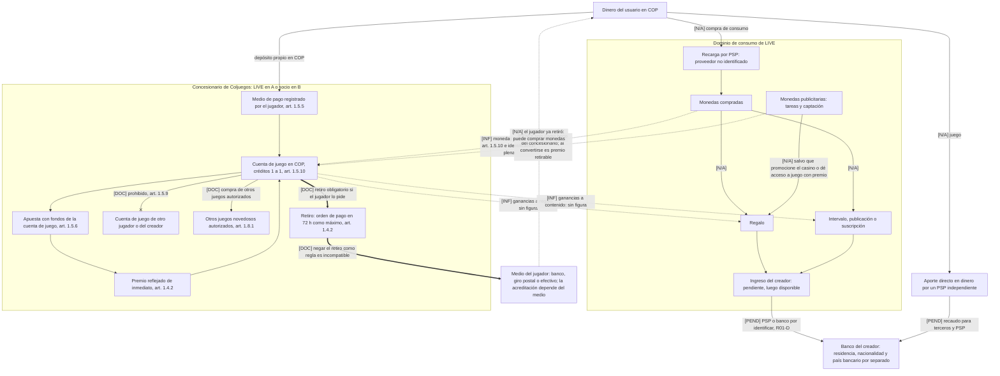

# LIVE-001-resultado-v1.1 — Verificación y corrección del informe de viabilidad

| Campo | Valor |
| --- | --- |
| Encargo | LIVE-001-R01 — Verificación y corrección del informe — v1.0 |
| Base de requisitos | Proyecto LIVE, definición v0.33 (sin cambios) |
| Documento verificado | `docs/investigacion/LIVE-001-resultado-v1.0.md`, commit `99603150aff28fc6ee0edd6d6cc391ea1e44a116`. Se conserva sin modificar |
| Fecha de consulta | 10 de octubre de 2026 (todas las consultas) |
| Registro de correcciones | `docs/investigacion/LIVE-001-R01-registro-correcciones.md` |
| Naturaleza | Revisión documental. No es asesoría jurídica, contable, tributaria ni financiera. No se contactó a ninguna entidad ni proveedor, no se programó nada y no se publicó nada |

> La investigación no sustituye la validación profesional de las interpretaciones jurídicas ni la aceptación escrita de los proveedores. Separar el casino, permitir retiros al jugador o impedir que use sus ganancias en regalos o contenido siguen siendo **propuestas de cambio que el promotor no ha elegido**. Esta revisión no las incorpora como decisión.

---

## 0. Cómo leer esta revisión

### 0.1 Relación con la v1.0

- La v1.1 **corrige y completa** la v1.0; no la sustituye en lo que no se revisó.
- Las secciones de la v1.0 que esta revisión no reverificó siguen valiendo con su etiqueta original y la marca **«no reverificado en R01»** (§2.8 y §6).
- Cuando la v1.1 cita una sección «§x» de la v1.0, lo dice expresamente. Las demás referencias «§x» son de este documento.

### 0.2 Acceso real a las fuentes

El encargo pedía leer las fuentes completas. **No fue posible**, y así se declara en cada fila:

- La política de red del contenedor rechazó la navegación directa (`CONNECT 403`) a coljuegos.gov.co, mastercard.com, wise.com, bold.co, bigo.tv, el Diario Oficial y la mayoría de dominios. La herramienta de lectura de páginas falló por resolución de nombres. No se intentó rodear el bloqueo con lectores o archivos de terceros.
- Solo se usó un **buscador web**. Cada fuente se clasifica según lo que realmente devolvió:
  - **texto amplio vía buscador**: varios párrafos coherentes de una réplica institucional;
  - **extracto breve**: una o dos frases o un resumen del buscador;
  - **no recuperado**: el documento se identificó, pero su contenido no se obtuvo.
- **Ningún documento se leyó íntegro.** Por eso la columna «fuente completa» de la tabla de auditoría se llama aquí «fuentes y acceso».
- Una réplica institucional (normogramas de Medellín, Superservicios, SISJUR, SuperSalud, DIAN, Función Pública) se acepta como copia del documento cuando coincide con otras réplicas. Ningún artículo se cotejó con el Diario Oficial.
- El cupo de búsquedas del turno (200, compartido entre agentes) **se agotó durante la verificación**. Consecuencias:
  - los verificadores de D (pagos) y C (fiscalidad) cortaron consultas;
  - **las revisiones de C, D, E y F no hicieron ninguna búsqueda propia**, y las de A y B, solo parcialmente. Sus veredictos son revisión lógica y aritmética, no verificación independiente;
  - Wise, Bold, Paxum y los adquirentes especializados en adulto **no se reverificaron**.
- Después de la verificación, el orquestador hizo 10 búsquedas dirigidas: 3 para resolver contradicciones (Acuerdo 02/2022, frase «A solicitud del jugador», TRM) y 7 para auditar filas de la v1.0 que ningún bloque cubría y completar la de Mastercard (§2.7).

Para leer los textos completos en un encargo posterior hay que ampliar el acceso de red del entorno, o permitir al menos `coljuegos.gov.co`, `diariooficial.imprenta.gov.co`, `suin-juriscol.gov.co`, `mastercard.com`, `wise.com`, `bold.co`, `payoneer.com`, `bigo.tv`, `tiktok.com` y `developers.cloudflare.com`.

### 0.3 Método

1. Por cada bloque del encargo (R01-A a R01-F), un verificador extrajo las afirmaciones de la v1.0 que deciden la viabilidad y buscó su respaldo.
2. Un revisor escéptico revisó cada resultado: citas, lógica, aritmética y sobreafirmaciones.
3. Un crítico comparó los seis bloques con los entregables del encargo y listó contradicciones y faltantes.
4. Conciliación. **Cuando verificador y revisor discrepan, la v1.1 adopta la formulación más prudente**, salvo que una búsqueda posterior resolviera la discrepancia (se indica en la fila).
5. Todos los cálculos se rehicieron con un script (§5). Todas las cifras de la v1.1 son reproducibles con las fórmulas que se muestran.

### 0.4 Categorías de conclusión

Las conclusiones por requisito (§6) usan **solo** las tres categorías del encargo:

| Categoría | Cuándo se usa |
| --- | --- |
| **Incompatibilidad documentada** | Un texto normativo o contractual recuperado (aunque sea por réplica) impide el requisito tal como está definido. Se indica «sobre réplicas; cotejo oficial pendiente» cuando corresponde |
| **Ruta condicionada** | Hay una vía documentada que exige condiciones identificadas: contrato, concesión, certificación, aceptación escrita o dictamen sobre un punto acotado |
| **Evidencia insuficiente** | La conclusión depende de una inferencia jurídica, de fuentes secundarias o no recuperadas, o de una prueba no hecha |

Regla de conversión: una **inferencia jurídica** pendiente de dictamen se clasifica como **evidencia insuficiente**, nunca como incompatibilidad documentada. En la tabla de auditoría (§2) se conserva la clasificación de cada afirmación («inferencia jurídica», «no aplica»), porque describe la evidencia y no el requisito.

### 0.5 Etiquetas

Se mantienen las de la v1.0: **[RC]**, **[EP]**, **[PR]**, **[CC]**, **[RP]** y **[NC]**. Se añade **[Supuesto]** para valores fijados por esta revisión sin fuente que los respalde (por ejemplo, una TRM o un parámetro de moderación). Los códigos de fuente (N, C, P, M, V, X) remiten al registro de §12. Los códigos F de la v1.0 se citan como «F##».

### 0.6 Observaciones del encargo que la v1.0 ya atendía

| Observación del encargo | Estado en la v1.0 | Qué hace la v1.1 |
| --- | --- | --- |
| Declarar que solo se usaron extractos | Atendida (§0.1 de la v1.0) | Se mantiene y se precisa el modo de acceso por fuente |
| Escenarios de 12 y 24 h como supuestos | Atendida (§7.1 de la v1.0) | Se mantiene. La «ocupación media» pasa a sensibilidad hipotética y sale de las conclusiones |
| No fijar ocupación media ni tarifas ausentes | Parcial: la «media» se usó en §7.6 | Retirada de las conclusiones (R01F-13) |
| Separar el casino como propuesta y no como decisión | Parcial: §1.2 de la v1.0 la llamaba «ruta mejor respaldada» | Se presenta como una alternativa más, sin preferencia (§7) |
| TRM como supuesto | Parcial: en §12.2, pero no en §1.1 ni §7.3 | Cifras de decisión en COP; la conversión solo como sensibilidad (§5.2) |
| Distinguir residencia, nacionalidad y país bancario | Enunciado en §5.2 de la v1.0, pero no aplicado en la tabla | Matriz separada (§4.5) |
| Monitoreo automatizado como [CC] | Atendido en la fila 23 de la v1.0 | Se mantiene; se corrige la etiqueta de incompatibilidad |

---

## 1. Resumen de los cambios que afectan a la decisión

**1. «El jugador no retira sus ganancias a su banco».** Se mantiene como **incompatibilidad documentada** con cualquier casino con dinero real, sea operado por LIVE (A) o por un socio (B). La base cambia:

- No es el texto «A solicitud del jugador, los saldos… serán transferidos», que solo apareció en una copia privada del reglamento de 2016 y cuyo número de artículo no se identificó.
- Es el art. 1.4.2 del Acuerdo 08/2020: aceptar y ordenar el pago del retiro en 72 h como máximo, sin cobro y con aviso inmediato de cualquier negativa. Lo completan el art. 1.5.2 (habilitación para retirar tras verificar) y el 1.5.4 (devolución de saldos al cancelar la cuenta).
- Matices: el medio puede no ser bancario (art. 1.5.5). Además del rechazo por las condiciones regladas, existe la suspensión por precaución y el SIPLAFT.
- Vale **sobre réplicas**: falta el cotejo con el Diario Oficial y con el texto íntegro del Acuerdo 01/2026.

**2. Ganancias usadas para regalos, intervalos, publicaciones o suscripciones.** **Baja de «incompatibilidad documentada» a inferencia jurídica de riesgo alto**, es decir, a **evidencia insuficiente** hasta tener dictamen.

- El art. 1.5.9 solo prohíbe transferir saldo entre cuentas de juego de jugadores distintos.
- La conclusión contraria se infiere de que el reglamento solo autoriza dos salidas del saldo: el retiro al medio del propio jugador y la compra de otros juegos autorizados (art. 1.8.1). A eso se suman el uso exclusivo de la cuenta de depósitos (1.1.4) y la naturaleza de los créditos (1.1.3).
- La decisión prudente no cambia, pero ahora depende de una consulta concreta (§8, Q1). **Esta conclusión es independiente de la del punto 1.**

**3. Monedas compradas o publicitarias usadas en el casino.**

- Las monedas compradas pasan de «no comprobado» a inferencia jurídica de riesgo alto (art. 1.5.10: pesos; sin monedas virtuales).
- Las monedas publicitarias solo podrían entrar como bono del concesionario. Pero **el bono convertido en créditos es premio y, por tanto, retirable** (art. 1.1.3), lo que choca con el diseño de la v0.33.

**4. Vigencia.**

- Según la réplica de Medellín y la prensa, el Acuerdo 01 de 07-05-2026 solo modifica el art. 1.3.12 (premio inmediato) y no toca retiros, transferencias, unidad monetaria ni créditos.
- No se ha descartado otro acto de 2026 (un Acuerdo 02/2026 sin identificar y el proyecto 307313).
- Se confirmó que el **Acuerdo 02/2022** existe y modificó el título 1 (definición de documento de identificación). La revisión de A lo había negado.

**5. Derechos de explotación.**

- Fórmula exacta (Ley 643, art. 38; Acuerdo 08, arts. 1.1.5 y 1.1.10): 15 % de (ingresos brutos − premios) con retorno ≥ 83 %, o 17 % de los ingresos brutos si no se acredita.
- Más 811 SMMLV por año de operación, pagaderos por adelantado: **COP 1.419.983.955 como referencia 2026**.
- El «≈ US$36.500/mes» es un equivalente contable y **no autoriza pagos mensuales**.
- La conversión a dólares se retira del texto de decisión (TRM no certificada).
- La ruta B **no tiene cifra**: no es más barata ni más cara mientras no haya cotización.

**6. Pagos.**

- Stripe: el contenido adulto está prohibido, sin excepción publicada (documentado). El casino solo con aprobación escrita discrecional (evidencia insuficiente).
- Payoneer: prohibido salvo preaprobación discrecional (evidencia insuficiente: la lista vigente no se recuperó).
- Wise, Bold, los especialistas en adulto y Paxum quedan **pendientes**.
- Se retira «no existe ningún proveedor». Lo correcto es: **entre los candidatos investigados no se identificó aceptación pública del modelo completo**.

**7. Moderación.** Los extractos de Mastercard (AN 5196; la 9.4.1 vigente no se leyó) exigen control de la plataforma y capacidad de monitorear y retirar directos en tiempo real, **sin fijar plantilla**.

- La «incompatibilidad documentada» con un único administrador se retira y pasa a **evidencia insuficiente**: es un bloqueo contractual pendiente del adquirente.
- La restricción real es la **guardia**: con 40 h semanales del administrador, quedan sin cubrir 186,7 h al mes en el escenario de 12 h y 546,7 h en el de 24 h.

**8. Multistream.** Pasa de «Parcialmente» a **no comprobado en conjunto**:

| Capacidad | Estado |
| --- | --- |
| Video a Bigo | Viable bajo condiciones |
| Video a TikTok | No comprobado (clave de terceros sin documento oficial) |
| BuzzCast | No comprobado |
| Chat y regalos externos | No comprobados |
| Contenido sexual o promoción de juego hacia TikTok y Bigo | Incompatibilidad documentada |

**9. Video.** El intervalo «US$1.100–1.700» unía dos productos y omitía simulcast, almacenamiento, región, cuota de plan y egress. Se sustituye por costos por arquitectura (§5.3). **No hay una cifra única** mientras no se fije la arquitectura de egress.

**10. No reverificado en R01.** Siguen sin auditar varios requisitos preservados: legalidad del contenido sexual explícito, retiros diarios de creadores, tareas en Bogotá y Medellín, moderadores designados, pausas y devoluciones, y territorio de jugadores. Se marcan como **evidencia insuficiente (no reverificado en R01)**.

Tres filas de la v1.0 se auditaron en esta edición (§2.7):

- edad: el Decreto 0769/2026 existe según prensa, pero su contenido no se recuperó;
- app en tiendas: Google Play y Apple prohíben el contenido sexual explícito (**incompatibilidad documentada** para una app con ese contenido);
- monedas frente a la regulación financiera: evidencia insuficiente.

---

## 2. Tabla de auditoría

Columnas: afirmación original y su ubicación en la v1.0; estado anterior; **fuentes y modo de acceso** (códigos de §12); hallazgo; corrección incorporada en la v1.1; efecto en la decisión; **veredicto conciliado** tras la revisión escéptica.

En cada bloque se indica si la revisión tuvo búsqueda propia. Hay 95 afirmaciones auditadas en seis bloques, más cuatro filas añadidas por el orquestador (§2.7).

### 2.1 R01-A. Vigencia de los juegos por internet

Revisión con búsqueda propia: **sí, parcial**. La revisión agotó el cupo antes de verificar los parágrafos del art. 1.1.5.

| ID | Afirmación v1.0 (ubicación) | Estado anterior | Fuentes y acceso | Hallazgo | Corrección v1.1 | Efecto en la decisión | Veredicto conciliado |
|---|---|---|---|---|---|---|---|
| R01A-01 | El Acuerdo 01/2026 amplía los juegos de premio inmediato (tipo Crash o Mines). Los dados deben encajar en una categoría autorizada (§6.4; F07). | [EP] secundaria (F07, prensa) | N01 (extracto); N04 (extracto); N05 (no recuperado); N06 (prensa); N08 y N23 (extractos) | Medellín anota en el 1.3.12: «modificado por el artículo 1 del Acuerdo 1 de 2026». El texto nuevo define el premio inmediato como juegos de contrapartida cuyo premio no depende de sorteo ni de secuencia de eventos, con multiplicador fijo o progresivo e interacción del jugador. Exige certificado y un retorno no inferior al de internet (par. 1) y excluye chance, lotería, raspa y gana, lotto y Keno (par. 2). Crash y Mines solo constan en prensa. Los dados no figuran en la lista cerrada del 1.3.1 lit. a). | Citar «Ac. 08/2020, art. 1.3.12, modificado por el art. 1 del Ac. 01 de 07-05-2026 (réplica de Medellín; Diario Oficial y vigencia pendientes)». Base legal: DL 808/2020, art. 2 (C-381/2020). Dados: encaje posible en el 1.3.12 o en casino en vivo (1.3.1 lit. c y 1.3.10), sujeto a certificación y dictamen. | Favorece los juegos rápidos dentro de una concesión (A o B). No toca retiros ni el uso de ganancias. | Confirmada con matiz; **ruta condicionada** |
| R01A-02 | El reglamento vigente es el Ac. 08/2020; F01 lista el Ac. 01/2026 (§0.1, §1.4). | [EP] F03; modificaciones no analizadas | N01, N02, N03 (extractos); N07, N09, N10, N11, N12, N13, N14 (extractos); N32 y N33 (extractos, búsqueda posterior) | Ac. 08/2020: Junta Directiva de Coljuegos, 16-09-2020, D.O. 51.452 de 29-09-2020. Cambios del título 1 localizados: Ac. 02/2021, Ac. 02/2022, Ac. 06/2023 y Ac. 01/2026 (detalle en §3.1). Los actos de Baloto, Keno y otros tocan otros títulos. No se identificó el Ac. 02/2026, y el proyecto 307313 (27-04 a 13-05-2026) es de tema desconocido. La revisión negó la existencia del Ac. 02/2022; una búsqueda posterior lo localizó (N32, N33). | Insertar la cronología de §3.1 con Diario Oficial y estado de cada réplica. No atribuir al título 1 entero los cambios de 2026. | Ninguno sobre la ruta. Ningún acto localizado toca los artículos de dinero. | Confirmada con matiz; no aplica |
| R01A-03 | El art. 1.5.9 prohíbe transferir saldos entre cuentas de juego de distintos jugadores (§1.1 P1). | [EP] F03 | N01, N02, N03 (texto amplio vía buscador) | El texto coincide en tres réplicas. Prohíbe además el saldo negativo y los préstamos del operador. Se conecta con el 1.5.2 (una cuenta por jugador), el 1.5.4 (suspensión por uso de terceros) y el 1.5.6 (se apuesta con los fondos de la propia cuenta de juego). La frase sobre medios prohibidos («cuentas bancarias, monederos virtuales, cuentas de juego…») es de otro capítulo y no del 1.5.9. | Mantener. Precisar que la regla literal se limita a cuentas de juego de jugadores distintos. Añadir 1.5.2, 1.5.4 y 1.5.6 como reglas conexas. | Excluye regalar saldo de juego a otro jugador. No resuelve por sí sola el pago a creadores (R01A-05, R01B). | Confirmada; **incompatibilidad documentada** (entre jugadores) |
| R01A-04 | El acuerdo obliga a transferir el saldo de juego al medio que pida el jugador (§3, §4.3). | [EP] F03 | N02 (texto amplio vía buscador); N01, N03 (extractos); N15 (copia comercial); N16 (copia no utilizable); N17 (prensa) | La regla «A solicitud del jugador, los saldos de la cuenta de juego… serán transferidos por el operador al medio de pago solicitado» consta en réplicas, pero su número de artículo no se identificó. Una búsqueda posterior tampoco halló esa frase en las réplicas del Ac. 08 (podría ser texto de 2016). El 1.4.2 se confirma: orden de pago en 72 h como máximo tras verificar, verificación de hasta 30 días hábiles, 3 retiros diarios, regla del 50 % (no aplica a premios) y ningún cobro por retirar. Los estados de la cuenta y la devolución al cancelar están en el 1.5.4, no en el 1.5.3. | Basar la obligación en el 1.4.2, el 1.5.2, el 1.5.4, el 1.5.5 y el 1.5.10. Marcar como pendientes el número y la literalidad de la regla «a solicitud». No citar el 1.2.3 de SlideShare. Origen de las reglas de retiro: Ac. 05/2018. | Bajo concesión, el saldo y los premios del jugador son retirables. | Confirmada con matiz; **incompatibilidad documentada** (con saldo no retirable) |
| R01A-05 | Usar ganancias en regalos, intervalos, publicaciones y suscripciones es incompatible (art. 1.5.9 y régimen de retiros) (§2 fila 2). | Incompatible según la fuente; pendiente de lectura textual | N01, N02 (extractos y texto amplio) | El 1.5.9 no cubre literalmente el pago a LIVE o a un creador. La conclusión se sostiene en conjunto: 1.1.3 (los créditos son el instrumento del jugador para jugar), 1.5.6 (se apuesta con los fondos de la cuenta de juego), 1.5.10 (adquisición y retiro por medios registrados del jugador, en pesos), 1.4.2 y 1.1.4 (cuenta de depósitos). No hay artículo que prohíba expresamente aplicar créditos a bienes de terceros; la falta de una figura que lo permita es evidencia negativa. | Reclasificar como **inferencia jurídica**. Base: 1.1.3, 1.1.4, 1.4.2, 1.5.6, 1.5.9 y 1.5.10 en conjunto. Llevar la pregunta a LIVE-005 (§8). | Mantiene el bloqueo del circuito ganancias → regalo o contenido mientras no haya dictamen. | Confirmada con matiz; **inferencia jurídica** |
| R01A-06 | Sin retiro bancario del jugador: incompatible bajo concesión (§2 fila 3). | Incompatible según la fuente; pendiente de lectura textual | N02 (texto amplio); N01, N03 (extractos) | Hay obligación de transferir y ordenar el pago (1.4.2) y de devolver el saldo al cancelar (1.5.4). Dos matices: (1) el operador puede suspender por precaución (fraude, colusión, uso de terceros) y aplicar SIPLAFT, no solo rechazar por las verificaciones regladas; (2) el 1.5.5 admite medios no bancarios (operadores postales, efectivo en puntos físicos). | Redactar: «Incompatibilidad documentada con un saldo de juego no retirable: el concesionario debe transferir el saldo a petición del jugador por alguno de los medios que ofrezca, que pueden no ser bancarios (1.5.5)». | El requisito «el jugador no retira» no es compatible con operar el casino bajo concesión, ni en A ni en B. Un retiro en efectivo también contradice la intención de la v0.33. | Confirmada con matiz; **incompatibilidad documentada** |
| R01A-07 | Usar monedas compradas para apostar: probable conflicto con los medios de pago admitidos (§2 fila 4; F04). | No comprobado | N01, N03 (extractos); N18 (listado oficial) | Art. 1.5.10 (casi literal): «No se permiten transacciones de juego en divisas, en monedas virtuales ni en monedas encriptadas»; «Un peso equivale a un crédito para la participación». El 1:1 viene del Ac. 05/2018. La lista del 1.5.5 es abierta («entre otros») e incluye cuentas y tarjetas vigiladas por la Superfinanciera, prepago con banco vigilado, operadores postales y efectivo. Excluye las tarjetas recargables internacionales. | Pasar a **inferencia jurídica** (1.5.5, 1.5.6 y 1.5.10). Sustituir F04 (vLex) por estos artículos. Quitar la referencia a «apuestas sobre criptomonedas», que es otra disposición. Dictamen: ¿son las monedas LIVE «moneda virtual»? | Refuerza que las monedas de consumo y los créditos de juego no comparten saldo. Para recargar el casino hacen falta pesos por un medio regulado. | Corregida; **inferencia jurídica** |
| R01A-08 | Las monedas de campaña pueden apostarse como bonos del operador, con tope regulado (§2 fila 5). | Condicionado | N02 (texto amplio); N28, N29 (prensa) | El 1.1.3 define el bono como entregado por el operador «previo cumplimiento de las condiciones derivadas de la participación en una o varias partidas o eventos»; pasa a ser premio al transferirse a créditos. Un bono por tareas publicitarias fuera del juego no encaja literalmente. Tope (Res. 20250022644): proyecto con comentarios hasta el 04-11-2025; Sigma lo da por expedido, sin texto. | Redactar: «Solo un bono del concesionario, emitido según su contrato. La definición exige condiciones ligadas al juego, por lo que un bono por tareas publicitarias requiere dictamen. Las monedas LIVE no son bono. Tope pendiente». | Las monedas de campaña no pueden apostarse directamente. | Confirmada con matiz; **ruta condicionada** (con dictamen) |
| R01A-09 | Casino con dinero real desde el lanzamiento: solo con concesión propia (A) o con un operador autorizado (B) (§2 fila 1). | Condicionado | N20, N21, N34 (extractos); N01 (extracto) | Ley 643, art. 38 (mod. Ley 1393/2010, art. 22, y Ley 1753/2015, art. 93): concesión, y apuesta y pago solo por internet «previo registro del jugador en el sitio o portal autorizado». El 1.3.1 lit. a) enumera tragamonedas, ruleta, black jack, baccarat, bingo, póker, juegos virtuales y premio inmediato (num. 8). No se analizó si en la ruta B el casino puede mostrarse dentro de LIVE. F18 (tipo penal) no se reverificó. | Añadir la Ley 643, art. 38, y el 1.3.1 como lista cerrada. Nueva pregunta para LIVE-005: ¿puede el casino del concesionario integrarse en el sitio o la app de LIVE, o debe operarse en su portal autorizado? | Tragamonedas y ruleta caben. Los dados y la integración de B quedan pendientes. | Confirmada con matiz; **ruta condicionada** |
| R01A-10 | La ruta A paga 15 % de ingresos brutos menos premios, más 811 SMMLV al año (COP 1.419.983.955, ≈ US$36.500 al mes), más 1 % de administración [EP secundaria] (§1.1 P4, §7.2). | [EP] F03; 1 % secundaria | N22 (texto amplio); N01 (extracto); N21, N24, N25, N26, N27 | Origen legal: Ley 643, art. 38 (17 % de ingresos brutos, o 15 % de ingresos brutos menos premios si el retorno es ≥ 83 %, más 811 SMMLV en los 20 primeros días hábiles de cada año de operación). El reglamento lo repite (1.1.5). El 1 % está en el 1.1.6 y en la Ley 643, art. 9 (el Decreto 130/2010, que lo subía al 5 %, cayó en la C-332/2010). SMMLV: 1.750.905; el Decreto 1469/2025 recuperó efectos en julio de 2026 y el 0159 quedó sin efecto. TRM no certificada. | Citar la ley y los arts. 1.1.5 y 1.1.6; el 1 % pasa a [EP]. Expresar las cifras en COP; en US$ solo como [Supuesto] con fecha y rango (§5.2). El equivalente mensual es contable: el pago fijo es anual. | Confirma la barrera fija de la ruta A. No cambia la decisión, pero su conversión a US$ deja de ser un dato. | Confirmada con matiz; **ruta condicionada** |
| R01A-11 | Retorno al jugador mínimo del 83 % (§3, §6.4). | [EP] F03 | N03 (texto amplio); N02 (extracto) | Art. 1.1.10: retorno mínimo del 83 % con tarifa del 15 % sobre ingresos brutos menos premios. Si no se cumple, la liquidación pasa al 17 % de los ingresos brutos del tipo de juego que incumplió. La prueba estadística (payout diario de 12 meses, p-valor) consta al menos para apuestas en eventos reales; su alcance en juegos con GNA no se verificó. | Citar el 1.1.10 con la consecuencia del 17 % y limitar la prueba estadística a lo documentado. | Es un requisito del proveedor certificado; no cambia la ruta. | Confirmada con matiz; ruta condicionada |
| R01A-12 | Garantías de pago y devolución [EP]; patrimonio y garantías no comprobados [NC] (§1.1 P4). | [EP] F01 / [NC] | N01, N03 (extractos); N04 | Art. 1.1.4: cuenta de depósitos en entidad vigilada; su saldo debe cubrir los créditos de los jugadores (una réplica dice «susceptibles de retiro»); par. 2: dos personas autorizan movimientos de más del 5 % del saldo en un día hacia un mismo tercero. Art. 1.1.8: cobertura mínima de $615.000.000, solo para premios no pagados y créditos no devueltos, mantenida durante el contrato y hasta su liquidación; actualización semestral el primer año; modalidades mínimas: encargo fiduciario y aval bancario. | Sustituir el [NC] por los arts. 1.1.4 y 1.1.8. Marcar como pendientes el monto vigente de la cobertura (Res. 20161200025334 y modificaciones) y la literalidad de la base del 1.1.4. | Añade a la ruta A capital inmovilizado y un control de doble firma incompatible con un único administrador (§6). | Corregida; **ruta condicionada** |
| R01A-13 | F03 (Medellín), F04 (vLex) y F07 (Gaming Intelligence) (§12.1). | [EI] / [S] | N01; N19; N08; N31 | F03 es la réplica más actualizada: es la única que trae la nota de 2026. Superservicios llega a 2025 y SISJUR no recoge notas posteriores. F04 es una base comercial con texto histórico. F07 coincide con Medellín. El «incentivo de premio inmediato» del CNJSA es otro régimen. Las copias de SlideShare y vLex no sirven para citar artículos. | F03: añadir D.O., emisor y fecha de corte. F04: sustituirla por los arts. 1.4.2 y 1.5.5 del Ac. 08/2020. F07: dejarla como prensa. Añadir el Ac. 05/2018 como origen. | Mejora la trazabilidad; no cambia las conclusiones. | Corregida; no aplica |
| R01A-14 | (Pregunta del encargo) ¿Afecta la actualización de 2026 a retiros, transferencias, unidad monetaria o créditos? | No analizado en v1.0 | N01, N12, N30 | La única nota de 2026 localizada está en el 1.3.12. Medellín, que sí recoge 2026, no muestra notas en los artículos de dinero, y la prensa describe solo la redefinición del premio inmediato. Sin el texto íntegro no se descarta un cambio en el 1.3.1 num. 8 o el 1.5.8. Siguen sin identificar el Ac. 02/2026 y el tema del proyecto 307313. | Redactar: «Según la réplica de Medellín y la prensa, el Ac. 01 de 07-05-2026 solo modifica el 1.3.12 y no toca retiros, transferencias, unidad monetaria ni créditos. No se ha descartado otro acto de 2026 sobre el título 1». | Las incompatibilidades de las filas 2 a 4 de v1.0 se mantienen, con esa salvedad. | Confirmada con matiz; **inferencia jurídica** |

### 2.2 R01-B. Retiros, transferencias y monedas

Revisión con búsqueda propia: **sí, parcial**. La revisión agotó el cupo antes de reverificar el art. 1.5.3, par. 2 (retención al retirar) y la frase de la guía de Coljuegos 306637.

| ID | Afirmación v1.0 (ubicación) | Estado anterior | Fuentes y acceso | Hallazgo | Corrección v1.1 | Efecto en la decisión | Veredicto conciliado |
|---|---|---|---|---|---|---|---|
| R01B-01 | El art. 1.5.9 prohíbe transferir saldos entre cuentas de juego de distintos jugadores (§1.1). | [EP] F03 | N02 (texto amplio); N01; N08; N53 (control de método) | El artículo se titula «Prohibición de transferencia de fondos entre jugadores ni préstamos del operador». Contiene: prohibición de transferir saldos entre cuentas de juego de distintos jugadores (literal), prohibición de préstamos del operador (literal) y prohibición de saldo negativo. La obligación técnica de impedir transferencias aparece en Superservicios y no en Medellín (diferencia entre réplicas). Ningún acto localizado lo modifica. | Mantener, con título, préstamos, saldo negativo y la obligación técnica (esta última pendiente de cotejo oficial). Limitar expresamente la regla a las cuentas de juego. | Base documentada del movimiento (a) de §4. Por sí sola no decide regalos ni contenido. | Confirmada con matiz; **incompatibilidad documentada** |
| R01B-02 | Hay obligación de transferir el saldo al medio que pida el jugador (§3, §4.3). | [EP] F03 | N01 (texto amplio); N15, N35 (copias comerciales); N36 (términos de un operador); N37 | El texto «A solicitud del jugador, los saldos… serán transferidos… previo cumplimiento de las obligaciones tributarias» solo apareció en la copia privada del reglamento de 2016. No se localizó en las réplicas del Ac. 08 (lo confirmó una búsqueda posterior). Lo que sí consta en réplicas: el art. 1.4.2 y el deber de transferir los saldos al cancelar la cuenta. La norma regula la **orden** de pago, no la acreditación en el banco. No está resuelto si las 72 h son naturales o hábiles (un operador aplica «1 a 72 horas hábiles»). | Basar la obligación en el art. 1.4.2 y en el texto de cancelación (1.5.4). Presentar «a solicitud del jugador» como texto de 2016, con equivalente vigente pendiente. Añadir el art. 1.8.1 (véase R01B-03). | Con cualquier concesionario, el retiro es un derecho sujeto a condiciones tasadas. | Confirmada con matiz; **incompatibilidad documentada** |
| R01B-03 | No hay figura que permita convertir saldo de juego en regalos o compras a favor de otra persona (§1.1 fila 5). | [NC] → [RP] | N03 (texto amplio); N02; N37; N38 (frase no confirmada) | Sí hay una figura que aplica saldo a compras: el art. 1.8.1, que compila el art. 51-2 del Ac. 02/2020 (D.O. 51.293). Permite «retiros de fondos de su cuenta de juego» para comprar otros juegos novedosos autorizados vendidos en la plataforma del operador. Solo cubre productos de juego autorizados y comprados por el propio jugador; no cubre regalos, contenido ni terceros. La frase atribuida a la guía 306637 («nadie más puede recibir dinero…») no se confirmó. | Redactar: «No se halló ninguna figura que permita aplicar saldo de juego a bienes o servicios de terceros; la única aplicación no bancaria documentada es la compra de otros juegos autorizados (art. 1.8.1)». Rebajar la guía 306637 a no verificada. | Una habilitación tan acotada refuerza, por inferencia, que cualquier otra aplicación necesita habilitación expresa. | Confirmada con matiz; **inferencia jurídica** |
| R01B-04 | Prohibir el retiro al jugador choca con su derecho a la transferencia (§1.1, §2 fila 3, §9). | Incompatible según la fuente; pendiente de lectura | N01 (texto amplio); N02; N05 (no recuperado); N39 (copia no oficial) | Confirmados: 1.4.2; 1.5.2 (una cuenta por jugador; verificación de hasta 30 días hábiles, tras la cual puede retirar); 1.5.4 (6 meses de inactividad → suspensión; 11 meses suspendida → cancelación; al cancelar, transferir o conservar los saldos). No se halló facultad general para negar retiros. En la ruta B, la definición de operador del reglamento y la cláusula sexta del contrato C1747 (copia no oficial) obligan a cumplir el reglamento. El 1.8.1 no permite al operador negar el retiro. | Mantener «incompatibilidad documentada (texto de réplicas; falta el texto oficial y el anexo del Ac. 01/2026)». Precisar: lo incompatible es negar u omitir el retiro; que el jugador elija no retirar no plantea problema. | P1 se divide: el retiro es obligatorio en cualquier ruta con casino en dinero real (§6, §8). | Confirmada con matiz; **incompatibilidad documentada** |
| R01B-05 | Usar ganancias en regalos, intervalos, publicaciones y suscripciones: incompatible (§2 fila 2, §9 fila 1, §4.3 recorrido 2). | Incompatible / incompatibilidad documentada | N02, N03 (texto amplio); N40 | El 1.5.9 no lo cubre literalmente, salvo que el creador tenga cuenta de juego con el mismo operador. Base de la inferencia: (1) los créditos son instrumento del jugador; (2) el reglamento solo autoriza expresamente dos salidas: el retiro al medio del jugador y la compra de otros juegos autorizados (1.8.1); (3) la cuenta de depósitos es de uso exclusivo para el juego (1.1.4, par. 1). Indicio adicional en la entrada: la Res. 19054/2023 prohíbe usar tarjetas de crédito de terceros. El apoyo en SIPLAFT no tiene texto recuperado. | Reclasificar a **inferencia jurídica de riesgo alto** en las tres ubicaciones. Pregunta cerrada para LIVE-005 (§8, Q1). | La decisión sigue siendo prudente, pero su base cambia de documentada a inferida. Conservar el circuito de v0.33 exige un dictamen favorable. | Corregida; **inferencia jurídica** |
| R01B-06 | Monedas compradas usadas para apostar: no comprobado (§2 fila 4; §4.1). | [NC] | N01, N02 (extractos); N40; N41; N42 | 1.5.10: pesos para adquirir y retirar; sin transacciones de juego en divisas ni en monedas virtuales o encriptadas. La lista del 1.5.5 es abierta, así que la ausencia de las monedas LIVE no prueba nada. Lo relevante del 1.5.5 es que, sea cual sea el medio, el operador debe identificar plenamente al jugador. La prohibición de medios del título 2 (Baloto) no aplica al título 1. Si LIVE canjeara monedas por pesos y depositara en nombre del jugador, el problema sería de intermediación e identificación. | Clasificar como **inferencia jurídica de riesgo alto [RP]**: 1.5.10, deber de identificación del 1.5.5 y Res. 19054/2023 (vigencia del literal pendiente por la suspensión parcial). No presentar la lista del 1.5.5 como cerrada. | Las monedas de consumo no deberían financiar la cuenta de juego sin dictamen favorable. | Corregida; **inferencia jurídica** |
| R01B-07 | Monedas de campaña para apostar: equivalen a bonos con tope regulado (§2 fila 5; §4.3 recorrido 4). | Condicionado | N03 (texto amplio); N02; N28, N29 | El bono exige condiciones «derivadas de la participación en una o varias partidas o eventos». Al transferirse a créditos para la participación «se considera premio» (1.1.3 y su par. 2), lo que lo hace **retirable** y ni siquiera queda sujeto a la regla del 50 %. Esto contradice el requisito de que las monedas publicitarias no generen retiro. Si las entrega LIVE sin ser operador, no son bono del operador. El tope (Res. 20250022644) solo consta como proyecto o en prensa, con bases distintas, y su tramo «con IVA» dependía de un IVA cuya situación cambió (R01-C). | Redactar: «Solo como bono del concesionario, con términos publicados y condiciones de juego; si se convierte, es premio retirable, lo que contradice v0.33; tope de estado desconocido; dictamen pendiente». Ruta documentada: pagar al participante en dinero a su propio medio. | P7 se reformula (§8). | Corregida; **ruta condicionada** (con cambio de requisito) |
| R01B-08 | Operar sin autorización encaja en el art. 312 del Código Penal (§1.1, §9). | [EP] F18 | N45; N44 | Ley 643, art. 38 par. 1 (concesión). Art. 312 CP, modificado por la Ley 1393/2010, art. 18: prisión de 6 a 8 años y multa de 500 a 1.000 SMMLV, con agravantes. SUIN muestra otras versiones de la pena, aparentemente históricas. La vigencia posterior a 2010 sigue pendiente. | Citar la Ley 1393/2010, art. 18, y la Ley 643, art. 38 par. 1. F18 solo como jurisprudencia. | Sin cambios: el casino con dinero real exige concesión propia o socio autorizado. | Confirmada; **incompatibilidad documentada** (casino sin concesión) |
| R01B-09 | Ley 643: definición de juego; juego por internet; concesión (F02; §3). | [EP] F02 | N20, N21, N46 | La definición está en el art. 5, no en el 38. El art. 38 fija un mínimo del 17 % de los ingresos brutos, o del 15 % de los ingresos brutos menos premios si el retorno es ≥ 83 %, más 811 SMMLV. El art. 5 incluye juegos «en los cuales se participa sin pagar directamente por hacerlo» con premio en bien o servicio, y el art. 31 regula los promocionales (14 % del plan de premios). Ambos son pertinentes para monedas promocionales que den acceso a juegos con premio. | Separar art. 5 y art. 38 en F02. Citar el art. 38 con su condición (17 % o 15 %). Añadir los arts. 5 y 31 como reglas aplicables a monedas gratuitas o promocionales [RP]. | Confirma que solo A y B dan casino en dinero real; el pago de premios forma parte de la definición legal. | Confirmada con matiz; ruta condicionada |
| R01B-10 | Custodia de fondos y saldos con garantías [EP F01] (§3). | [EP] F01 | N02 (texto amplio); N01; N15; N47 | 1.1.4: cuenta de depósitos en entidad vigilada, saldo ≥ créditos, rendimientos para el operador solo si cubre, par. 1: uso exclusivo para el juego. 1.1.8: cobertura ≥ COP 615.000.000. La regla de actualización (mayor entre el 8,1 % de los ingresos netos del semestre y el mínimo) solo consta en la copia de 2016. La Res. 20250021304 de 23-09-2025 modifica la Res. 20161200025334/2016 y, según prensa, admite póliza de seguro. | Sustituir [EP F01] por los arts. 1.1.4 y 1.1.8. Presentar 615 M como **piso**. Marcar como pendientes la actualización del 8,1 % y las modalidades (Res. 20250021304/2025). Ninguno de los dos fondos es gasto. | Ruta A: inmoviliza la cobertura y los saldos de los jugadores; no pueden usarse para creadores. Ruta B: los asume el socio. | Confirmada con matiz; **ruta condicionada** |
| R01B-11 | Retorno mínimo del 83 % [EP F03] (§3). | [EP] F03 | N01 | El verificador no localizó el artículo en el Ac. 08 y proponía citar el art. 11 del Ac. 04/2016. La revisión lo localizó en el art. 1.1.10 y en la definición de «Retorno al jugador». La corrección propuesta se **rechaza**. | Mantener [EP F03] precisando «Ac. 08/2020, art. 1.1.10, y definición de Retorno al jugador», con la Ley 643, art. 38. | Ninguno. | **Refutada la corrección**; se mantiene v1.0 con precisión |
| R01B-12 | Paga retiros: LIVE en A; operador en B (§3). | [EP] F03 | N01 (texto amplio); N39 | Asignación correcta. Contenido de la obligación: verificación (≤ 30 días hábiles), orden de pago en 72 h, 3 retiros diarios, regla del 50 % solo para depósitos, sin cobros salvo los legales, aviso inmediato de la negativa. La retención al retirar (atribuida al 1.5.3, par. 2) no se reverificó y la numeración es contradictoria (§11). En B, el deber de cumplir el reglamento consta en la definición de operador y en el contrato (copia no oficial). | Añadir las condiciones y la diferencia entre orden de pago y acreditación. En B, «sin retiro» tampoco es negociable. | Determina la carga operativa de la ruta A (R01B-24). | Confirmada con matiz; ruta condicionada |
| R01B-13 | Entrada económica: 811 SMMLV y 15 % [EP F03] (§3). | [EP] F03 | N20; N01; N03 | Ambos componentes están en la Ley 643, art. 38. El 15 % también está en el art. 1.1.5 del Ac. 08. Los 811 SMMLV en el Acuerdo: evidencia mixta (una búsqueda los sitúa allí; otra no halló «ochocientos once» en Medellín). El pago es anual, dentro de los primeros 20 días hábiles de cada año. | Citar F02 (art. 38) **y** F03 (art. 1.1.5), sin sustituir una por otra. Rechazar «cambiar F03 por F02». Cifras en §5.1. | Sin cambio. | Confirmada con matiz; corrección del verificador rechazada en parte |
| R01B-14 | El operador usa dominio .co y figura en la lista oficial, que tenía 15 operadores en 2026 [EP F08] (§3). | [EP] F08 | N49 | La prensa (28-05-2026) cita a Coljuegos: con MrYoker (contrato C2261 de 2026) «ya son 15». La publicación 307328 no se recuperó. La cifra varía (16 en 2023; 16 o 17 en 2024). El .co solo consta como recomendación de Coljuegos al usuario, sin base normativa recuperada. | Redactar: «15 operadores según Coljuegos (mayo de 2026), cifra variable; consultar el listado oficial al decidir». El .co, como recomendación con base pendiente. | Ninguno sobre la viabilidad; sirve para buscar socio en B. | Confirmada con matiz; no aplica |
| R01B-15 | Cobertura del circuito v0.33: ni A ni B cubren ganancias → regalos ni prohibición de retiro (§3). | Referencia a §1.1 | N01 | Las dos rutas comparten reglas. El peso de la evidencia difiere: negar el retiro y transferir entre cuentas de juego, documentados; ganancias → regalos o contenido, inferido. | Desdoblar la fila: «Retiro obligatorio: incompatibilidad documentada en A y B (1.4.2; deber contractual)»; «Ganancias → regalos o contenido: inferencia en A y B; única salida no bancaria documentada: 1.8.1». | Elegir B no resuelve la incompatibilidad del retiro. | Confirmada con matiz; **incompatibilidad documentada** (retiro) + **inferencia** (regalos) |
| R01B-16 | Diagrama §4.1: líneas discontinuas «no admitido / revisar». | — | — | Las etiquetas mezclaban prohibición literal e inferencia. Faltaban la línea CJ → cuenta de juego de otro jugador o creador (la única con prohibición literal) y la salida permitida CJ → otros juegos autorizados (1.8.1). | Sustituir por el diagrama de §4.2 de este informe, con etiquetas [DOC], [INF], [PEND] y [N/A]. | El diagrama deja de presentar como documentado lo inferido. | Corregida; inferencia jurídica |
| R01B-17 | Recorrido 2: garantía de pago de premios con monto [NC] (§4.3). | Monto [NC] | N01 | El monto mínimo sí consta (≥ COP 615.000.000, piso). Falta la cuenta de depósitos (≥ Σ créditos). La liquidación es una orden de pago en un máximo de 72 h; la acreditación depende del medio. | Reservas: «cuenta de depósitos ≥ Σ créditos (1.1.4); cobertura ≥ COP 615 M (1.1.8), con actualización y modalidades pendientes». Estado del tramo ganancia → regalo: inferencia. | Aclara los fondos inmovilizados de A. | Corregida; ruta condicionada |
| R01B-18 | Recorrido 4: tarea publicitaria → dinero o monedas → usos internos: condicionado; casino no comprobado (§4.3). | Condicionado | N03; N40 | Pagar en dinero al medio del participante, o en monedas que no entran a ninguna cuenta de juego, queda fuera del régimen de juego, con dos excepciones: si la tarea promociona el casino u operador, aplica la Res. 19054/2023 (comunicación comercial directa o por terceros; parcialmente suspendida); si las monedas dan acceso a un juego con premio de valor, aplican los arts. 5 y 31 de la Ley 643. | Redactar los tres estados: fuera del régimen de juego; comunicación comercial [PEND]; arts. 5 y 31 [RP]. Uso en casino: evidencia insuficiente. | Alimenta P7. | Confirmada con matiz; **evidencia insuficiente** (uso en casino) |
| R01B-19 | Creador como salida de valor de un jugador; SIPLAFT [EP F12] (§4.6). | [PR], [EP] F12 | N48 | SIPLAFT: Res. 20195100044514 de 31-12-2019 (D.O. 51.237 de 24-02-2020), modificada por la Res. 20215000012784 de 2021. Su integración en los contratos de concesión solo consta en una paráfrasis secundaria. Controles ya previstos en el reglamento: una cuenta por jugador (1.5.2), suspensión por precaución (1.5.4) y obligación técnica de impedir transferencias (1.5.9). | Citar las dos resoluciones con acceso por extracto. «Las ganancias no pueden regalarse» es una propuesta de diseño apoyada en una inferencia. | Ninguno sobre la recomendación de separar dominios, que sigue siendo propuesta. | Confirmada con matiz; inferencia jurídica |
| R01B-20 | F04: Ac. 04/2016 (vLex), medios de pago (§12.1). | [EI] | N19; N02 | F04 es histórica. El 1.5.5 vigente es más amplio y abierto. No hay cobro por retiro salvo el legal (1.4.2). | Citar los arts. 1.5.5 (lista abierta e identificación plena) y 1.4.2. F04 y el Ac. 05/2018 quedan como antecedentes. | Mejora la trazabilidad. | Corregida; no aplica |
| R01B-21 | F03 respalda 15 %, 811 SMMLV, 83 %, 1.5.9, retiro a solicitud y bono (§12.1). | [EI] | N07, N08, N11, N13; N50; N52; N54 | F03 es válida. El 15 % y el 83 % sí constan en el Ac. 08 (1.1.5 y 1.1.10); el verificador decía lo contrario. Los 811 SMMLV en el Acuerdo quedan pendientes. La lista de vigencia del verificador omitía el Ac. 02/2022 (D.O. 52.193 de 20-10-2022) y el 1.8.1. El título 2 ya lo había sustituido el Ac. 03/2021, con modificaciones posteriores. | No reasignar el 15 % ni el 83 %. Completar la vigencia con los Ac. 02/2021, 02/2022, 06/2023 y 01/2026 (§3.1). | Mantiene vigentes, salvo prueba en contrario, las reglas de dinero. | Confirmada con matiz; corrección del verificador rechazada en parte |
| R01B-22 | Vende las monedas: LIVE vende monedas de consumo; la cuenta de juego es aparte, en dinero o créditos [RP] (§3, §4.1). | [RP] | N01; N41; N50 (no recuperado) | Los créditos se adquieren y retiran en pesos (1.5.10). Equivalencia 1:1: una revisión la halló como frase de SISJUR («Un peso equivale a un crédito para la participación»); otra no la encontró en búsqueda exacta y solo la vio en una fuente secundaria. Los requisitos técnicos de visualización (Res. 20224000026034/2022) no se recuperaron. Si una «moneda» entra en la cuenta de juego, funciona como crédito: retirable en pesos e intransferible. Cualquier diferencia de conversión al retirar funcionaría como un cobro prohibido (inferencia). | Redactar: «Cuenta de juego en pesos (1.5.10); equivalencia 1:1 pendiente de texto oficial; toda representación visual pendiente de requisitos técnicos y dictamen; las monedas de consumo no son créditos». | Descarta la moneda única como unidad de juego mientras no haya dictamen. | Confirmada con matiz; **evidencia insuficiente** |
| R01B-23 | No se halló ruta que acredite el modelo completo (casino real + ganancias para regalar + sin retiro) (§1.1). | Conclusión sobre extractos | N01 | La conclusión se sostiene, pero con pesos distintos: casino sin concesión y negativa de retiro, documentados; ganancias → regalos o contenido, inferido. Basta la negativa de retiro para que ninguna concesión cubra el modelo tal como está definido. | Reescribir con dos conclusiones separadas (§6). Mencionar el 1.8.1 como límite de lo que sí se permite. | P1 se divide en dos preguntas (§8). | Confirmada con matiz; **incompatibilidad documentada** |
| R01B-24 | (Omisión de v1.0) En la ruta A, LIVE paga retiros y atiende disputas y obligaciones con un único administrador. | No evaluado | N01; N51; N43 | Obligaciones de A: orden de pago en 72 h, aviso inmediato, verificación en ≤ 30 días hábiles, suspensiones y cancelaciones, acreditación de la cuenta de depósitos, cobertura, retención y SIPLAFT (con oficial de cumplimiento; su dedicación exigida no se recuperó). Una sola persona sin horario fijo no garantiza esos plazos. En B, la carga del tramo de juego recae en el socio. | Añadir la fila «Carga de la persona única»: ruta A, **inferencia operativa** ([RP] sobre SIPLAFT; 72 h naturales u hábiles por aclarar); ruta B, trasladada al socio [CC]. No fijar dotaciones. | Refuerza P2 y P5. | Corregida; inferencia jurídica |

### 2.3 R01-C. Derechos de explotación, capital y fiscalidad

Revisión con búsqueda propia: **no**. El cupo de búsquedas estaba agotado cuando empezó. La revisión recalculó todas las cifras y contrastó la lógica con v1.0 y con los resultados de R01-A y R01-B.

| ID | Afirmación v1.0 (ubicación) | Estado anterior | Fuentes y acceso | Hallazgo | Corrección v1.1 | Efecto en la decisión | Veredicto conciliado |
|---|---|---|---|---|---|---|---|
| R01C-01 | La ruta A exige el 15 % de ingresos brutos menos premios más 811 SMMLV por año; en §7.3 dice «15 % de los ingresos de juego» (§1.1 P4, §3, §7.3). | [EP] F03 | N20 (texto amplio); C01, C02, C03; N01, N02, N03 | Ley 643, art. 38, inc. 2 (mod. Ley 1753/2015, art. 93): mínimo 17 % de los ingresos brutos; con retorno ≥ 83 %, mínimo 15 % sobre (ingresos brutos − premios pagados); además 811 SMMLV en los 20 primeros días hábiles de cada año de operación. Lo repiten los arts. 1.1.5 y 1.1.10 del reglamento. «Ingresos brutos» = total de apuestas sin IVA. El 1.1.5 liquida por tipo de juego, cuenta bonos y jackpots como premio deducible y lleva a 0 una liquidación negativa (extracto; parágrafos no reverificados). El DL 576/2020 llama al fijo «derechos de explotación de tarifa fija». | Usar la fórmula exacta (§5.1) y eliminar «15 % de los ingresos». El fijo es adicional, no un mínimo ni un crédito contra el variable. Leer el variable sobre apuestas lo sobreestima en un factor de 1/(1 − retorno): ≈ 5,9 con 83 %, 10 con 90 %, 20 con 95 %. Rebajar el fijo exigiría una norma con fuerza de ley. | Sigue siendo alta la entrada a la ruta A; se corrige la base del variable. | Confirmada con matiz; **ruta condicionada** |
| R01C-02 | En 2026 el fijo equivale a COP 1.419.983.955; SMMLV con prensa (F16) (§1.1, §3, §7.2). | Prensa (F16) | C04, C05, N26 (extractos); C06 (no recuperado); C07 | SMMLV 2026 = COP 1.750.905 (Decreto 1469/2025, art. 1). El Consejo de Estado lo suspendió el 12-02-2026 y el Decreto 0159/2026 fijó transitoriamente el mismo valor. Según prensa, en julio de 2026 se revocó la suspensión; el auto no se recuperó y la nulidad sigue sin fallo. La cuenta 811 × 1.750.905 = 1.419.983.955 es exacta. El pago real usaría el SMMLV vigente el año de cada pago (inferencia; el contrato puede fijarlo). | Presentar la cifra como **referencia 2026**. Citar el Decreto 1469/2025 y el 0159/2026 (Presidencia); la revocatoria, como dato de prensa. Supuesto explícito: inicio de operación no antes de 2027. No sumar el auxilio de transporte. | La cifra vale como orden de magnitud, no como desembolso. El presupuesto de A debe indexarse. | Confirmada con matiz; ruta condicionada |
| R01C-03 | ≈ US$438.000 a TRM 3.238,88, es decir ≈ US$36.500 al mes (§1.1; F17). | Secundaria (DolarHoy); supuesto en §12.2 sin etiqueta en §1.1 | C08 (extracto); C09, C10 (no recuperados); C11; N27 | No se obtuvo certificación de la SFC para la fecha de cálculo. Las cifras disponibles no coinciden entre agregadores ni prensa: 3.238,88 (v1.0, 08-10), 3.218,75 (09-10, Banco de la República según extracto), 3.194,44 (10-10, La República, sin verificar), 3.216,01 (07-10) y 3.312,84 (01-10). | **Eliminar la conversión del texto de decisión y expresar el componente en COP.** Si se usa, etiquetarla [Supuesto], con fecha explícita y rango (§5.2). El «al mes» es solo contable: el pago es anual y anticipado. | Ninguno sobre la viabilidad; corrige la trazabilidad. | Corregida; **evidencia insuficiente** (TRM) |
| R01C-04 | Patrimonio y garantías no comprobados [NC] (§1.1, §7.2, §7.4). | [NC] | N01, N03 (extractos); C12, C13, C14, N04, N15, N39 | Cobertura (1.1.8, origen: art. 7 del Ac. 04/2016): mínimo COP 615.000.000 para premios no pagados y créditos no devueltos. Primer año: actualización semestral al mayor entre el 8,1 % de los ingresos netos de 6 meses y el mínimo (extracto literal). Años siguientes: 4,1 % (solo paráfrasis). Debe restituirse si se afecta. Modalidades: encargo fiduciario y aval bancario como mínimo; la póliza solo consta en prensa (Res. 20250021304/2025). «Ingresos netos» no tiene definición recuperada. Patrimonio, indicadores y garantía de cumplimiento: no recuperados. | Sustituir el [NC] por: cobertura (1.1.8) con piso de 615 M y vigencia del importe pendiente; cuenta de depósitos (1.1.4) con par. 2 (doble autorización); patrimonio y garantía de cumplimiento pendientes. Efectivo: si es aval bancario, comisión y contragarantía [CC]; si es encargo fiduciario, 615 M inmovilizados. | Añade a A al menos 615 M de cobertura. Sin capital mínimo, el efectivo de arranque no puede cerrarse. | Corregida; **evidencia insuficiente** (capital) |
| R01C-05 | «Cualquier ruta de casino» supera la referencia; la A unas 12 veces solo con los derechos fijos (§1.1, §7.6). | Sin etiqueta | N20; N01 | Para A, el orden de magnitud se sostiene (≈ 12 veces el equivalente contable), pero el desembolso es anual y anticipado. Para B no hay evidencia de costo: derechos, fijo, 1 %, cobertura, cuenta de depósitos y retenciones recaen en quien opera. Incidencia económica: el socio puede trasladar costos por reparto, mínimos o garantías. B no es «barata»: es **evidencia insuficiente**. | Redactar: «Ruta A: su fijo legal equivale contablemente a unas 12 veces US$3.000 al mes. Ruta B: LIVE no es sujeto de los derechos de explotación, pero el socio puede trasladar parte de sus costos por contrato; costo sin cifra hasta tener una cotización escrita [CC]». | Evita descartar B por un costo que no le corresponde, sin presentarla como barata. | Corregida; **evidencia insuficiente** (ruta B) |
| R01C-06 | Entrada económica: 1 % de administración [EP secundaria] (§3). | Secundaria | N01, N22 (extractos); C15; C03 | 1 %: art. 1.1.6 y Ley 643, art. 9 («no superior al uno por ciento»). Aplicarlo sobre el fijo es una inferencia (DL 576/2020). La mención de un 5 % en SISJUR corresponde al Decreto 130/2010, declarado inexequible (C-332/2010; N24). | Pasar el 1 % a [EP]. Su aplicación al fijo: [RP] (≈ COP 14.199.839,55 al año con SMMLV 2026). | El 1 % se documenta; B no cambia. | Confirmada con matiz; ruta condicionada |
| R01C-07 | La Corte declaró inexequible el IVA del 19 % del Decreto 1474/2025 (abril de 2026) [EP secundaria F13] (§3, §1.4). | Secundaria | C16–C21 (extractos); C22 (no recuperado) | El DL 175/2025 gravó con IVA del 19 % los depósitos en juego exclusivamente por internet del 22-02 al 31-12-2025 (C-431/25: exequible condicionado). El DL 1474/2025 lo extendía a 2026: fue suspendido el 29-01-2026 (auto 082 u 084, numeración inconsistente) e inexequible por consecuencia en la C-079/26 (15-04-2026), con modulación de efectos que incluye devolver lo pagado. Art. 420, lit. e), ET: excluye del IVA los juegos operados exclusivamente por internet. | Redactar la cronología (§3.2). Conclusión: a 2026-10-10 no se identificó IVA vigente sobre esta actividad [inferencia; RP]. Sustituir F13 por la C-079/26. El IVA de las ventas de monedas o contenido de LIVE queda fuera de este bloque. | El IVA deja de contar como costo del juego en 2026; 2027 sigue abierto. | Confirmada con matiz; **inferencia jurídica** |
| R01C-08 | DL 0240/2026: impuesto al consumo del 16 % sobre ingresos brutos; vigencia y control no confirmados [NC F14] (§3). | [NC] | C23, C24, C25, C26 (extractos); C27 (no recuperado) | DL 0240 de 12-03-2026 (D.O. 53.426), bajo la emergencia del Decreto 0150/2026: impuesto nacional al consumo «por el año 2026» (art. 512-22 ET). Hecho generador: el depósito del apostador. Base: GGR = apuestas − premios pagados en el bimestre (no el «ingreso bruto» del reglamento). Tarifa: 16 %. Responsable: quien opera. La DIAN lo anota «vigente hasta el 31-12-2026». La C-191/26 condicionó la declaratoria de emergencia. **Control constitucional del DL 0240: no verificado** (no se halló la sentencia; podría existir). Calendario (30-04 con 50 % y 01-06) incoherente con la base bimestral. | Redactar como en §3.2, con «control constitucional no verificado» y calendario por confirmar. «No aplicaría a una concesión de LIVE que empiece en 2027, salvo prórroga o nueva norma» [inferencia]. | No es costo inevitable de LIVE: en B lo asume el socio; en A solo aplicaría si se operara en 2026 o se prorrogara. | Corregida; **evidencia insuficiente** |
| R01C-09 | Retención del 20 % sobre premios de más de 48 UVT = COP 2.513.952; UVT con fuente secundaria [EP F15, RP] (§3). | UVT secundaria; F15 extracto | C28, C29, C30, C31, C32 (extractos); C33 (no recuperado); N02 | UVT 2026 = COP 52.374 (Res. DIAN 000238/2025). Umbral de 48 UVT: art. 404-1 ET. La tarifa del 20 % se atribuyó al art. 317 ET y al DUR 1625, art. 1.2.5.1 (sin fuente listada); el art. 404 ET no se consultó. El art. 306-1 ET no se leyó. El reglamento sitúa la retención «al momento del retiro» (atribuida al 1.5.3, par. 2; numeración contradictoria y no reverificada). | Redactar: «20 % sobre premios superiores a 48 UVT (COP 2.513.952 en 2026). Pendiente: artículo exacto de la tarifa (404 y 317 ET, DUR) y texto del 306-1. Momento de causación en el modelo v0.33 sin retiros: [RP]». Retirar la cita literal del DUR mientras no tenga fuente. | Obligación del operador como agente; no es costo de LIVE en B. En A exige un circuito de retención. | Confirmada con matiz; **inferencia jurídica** |
| R01C-10 | Ruta A: derechos fijos anuales de 811 SMMLV pagaderos en los 20 primeros días hábiles (§7.2). | [EP] reglamento; SMMLV con prensa | N20; N01; C02 | El calendario tiene cita literal en ley y reglamento. «Año de operación» como año contractual es inferencia indirecta (DL 576/2020). No se halló prorrateo ni cuotas en los extractos. El momento del primer pago depende de la minuta del contrato. | Añadir: «Momento exacto del primer pago y cómputo del año de operación: verificar en la minuta del contrato [CC/RP]». Añadir el 1 % sobre el fijo [RP]. | El fijo debe estar en caja antes o al inicio del primer año de operación. | Confirmada con matiz; ruta condicionada |
| R01C-11 | Fila «Ruta A: derechos fijos» (811 SMMLV / 12 ≈ 36.535) en la tabla §7.3 (US$, sin impuestos ni conversión cambiaria). | Gasto mensual en US$ | N20; N01 | Es el prorrateo contable de un pago anual anticipado; mostrarlo como gasto mensual sugiere pagos mensuales. «15 % de los ingresos de juego» es ambiguo. No depende del escenario de carga. La TRM de esa fila (y de la de moderación) es un supuesto sin etiqueta. | Retirar la fila de §7.3 y sustituirla por la tabla en COP de §5.1, con «equivalente mensual contable: COP 118.331.996,25; no autoriza pagos mensuales». | Evita tratar el fijo como gasto operativo financiable mes a mes. | Corregida; no aplica |
| R01C-12 | F02: Ley 643, art. 38 (mod. Ley 1753/2015, art. 93) (§12.1). | [EP] extracto | N21; N20; C01 | El inciso 2 contiene las tarifas, el fijo y el plazo; el par. 1, la concesión con personas jurídicas. La exclusividad («solo») se deriva del monopolio [inferencia]. La nota de vigencia de la compilación de la SHD (fuente que pide el encargo) no se pudo leer. | Ampliar F02: «art. 38, inc. 2 (texto amplio vía buscador); par. 1 (extracto); nota de vigencia de la SHD pendiente». Las tarifas variables son mínimas: el reglamento podría subirlas. | Aclara la jerarquía normativa. | Confirmada con matiz; no aplica |
| R01C-13 | F03 respalda 15 %, 811 SMMLV y 83 % (§12.1). | [EP] extracto, sin artículos | N01; N05 (no recuperado); N11; C34 | Artículos: 1.1.3 (bonos), 1.1.4 (cuenta de depósitos; numeración discrepante en SISJUR), 1.1.5 (pars. 1, 2 y 4), 1.1.6, 1.1.8 y 1.1.10. Sin notas de 2026 en los artículos económicos. | Citar F03 con esos artículos y con la cronología de §3.1. Quitar «modificado por el Ac. 05/2018» como origen del 1.1.5 si no se cita fuente. | Cifras con riesgo bajo de cambio hasta confirmar el Ac. 01/2026. | Confirmada con matiz; no aplica |
| R01C-14 | F05: Res. 20161200025334/2016 y Res. 20231200017474/2023; montos no obtenidos (§12.1, §3). | [NC] | C12, C13; N04 | Res. 20161200025334 de 28-09-2016 (publicada 03-10-2016), modificada por la Res. 20201000008294 de 15-04-2020 y la Res. 20231200017474 de 22-09-2023 (num. 10 del art. 5); y, según prensa, por la Res. 20250021304 de 23-09-2025 (N47). El Anexo 1 regula el valor estimado del contrato. Sin montos de patrimonio, indicadores ni garantía de cumplimiento. Dos datos del verificador carecen de URL (corrección 20164000029574/2016; documento de 2025 sobre el art. 5 num. 1) y se retiran. | Mantener como pendiente con el documento exacto, ampliado: «confirmar si las Res. de 2020 y 2025 modificaron el importe o las modalidades de la cobertura del 1.1.8». | Impide calcular el capital y el efectivo de arranque de A. | Pendiente; **evidencia insuficiente** |
| R01C-15 | Obligaciones regulatorias por ruta, sin desglose por tributo ni responsable (§3, §1.4). | Sin desglose | C35, C36; C23; C29 | Responsables: derechos y 1 %, el operador; consumo del 16 % (2026), el operador; retención del 20 %, el operador como agente; ganancia ocasional, el jugador; IVA del juego en línea, no vigente en 2026 (inferencia); GMF del 4 por mil (ET, art. 872), quien dispone de los recursos. Faltan: renta e ICA del operador en A (o la regla que impida tributos territoriales sobre el juego; artículo por identificar), exenciones del GMF y tributos propios de LIVE en B [RP]. | Insertar la tabla de §3.2 con responsable y vigencia, marcando [RP] lo no verificado. | En B, los costos fiscales y regulatorios del juego no recaen en LIVE; los suyos son contractuales y de tributación propia. | Confirmada con matiz; **inferencia jurídica** |

### 2.4 R01-D. Pagos y cobertura internacional

Revisión con búsqueda propia: **no**. Sus tres consultas dirigidas (Wise, Bold, disponibilidad de Stripe en Colombia) fueron rechazadas por cupo agotado. El verificador también agotó el cupo tras 11 consultas, por lo que Wise, Bold, Paxum y los adquirentes especializados en adulto **no se reverificaron**.

| ID | Afirmación v1.0 (ubicación) | Estado anterior | Fuentes y acceso | Hallazgo | Corrección v1.1 | Efecto en la decisión | Veredicto conciliado |
|---|---|---|---|---|---|---|---|
| R01D-01 | Stripe excluye el contenido adulto (§1.1, §5.1; F28 «Global»). | [EP] F28 | P01, P02 (extractos, sin fecha de versión) | La lista de negocios prohibidos incluye «Adult services, including … pay-per-view … and adult live-chat features». El FAQ: Stripe «can't currently work with businesses that sell or offer adult content or services». No hay excepción publicada para el adulto. La frase del FAQ sobre creadores que «no necesitan preaprobación» se refiere a creadores en general y **no** es una vía para el adulto. | Redactar: «Stripe: contenido y servicios para adultos en su lista de prohibidos (pay-per-view y chat en vivo adulto expresos); FAQ: no puede trabajar con negocios que vendan u ofrezcan contenido adulto [EP, extracto breve; versión sin fecha]». Que alcance a cobro, aporte y pago al creador es **inferencia** del sujeto «businesses». F28: alcance «según la entidad Stripe del país de la cuenta». | Stripe queda descartado para todo tramo del dominio adulto. | Confirmada con matiz; **incompatibilidad documentada** (adulto, sin excepción publicada) |
| R01D-02 | Stripe excluye el juego (§1.1) / «requiere aprobación previa o está prohibido» (§5.1). | [EP] extracto; formulaciones distintas | P01, P02, P03, P04 (extractos) | El juego figura en la lista de negocios no admitidos («Games of chance including gambling, internet gambling, casino games, sweepstakes and contests…»; encabezado no visible en el extracto). El FAQ y el contrato (SSA) prevén aprobación previa explícita y escrita, discrecional y sin condiciones públicas. Treasury prohíbe «Casinos, gambling or gaming» salvo aprobación, y probablemente solo aplica a plataformas de EE. UU. (no verificado). Las monedas promocionales con premio podrían entrar en «sweepstakes and contests» (inferencia). | Unificar §1.1, §5.1 y F28: «juego en la lista de no admitidos; solo con aprobación previa explícita y escrita, discrecional y no pública [EP, extracto breve; CC]». Misma categoría que Payoneer (R01D-04). | El casino aislado con Stripe es hipotético: depende de la aprobación, de la concesión y del país de la cuenta (no confirmado para Colombia). Combinado con adulto, no hay ruta. | Corregida; **evidencia insuficiente** |
| R01D-03 | §5.1: Stripe sin país ni moneda; F28 «Global». | Sin análisis territorial | P05, P06 (extractos); P07 (no recuperado) | No se confirmó que una entidad colombiana pueda abrir cuenta (la página stripe.com/global indexada era antigua). Desde el 2026-03-25, Global Payouts admite en vista previa pública cuentas bancarias receptoras en Colombia; el país emisor admitido no se verificó (posiblemente solo EE. UU.). Venezuela: no encontrado, lo que no equivale a excluido. | Columna de país: «Entidad colombiana: no confirmada. Destino CO: Global Payouts en vista previa desde 2026-03-25 (extracto); emisor admitido no verificado; VE: no encontrado. La cobertura territorial no levanta la prohibición por actividad». | Ninguno sobre la viabilidad; evita confundir cobertura con admisión. | Pendiente; **evidencia insuficiente** |
| R01D-04 | Payoneer excluye el contenido adulto y el juego (§1.1, §5.1; F34). | [EP] extracto | P08 (PDF sin fecha); P09 (AU, mar-2026); P10 (EU, ago-2025; solo resumen); P11 (INC, versión no confirmada); P12 (no recuperada); P13 | Los ítems literales («Betting, including lottery tickets, casino gaming chips…»; «adult businesses or adult related services…») proceden de un PDF de términos sin fecha, posiblemente antiguo. Los términos de 2025–2026 incorporan la lista por referencia (lista vigente **no recuperada**) y permiten una preaprobación «subject to its sole discretion». La prohibición alcanza a quien hace y a quien recibe pagos (cláusula INC, versión no confirmada), así que afectaría también a la cuenta del creador; generalizarlo a todas las entidades es inferencia. «Sorteos» no aparece literalmente. | Redactar: «Payoneer: términos (versión antigua sin fecha) listan como prohibidos adulto y apuestas; términos 2025–2026 incorporan la lista (no recuperada) y permiten preaprobación discrecional [EP, extracto]. Alcance al receptor de cualquier país: inferencia [CC]». Misma categoría que Stripe-casino. | Payoneer queda fuera como pagador o cuenta de cobro de creadores adultos y como medio del casino, salvo preaprobación escrita. | Confirmada con matiz; **evidencia insuficiente** (prohibido salvo preaprobación discrecional) |
| R01D-05 | §5.2: «Payoneer y Wise excluyen el adulto» repetido por país; VE no comprobado. | [EP] usado como restricción por país | P14 (genérico); P15 (foro, anecdótico) | La restricción depende de la actividad, no del país. v1.0 ya enunciaba la separación entre residencia, nacionalidad, país de cobro y país de la operadora (§5.2), pero la tabla no la aplicaba. No hay fuente oficial de cobertura de Payoneer por país y producto («190+ countries» es genérico). | Separar en §4.2 de este informe: (a) admisión por actividad; (b) cobertura del producto por residencia, nacionalidad y país bancario del creador, condicionada al país de la operadora [RC]. | La cobertura en CO, US, ES y VE queda pendiente de producto y contrato. | Corregida; **evidencia insuficiente** |
| R01D-06 | Wise excluye el contenido adulto y el juego (§1.1); juego «bajo su discreción» (§5.1); F35 «Global». | [EP] extracto | P16, P17 (no recuperados) | No reverificado. v1.0 se contradice entre §1.1 y §5.1. El URL de F35 es genérico; según el encargo, la versión consultada fue la británica (/gb/). No se sabe a qué entidad corresponden la fecha 25-03-2026 ni el extracto. Falta identificar la entidad y la política para una operadora en CO, US o ES, por producto, y la cobertura de VE. | Redactar: «Wise: pendiente (entidad contratante, producto y política aplicable; cobertura VE) [NC; CC]». Retirar «Wise excluye el juego» y el «Global» de F35. | Wise no sirve ni como descarte firme ni como candidato. | Pendiente; **evidencia insuficiente** |
| R01D-07 | Bold excluye el contenido adulto; casino NC (§1.1, §5.1, §5.2; F29). | [EP] extracto | P18 (no recuperado) | No reverificado. Se conserva el extracto de v1.0 («páginas de contenido pornográfico o videochats para adultos») como evidencia previa. Pendientes: lista completa con fecha, juego, productos cubiertos (datáfono, link de pago, PSE, tienda) y existencia de dispersión a terceros. | Redactar: «Bold (CO): según el extracto de v1.0 (no reverificado; fecha no recuperada), prohíbe páginas pornográficas y videochats para adultos. Casino, productos y dispersión: NC». | Descarte probable para el adulto; sin evidencia para casino ni pagos a creadores. | Pendiente; **evidencia insuficiente** |
| R01D-08 | Adquirentes especializados en adulto (CCBill, Segpay, Verotel, Epoch) son candidatos; «ruta menos incierta» (§1.1, §5.1). | Secundaria | P19 (no recuperado) | No se consultaron (cupo agotado). Sin fuente del propio proveedor no puede asignárseles ningún tramo, país, moneda (COP) ni método (PSE). F25 es una copia de una norma de Mastercard alojada por Segpay: no documenta su oferta. Con monedas utilizables en el casino (v0.33), el cobro de monedas es también un tramo de juego. | Redactar: «Candidatos sin verificar; ningún tramo documentado con fuente del proveedor [NC; CC]; con monedas utilizables en el casino, el proveedor del cobro tendría que aceptar también el juego». Retirarlos como tramo de la ruta. | La ruta de §5.1 queda como hipótesis para LIVE-006. | Pendiente; **evidencia insuficiente** |
| R01D-09 | Paxum: alto riesgo, ≈ US$5 por retiro; «Paxum u otro especialista (US, ES)» (§5.1, §5.2; F37). | Secundaria (wiki de Bisq) | P20 (secundaria) | F37 es la wiki de un proyecto ajeno. Paxum **no se consultó** en R01. La tarifa no tiene respaldo. | Redactar: «Paxum: mencionado en fuentes secundarias; tramo, términos, cobertura y tarifas no verificados [NC; CC]». Eliminar la tarifa. Conclusión de §5.1: «proveedor de pagos a creadores aún no identificado con fuente propia». | El pago a creadores en US y ES no tiene candidato documentado. | Corregida; **evidencia insuficiente** |
| R01D-10 | «Ninguno acepta públicamente la combinación»; «no hay ningún candidato público»; «ningún proveedor público acepta…» (§1.1, §5.1, §9). | Generalización | P01; P09 | Son afirmaciones universales que la evidencia no sostiene. Además, «hay candidatos documentados para tramos aislados» (§1.1) solo vale para juego o PSE (Nuvei 2020 con un operador licenciado; dLocal, material comercial), no para el cobro adulto ni el pago a creadores. Wompi, PayU, Nuvei, dLocal y PayPal no se reverificaron en R01; su evidencia es antigua o regional (PayPal, versión de Malasia). | Redactar: «Entre los candidatos investigados (Stripe y Payoneer reverificados; Wise, Bold, especialistas en adulto y Paxum pendientes; Wompi, PayU, Nuvei, dLocal y PayPal sin reverificar) no se identificó aceptación pública del modelo completo. Esto no prueba que no exista ningún proveedor; la aceptación de un tramo no legitima el circuito». | No cambia la decisión: LIVE-006 sigue siendo necesario. | Corregida; **evidencia insuficiente** |
| R01D-11 | «Ruta menos incierta»: adquirente adulto para monedas y aportes; PSP colombiano para el casino; pago a creadores por cuentas propias o Paxum; nota sobre MCC 7995 (§5.1). | [PR] [CC] | P02 | Ningún tramo tiene candidato documentado. La separación solo funciona si las monedas de consumo **no** pueden usarse en el casino, lo que modifica v0.33 (no elegido por el promotor). Con monedas de doble uso, cobrarlas en un comercio declarado solo como adulto sería declarar una categoría incompleta. Cada actividad debe declararse con su categoría real; no se propone reetiquetar ni usar intermediarios. | Reformular como hipótesis [PR] (§7, alternativa 4) con la condición de monedas segregadas como cambio de requisito, y con el tramo de casino «pendiente de R01-A y R01-B; no elegido». | La ruta pasa de «menos incierta» a hipótesis sin candidatos verificados. | Corregida; ruta condicionada (con cambio de requisito) |
| R01D-12 | Retiros a creadores: «Condicionado en CO, US y ES; No comprobado en VE» [F34–F41]; aportes directos: «No comprobado» (§2 filas 9 y 10). | Condicionado / NC | P21 (no recuperado); F40, F41 de v1.0 | F34 y F35 documentan prohibiciones, no habilitaciones. En US y ES v1.0 solo ofrecía «una cuenta que acepte el sector [CC]» y Paxum [NC]: no hay ruta documentada. En CO, «Condicionado» solo se sostiene si la operadora es colombiana y un banco la vincula (ACH o Bre-B) [CC]. | Fila 9: «CO: condicionado si la operadora es colombiana y un banco la vincula [CC]. US y ES: no comprobado. VE: no comprobado. Stripe: adulto prohibido. Payoneer: prohibido salvo preaprobación discrecional. Wise: pendiente». Fila 10: «No comprobado». | Se rebaja US y ES de «Condicionado» a «No comprobado». | **Refutada en parte** la conservación de «Condicionado»; **evidencia insuficiente** |

### 2.5 R01-E. Moderación y carga de una persona

Revisión con búsqueda propia: **no**. Sus dos intentos fueron rechazados por cupo agotado. La revisión recalculó toda la aritmética y contrastó la lógica interna. **No se recuperó el cuerpo de la sección 9.4.1** de la SPME de 4-8-2026: solo su título en el índice.

| ID | Afirmación v1.0 (ubicación) | Estado anterior | Fuentes y acceso | Hallazgo | Corrección v1.1 | Efecto en la decisión | Veredicto conciliado |
|---|---|---|---|---|---|---|---|
| R01E-01 | La moderación en tiempo real «que exigen las redes» supone unas 2–4 personas equivalentes (§1.1 P4). | Exigencia de red, sin etiqueta | M01 (extracto; literalidad no confirmada); M02 (extracto); M03 (solo índice); M15 (no recuperado) | Ni el AN 5196 ni el comunicado de 2021 (extractos) fijan personas, horas ni proporción. Piden control de la plataforma con monitoreo y retirada en tiempo real; la cita «Be able to fully control its platform used for live streaming, including real-time monitoring and content removal» no pasó la búsqueda de frase exacta: es **paráfrasis del buscador**. «2–4» sale de 300, 360 y 720 h ÷ 182 = 1,65, 1,98 y 3,96, con tres supuestos no declarados: cobertura humana continua, una persona vigila hasta 5 directos y el administrador no aporta horas. Solo se examinó Mastercard; Visa (F26) no. | Redactar: «Los extractos de Mastercard (AN 5196; 9.4.1 vigente no leída) exigen control y capacidad de monitorear y retirar directos en tiempo real; no fijan plantilla. El personal depende de las condiciones escritas del adquirente y del diseño. Visa no examinada». Rango según escenarios en §5.4. | La moderación deja de ser un costo fijo impuesto por la red y pasa a depender del adquirente (P5, LIVE-006). No se puede concluir aún si supera la referencia. | Corregida; **evidencia insuficiente** |
| R01E-02 | Administración única: incompatible con el monitoreo en tiempo real de Mastercard cuando hay emisiones sin cobertura humana ([CC] si basta el automatizado) (§2 fila 23). | Incompatible según la fuente | M01, M04 (extractos; literalidad no confirmada); M03 (no recuperado) | El texto recuperado no exige presencia humana continua y no se pronuncia sobre herramientas automáticas. v1.0 ya preveía la vía automatizada como [CC]; el defecto era la etiqueta. Segpay pide un procedimiento escrito y confirmar el corte inmediato (cita no confirmada en búsqueda exacta). No hay aceptación de ningún adquirente ni capacidad probada. Umbral: con vigilancia humana continua, una persona solo cubre «más de 8 h diarias» con más de 55,4 h semanales todos los días (240 h al mes) y vigilando a la vez todos los directos. | Estado: **evidencia insuficiente** (no «ruta condicionada»: no consta ninguna aceptación). Vía hipotética [CC]: detección automática, corte inmediato, escalado humano y guardia definida. | No bloquea por norma la administración única; la decisión pasa a P5 y LIVE-006. | Corregida; **evidencia insuficiente** |
| R01E-03 | Costo laboral: SMMLV × 1,5 + auxilio = COP 2.875.453 ≈ US$888 por persona-mes; cobertura ÷ 182 h (§7.3). | Hipótesis rotulada | M05, M06, M07 (extractos) | La aritmética se reproduce. Problemas: la unidad mezcla el auxilio de transporte (249.095,5 implícitos) sin declararlo; «× 1,5» es ambiguo (salario de 1,5 SMMLV o factor prestacional); 182 h son horas contratadas, no efectivas (≈ 162,75 con festivos y vacaciones, supuesto); supone 5 directos por persona. Recargos: dominical o festivo del 90 % desde el 1-7-2026 y nocturno de 19:00 a 6:00 (Ley 2466/2025; artículo no identificado). | Unidad hipotética = **1,5 × SMMLV = COP 2.626.357,5** (sin auxilio) **+ auxilio de transporte como partida laboral separada** (valor 2026 no verificado) + recargos. Declarar que 1,5 es un supuesto de costo total. Sin conversión a US$ o con TRM supuesta y fecha. | Bajan algo los unitarios; el total depende de la lectura del requisito, de k y de las horas del administrador. | Corregida; **evidencia insuficiente** |
| R01E-04 | Monitoreo en tiempo real exigido por Mastercard [EP F25]: 300 / 360 / 720 h al mes (§8.1). | [EP] F25 | M01; M08 (comercial) | 300, 360 y 720 son horas con algún directo (h/día × 30). Solo equivalen a horas humanas si una persona vigila a la vez todos los directos. Hay que distinguir supervisión activa (lectura A: S_A = h/d × 30 × ⌈c/k⌉; lectura B: S_B = horas-directo × (a·t + s)/60) y guardia. Los parámetros a, t, s y k no tienen fuente. Es una estimación operativa, no una inferencia jurídica. | Desdoblar la fila en supervisión activa [PR] y guardia [PR]; aceptación [CC]. Etiquetar la exigencia como «extracto del AN 5196, literalidad no confirmada; 9.4.1 pendiente». | Cambia la base de la brecha y de P5 (§5.4). | Corregida; evidencia insuficiente |
| R01E-05 | Revisión previa de publicaciones (exigida por Mastercard): 450 elementos, 1,5 min, 11,3 h (§8.1). | Sin etiqueta | M01, M02 (extractos) | La revisión previa está documentada en extracto («Review all uploaded content prior to publication…»), sin decir si es humana. 450 y 1,5 min son supuestos; con 4 min, 30 h. Omisión: si las grabaciones de directos se publican, son contenido cargado sujeto a revisión previa (con el 10 % grabado de v1.0: 60 / 180 / 360 h de video al mes). | Mantener el requisito; usar 11,3–30 h como supuesto. Añadir la fila condicional de grabaciones publicadas, o declarar que no se publicarán. | Carga pequeña y asíncrona, salvo que se publiquen grabaciones. | Confirmada con matiz; ruta condicionada |
| R01E-06 | Total sin monitoreo ≈ 85 h; con monitoreo ≈ 385 / 445 / 805 h (§8.1). | Supuestos editables | M02; M09, M10 (secundaria y procesador) | La suma 84,8 h se reproduce, pero los reportes se calcularon con el escenario de 12 h y se aplicaron a todos. Por escenario: 45 / 180 / 360 reportes. Faltan el informe mensual al adquirente (fuente secundaria o procesador) y las quejas en 7 días hábiles con apelaciones (comunicado de 2021). Otras tareas: E1 75,5–94,2 h; E2 86,8–105,5 h; E3 101,8–120,5 h. | Recalcular por escenario y agrupar por trabajo (verificación, contenido cargado, reportes y quejas, campañas, soporte y retiros). Supuesto explícito de volumen de quejas. | Fuera de los directos, la carga está entre 76 y 121 h al mes. | Confirmada con matiz; evidencia insuficiente |
| R01E-07 | Jornada legal de 42 h semanales (≈ 182 h al mes) [EP F84] (§8.1). | [EP] F84 (secundaria) | M05, M06 | Ley 2101/2021, art. 3 (gradualidad hasta 42 h); 42 h desde julio de 2026 según MinTrabajo. 182 h es la jornada ordinaria máxima de un trabajador, no la disponibilidad del promotor (no confirmada), y no descuenta festivos ni vacaciones. | Citar la ley y el comunicado en lugar de F84. Usar 182 h solo para personal contratado; escenarios de 20 / 40 / 60 h semanales (86,7 / 173,3 / 260 h) para el administrador. | La brecha depende de las horas que declare el promotor. | Confirmada con matiz; no aplica |
| R01E-08 | Brecha «mínima» de unas 200 h al mes en la media y 620 h en 24 h (§8.2). | Cálculo propio | M01 | Reconstrucción: 300 + 85 − 182 = 203; 720 + 85 − 182 = 623; el escenario de 12 h da 263 (no mencionado). No es un mínimo: depende de la lectura del requisito, de k y de las horas del promotor. Mezcla horas síncronas y asíncronas, que no son intercambiables. | Sustituir por la tabla de §5.4: horas síncronas, asíncronas y guardia no cubierta por separado. Eliminar «mínima». | P5 se reformula (§8). | Corregida; **evidencia insuficiente** |
| R01E-09 | Opciones: IA con corte y escalado [CC]; limitar directos a horas con cobertura o a un solo directo [RC] (§8.2). | [CC] / cambio de requisito | M04, M11, M12 (extractos; atribuciones no verificadas) | No hay aceptación escrita de Mastercard ni de un adquirente; tampoco capacidad probada (tasa de detección, tiempo hasta el corte). Los costos de la vía automatizada omitían el costo de detección por IA (v1.0 §7.3: US$216–648, 648–1.944 y 1.296–3.888 al mes; video y CSAM pendientes de cotización), por lo que no está demostrado que sea más barata. | Mantener [CC]. Añadir pruebas de capacidad para LIVE-002. Sumar en cada caso el costo de detección y el de la guardia no cubierta. Presentar «directos solo con guardia» como variante de limitar horas, con su efecto sobre el requisito de más de 8 h. | La vía automatizada es la única que podría conservar la administración única, sigue condicionada y su costo está abierto. | Confirmada con matiz; **evidencia insuficiente** |
| R01E-10 | Monitoreo en tiempo real frente a una sola persona: incompatibilidad documentada (§9 fila 6; F25; resuelve P5). | Incompatibilidad documentada | M01; M03 (no recuperado) | No hay incompatibilidad documentada con la evidencia disponible. Lo inviable por razones operativas es la **guardia**: con 40 h semanales del administrador quedan sin cubrir 126,7 h (E1), 186,7 h (E2) y 546,7 h (E3) de las 300 / 360 / 720 h de directo. | Tipo: **evidencia insuficiente (bloqueo contractual pendiente)**. Lo resolverían: 9.4.1 vigente, requisitos de Visa, condición escrita del adquirente (LIVE-006), horas y guardia declaradas por el promotor y prueba de corte (LIVE-002). | Baja como bloqueo normativo y sube como bloqueo contractual. Si se exige vigilancia humana continua, el requisito de más de 8 h falla con menos de 55,4 h semanales. | **Refutada** la incompatibilidad documentada; **evidencia insuficiente** |
| R01E-11 | F25: AN 5196 (copia de Segpay) «ahora en Security Rules 9.4.1» (§12.1 y usos en §2, §8.4, §9). | Extracto indexado | M01, M02, M03, M13, M14 | El AN 5196 se publicó el 13-04-2021 y fue exigible desde el 15-10-2021 (fechas de extractos). La copia está en un procesador, no en un portal institucional. La SPME de 4-8-2026 (y la de 11-2-2025) contienen en el índice la 9.4.1 «Non-face-to-face Adult Content and Services Merchants»; que el AN 5196 esté ahora allí, con cambios, solo lo afirma una fuente secundaria. Requisitos en extracto: acuerdos escritos con quienes suben o generan contenido (consentimiento, edad e identidad), solo proveedores verificados, revisión previa, control y retirada en directo, apelación, cese de aceptación si el adquirente no asegura el cumplimiento. | Dividir F25: F25a (AN 5196, copia de Segpay, extracto; literalidad parcial no confirmada); F25b (SPME 4-8-2026, índice; cuerpo pendiente); F25c (comunicado de 2021). Indicar la procedencia de cada requisito. «La copia consultada no muestra revisiones», no «no hay revisiones». | Los controles de edad, identidad, consentimiento y revisión previa siguen respaldados en lo esencial, con evidencia de 2021 en extracto. No deben cerrarse contratos sin leer la 9.4.1. | Confirmada con matiz; **evidencia insuficiente** |

### 2.6 R01-F. Multistream y costo de video

Revisión con búsqueda propia: **no**. El cupo estaba agotado desde la primera llamada. La revisión recalculó todas las cifras y contrastó el resultado con v1.0, v0.33 y el encargo LIVE-001. **Ninguna guía de PC se usa como prueba móvil.**

| ID | Afirmación v1.0 (ubicación) | Estado anterior | Fuentes y acceso | Hallazgo | Corrección v1.1 | Efecto en la decisión | Veredicto conciliado |
|---|---|---|---|---|---|---|---|
| R01F-01 | Un celular envía una sola señal a nuestro servidor y este la redistribuye por RTMP a los destinos que den clave a la cuenta del creador (§1.1 P3; §2 fila 16). | Condicionado [PR] | V01, V02, V03 (oficiales, extractos); V04 (extracto); V05 (comunitario) | Solo BIGO documenta oficialmente la ingesta por URL y clave, en un flujo de PC (OBS; Connector con Windows 10+). En TikTok no se recuperó documento oficial sobre la clave para software de terceros. BuzzCast: sin evidencia. Cloudflare Stream: «Simulcasting (restreaming via RTMP/SRT) is not supported» con WebRTC (página beta; el GA se anuncia para el 2026-10-15). IVS: no se encontró documentación oficial de salida RTMP a terceros (solo indicio comunitario). | Mantener «Condicionado» con condiciones explícitas: clave por cuenta y destino; obtención y renovación desde el teléfono sin documentar; componente con salida RTMP (servidor propio u otro servicio; evaluado: LiveKit; otros no evaluados); solo contenido no sexual y sin promoción del casino; prueba en LIVE-002. Revalidar Cloudflare tras el GA. | El egress pasa a ser partida propia de la arquitectura (§5.3). | Confirmada con matiz; **ruta condicionada** |
| R01F-02 | Chat y regalos de los tres destinos: no se encontró API oficial [NC] (§1.1 P3; §2 filas 17–18; §5.3). | [NC] | V06, V07 (extractos); V08 (no recuperado) | Los scopes de TikTok no incluyen LIVE; «Live» en las guías es un estado de la app. No se encontró API pública ni programa documentado de BIGO ni de BuzzCast. Las herramientas de chat y regalos de TikTok halladas son de terceros. La búsqueda no fue exhaustiva y no se buscó expresamente un programa restringido de socios. Existe una tercera vía no evaluada como API: consultar el chat y los regalos en la app de cada destino desde el mismo teléfono (multiventana), por probar en LIVE-002. | Redactar: «Chat y regalos externos en nuestro panel: no comprobado; no se encontró API pública ni programa documentado. Alternativas: convenio escrito [CC]; consulta en la app del destino (LIVE-002); o cambio de requisito, decisión del promotor». No se proponen scraping ni librerías no oficiales. | Sin ruta respaldada para chat y regalos en el panel propio. | Confirmada con matiz; **evidencia insuficiente** |
| R01F-03 | TikTok y Bigo prohíben la desnudez y el contenido sexual y restringen la promoción de juego [EP secundaria]; BuzzCast 16+ (§1.1 P3; §5.3). | [EP] secundaria | V09–V13 (oficiales, extractos); V14 (no recuperado) | Respaldo primario en extractos. TikTok LIVE: «Do not promote gambling»; «Do not imitate or imply sex acts». TikTok Community Guidelines: «We do not allow the facilitation or marketing of gambling…». BIGO: prohíbe pornografía, desnudez, actos sexuales y «gambling, betting, or related promotion». Las versiones de TikTok citadas son de 2023–2025 (posible actualización de septiembre de 2026 no verificada). Las calificaciones de tienda de BuzzCast (Mature 17+, 16+) no son normas. | Pasar F48 y F50 a [EP] con URL oficiales. Limitar la incompatibilidad documentada al **contenido sexual y a la promoción o enlace de juegos de azar** emitidos hacia TikTok y Bigo; vigencia por confirmar. Citar el término original del Broadcaster Agreement. BuzzCast pendiente. | La emisión externa solo puede usar contenido público no sexual y sin casino. El multistream en sí no está prohibido. | Confirmada con matiz; **incompatibilidad documentada** (contenido sexual y promoción de juego hacia TikTok y Bigo) |
| R01F-04 | En Android, Chrome suspende la cámara con la página oculta y ~15 s tras bloquear la pantalla; emisión web condicionada a primer plano (§1.1 P3; §2 fila 15; §6.1). | [EP] secundaria; Condicionado | V15, V16, V17, V18 (extractos); V19, V20 (no recuperados) | PSA de Chromium: «disable camera capture 15s after a screen lock occurs». El caso de la página oculta solo consta en un hilo de 2013; la revisión de código de 2017 citada en F52 no se reabrió. RFC 9725 (WHIP): Proposed Standard, marzo de 2025. Rutas de ingesta desde navegador **evaluadas**: Cloudflare WHIP, IVS Web Broadcast SDK y LiveKit; otras no evaluadas. | Mantener «Condicionado». Etiquetar el caso de la página oculta como comportamiento histórico por confirmar en LIVE-002 con la versión actual de Chrome; medir el corte con multiventana. Pendiente: documentación oficial de Android sobre cámara en segundo plano. | Refuerza que consultar las apps de destino desde el mismo teléfono no está probado. | Confirmada con matiz; ruta condicionada |
| R01F-05 | Solo se puede verificar que dejamos de enviar, no que el destino cerró; el servidor verifica proceso, socket y bytes (§2 fila 19; §5.3; §6.2). | Condicionado [PR] | V21, V22 (extractos) | Sin API del destino, solo se verifica nuestro lado. Con egress propio: verificación local (proceso, socket, sin bytes después de T). Con egress administrado: desactivar cada salida por API (latencia y confirmación no documentadas). Desactivar la entrada en Cloudflare termina también la emisión interna, así que no sirve para la transición. | En §6.2 distinguir (a) egress propio, verificación local; (b) egress administrado, desactivación por salida con semántica pendiente [NC/CC]. El contenido exclusivo debe viajar por una entrada sin salidas configuradas. | Afecta el diseño de LIVE-002 y LIVE-003. | Confirmada con matiz; ruta condicionada |
| R01F-06 | El video cuesta unos US$1.100–1.700 al mes con un servicio administrado a 12 h y ocupación máxima (§1.1 P4). | [EP] F56, F58 (secundaria) | V23 (texto amplio); V24, V25 (extractos) | El intervalo une dos productos: Cloudflare Stream 1.080 (1.080.000 min × US$1/1.000) e IVS Basic 1.656 (tarifa plana de Norteamérica, secundaria). Omite simulcast, almacenamiento, región, cuota de plan y egress. LiveKit (≥ US$1.725 en v1.0; ≥ US$2.225 con la cuota del plan) ya quedaba fuera del intervalo. Las partidas de simulcast y grabación de Cloudflare solo aplican con entrada RTMP/SRT, no con la PWA y WHIP de v1.0. | Sustituir por configuraciones coherentes por arquitectura (§5.3), sin conclusión de costo hasta fijar la arquitectura. Ningún proveedor ha aceptado por escrito el contenido adulto [CC]. | El precio no decide; decide la aceptación del contenido y la arquitectura de egress. | Corregida; **ruta condicionada** |
| R01F-07 | TikTok: clave en LIVE Center o LIVE Studio; elegibilidad sin criterios oficiales (≈ 1.000 seguidores, 18+) (§2 fila 16; §5.3). | Condicionado; F45 secundaria | V26–V31 (extractos); V32 (no recuperado) | Sí hay criterios oficiales: LIVE móvil, 18+ y ≈ 1.000 seguidores «may vary across regions»; regalos, 18+. LIVE Studio es software de escritorio (no genera claves), con requisitos propios: cuenta de 30 días, 1k seguidores fuera de EE. UU. (10k en EE. UU.), un LIVE de más de 25 min. La clave para software de terceros no tiene documento oficial recuperado; la rotación por sesión y el acceso por agencias solo constan en fuentes secundarias de baja fiabilidad. No se reconcilió con la línea de v0.33 que cita una ayuda oficial que menciona LIVE Studio y OBS. Windows comprobado; macOS no. | Separar: (a) LIVE móvil (oficial); (b) LIVE Studio (escritorio, no útil sin PC); (c) clave de terceros (sin documento oficial). Revisar la fuente oficial citada en v0.33. | **Video a TikTok: no comprobado.** | Corregida; **evidencia insuficiente** |
| R01F-08 | Bigo: guía oficial de PC; claves desde el Personal Center (secundaria); móvil NC (§2 fila 16; §5.3). | Condicionado / NC | V01, V02 (oficiales); V33 (foro) | La obtención de la clave tiene respaldo oficial (página OBS de BIGO): Personal Center, activar OBS, copiar URL y clave. Es un flujo de PC; la sección «Stream parameters requirements» no se recuperó. No consta si la clave se obtiene desde el navegador móvil, si rota, ni si se admite desde un servidor de terceros. Un foro indica acceso restringido. | Redactar: «Ingesta por URL y clave documentada oficialmente para software de PC. No comprobados: obtención desde el móvil, uso desde un servidor, rotación y elegibilidad». | **Video a Bigo: viable bajo condiciones** (pendiente de LIVE-002). | Confirmada con matiz; **ruta condicionada** |
| R01F-09 | BuzzCast: sin evidencia de ingesta externa; web app fase 1; 16+ (§5.3). | No comprobado | V34, V35 (extractos); V14 (no recuperado) | El comunicado de 24-12-2024 sobre la web app no menciona emisión, clave, OBS ni API. «Terms and Policies» no recuperado. Mature 17+ (Google Play) es calificación de tienda. v0.33 identificó un canal de soporte aún no contactado. | Mantener «No comprobado» en todas las capacidades; registrar el canal de soporte como vía de confirmación escrita [CC]. | BuzzCast no puede incluirse sin confirmación escrita. | Confirmada; **evidencia insuficiente** |
| R01F-10 | ¿Multistream desde un solo celular? «Parcialmente» (§1.1 P3). | Parcialmente | V01, V28, V34 | Ninguna fuente prueba la operación desde un solo teléfono. Por capacidad: video a Bigo, viable bajo condiciones; video a TikTok, no comprobado; BuzzCast, no comprobado; chat y regalos, sin API encontrada (multiventana por probar); contenido sexual y casino hacia TikTok y Bigo, incompatibilidad documentada; egress, componente por elegir; cierre externo, verificable solo de nuestro lado. | Cambiar «Parcialmente» por **«No comprobado en conjunto»**, con el desglose. | P4: el requisito completo no puede darse por viable. «Solo video» es un cambio de requisito del promotor. | Corregida; **evidencia insuficiente** |
| R01F-11 | Mostrar enlaces, QR o invitaciones hacia una plataforma adulta con casino es conducta de riesgo bajo las normas de TikTok [EP secundaria] [RP] (§5.3). | [EP] secundaria; [RP] | V36, V37 (extractos) | La regla oficial de TikTok no permite facilitar ni comercializar juego; la versión de 2023 citaba «providing a link to a gambling service». Creator Academy (material formativo) incluye el sexcamming entre lo no comercializable. BIGO prohíbe «related promotion». La regla vigente sobre enlaces fuera de la plataforma no se recuperó. Aplicarla a un QR o invitación a LIVE es interpretación. | **Dividir:** (a) promocionar o enlazar juegos de azar o servicios sexuales desde TikTok o Bigo: **incompatibilidad documentada** (versiones 2023–2025; vigencia por confirmar); (b) mostrar un QR o invitación a LIVE sin enseñar casino ni contenido sexual: **riesgo interpretativo [RP]**. | La captación desde esos destinos no debe mostrar casino ni contenido sexual; como embudo requiere revisión con cada destino. | Confirmada con matiz; **incompatibilidad documentada** (a) + **evidencia insuficiente** (b) |
| R01F-12 | Captura por WebRTC con WHIP; servidor de medios propio o administrado con aceptación escrita; un egress RTMP por destino y creador (§6.1). | [PR] | V04, V21, V38, V39 (extractos); V40 (no recuperado) | Cloudflare con entrada RTMP/SRT admite hasta 50 destinos por entrada; con WHIP no hace simulcast (página beta). IVS de baja latencia acepta RTMP(S)/SRT o su Web Broadcast SDK; salida RTMP a terceros no documentada. LiveKit ofrece egress RTMP, con límite de 12 h por egress y facturación pendiente. Otros servicios no se evaluaron. | Precisar en §6.1: con PWA y WHIP, las salidas RTMP exigen servidor propio, LiveKit Egress u otro servicio no evaluado. Documentar el límite de 12 h de LiveKit. Analizar separar el transporte de la sala exclusiva de un egress aislado que solo recibe la parte pública. | Cambia la elección de proveedor y el costo; puede cambiar de quién depende la aceptación del contenido adulto. | Corregida; ruta condicionada |
| R01F-13 | Volúmenes de §7.1 y columna de ocupación media (10 h, 2 creadores, 15 espectadores). | Supuestos editables | V23; V24 | La aritmética es correcta. LIVE-001 admitía un escenario medio declarado y editable; R01 pide no fijar la ocupación media. El defecto de v1.0 fue usar la «media» en conclusiones (§7.6 «al límite»). Unidades: Cloudflare factura minutos; IVS, horas por resolución y región; LiveKit, GB y minutos. | Rotular la columna como «sensibilidad hipotética (admitida por LIVE-001; R01 pide no fijarla)» y retirarla de las conclusiones de §1.1 y §7.6. | Las sumas «media» (1.436 / 2.899) dejan de servir para decidir. | Confirmada con matiz; no aplica |
| R01F-14 | Cloudflare Stream: US$1/1.000 min entregados; ingesta gratis; simulcast [NC] (§7.3). | [EP] | V23 (texto amplio); V41, V42 (extractos) | Confirmados con cita literal: US$1 por 1.000 min entregados; el simulcast por salidas RTMP/SRT cuenta como minutos entregados; almacenamiento prepagado de US$5 por 1.000 min de capacidad al mes. **Sin cita literal:** que la reproducción en vivo por HLS/DASH exija grabación automática, y el rango de 30 a 1.096 días de borrado. La entrega WebRTC (WHEP) se factura desde el 2026-10-15 (por revalidar). Los términos permiten retirar contenido que Cloudflare juzgue «illegal or harmful»; no hay cláusula explícita sobre adulto legal. | Fórmula solo con entrada RTMP/SRT: 1.080 + 324·f + almacenamiento (§5.3). Con WHIP: 1.080 por WHEP, sin simulcast ni grabación. «Como mínimo 1.424» se retira: con f = 0 y un día de retención serían ≈ 1.100. Contenido adulto: [CC]. | La opción más barata no tiene un mínimo de 1.424; depende de f y de la retención. | Corregida; ruta condicionada |
| R01F-15 | Amazon IVS Basic: US$0,20/h + ≈ 0,072/h-espectador (Norteamérica, secundaria) (§7.3). | [EP] + secundaria | V24, V43, V44 (extractos); V45 (no recuperado) | Página oficial: entrada Basic US$0,20/h; salida HD por tramos: Norteamérica 0,0720 y 0,0660; Sudamérica (incluye Colombia) 0,0840 y 0,0780. La regla de región de facturación no tiene cita literal, y la acumulación de tramos por cuenta es un supuesto. Basic no transcodifica (Standard US$2,00/h; Advanced SD 0,50; HD 0,85). La AUP vigente de AWS no se recuperó. | A 12 h: 1.608–1.824; a 24 h: 3.156–3.588 (§5.3). Sustituir F58 por la página oficial. Simulcast, grabación S3 y aceptación del contenido: abiertos [CC]. | La cifra de v1.0 (1.656) cae dentro del rango: corrección de precisión y fuente. | Corregida; ruta condicionada |
| R01F-16 | LiveKit Cloud: US$0,10/GB y US$0,0004/min sobre lo incluido; ≥ 1.725 (§7.3). | [EP] | V25, V39, V46, V47 (extractos) | El plan Scale «starts at $500/mo» e incluye 3 TB y 1,5 M min. A 12 h: 500 + (20.250 − 3.000) × 0,10 = 2.225; a 24 h: 4.600,4. El egress (unidad, plan y tarifa) no está confirmado; la tarifa de US$0,015/min no tiene plan asociado. La AUP prohíbe contenido obsceno o ilícito, sin posición explícita sobre adulto legal. | LiveKit Scale: ≥ 2.225 (12 h) y ≥ 4.600,4 (24 h), sin egress; egress pendiente [NC]. **Retirar** 4.740 y 9.600 y la conclusión «la opción más cara». | LiveKit queda fuera del intervalo de v1.0; su egress está sin cifra. | Corregida; ruta condicionada |
| R01F-17 | Grabaciones opcionales: US$5/1.000 min almacenados con el 10 % grabado; acumulativas (§7.3). | Supuesto | V41, V48 (extractos) | Si Cloudflare obliga a grabar para HLS/DASH (sin cita literal), habría una **retención técnica forzada** distinta de las **grabaciones publicadas** por decisión del creador (v0.33), que son acumulativas. Grabar todos los directos, incluida la sala exclusiva, en un tercero choca con la decisión de v0.33 de no grabar todos los directos y tiene implicaciones de datos sensibles. | Dos partidas: (a) retención técnica forzada, solo si se usa Cloudflare con HLS/DASH (pendiente de cita): hasta 540 a 12 h con borrado de 30 días; (b) grabaciones publicadas: fórmula de v1.0 con el porcentaje como supuesto. Señalar el conflicto con la grabación opcional y con la protección de datos [RP]. | Introduce un conflicto de requisito si se elige Cloudflare con HLS. | Corregida; **evidencia insuficiente** |
| R01F-18 | §7.6: media ≈ 1.436 / 2.899; 12 h ≈ 2.678 sin moderación humana y ≈ 4.434 con ella; 24 h ≈ 7.920. | Cálculo propio | V23 | Las sumas de v1.0 son correctas, pero el video solo incluía la entrega de Cloudflare. El verificador propuso «≥ 3.022», pero ese número trata como mínimo un techo (3 destinos al 100 %) y mezcla arquitecturas (con WHIP no hay simulcast). Con un día de retención, la referencia de US$3.000 solo se supera si f ≥ 0,932; con 30 días de retención se superaría incluso sin simulcast (3.218). | Recalcular §7.6 por arquitectura (§5.3): A (WHIP) = 2.678 + egress sin cotizar; B (RTMP/SRT con relé) = 2.678 + 324·f + almacenamiento + relé sin cotizar. No afirmar que se supera la referencia mientras no se fijen f, la retención y el egress. Marcar la «media» como sensibilidad. | §7.6 deja de dar un total único para el video. | Corregida; **evidencia insuficiente** |
| R01F-19 | Fuentes F45–F59 y nivel de evidencia («destinos: Bajo»; «precios: Medio») (§12.1, §1.4). | Mezcla de tipos | V49, V50 | F48 y F50 pasan a fuentes oficiales; F49 añade la página OBS y Connector; F52, parcialmente confirmada (15 s); F56, con correcciones; F58, sustituir por la página oficial; F59, con la cuota de US$500. Subir los precios a «Medio-alto» excede la evidencia: IVS y LiveKit solo en extractos breves y dos reglas clave sin cita literal. | §1.4: destinos «Bajo-medio»; precios «Medio». F48: separar normas comunitarias (oficiales) de la política de anuncios (no revisada). F49: rotular el enlace de Inquirer como secundario. | Mejora la trazabilidad. | Confirmada con matiz; no aplica |

### 2.7 Filas de la v1.0 auditadas por el orquestador en esta edición

El crítico señaló filas de la v1.0 que ningún bloque auditó y que afectan a requisitos preservados o están clasificadas como incompatibles. Se hicieron búsquedas dirigidas (7 en total), sin revisión escéptica independiente.

| ID | Afirmación v1.0 (ubicación) | Estado anterior | Fuentes y acceso | Hallazgo | Corrección v1.1 | Efecto en la decisión | Veredicto |
|---|---|---|---|---|---|---|---|
| R01G-01 | Verificación de edad del espectador en el registro: condicionada a proveedor y método (Ley 2489/2025, Decreto 769/2026) (§2 fila 20; §8.4). | Condicionado; [EP secundaria F22] | X01, X02, X03 (prensa y portal MinTIC, extractos) | La prensa confirma que el **Decreto 0769 de 2026** (MinTIC y MinEducación; fecha 16-07-2026 según una fuente, publicado por MinTIC el 22-07-2026) reglamenta la Ley 2489 de 2025 sobre entornos digitales seguros para menores. Según Asuntos Legales, obliga a las empresas a implementar verificación de edad, bloqueo y reporte inmediato y control parental, sin censura previa ni monitoreo generalizado. **No se recuperó el texto** ni el mecanismo exigido para servicios con contenido para adultos. | Mantener la exigencia de verificar la edad y citar X01–X03 como prensa. Estado: **evidencia insuficiente** hasta leer el decreto (método, umbral, sujetos obligados). | No bloquea, pero el método de verificación es un requisito previo del registro. | Confirmada con matiz; **evidencia insuficiente** |
| R01G-02 | App posterior en tiendas: incompatible para contenido explícito (Google Play, Apple) (§2 fila 24; §8.7). | Incompatible según la fuente; [EP F72–F75] | X04, X05 (páginas del proveedor, extractos) | Google Play: «We don't allow apps that contain or promote sexual content or profanity, including pornography, or any content or services intended to be sexually gratifying». Apple, guía 1.1.4: prohíbe el material abiertamente sexual o pornográfico, definido como representaciones explícitas de órganos o actividades sexuales destinadas a estimular respuestas eróticas. La guía 5.3 vigente (juego con dinero real) no se recuperó; solo un rastreador de terceros resume requisitos de licencia, restricción geográfica y prohibición de financiar el juego con compras dentro de la app. | Mantener: **incompatibilidad documentada** para una app de tienda con contenido sexual explícito. Una app compatible sería otro producto (sin contenido explícito; o la app de casino del operador). 5.3 de Apple: pendiente. | Confirma que la app de tienda no puede replicar la web. | Confirmada; **incompatibilidad documentada** (contenido explícito en tiendas) |
| R01G-03 | Monedas como prepago y pagos a creadores frente a la regulación de captación, pagos de bajo valor y recaudo para terceros: revisión profesional pendiente (§9 bloqueo 12). | [RP]; F38, F39 | X06, X07 (conceptos de la SFC y guía de Supersociedades, extractos) | La Superfinanciera sostiene que la captación profesional de recursos del público solo puede hacerla una entidad vigilada (Código Penal, arts. 316 y 316A). Según Supersociedades, la captación es masiva cuando se recibe dinero de más de 20 personas o se pactan 50 o más obligaciones de devolución **sin entregar un bien o servicio a cambio**. Las SEDPE captan solo mediante depósitos electrónicos. Un concepto de 2021 indica que una billetera ligada a actividades de las vigiladas debe operar con una entidad con capacidad de captación. No se halló pronunciamiento sobre monedas de consumo de una plataforma de contenido, ni sobre el recaudo para terceros (creadores). | Mantener [RP]. Precisar la pregunta para el dictamen SFC: si unas monedas con devolución proporcional en monedas, sin reembolso en dinero, y unos saldos de creadores pendientes de pago constituyen captación, depósito electrónico o recaudo para terceros (§8, Q9). | Afecta el diseño de saldos y la elección de PSP; no cambia la decisión por sí sola. | Pendiente; **evidencia insuficiente** |
| R01G-04 | (Complemento de E) Mastercard 9.4.1 cubre los directos de contenido adulto. | — | X08 (secundarias, extractos) | Fuentes secundarias (abogado del sector y procesadores) describen la 9.4.1 como regla para comercios de contenido adulto no presenciales. Señalan: registro previo del comercio por el adquirente con MCC y TCC específicos; acuerdos escritos cuando terceros suben o generan contenido, incluidos los directos; monitoreo del directo en tiempo real con capacidad de retirada. Vigencia: 15 o 16-10-2021, según la fuente. **El texto oficial de la 9.4.1 no se recuperó.** | Usar solo como indicio concordante con el AN 5196. No cambia el veredicto de R01E-01, R01E-02 ni R01E-10. | Ninguno adicional. | Indicio secundario; **evidencia insuficiente** |

### 2.8 Afirmaciones de la v1.0 no reverificadas en R01

Se conservan con su estado y etiqueta de la v1.0 y con la marca «no reverificado en R01». No deben usarse para decidir sin revisión:

| Ubicación en la v1.0 | Afirmación | Estado en la v1.0 | Motivo de la marca |
| --- | --- | --- | --- |
| §2 fila 6; §9 bloqueo 9 | Anfitrión remunerado con un % de lo apostado; anfitriones en ES y US | No comprobado; [RP] | Solo se añadió que la Res. 19054/2023 está parcialmente suspendida (prensa de junio–julio de 2026; auto no recuperado) |
| §2 fila 7 | Contenido sexual explícito entre adultos (Ley 679/2001, arts. 7–8; Decreto 1524/2002) | Condicionado | No reverificado |
| §2 filas 8, 10 | Recargas de monedas y aportes directos | No comprobado | Solo se revisaron Stripe, Payoneer y Bold (R01-D) |
| §2 filas 11–12 | Intervalos, devoluciones, suscripciones (Ley 1480) | Respaldado técnicamente; consumo condicionado | No reverificado |
| §2 filas 13–14; §8.5–8.6 | Campaña QR, publicidad exterior en Bogotá y Medellín, privacidad del cartel | Condicionado; [RP] | No reverificado |
| §2 fila 21 | Verificación de creadores y de toda persona que aparezca | Condicionado | Solo se confirmó el requisito de Mastercard en extracto (R01E-11) |
| §2 fila 22 | Notificaciones en Android e iPhone | Respaldado | F54 confirmada por el bloque F; no afecta a la viabilidad |
| §4.4–4.6 | Libro mayor, ejemplos numéricos, controles de salida de valor | [PR] | Propuestas de diseño; no son afirmaciones verificables |
| §6.3–6.5 | Pendientes de LIVE-002 y dependencias | [PR] | Sin cambios |
| §7.2 filas de SAS, asesoría, laboratorio | Constitución, asesoría y certificación | Secundaria; [CC] | No reverificado |
| §7.3 filas de KYC, IA, servidores, alojamiento propio y medios | Veriff, Sumsub, Didit, Hive, DigitalOcean, R2 | [EP] o secundaria | No reverificado. El alojamiento propio redondea a ≈ 57 (no 58) en la «media» |
| §8.3, §8.4 | Chat de soporte; controles prioritarios (datos, consumo, juego responsable) | [PR]; [EP] | No reverificado |
| §9 bloqueos 13–15 | Publicidad exterior; Venezuela; captura en Android | [RP]; [NC]; prueba | Venezuela: las sanciones de EE. UU. (F41, 2019) no se reverificaron |
| §12.1 | Fuentes de la v1.0 no citadas en §2.1–§2.7 (entre ellas F06–F08, F19–F24, F38–F44 y F60–F85) | Según la v1.0 | No reabiertas en R01 |

---

## 3. Matriz normativa con vigencia y límites

### 3.1 Actos sobre el título 1 del Acuerdo 08 de 2020 (juegos operados por internet)

| Acto | Fecha y publicación | Tipo | Qué modifica (según la evidencia) | ¿Toca reglas de dinero? | Acceso |
| --- | --- | --- | --- | --- | --- |
| Acuerdo 08 de 2020 (Junta Directiva de Coljuegos) | 16-09-2020; D.O. 51.452 de 29-09-2020 | Norma base. El título 1 compila el Ac. 04/2016 y sus reformas, entre ellas el Ac. 05/2018 (medios de pago, retiro, 1 peso = 1 crédito) y el Ac. 02/2020 (art. 1.8.1) | — | — | N01–N03 (réplicas); D.O. no cotejado |
| Acuerdo 02 de 2021 | 30-03-2021; D.O. 51.640 de 09-04-2021. El Ac. 06/2023 lo cita como «30 de mayo» (discrepancia menor) | Definitivo | Añade el num. 8 (premio inmediato) al 1.3.1 lit. a); modifica el 1.5.8; añade el 1.3.12 | No | N07, N08 |
| Acuerdo 02 de 2022 | Sesión 194 de 30-09-2022; D.O. 52.193 de 20-10-2022 | Definitivo | Art. 1.1.3 num. 14: documento de identificación (los considerandos mencionan PPT y PEP) | No (afecta al registro y al KYC) | N32, N33, N50 (extractos). La revisión de A lo negó; queda corregido |
| Proyecto 306599 | 17-08 a 12-09-2022 | Proyecto | — | — | N10; no se localizó acto resultante |
| Acuerdo 06 de 2023 | 26-10-2023; D.O. 52.564 de 30-10-2023 | Definitivo (antes, proyecto derogatorio 306710) | Art. 1: 1.3.12 (lista cerrada). El verificador de B lo extiende también al 1.3.1, sin confirmar | No | N09 |
| Proyecto de 2026 (premio inmediato) | Comentarios del 27-02 al 06-03-2026 (prensa) | Proyecto | — | — | Prensa |
| Archivo «ACUERDO_1_2026_MODIFATORIA_ACUERDO_07_2024_KENO.pdf» | 17-03-2026; también en «Proyectos de reglamentación» con matriz de 11-03-2026 | **Por aclarar** (¿acto o versión de proyecto?; posible doble número 1/2026) | Keno (Ac. 07/2024) | No | N13, N14 |
| Proyecto 307313 «¡Aquí!» | Comentarios del 27-04 al 13-05-2026 | Proyecto | **Tema no identificado** | Desconocido | N12 |
| **Acuerdo 01 de 07-05-2026** | Ficha de 08-05-2026; **D.O. no localizado** | Definitivo según ficha, prensa y compilación | Art. 1: 1.3.12 (definición funcional de premio inmediato; certificado; retorno no inferior al de internet; exclusiones) | No, **según** la réplica de Medellín y la prensa | N01 (nota de vigencia), N04, N06, N30; **N05 no recuperado** |
| Acuerdo 02 de 2026 | Entre el 01 (07-05) y el 03 (02-07-2026) | **No identificado** | Desconocido | Desconocido | — |
| Acuerdo 03 de 2026 | 02-07-2026 según SISJUR (otra fuente da 02-06-2026); D.O. 53.541 | Definitivo | Sustituye el título 2 (Baloto); deroga el Ac. 03/2021 desde el 27-05-2027 | No (otro título) | N11 |
| Otros actos 2021–2026 (Ac. 03/2021, 01/2022, 02/2023, 01/2024, 02/2024, 02/2025; Ac. 07/2024 y 03/2025 sobre Keno; Ac. 09 y 11/2024 sobre título 3) | Varios | Definitivos | Otros títulos | No | N52, C34 |

**Conclusión de vigencia.** No se halló ninguna modificación de 2021 a 2026 a los artículos de cuentas, créditos, bonos, retiros, transferencias, unidad monetaria, derechos, cobertura ni retorno.

Los límites son tres:

- El texto íntegro del Ac. 01/2026 y su publicación no se recuperaron.
- Un Acuerdo 02/2026 y el proyecto 307313 siguen sin identificar.
- Ningún artículo se cotejó con el Diario Oficial.

### 3.2 Matriz por norma y artículo

«Límite» indica qué impide usar la fila como base definitiva de una decisión.

| Norma y artículo | Regla examinada | Modificación aplicable | Versión comprobada y réplica | Estado a 2026-10-10 | Límite | Relación con el modelo |
| --- | --- | --- | --- | --- | --- | --- |
| Ley 643/2001, art. 5 | Juego de suerte y azar: apuesta o pago por participar, premio en dinero o especie, azar. Incluye juegos «en los cuales se participa sin pagar directamente por hacerlo» con premio en bien o servicio | Incisos modificados (sin detalle) | Senado, Función Pública, CNJSA (extractos) | Vigente | Texto vigente de los incisos | Monedas gratuitas o promocionales con acceso a juegos con premio |
| Ley 643/2001, art. 9 | Gastos de administración «no superior al uno por ciento» de los derechos cuando se opera por terceros | El Decreto 130/2010 (que lo subía al 5 %) fue declarado inexequible (C-332/2010) | Medellín, Función Pública (extractos) | Vigente | — | 1 % de la ruta A |
| Ley 643/2001, art. 31 | Juegos promocionales; derechos del 14 % del plan de premios | — | CNJSA (extracto) | Vigente | No leído en detalle | Campañas con premio |
| Ley 643/2001, art. 38 (mod. Ley 1393/2010, art. 22; Ley 1753/2015, art. 93) | Juego por internet: apuesta y pago de premios solo por internet con registro previo en el portal autorizado; concesión a personas jurídicas; mínimo 17 % de IB, o 15 % de (IB − premios) con retorno ≥ 83 %; más 811 SMMLV en los primeros 20 días hábiles de cada año de operación | DL 576/2020 (rebaja temporal; histórico) | Senado (texto amplio), Medellín, SISJUR, Función Pública | Vigente; no se halló reforma posterior a 2015 | **Nota de vigencia de la compilación de la SHD no leída** | Casino solo con concesión; costo de la ruta A; integración en B |
| DL 808/2020, art. 2 | Base legal del premio inmediato | Exequible (C-381/2020) | Corte Constitucional (extracto) | Vigente según la cita del Ac. 02/2021 | Permanencia tras la emergencia no verificada | Juegos rápidos |
| Código Penal, art. 312 (mod. Ley 1393/2010, art. 18) | Ejercicio ilícito de actividad monopolística: prisión de 6 a 8 años, multa de 500 a 1.000 SMMLV | — | Senado, DIAN (extractos) | Vigente | Versiones posteriores a 2010 no verificadas | Casino sin concesión |
| Ac. 08/2020, art. 1.1.3 | Créditos para la participación: «instrumento a disposición del jugador», compuestos por lo adquirido y los premios. Bono: lo entrega el operador tras condiciones «derivadas de la participación en una o varias partidas o eventos»; **es premio al transferirse como crédito** | Ac. 02/2022 (num. 14) | Superservicios, SISJUR (texto amplio) | Vigente | D.O. | Saldo de juego distinto de las monedas LIVE; bono convertido = premio retirable |
| Ac. 08/2020, art. 1.1.4 | Cuenta de depósitos en entidad vigilada por la SFC; saldo ≥ créditos («existentes en todas las cuentas» o «susceptibles de retiro», según la réplica); par. 1: uso exclusivo para el juego; par. 2: dos personas autorizan movimientos de más del 5 % del saldo en un día hacia un mismo tercero | Ninguna hallada | Superservicios, Medellín. **SISJUR muestra otro texto con ese número** | Vigente | Literalidad de la base; numeración discrepante | Fondos no aplicables a creadores; doble firma incompatible con una sola persona en A |
| Ac. 08/2020, art. 1.1.5 | 15 % de (IB − premios) por tipo de juego. Par. 1: reporte por municipio. Par. 2: bonos y jackpots cuentan como premio. Par. 4: liquidación negativa = 0. 811 SMMLV adicionales | Ninguna hallada | Medellín, SISJUR (extractos). **Parágrafos no reverificados**; «ochocientos once» no hallado en una búsqueda | Vigente | Parágrafos y ubicación del 811 en el acuerdo | Costo de la ruta A |
| Ac. 08/2020, art. 1.1.6 | 1 % de los derechos para gastos de administración | Ninguna hallada | Medellín (extracto literal) | Vigente | Si la base incluye el fijo [RP] | Costo de la ruta A |
| Ac. 08/2020, art. 1.1.8 | Cobertura ≥ COP 615.000.000, solo para premios no pagados y créditos no devueltos. Se mantiene durante el contrato y hasta su liquidación y se restituye si se afecta. Primer año: actualización semestral al mayor entre el 8,1 % de los ingresos netos de 6 meses y el mínimo. Después: 4,1 % (solo paráfrasis). Modalidades: encargo fiduciario y aval bancario como mínimo | Res. 20250021304/2025 (póliza, según prensa) | Medellín, SISJUR (extractos); origen: art. 7 del Ac. 04/2016 | Vigente; importe vigente **pendiente** | Res. 20161200025334 y modificaciones no leídas; «ingresos netos» sin definición | Capital inmovilizado en A |
| Ac. 08/2020, art. 1.1.10 | Retorno mínimo del 83 %; si no se acredita, 17 % de los IB del tipo de juego. La prueba estadística (payout diario de 12 meses, p-valor) está descrita al menos para las apuestas en eventos reales | Ninguna hallada | SISJUR, Superservicios (texto amplio) | Vigente | Alcance de la prueba en juegos con GNA; redacción del p-valor | Proveedor certificado |
| Ac. 08/2020, art. 1.3.1 lit. a) | Lista enumerada: tragamonedas, ruleta, black jack, baccarat, bingo, póker, juegos virtuales y premio inmediato (num. 8). **Los dados no figuran** | Ac. 02/2021 | Medellín (extracto) | Vigente; 2026 sin comprobar | Si el Ac. 01/2026 lo tocó | Tragamonedas y ruleta caben |
| Ac. 08/2020, arts. 1.3.1 lit. c) y 1.3.10 | Casino en vivo | — | Medellín (extracto) | Vigente | Contenido no leído | Posible encaje de los dados con crupier real |
| Ac. 08/2020, art. 1.3.12 (texto de 2026) | Premio inmediato: contrapartida; premio que no depende de sorteo ni de secuencia de eventos; multiplicador fijo o progresivo; interacción del jugador; certificado; retorno no inferior al de internet; excluye chance, lotería, raspa y gana, lotto, Super Astro y Keno | Ac. 02/2021, 06/2023, 01/2026 | Medellín (extracto parcial) | Vigente según la réplica | Texto íntegro, D.O. y fecha de vigencia | Juegos rápidos; posible encaje de dados |
| Ac. 08/2020, art. 1.4.2 | Premio reflejado de inmediato. Retiro: aceptar y ordenar el pago en ≤ 72 h tras verificar; ≤ 3 retiros diarios; apuestas acumuladas ≥ 50 % de los depósitos (no aplica a premios); sin cobros salvo los legales; aviso inmediato de la negativa | Ninguna hallada (una nota aislada del buscador lo vinculó al Ac. 02/2021, probablemente por error) | Medellín (texto amplio), SISJUR, términos de Wplay | Vigente | ¿72 h naturales o hábiles? (un operador aplica «1 a 72 horas hábiles»); D.O. | **Retiro obligatorio** |
| Regla «A solicitud del jugador, los saldos… serán transferidos» | Transferencia al medio solicitado, entre los ofrecidos, previo cumplimiento tributario | — | Solo en una copia privada del reglamento de 2016 (N15). **No hallada en las réplicas del Ac. 08** | **Origen y número no identificados** | No usar como base única | Refuerzo, no base |
| Ac. 08/2020, art. 1.5.2 | Una sola cuenta de usuario por jugador; verificación de datos de hasta 30 días hábiles, tras la cual puede retirar | Ninguna hallada | Medellín, SISJUR (extractos) | Vigente | D.O. | Retiro; control de cuentas vinculadas |
| Ac. 08/2020, art. 1.5.3 | «Consulta cuenta de usuario». Un extracto le atribuye un par. 2 sobre retención por ganancia ocasional al retirar | — | Medellín; Superservicios (extracto no reverificado) | **Contradictorio** | Número y contenido del parágrafo | Momento de la retención |
| Ac. 08/2020, art. 1.5.4 | Estados: activa, suspendida (6 meses de inactividad o por precaución ante fraude, colusión, uso por terceros), cancelada (tras 11 meses suspendida o por anulación). Al cancelar, transferir los saldos o conservarlos | Ninguna hallada | Medellín, SISJUR (texto amplio en parte; precaución en paráfrasis) | Vigente | D.O. | Saldos no quedan atrapados; suspensión por precaución |
| Ac. 08/2020, art. 1.5.5 | Medios de pago «entre otros»: cuentas y tarjetas de entidades vigiladas, operadores postales, prepago amparadas por banco vigilado (no recargables internacionales), efectivo en puntos físicos. Identificación plena del jugador con cualquier medio | Ac. 05/2018 (origen) | Superservicios, Medellín (extractos) | Vigente | Lista **abierta** | El retiro puede no ser bancario; LIVE como medio: dictamen |
| Ac. 08/2020, art. 1.5.6 | Las apuestas se hacen desde la cuenta de usuario «empleando los fondos que tuviere presentes en la cuenta de juego» | Ninguna hallada | Medellín, Superservicios (extractos) | Vigente | — | Monedas LIVE no apostables directamente |
| Ac. 08/2020, art. 1.5.9 | Prohíbe transferir saldos entre cuentas de juego de distintos jugadores, el saldo negativo y los préstamos del operador. La obligación técnica de impedirlo solo consta en Superservicios | Ninguna hallada | Tres réplicas (texto amplio) | Vigente | D.O.; diferencia entre réplicas | Regalar saldo de juego a otro jugador: prohibido |
| Ac. 08/2020, art. 1.5.10 | Pesos para adquirir y retirar; «No se permiten transacciones de juego en divisas, en monedas virtuales ni en monedas encriptadas»; adquisición y retiro por los medios registrados por el jugador. Equivalencia «Un peso equivale a un crédito»: hallada en extracto de SISJUR por una revisión y no hallada en búsqueda exacta por otra | Ac. 05/2018 (1:1) | SISJUR, Medellín (extractos) | Vigente | Literalidad de la equivalencia | Monedas LIVE como depósito: inferencia de riesgo alto |
| Ac. 08/2020, art. 1.8.1 | Compila el art. 51-2 del Ac. 02/2020: el jugador puede hacer «retiros de fondos de su cuenta de juego» para comprar otros juegos novedosos autorizados vendidos en la plataforma | — | Cancillería (extracto); ubicación en el Ac. 08 según el buscador | Vigente | Número confirmado solo por el buscador | **Única aplicación no bancaria documentada** del saldo; no cubre terceros |
| Res. Coljuegos 20161200025334/2016 (mod. 20201000008294/2020, 20231200017474/2023 y 20250021304/2025) | Requisitos y garantías de la concesión; Anexo 1: valor estimado del contrato | 2020, 2023, 2025 | vLex, SUIN (fichas); prensa | Vigente; contenido **no recuperado** | Patrimonio, indicadores y garantía de cumplimiento sin cifra | Efectivo de arranque de A |
| Res. 20250022644 (tope de bonos) | 1,6 % (base discutida) o promedio de derechos | — | Prensa: proyecto con comentarios hasta 04-11-2025; Sigma lo da por emitido sin texto | **Estado desconocido** | Texto y fecha | Monedas publicitarias como bono |
| Res. 20231000019054/2023 (comunicación comercial) | Comunicación comercial directa o por terceros; recarga con tarjeta de crédito a una cuota; prohibición de tarjetas de terceros | Suspensión parcial (Consejo de Estado; prensa de 22 a 25-06-2026; firme en julio según una fuente) | SuperSalud (extracto); prensa | Parcialmente suspendida | Auto no recuperado; literal exacto no confirmado | Anfitriones; carteles que promocionen el casino |
| Res. 20195100044514/2019 (SIPLAFT; mod. 20215000012784/2021) | SIPLAFT en contratos de concesión; oficial de cumplimiento | 2021 | SuperSalud, vLex (extractos) | Vigente | Texto no recuperado; dedicación del oficial | Carga de la persona única en A |
| Res. 20224000026034/2022 (requerimientos técnicos) | Requisitos técnicos de juegos por internet | — | Rama Judicial (cabecera) | Vigente | Contenido no recuperado | Visualización del saldo en «monedas» |
| Decreto 1469/2025, art. 1; Decreto 0159/2026 | SMMLV 2026 = COP 1.750.905 (transitorio el 0159; suspensión del 1469 revocada en julio de 2026, según prensa) | Nulidad pendiente | SISJUR, Presidencia (extractos); prensa | Vigente: 1.750.905 | Auto de julio no recuperado | Unidad del fijo (sin auxilio de transporte) |
| Res. DIAN 000238/2025 | UVT 2026 = COP 52.374 | — | DIAN (extracto) | Vigente | — | Umbral de retención |
| ET, arts. 404-1, 317 y 306-1; DUR 1625/2016, art. 1.2.5.1 | Retención del 20 % sobre premios de más de 48 UVT (COP 2.513.952); ganancia ocasional del 20 % | — | Senado (404-1, extracto). **Art. 404 no consultado; 306-1 no recuperado; cita del DUR sin fuente** | Vigente | Artículo exacto de la tarifa; momento del abono en el modelo v0.33 | Retención a cargo del operador |
| ET, art. 420 lit. e); DL 175/2025; DL 1474/2025 | Exclusión del IVA para el juego exclusivamente por internet. IVA del 19 % sobre depósitos del 22-02 al 31-12-2025. Extensión a 2026 inexequible por consecuencia (C-079/26, 15-04-2026), con devolución de lo pagado | — | Corte Constitucional, Senado, DIAN (extractos) | IVA **no vigente** en 2026 (inferencia) | Concepto DIAN 8912/2026 no recuperado; régimen de 2027 | Costo fiscal del juego |
| DL 0240/2026; ET, arts. 512-1 num. 4 y 512-22 | Impuesto al consumo del 16 % sobre GGR (apuestas − premios por bimestre); hecho generador: el depósito; responsable: el operador | — | DIAN, Función Pública (extractos) | Anotado «vigente hasta el 31-12-2026» | **Control constitucional no verificado**; calendario incoherente con la base bimestral | Solo si se opera en 2026 o se prorroga |
| ET, arts. 871–872 | GMF del 4 por mil al disponer de recursos | — | DIAN (extractos) | Vigente | Exenciones no verificadas | Cuentas de depósitos y pagos a creadores |
| Ley 2101/2021, art. 3 | Jornada máxima de 42 h semanales desde julio de 2026 | — | Función Pública, MinTrabajo (extractos) | Vigente | — | Unidad laboral |
| Ley 2466/2025 | Recargo del 90 % por día de descanso desde el 1-7-2026; nocturno de 19:00 a 6:00 | — | Función Pública (extracto) | Vigente | Número de artículo no identificado | Costo de guardia nocturna y dominical |

### 3.3 Normas no de juego ligadas a requisitos preservados

| Norma | Requisito afectado | Estado en R01 | Documento o consulta que falta |
| --- | --- | --- | --- |
| Ley 679/2001, arts. 7–8; Decreto 1524/2002 | Contenido sexual explícito; menores | **No verificado en R01** (F20, F21 de la v1.0) | Texto vigente; aplicación a plataformas con directos |
| Ley 2489/2025; Decreto 0769/2026 | Verificación de edad | Decreto confirmado solo por prensa (R01G-01) | Texto del decreto: método y sujetos obligados |
| Ley 1581/2012 | Datos sensibles; cartel; grabaciones retenidas por terceros | No verificado en R01 | Dictamen de datos; transferencia internacional |
| Ley 1480/2011 (arts. 47 y 51) y Ley 2439/2024 | Devoluciones, retracto, reversión | No verificado en R01 | Aplicación a monedas y accesos consumidos |
| Régimen SFC (captación; SEDPE; pagos de bajo valor; recaudo para terceros) | Monedas, saldos de creadores | Conceptos generales en extracto (R01G-03) | Dictamen SFC |
| Ley 140/1994; Decretos de Bogotá 959/2000 y 506/2003; Ley 1801, art. 140; normas de Medellín | Tareas y cartel en Bogotá y Medellín | No verificado en R01 | Consulta municipal |
| Reglas de publicidad de juego en España y EE. UU. | Anfitriones residentes allí | No verificado en R01 | Dictamen local |
| Sanciones de EE. UU. sobre Venezuela; régimen cambiario | Pagos a creadores en VE | No verificado (F41, 2019) | Fuente oficial vigente |
| Tributación de los pagos a creadores (residentes y no residentes) | Retiros de creadores | No verificado | Dictamen tributario |
| Mastercard SPME 9.4.1 (04-08-2026); Visa (F26) | Moderación de directos adultos | Solo el índice de la 9.4.1; Visa no examinada | Texto íntegro; condiciones del adquirente |

---

## 4. Circuito de dinero y matriz de proveedores

### 4.1 Circuito completo hasta el banco del creador

Leyenda:

- **[DOC]**: prohibición u obligación documentada (sobre réplicas);
- **[INF]**: inferencia jurídica, que en §6 cuenta como evidencia insuficiente;
- **[PEND]**: pendiente de dictamen, contrato o evidencia;
- **[N/A]**: fuera del régimen de juego, aunque sujeto a otros regímenes.

El concesionario es LIVE en la ruta A o el socio autorizado en la ruta B. Las líneas discontinuas son movimientos que la v0.33 pide y que no tienen ruta documentada.

Lectura del diagrama:

- **Documentado:**
  - la prohibición entre cuentas de juego;
  - la obligación de retiro;
  - la compra de otros juegos autorizados como única salida no bancaria.
- **Inferido:** el paso de ganancias a regalos o contenido y el depósito con monedas LIVE.
- **Pendiente:**
  - las monedas publicitarias en el casino;
  - el cobro de monedas;
  - el pago a creadores;
  - el aporte directo.

Con monedas utilizables a la vez en consumo y casino (v0.33), el cobro de monedas es también un tramo ligado al juego (R01D-11).

### 4.2 Movimientos: clasificación

| # | Movimiento | ¿Toca la cuenta de juego? | Evidencia | Categoría (§0.4) | Qué falta |
| --- | --- | --- | --- | --- | --- |
| a | Transferir saldo entre cuentas de juego de distintos jugadores (incluido un creador que juegue con el mismo operador) | Sí | Art. 1.5.9 (texto amplio) | **Incompatibilidad documentada** | Cotejo con el D.O. |
| a2 | Préstamo de créditos del operador al jugador; saldo negativo | Sí | Art. 1.5.9 | **Incompatibilidad documentada** | — |
| b1 | Pagar una publicación o suscripción al creador con saldo de juego | Sí; salida a un tercero | Inferencia: 1.1.3, 1.1.4 par. 1, 1.4.2, 1.5.6, 1.5.10; solo dos salidas autorizadas (retiro y 1.8.1). **Una compra a un creador no queda autorizada por defecto** | **Evidencia insuficiente** (riesgo alto) | Dictamen o consulta a Coljuegos (Q1) |
| b2 | Comprar al creador con monedas compradas después de retirar el premio | No | El dinero salió del régimen de juego | Ruta condicionada (pagos y consumo), pero **exige retirar**, contra la v0.33 | R01-D |
| c1 | Regalo pagado con saldo de juego que genera ingreso retirable por el creador | Sí | Igual que b1, más la salida de valor a un tercero (SIPLAFT; texto no recuperado) | **Evidencia insuficiente** (riesgo alto) | Q1; SIPLAFT |
| c2 | Regalo con monedas compradas sin origen en el juego | No | — | Fuera del régimen de juego; pagos pendientes | R01-D |
| d | Aporte independiente en dinero mediante un PSP | No | Si se financiara desde la cuenta de juego, sería b1 o c1 | **Evidencia insuficiente** (ningún PSP documentado) | LIVE-006; dictamen SFC |
| e1 | Remuneración del anfitrión como % de lo apostado | No mueve saldos | Res. 19054/2023 (comunicación comercial directa o por terceros; parcialmente suspendida) | **Evidencia insuficiente** | Auto del Consejo de Estado; dictamen |
| e2 | Monedas publicitarias acreditadas para apostar | Sí | Solo como bono del concesionario. Exige condiciones ligadas al juego y **al convertirse es premio retirable**. Si las entrega LIVE sin ser operador, son fondos de un tercero fuera de los medios registrados. Tope: estado desconocido | **Evidencia insuficiente** | Dictamen; texto del tope (Q6) |
| e3 | Pago de tareas en dinero al medio del participante | No | Si luego deposita con su medio, es un depósito ordinario. Excepción: si la tarea promociona el casino (Res. 19054) o las monedas dan acceso a juego con premio (Ley 643, arts. 5 y 31) | Ruta condicionada [RP] | Régimen fiscal y laboral; publicidad exterior |
| f | Monedas compradas a LIVE usadas como depósito | Sí | Art. 1.5.10 (sin monedas virtuales; pesos); 1.5.5 (identificación plena; lista abierta); Res. 19054 (fondos de terceros) | **Evidencia insuficiente** (riesgo alto) | ¿Son «moneda virtual»? (Q3) |
| g | Negar el retiro al jugador como regla de producto | Sí | 1.4.2, 1.5.2, 1.5.4 | **Incompatibilidad documentada** (sobre réplicas) | Cotejo oficial; texto del Ac. 01/2026 |
| h | Gastar saldo de juego en otros juegos novedosos autorizados de la plataforma | Sí | Art. 1.8.1 | Ruta condicionada (solo productos de juego autorizados) | Número del artículo confirmado solo por el buscador |

### 4.3 Retiro al jugador: condiciones y alcance

| Aspecto | Regla | Fuente | Estado |
| --- | --- | --- | --- |
| Solicitud | El jugador pide el retiro; el operador lo acepta y ordena | Art. 1.4.2 | Documentado (texto amplio). La frase «A solicitud del jugador…» solo consta en la copia de 2016 |
| Verificación | Datos de apertura verificados en ≤ 30 días hábiles; después, habilitado para retirar | Art. 1.5.2 | Documentado (extracto) |
| Orden de pago | ≤ 72 h desde la solicitud | Art. 1.4.2 | Documentado. **Naturales o hábiles: pendiente** |
| Recepción en el banco | No regulada en el texto recuperado; depende del medio | — | Pendiente |
| Medio | Entre los ofrecidos por el operador, que pueden no ser bancarios (giro postal, efectivo en punto físico) | Art. 1.5.5 | Documentado (extracto) |
| Límites | ≤ 3 retiros diarios; no se hallaron topes de importe | Art. 1.4.2 | Documentado |
| Depósitos frente a premios | Si las apuestas acumuladas son < 50 % de los depósitos, puede no autorizarse el retiro de lo depositado; **no aplica a premios** | Art. 1.4.2 | Documentado. Imputación de saldos mixtos: pendiente |
| Costos | Sin cobros salvo los legales. Retención por ganancia ocasional al retirar (extracto atribuido al 1.5.3, par. 2; no reverificado) | Arts. 1.4.2; 1.5.3 | Parcial |
| Negativa o suspensión | Por los motivos descritos, con aviso inmediato. Además, suspensión por precaución (fraude, colusión, uso por terceros, actividad inusual) y obligaciones SIPLAFT | Arts. 1.4.2, 1.5.4; Res. SIPLAFT | Documentado en parte (precaución en paráfrasis) |
| Cancelación | Transferir los saldos al medio elegido o conservarlos | Art. 1.5.4 | Documentado |
| Alternativa no bancaria | Comprar otros juegos autorizados con el saldo | Art. 1.8.1 | Documentado (extracto) |

Plazos derivados (cálculo con supuestos declarados):

- Hasta la **orden** de pago del primer retiro: ≤ 30 días hábiles de verificación + 72 h. La acreditación posterior no se suma.
- Ciclo de inactividad: 6 meses → suspensión; 11 meses más → cancelación. Total: 17 meses desde la última actividad.

### 4.4 Matriz de proveedores por producto y territorio

Estado según §0.4. «No reverificado» significa que el dato procede solo de la v1.0.

| Proveedor | Producto | Entidad o país de la operadora | Actividad | Tramo | Regla o aprobación (texto recuperado) | Fuente y fecha | Estado | Dato contractual pendiente |
| --- | --- | --- | --- | --- | --- | --- | --- | --- |
| Stripe | Payments, propinas, Connect, Global Payouts | Entidad Stripe del país de la cuenta. **Cuenta de entidad colombiana: no confirmada.** US y ES: no verificados | Contenido adulto | Cobro, aporte, custodia, pago al creador | «Adult services, including … pay-per-view … and adult live-chat features» prohibidos. FAQ: «can't currently work with businesses that sell or offer adult content or services». Aplicación a cada tramo: inferencia de «businesses» | P01, P02 (sin fecha de versión) | **Incompatibilidad documentada** (sin excepción publicada) | — |
| Stripe | Payments; Treasury (solo plataformas de EE. UU., no verificado) | Ídem | Casino | Cobro, custodia | Juego en la lista de no admitidos; «might be able to support … with explicit prior approval»; SSA: «pre-approved … in writing». Treasury: «Casinos, gambling or gaming» salvo aprobación | P01–P04 | **Evidencia insuficiente** (aprobación discrecional no pública) | Aprobación escrita; país de la cuenta; concesión |
| Stripe | Global Payouts (vista previa) | Emisor admitido no verificado (posiblemente solo EE. UU.) | Cualquiera | Pago al creador | Cuentas bancarias receptoras en Colombia desde el 2026-03-25 (vista previa pública). VE: no encontrado. No levanta la prohibición por actividad | P05, P06 | **Evidencia insuficiente** | Disponibilidad general; país emisor |
| Payoneer | Cuenta, cobro, pagos masivos, cuenta del receptor | INC (US), EU (ago-2025), AU (mar-2026). **Entidad para una operadora colombiana: no identificada** | Adulto y apuestas | Todos, incluido el receptor | PDF sin fecha: «adult businesses or adult related services»; «Betting, including lottery tickets, casino gaming chips». 2025–2026: lista incorporada por referencia (**no recuperada**); preaprobación «subject to its sole discretion». «make or receive payments» (versión INC no confirmada) | P08–P13 | **Evidencia insuficiente** (prohibido salvo preaprobación discrecional) | Lista vigente; preaprobación escrita; cobertura de VE |
| Wise | Business, pagos masivos, cobro | Política británica consultada en la v1.0; **entidad y política aplicables a CO, US o ES no identificadas** | Adulto; casino | Todos | No recuperado en R01. La v1.0 se contradecía (§1.1 «excluye el juego» frente a §5.1 «bajo su discreción») | P16, P17 (no recuperados) | **Evidencia insuficiente** (pendiente) | Política por entidad; empresas colombianas; VE |
| Bold | Datáfono, link de pago, PSE, tienda | Colombia, COP | Adulto | Cobro | Extracto de la v1.0 (no reverificado; sin fecha): prohíbe «páginas de contenido pornográfico o videochats para adultos» | P18 (no recuperado) | **Evidencia insuficiente** (descarte probable para adulto) | Lista completa; casino; dispersión |
| CCBill, Segpay, Verotel, Epoch | Adquirencia | No determinado | Adulto | Cobro | **Sin fuente del proveedor** (no consultados en R01). Con monedas utilizables en el casino, también tendrían que aceptar el juego | — | **Evidencia insuficiente** | Términos, país del comercio, COP o PSE, juego, pagos a creadores |
| Paxum | Pagos a creadores | No determinado | Adulto | Pago al creador | Solo fuente secundaria (wiki de Bisq). **No consultado en R01** | P20 | **Evidencia insuficiente** | Todo; tarifa eliminada |
| Nuvei, dLocal | Adquirencia; PSE | — | Juego licenciado; PSE | Cobro (casino del operador) | Presencia en juego licenciado colombiano (Nuvei, nota de 2020) y PSE (dLocal, material comercial). Adulto: NC | F32, F33 de la v1.0 (**no reverificados**) | **Evidencia insuficiente** | Postura sobre adulto; vigencia |
| Wompi, PayU, Mercado Pago | Pasarelas CO | — | — | Cobro | Evidencia de la v1.0 antigua o regional (PayU: tabla de fecha no recuperada) | F30 (Wompi) y F31 (PayU) de la v1.0; Mercado Pago sin código (**no reverificados**) | **Evidencia insuficiente** | Políticas vigentes |
| PayPal | — | La política citada es la de **Malasia** (/my/), etiquetada «Global» en la v1.0 | Adulto | — | Restricción del adulto según F36 (versión regional) | F36 de la v1.0 (**no reverificado**) | **Evidencia insuficiente** | Política de la región aplicable |
| Bancos colombianos (ACH, Bre-B) | Cuenta de la operadora; dispersión | Operadora colombiana (P6 abierta) | Adulto | Pago al creador CO | Ruta técnica (F40, secundaria); vinculación sujeta a SARLAFT del banco | F40 de la v1.0 | **Ruta condicionada** [CC] si la operadora es colombiana y un banco la vincula | Aceptación escrita del banco |
| Cloudflare Stream | Video | — | Adulto | Infraestructura | Puede retirar lo que juzgue «illegal or harmful»; sin cláusula sobre adulto legal | V42 | **Evidencia insuficiente** [CC] | Aceptación escrita |
| Amazon IVS | Video | — | Adulto | Infraestructura | AUP vigente no recuperada | V45 | **Evidencia insuficiente** [CC] | Ídem |
| LiveKit Cloud | Video y egress | — | Adulto | Infraestructura | AUP: prohíbe contenido obsceno o ilícito; sin posición sobre adulto legal | V46, V47 | **Evidencia insuficiente** [CC] | Ídem |
| Veriff, Sumsub, Didit | KYC y edad | — | Adulto | Registro | Precios de la v1.0; aceptación del sector y método exigido por el Decreto 0769/2026 no verificados | F67–F71 de la v1.0 (**no reverificados**) | **Evidencia insuficiente** | Aceptación; método |
| Hive | IA de moderación | — | Adulto | Moderación | US$3 por 1.000 fotogramas; video y CSAM se cotizan aparte | F65 de la v1.0 (**no reverificado**) | **Evidencia insuficiente** [CC] | Cotización de video en vivo |
| Operadores autorizados (ruta B) | Casino B2B | Colombia | Casino | Juego | 15 operadores según Coljuegos (mayo de 2026, prensa; cifra variable). No se evaluó ninguno: oferta B2B, integración en el sitio de LIVE, reparto ni mínimos | N49 | **Evidencia insuficiente** | Cotización escrita; dictamen sobre integración (Q5) |

**Conclusión de la matriz.** Entre los candidatos investigados no se identificó aceptación pública del modelo completo: adulto, juego, regalos y retiros de creadores. **Esto no prueba que no exista ningún proveedor.** La aceptación de un tramo no legitima el circuito. Cada actividad debe declararse ante cada proveedor con su categoría comercial real; no se propone reetiquetar actividades ni usar intermediarios para eludir restricciones.

### 4.5 Cobertura del creador: residencia, nacionalidad y país bancario

Cada dimensión se evalúa por separado y, además, depende del país donde se constituya la operadora (P6, pendiente [RC]).

| Dimensión | Colombia | Estados Unidos | España | Venezuela |
| --- | --- | --- | --- | --- |
| **Residencia** (régimen fiscal y sanciones aplicables al pago) | Retención y tributación del pago: no verificadas | Ídem; reglas de publicidad de juego si actúa como anfitrión: no verificadas | Ídem | Sanciones de EE. UU. y régimen cambiario: no reverificados (F41, 2019) |
| **Nacionalidad** (KYC y listas restrictivas del proveedor) | No verificada por proveedor | Ídem | Ídem | Ídem |
| **País bancario** (rieles disponibles) | ACH o Bre-B desde una operadora colombiana: ruta condicionada [CC]. Stripe Global Payouts: destino CO en vista previa, actividad prohibida | Ningún proveedor documentado | Ningún proveedor documentado | Ningún proveedor documentado |
| **Estado global del tramo** | **Ruta condicionada** (operadora colombiana y banco que la vincule) | **Evidencia insuficiente** | **Evidencia insuficiente** | **Evidencia insuficiente** |

Las residencias de los creadores **no amplían** el territorio de jugadores [RC]. Su efecto en el geobloqueo y en la publicidad de juego no se verificó en R01.

---

## 5. Cálculos reproducibles

Todas las cifras se recalcularon con un script durante esta revisión. Las entradas sin fuente llevan [Supuesto]. Ninguna cifra se ajustó para encajar en la referencia de US$3.000, que no es un límite de diseño [RC].

### 5.1 Derechos de explotación y obligaciones de la ruta A (COP)

| Concepto | Fórmula | Entradas | Resultado | Fuente | Naturaleza |
| --- | --- | --- | --- | --- | --- |
| SMMLV 2026 | — | — | COP 1.750.905 | Decreto 1469/2025, art. 1 (y Decreto 0159/2026 con el mismo valor) | Unidad, **sin auxilio de transporte** |
| Componente fijo | 811 × SMMLV | 811; 1.750.905 | **COP 1.419.983.955 por año de operación** (referencia 2026) | Ley 643, art. 38, inc. 2; Ac. 08, art. 1.1.5 | Pago **anual y anticipado**, en los 20 primeros días hábiles de cada año de operación. El pago real usaría el SMMLV vigente el año de cada pago [inferencia; verificar en la minuta del contrato]. [Supuesto] Inicio de operación no antes de 2027 |
| Equivalente mensual contable | fijo ÷ 12 | — | COP 118.331.996,25 | Cálculo | **No autoriza pagos mensuales** |
| Gastos de administración sobre el fijo | 0,01 × fijo | — | COP 14.199.839,55 al año | Ac. 08, art. 1.1.6; Ley 643, art. 9 | Que la base incluya el fijo es inferencia [RP] |
| Fijo más administración | fijo × 1,01 | — | COP 1.434.183.794,55 al año | Cálculo | Condicionado a la inferencia anterior |
| Componente variable | DE = Σ por tipo de juego de máx(0; 0,15 × (IB − premios)), contando bonos y jackpots como premio. Si no se acredita el retorno del 83 %: 0,17 × IB del tipo de juego | IB = valor total de las apuestas sin IVA | Depende del volumen | Ley 643, art. 38; Ac. 08, arts. 1.1.5 (parágrafos no reverificados) y 1.1.10 | Gasto variable |
| Administración sobre el variable | 0,01 × DE | — | Depende del volumen | Art. 1.1.6 | Gasto variable |
| Ejemplo ficticio del variable | IB = 100.000.000; premios = 90.000.000 (retorno del 90 %) | Cifras ilustrativas | DE = 1.500.000; administración = 15.000. Con el 17 %: 17.000.000. Lectura errónea «15 % de los ingresos»: 15.000.000 | — | Leer el 15 % sobre las apuestas sobreestima en un factor de 1/(1 − retorno): ≈ 5,9 con el 83 %, 10 con el 90 %, 20 con el 95 % |
| Impuesto al consumo (solo 2026) | 0,16 × GGR del bimestre | GGR ficticio = 10.000.000 | 1.600.000, a cargo del operador | DL 0240/2026 (control constitucional no verificado) | Solo si se opera en 2026 o se prorroga |
| Umbral de retención sobre premios | 48 × UVT | UVT = 52.374 | COP 2.513.952 | ET, art. 404-1; Res. DIAN 000238/2025 | Por premio |
| Ejemplo de retención | 0,20 × premio | Premio ficticio de 3.000.000 | 600.000 retenidos por el operador | ET, art. 317 (artículo exacto de la tarifa pendiente) | Anticipo de ganancia ocasional del jugador |
| GMF | 0,004 × monto dispuesto | 10.000.000 ficticio | 40.000 | ET, art. 872 | Exenciones no verificadas |
| Cobertura de premios y devolución | ≥ 615.000.000. Primer año: máx(0,081 × ingresos netos de 6 meses; 615.000.000). Después: 4,1 % (paráfrasis no verificada) | [Supuesto] ingresos netos = IB − premios | **Piso de COP 615.000.000** (≈ 351,25 SMMLV de 2026, dato informativo: la norma la fija en pesos) | Ac. 08, art. 1.1.8; importe vigente pendiente | Garantía. No es gasto |
| Cuenta de depósitos | ≥ Σ créditos de las cuentas de juego | Volumen | Variable | Art. 1.1.4 | Fondos de los jugadores; no es gasto ni puede usarse para creadores |
| Efectivo parcial conocido para arrancar | fijo + 1 % + cobertura | 1.419.983.955 + 14.199.839,55 + 615.000.000 | **COP 2.049.183.794,55** si la cobertura se constituye con fondos inmovilizados (encargo fiduciario). Si es aval bancario: COP 1.434.183.794,55 más comisión y contragarantía [CC] | Cálculo | **Parcial.** Excluye patrimonio y garantía de cumplimiento [NC], laboratorio y plataforma [CC], constitución y asesoría [CC] |

**Magnitudes que no deben sumarse como si fueran lo mismo:**

| Magnitud | Ruta A (LIVE concesionaria) | Ruta B (socio autorizado) |
| --- | --- | --- |
| Gasto anual fijo | COP 1.419.983.955 por año (referencia 2026), más el 1 % si aplica [RP] | No recae legalmente en LIVE. **Incidencia económica posible** por reparto, mínimos o garantías [CC] |
| Gasto variable | 15 % × (IB − premios), o 17 % × IB; más el 1 %; consumo del 16 % sobre GGR (solo 2026) | Reparto o comisión pactada [CC] |
| Equivalente mensual contable | COP 118.331.996,25. No autoriza pagos mensuales | — |
| Efectivo para arrancar | Parcial: COP 2.049.183.794,55 o COP 1.434.183.794,55 + [CC], según la modalidad de cobertura | Integración y mínimos [CC] |
| Capital o patrimonio | Res. 20161200025334, art. 5 y Anexo 1 [NC] | Lo exige el operador salvo pacto [CC] |
| Garantías y coberturas | Cobertura ≥ COP 615 M; garantía de cumplimiento [NC]; otras pólizas mencionadas en el informe de gestión de Coljuegos de 2019 | Del operador; las que pida el contrato a LIVE [CC] |
| Depósitos de respaldo | 100 % de los créditos de los jugadores en cuenta vigilada | Del operador |
| Fondos de campaña | Sin definir [RC]. Fórmula de la v1.0 (§7.4) | Igual (LIVE) |
| Liquidez para creadores | 100 % de saldos pendientes, disponibles y reservados, más la reserva del procesador [CC] | Igual (LIVE) |

**Comparación con la referencia de US$3.000:**

- Ruta A: su fijo legal equivale contablemente a unas 12 veces la referencia (§5.2), pero se paga anualmente por adelantado.
- Ruta B: **evidencia insuficiente**. No es «barata» ni «cara» mientras no haya una cotización escrita.

### 5.2 Tipo de cambio

**Decisión de la v1.1:** las cifras de decisión se expresan en COP y la conversión a dólares se retira del texto de decisión. No se obtuvo ninguna certificación de la Superfinanciera para la fecha de cálculo (sábado 10-10-2026), y las cifras disponibles no coinciden entre sí.

Sensibilidad [Supuesto], solo como orden de magnitud:

| TRM (COP/US$) | Fecha y fuente | Estado | Fijo anual (US$) | Equivalente mensual (US$) | Veces US$3.000 | Cobertura mínima (US$) | Efectivo parcial (US$) |
| --- | --- | --- | --- | --- | --- | --- | --- |
| 3.312,84 | 01-10-2026; prensa que cita a la SFC (C11) | No verificada | 428.630 | 35.719 | 11,91 | 185.641 | 618.558 |
| 3.238,88 | 08-10-2026; DolarHoy (F17 de la v1.0) | Agregador; no certificada | 438.418 | 36.535 | 12,18 | 189.880 | 632.683 |
| 3.218,75 | 09-10-2026; página del Banco de la República (C08) | Extracto de un dominio oficial; certificado no descargado | 441.160 | 36.763 | 12,25 | 191.068 | 636.640 |
| 3.216,01 | 07-10-2026; prensa (C11) | No verificada | 441.536 | 36.795 | 12,26 | 191.231 | 637.182 |
| 3.194,44 | 10-10-2026; La República, según la revisión de C | Sin verificar | 444.517 | 37.043 | 12,35 | 192.522 | 641.485 |

Fórmulas: fijo ÷ TRM; ÷ 12; ÷ 3.000; 615.000.000 ÷ TRM; 2.049.183.794,55 ÷ TRM.

Alrededor de la fecha de cálculo (08 a 10-10-2026), el fijo equivale a **US$438.000–445.000 al año**. Con la cifra de principios de octubre baja a unos US$429.000. La conclusión (unas 12 veces la referencia) no cambia.

### 5.3 Video: unidades, arquitectura y proveedor

Volúmenes a ocupación máxima (5 creadores y 50 espectadores **totales** [RC]; 30 días). Las horas por día son escenarios del encargo, no previsiones:

| Magnitud | Fórmula | 12 h/día | 24 h/día |
| --- | --- | --- | --- |
| Horas de creador | 5 × h × 30 | 1.800 (108.000 min) | 3.600 (216.000 min) |
| Horas de espectador interno | 50 × h × 30 | 18.000 (1.080.000 min) | 36.000 (2.160.000 min) |
| GB de salida interna a 2,5 Mbps | h espectador × 1,125 | 20.250 | 40.500 |
| Minutos de conexión (creadores + espectadores) | (h creador + h espectador) × 60 | 1.188.000 | 2.376.000 |
| Horas de salida externa con 3 destinos | 3 × h creador × f (f = fracción del tiempo con 3 destinos, entre 0 y 1) | 5.400 · f | 10.800 · f |

Qué unidad factura cada proveedor:

- **Cloudflare Stream:** minutos entregados (incluido el simulcast) y capacidad de almacenamiento.
- **Amazon IVS:** horas de entrada por tipo de canal y horas de salida por resolución, región y tramo.
- **LiveKit:** cuota del plan, GB de bajada, minutos de conexión y egress (unidad pendiente).
- **Alojamiento propio:** GB de salida y servidores.

**Volumen que queda abierto:**

- la fracción f;
- la retención de grabaciones;
- las grabaciones que los creadores publiquen;
- la región de servicio;
- la transcodificación;
- las pruebas de cartel y los jugadores sin video (§5.6).

Costos por arquitectura (US$ al mes; tarifas de extractos de páginas del proveedor consultadas el 10-10-2026):

| Arquitectura | Proveedor | Fórmula | 12 h | 24 h | Sin cotizar o pendiente |
| --- | --- | --- | --- | --- | --- |
| **A. PWA en el navegador con WHIP** (la de la v1.0) | Cloudflare Stream (entrega WHEP) | min espectador ÷ 1.000 × 1 | 1.080 | 2.160 | **Egress RTMP** (servidor propio u otro servicio). Con WHIP, Cloudflare no hace simulcast, según la página beta (revalidar tras el GA del 15-10-2026; WHEP facturable desde esa fecha) |
| A | Amazon IVS Basic (Web Broadcast SDK) | h creador × 0,20 + salida HD por tramos (Norteamérica 0,072 / 0,066; Sudamérica 0,084 / 0,078) | 1.608–1.824 | 3.156–3.588 | Egress RTMP (no documentado); región de facturación (sin cita literal); acumulación de tramos [Supuesto]; grabación S3 |
| A | LiveKit Cloud Scale | 500 + (GB − 3.000) × 0,10 + máx(min conexión − 1.500.000; 0) × 0,0004 | ≥ 2.225 | ≥ 4.600,4 | Egress RTMP: unidad y tarifa pendientes; límite de 12 h por egress |
| **B. Entrada RTMP/SRT** (relé propio en el servidor, o APK fuera de tienda, que cambia el canal) | Cloudflare Stream | 1.080 + 324 · f + S, donde S = ⌈min retenidos ÷ 1.000⌉ × 5 | 1.100–1.944 (f = 0 y 1 día de retención hasta f = 1 y 30 días) | 2.200–3.888 | Relé o APK; la grabación obligatoria con HLS/DASH y el rango de 30 a 1.096 días no tienen cita literal; el mínimo de 1 día depende de un borrado por API no verificado |
| B | Amazon IVS Basic (RTMP) | Igual que en A | 1.608–1.824 | 3.156–3.588 | Sin simulcast documentado |
| **C. Alojamiento propio** | Proveedor que admita adultos | (salida interna + externa) en GiB × 0,01 (precio secundario de la v1.0) | ≈ 245 | ≈ 490 | Servidores, CPU, operación (**no reverificado**) |

Grabaciones, como dos partidas distintas:

- **(a) Retención técnica forzada.** Solo aplica si se usa Cloudflare con reproducción HLS/DASH (pendiente de cita): hasta US$540 al mes a 12 h con borrado automático a 30 días. Grabar todos los directos, incluida la sala exclusiva, en un tercero **choca con la decisión de la v0.33 de no grabar todos los directos** y con la protección de datos [RP].
- **(b) Grabaciones publicadas por decisión del creador.** Son acumulativas. Fórmula de la v1.0: 10 % de las horas de creador [Supuesto] = 10.800 min al mes a 12 h → US$54 de capacidad nueva cada mes en Cloudflare.

Ningún proveedor de video ha aceptado por escrito el contenido sexual explícito legal [CC]. Separar el proveedor que transporta la sala exclusiva de un egress aislado que solo recibe la parte pública cambiaría de quién depende esa aceptación (por analizar en LIVE-002).

### 5.4 Carga humana y costo laboral

**Unidades:**

| Unidad | Valor | Base |
| --- | --- | --- |
| Costo por persona-mes | U = 1,5 × SMMLV = **COP 2.626.357,5** | [Supuesto] Costo total de una persona a salario mínimo con prestaciones. El «1,5» no tiene fuente y la v1.0 no aclaraba si era factor prestacional o salario |
| Auxilio de transporte | **Partida laboral separada** | Aplica a salarios de hasta 2 SMMLV. La v1.0 lo había sumado implícitamente (COP 249.095,5). Valor y decreto de 2026 no verificados en R01. **No se suma al SMMLV usado como unidad de los derechos (§5.1)** |
| Recargos | No incluidos | Nocturno de 19:00 a 6:00; día de descanso obligatorio al 90 % desde el 1-7-2026 (Ley 2466/2025; artículo no identificado) |
| Horas efectivas por persona contratada | **162,75 h al mes** | [Supuesto] (42 h × 52 − 18 festivos × 7 h − 15 días de vacaciones × 7 h) ÷ 12. La jornada ordinaria contratada es de 182 h (Ley 2101/2021) |
| Horas del administrador | 20 / 40 / 60 h semanales = **86,7 / 173,3 / 260 h al mes** | [Supuesto]. **No confirmadas por el promotor** |

**Escenarios:**

| Escenario | h/día | Creadores simultáneos | Espectadores | Horas con algún directo | Horas-directo |
| --- | --- | --- | --- | --- | --- |
| E1: sensibilidad hipotética (no prevista) | 10 | 2 | 15 | 300 | 600 |
| E2 | 12 | 5 | 50 | 360 | 1.800 |
| E3 | 24 | 5 | 50 | 720 | 3.600 |

**Trabajos distintos, no intercambiables** (horas al mes; volúmenes y minutos de la v1.0 como supuestos editables):

| Trabajo | E1 | E2 | E3 | Base |
| --- | --- | --- | --- | --- |
| Verificación (altas de creadores, personas que aparecen, KYC manual) | 10,5 | 10,5 | 10,5 | v1.0 §8.1 |
| Revisión previa del contenido cargado (450 elementos a 1,5–4 min) | 11,25–30 | 11,25–30 | 11,25–30 | AN 5196 (extracto); minutos [Supuesto] |
| Reportes, quejas, expulsiones, incidentes e informe mensual al adquirente (2 h [Supuesto]) | 9,25 | 20,5 | 35,5 | Reportes: 1 por cada 100 h de espectador × 5 min |
| Campañas (adhesivos, prenda, cartel, bonos) | 19 | 19 | 19 | v1.0 §8.1 |
| Soporte, retiros de creadores y conciliación | 25,5 | 25,5 | 25,5 | v1.0 §8.1 |
| **Subtotal asíncrono O** | **75,5–94,25** | **86,75–105,5** | **101,75–120,5** | Suma |
| Revisión de grabaciones publicadas, si se publican | 60 / 180 / 360 h de video | — | — | Condicional: método y aceptación [CC] |

**Lectura A: el adquirente exige vigilancia humana continua.** k es el número de directos que vigila a la vez una persona [Supuesto; sin fuente fiable].

- Supervisión síncrona: S_A = h/día × 30 × ⌈c ÷ k⌉.
- Déficit: S_A + O (bajo) − horas del administrador.
- Personas: déficit ÷ 162,75. Costo: personas × U.

| Escenario | k | S_A (h) | Déficit con 20 / 40 / 60 h semanales | Personas (40 h) | Costo COP al mes (40 h) |
| --- | --- | --- | --- | --- | --- |
| E2 | 5 | 360 | 360,1 / 273,4 / 186,8 | 1,68 | 4.412.227 |
| E2 | 3 | 720 | 720,1 / 633,4 / 546,8 | 3,89 | 10.221.681 |
| E2 | 1 | 1.800 | 1.800,1 / 1.713,4 / 1.626,8 | 10,53 | 27.650.044 |
| E3 | 5 | 720 | 735,1 / 648,4 / 561,8 | 3,98 | 10.463.742 |
| E3 | 3 | 1.440 | 1.455,1 / 1.368,4 / 1.281,8 | 8,41 | 22.082.651 |
| E3 | 1 | 3.600 | 3.615,1 / 3.528,4 / 3.441,8 | 21,68 | 56.939.377 |
| E1 (sensibilidad) | 5 o 3 | 300 | 288,8 / 202,2 / 115,5 | 1,24 | 3.262.439 |
| E1 (sensibilidad) | 1 | 600 | 588,8 / 502,2 / 415,5 | 3,09 | 8.103.651 |

**Umbral de la lectura A.** Para que una sola persona cubra «más de 8 h diarias» [RC] con vigilancia continua (240 h al mes), debe trabajar **más de 55,4 h semanales todos los días** y vigilar a la vez todos los directos simultáneos. Con 40 h semanales cubre como mucho unas 5,8 h al día.

**Lectura B: el adquirente acepta detección automática, corte inmediato y escalado humano** [CC; no consta ninguna aceptación].

- Trabajo síncrono: S_B = horas-directo × (a·t + s) ÷ 60, donde a = alertas por hora-directo, t = 3 min por alerta y s = minutos de muestreo humano por hora-directo [Supuestos por calibrar en LIVE-002]. Bajo (0,2; 3; 1) = 0,0267 h por hora-directo; central (0,5; 3; 3) = 0,075; alto (1; 3; 5) = 0,1333.
- **Guardia** G: una persona localizable para intervenir durante todas las horas con directo.
- Demanda = máx(G; S_B + O). [Supuesto] El trabajo asíncrono puede hacerse durante la guardia.
- En todos los escenarios y parámetros, G > S_B + O, así que **la guardia es la restricción**.

| Escenario | S_B bajo / central / alto (h) | Guardia G (h) | Guardia no cubierta con 20 / 40 / 60 h semanales | Personas (40 h) | Costo COP al mes (40 h) |
| --- | --- | --- | --- | --- | --- |
| E1 (sensibilidad) | 16 / 45 / 80 | 300 | 213,3 / 126,7 / 40,0 | 0,78 | 2.044.067 |
| E2 | 48 / 135 / 240 | 360 | 273,3 / 186,7 / 100,0 | 1,15 | 3.012.310 |
| E3 | 96 / 270 / 480 | 720 | 633,3 / 546,7 / 460,0 | 3,36 | 8.821.764 |

A la lectura B hay que sumar la detección automática. Precio de imágenes de la v1.0 (no reverificado): US$216–648 (E1), 648–1.944 (E2) y 1.296–3.888 (E3) al mes; el video en vivo y el CSAM están pendientes de cotización. Si la guardia cuenta como tiempo de trabajo, es una cuestión [RP].

**Reconstrucción de las cifras de la v1.0:**

- «2–4 personas» = 300, 360 y 720 h ÷ 182 = 1,65, 1,98 y 3,96. Supone vigilancia humana continua con k = 5 y ninguna hora del administrador.
- «Brecha mínima de 200–620 h» = (300 o 720) + 85 − 182 = 203 o 623. El escenario de 12 h daba 263 y no se mencionó. **No es un mínimo.**
- La unidad de la v1.0, COP 2.875.453 = 1,5 × 1.750.905 + 249.095,5, sumaba el auxilio sin declararlo.

### 5.5 §7.6 de la v1.0 recalculado

Partidas en US$ con tarifa del proveedor y partidas laborales en COP, **sin sumarlas** mientras la TRM sea un supuesto.

Partidas no reverificadas en R01, tomadas de la v1.0: KYC con Veriff (800), IA con Hive a 30 s (648 a 12 h; 1.296 a 24 h) y servidores (150).

| Configuración | 12 h (US$/mes) | 24 h (US$/mes) | Además, sin cifra |
| --- | --- | --- | --- |
| A + Cloudflare | 2.678 | 4.406 | Egress RTMP |
| B + Cloudflare (relé) | 2.698 + 324 · f + (S − 20), es decir, 2.698–3.542 | 4.446–6.134 | Relé |
| A o B + IVS Basic | 3.206–3.422 | 5.402–5.834 | Egress |
| A + LiveKit Scale | ≥ 3.823 | ≥ 6.846,4 | Egress de LiveKit |
| **Moderación humana** (COP al mes, con 40 h semanales del administrador) | Lectura A, k = 5: 4.412.227. Lectura B: 3.012.310 | Lectura A, k = 5: 10.463.742. Lectura B: 8.821.764 | Recargos, auxilio, supervisión; condición del adquirente |

Lectura:

- Sin moderación humana y con Cloudflare en B, la referencia de US$3.000 solo se supera si **f ≥ 0,932** con un día de retención, o con **cualquier f** si la retención automática es de 30 días (3.218).
- En A, el resultado depende de un egress sin cotizar.
- **No se puede afirmar si el piloto cabe en la referencia** mientras no se fijen la arquitectura de egress, f, la retención y la lectura de moderación.
- Siguen fuera: casino, procesamiento de pagos, asesoría legal, fondos de obligaciones y campañas.

### 5.6 Cargas que se dimensionan aparte

| Carga | Volumen | Costo | Nota |
| --- | --- | --- | --- |
| Pruebas de cartel en vivo | [Supuesto] 20 tareas × 2 h = 40 h de entrada a 0,8 Mbps = 14,4 GB; 2.400 min | Grabación opcional ≈ US$12 al mes en Cloudflare (v1.0). Entrega solo al revisor | Si se usa Cloudflare con HLS, también entraría en la retención forzada |
| Jugadores sin video | Tráfico de API | En B lo asume el socio; en A, la plataforma de juego certificada [CC] | No cuentan para los 50 espectadores |
| Audiencias externas | — | Las facturan los destinos | No cuentan para los 50 [RC] |

---

## 6. Conclusión por requisito preservado

Cada requisito o subrequisito de la v0.33 recibe **una sola** categoría (§0.4). «No reverificado en R01» indica que la conclusión sigue la evidencia de la v1.0 sin auditoría nueva.

### 6.1 Incompatibilidad documentada

| Requisito [RC] | Conclusión | Base | Límite |
| --- | --- | --- | --- |
| **El jugador no retira sus ganancias** (sin retiro al propio jugador) | Con cualquier casino con dinero real, sea propio (A) o de un socio (B), el concesionario debe aceptar y ordenar el retiro que pida el jugador, devolver los saldos al cancelar la cuenta y no cobrar por retirar. Una regla de producto que impida retirar es incompatible. El jugador puede **elegir** no retirar y volver a apostar. El medio de retiro puede no ser bancario, pero cualquier medio sigue sacando dinero hacia el jugador | Ac. 08/2020, arts. 1.4.2, 1.5.2, 1.5.4 y 1.5.5; definición de operador y deber contractual (contrato C1747, copia no oficial) | **Sobre réplicas; cotejo oficial pendiente** (D.O. 51.452 y texto del Ac. 01/2026). Origen y número de la regla «a solicitud del jugador» no identificados |
| Regalar **saldo de juego** a otro jugador (o a un creador que juegue con el mismo operador) | Prohibido | Art. 1.5.9 | Sobre réplicas |
| Casino con dinero real **sin concesión** | Ilegal | Ley 643, art. 38; Código Penal, art. 312 (mod. Ley 1393/2010) | Vigencia de la pena posterior a 2010 sin verificar; no altera la conclusión |
| Emitir **contenido sexual** o **promocionar o enlazar el casino** hacia TikTok y Bigo (parte pública del multistream) | Prohibido por las normas de esos destinos | Normas comunitarias de TikTok (2023–2025) y de BIGO; Broadcaster Agreement | Vigencia de las versiones de TikTok por confirmar |
| **App en tiendas** con el mismo contenido sexual explícito | Google Play y Apple lo prohíben. Una app compatible sería otro producto | Política de Google Play sobre contenido sexual; Apple 1.1.4 (extractos del proveedor) | La guía 5.3 de Apple vigente no se recuperó |

### 6.2 Ruta condicionada

| Requisito [RC] | Ruta | Condiciones |
| --- | --- | --- |
| **Casino con clientes reales**: tragamonedas y ruleta | Ruta A (concesión propia) o B (socio autorizado) | Concesión y certificación (A) o contrato B2B (B). **Retiro al jugador obligatorio** (§6.1). Costo de A en §5.1 |
| **Juegos rápidos** tipo premio inmediato | Art. 1.3.12 (texto de 2026, según la réplica de Medellín) | Certificado ante Coljuegos con retorno no inferior al de internet; texto íntegro y D.O. del Ac. 01/2026 pendientes |
| Creadores retiran ingresos: **residentes en Colombia** con cuenta bancaria colombiana | Transferencia ACH o Bre-B desde cuentas de una operadora colombiana | P6 (país de la operadora); vinculación del banco [CC] |
| Remuneración de campaña **en dinero** al medio propio del participante | Fuera del régimen de juego | [RP] si la tarea promociona el casino (Res. 19054/2023, parcialmente suspendida) o si da acceso a un juego con premio (Ley 643, arts. 5 y 31). Régimen fiscal y laboral no reverificado |
| Monedas publicitarias usadas en **regalos y acceso** (no en el casino) | Fuera del régimen de juego, con las mismas excepciones | Ídem |
| **Video a Bigo** desde el servidor de LIVE | Ingesta por URL y clave documentada oficialmente (flujo de PC) | Obtener la clave sin PC, uso desde un servidor de terceros, rotación y elegibilidad: por probar en LIVE-002. Solo contenido no sexual y sin casino |
| **Finalizar las emisiones externas** antes de la sala exclusiva | Verificar nuestro lado: egress propio (proceso, socket, sin bytes después de T) o desactivación de cada salida por API | Sin API de los destinos para confirmar su cierre. El contenido exclusivo debe viajar por una entrada sin salidas |
| Emisión web desde Android | Captura con la página en primer plano | Comportamiento con la página oculta y con multiventana: LIVE-002 |
| **Hasta 5 creadores y 50 espectadores internos; más de 8 h diarias** (infraestructura) | Arquitecturas A, B o C de §5.3 | Aceptación escrita del contenido adulto por el proveedor de video [CC]; componente de egress RTMP; costo según arquitectura (§5.5) |
| Gastar saldo de juego en **otros juegos autorizados** de la plataforma | Art. 1.8.1 | Solo productos de juego autorizados; no regalos ni contenido |

### 6.3 Evidencia insuficiente

| Requisito [RC] | Estado de la evidencia | Qué lo resolvería |
| --- | --- | --- |
| Usar **ganancias de juego en regalos, intervalos, publicaciones y suscripciones** | Inferencia jurídica de riesgo alto en contra: solo hay dos salidas autorizadas del saldo (retiro y 1.8.1), la cuenta de depósitos es de uso exclusivo y los créditos son instrumento del jugador. **No hay prohibición literal.** Conclusión separada de la de §6.1 | Dictamen o consulta a Coljuegos (Q1) |
| **Dados** | No figuran en la lista del 1.3.1 lit. a). Encaje posible en el 1.3.12 (si hay multiplicador e interacción) o en casino en vivo (1.3.10) | Q4; certificación |
| Casino **desde el lanzamiento** | No se investigaron plazos de concesión, de certificación ni de integración en B | Cotización y calendario del operador; dictamen |
| Casino **dentro del sitio o la app de LIVE** en la ruta B | La ley exige registro «en el sitio o portal autorizado» | Q5 |
| **Monedas compradas** utilizables en el casino | Inferencia de riesgo alto en contra (1.5.10; identificación plena; fondos de terceros) | Q3 |
| **Monedas publicitarias** utilizables en el casino | Solo como bono del concesionario, con condiciones ligadas al juego. **Al convertirse es premio retirable**, lo que choca con el diseño de la v0.33. Tope de bonos de estado desconocido | Q6; P7 |
| **Recargas de dinero para monedas** | Ningún PSP documentado para el adulto. Stripe: prohibido; Payoneer: salvo preaprobación; Bold: extracto en contra; Wise y especialistas: pendientes. Con monedas de doble uso, el PSP tendría que aceptar también el juego. Régimen SFC (prepago, captación) pendiente | LIVE-006 (Q11); dictamen SFC (Q9) |
| **Aportes directos** mediante pago independiente | Ningún proveedor documentado | LIVE-006 |
| Creadores residentes en **EE. UU., España y Venezuela** retiran | Ningún banco ni proveedor documentado. Venezuela: sanciones no reverificadas | LIVE-006; dictamen |
| Solicitudes de **retiro diarias** de creadores con mínimo pendiente | No reverificado en R01 (rieles, plazos, costos, retenciones) | LIVE-006; dictamen tributario |
| **Residencias de creadores sin ampliar el territorio** de jugadores | No reverificado en R01 (geobloqueo; anfitriones en ES y US) | Dictamen (P6, P8) |
| **Contenido sexual explícito** en la web móvil | No reverificado en R01 (Ley 679/2001; Decreto 1524/2002) | Dictamen de menores y contenido |
| **Verificación de edad** en el registro | El Decreto 0769/2026 existe según prensa; su texto y el método exigido no se recuperaron | Texto del decreto; Q14 |
| Contenido y suscripciones **solo con saldo interno** | Técnicamente viable [PR]. Consumo (Ley 1480) no reverificado | LIVE-004; dictamen de consumo |
| **Pausas, 1 minuto de reconexión, devoluciones proporcionales, excedente que vence, expulsión con revisión** | Técnicamente viable [PR]. Consumo no reverificado | LIVE-003; dictamen de consumo |
| **Tareas en Bogotá y Medellín** y cartel con video continuo | Permisos de publicidad exterior y privacidad de transeúntes no reverificados. Continuidad técnica: LIVE-002 | Consulta municipal; dictamen de datos |
| **Multistream desde un solo celular, en conjunto** | Video a TikTok: no comprobado (clave de terceros sin documento oficial). BuzzCast: sin evidencia de ingesta. Chat y regalos externos: sin API pública ni programa encontrado | LIVE-002 con cuentas reales; respuestas escritas de TikTok, BIGO y BuzzCast (Q13) |
| **Un único administrador y revisor**, chat según disponibilidad | Los extractos de Mastercard no fijan plantilla; la 9.4.1 vigente no se leyó; Visa no se examinó. La guardia de 300–720 h al mes supera cualquier escenario de horas del administrador. En la ruta A se suman obligaciones del juego (orden de pago en 72 h, aviso inmediato, verificación, SIPLAFT) | Condición escrita del adquirente (Q10); horas declaradas por el promotor (P5) |
| **Moderadores designados** de cada sala | No analizado: ¿cuentan para el control de la plataforma? | Q10 |
| **Capital inicial y fondos de campaña** | Sin definir [RC]; patrimonio y garantía de cumplimiento de A [NC] | P2; Res. 20161200025334 consolidada |
| Referencia de **US$3.000 al mes** | No es un requisito de diseño. La ruta A la supera unas 12 veces en equivalente contable. Sin casino, el resultado depende del egress, de f, de la retención y de la moderación (§5.5) | Fijar arquitectura y condiciones del adquirente |

---

## 7. Alternativas de operación

Son opciones para la decisión del promotor. **Ninguna está elegida**, y separar el casino no se incorpora como decisión. El orden de la tabla no implica preferencia. Costos: §5 o [CC].

| # | Alternativa | Requisitos v0.33 que conserva | Requisitos v0.33 que cambian | Responsables | Contratos o dictámenes pendientes | Costos | Estado de la evidencia |
| --- | --- | --- | --- | --- | --- | --- | --- |
| 0 | **Mantener la v0.33 completa** | Todos | Ninguno | Promotor; abogado de juego | Solo cabría si un dictamen contradijera la lectura de los arts. 1.4.2 y 1.5.4 sobre el texto oficial, cosa que la evidencia actual no sugiere | Asesoría [CC] | **Sin ruta documentada**: el retiro al jugador es obligatorio con cualquier concesionario |
| 1 | **Ruta A: LIVE concesionaria**, con retiro al jugador | Casino propio integrado; tragamonedas y ruleta; juegos rápidos (1.3.12); el jugador puede volver a apostar | «Sin retiro al jugador». Además, según el resultado de Q1, Q3 y Q6: ganancias en regalos o contenido; monedas compradas o publicitarias en el casino | LIVE como operadora de juego; oficial de cumplimiento SIPLAFT; personal para pagos en 72 h, verificación y suspensiones | Concesión de Coljuegos; laboratorio; plataforma certificada; banco para la cuenta de depósitos; fiducia o aval para la cobertura; PSP de juego | Fijo de COP 1.419.983.955 por año (referencia 2026) + 1 % [RP] + 15 % × (IB − premios) + cobertura ≥ COP 615 M + patrimonio [NC] + plataforma [CC] | Ruta condicionada |
| 2 | **Ruta B: socio autorizado**, con retiro al jugador | Casino con dinero real desde un concesionario; consumo de LIVE intacto | «Sin retiro al jugador». Probablemente: ganancias en regalos o contenido; monedas de LIVE como depósito; posiblemente el casino integrado en el sitio de LIVE (Q5) | Socio (juego, retiros, SIPLAFT, cuentas de juego); LIVE (consumo, creadores) | Contrato B2B; reglas de comunicación comercial (Res. 19054/2023); dictamen de integración | [CC]. El socio puede trasladar costos por reparto, mínimos o garantías | Evidencia insuficiente (sin cotización ni operador evaluado) |
| 3 | **Posponer el casino** | Directos adultos, regalos, intervalos, perfiles, retiros de creadores, multistream, campañas | «Casino desde el lanzamiento»; uso de monedas y ganancias en el casino | LIVE | PSP adulto, KYC, video, adquirente (LIVE-006) | Sin derechos de explotación. Resto según §5.5 | Las dependencias de pagos y moderación siguen pendientes |
| 4 | **Monedas segregadas**: monedas de consumo sin uso en el casino; cuenta de juego en pesos aparte | Regalos y contenido con monedas compradas; retiros de creadores; casino en A o B | «Monedas utilizables en el casino» (compradas y publicitarias); ganancias en regalos (si Q1 es negativa) | LIVE y su PSP; concesionario | Adquirente que acepte el adulto declarado como tal [CC]; dictamen SFC sobre prepago (Q9) | Comisiones de PSP [CC] | Permite declarar a cada proveedor su categoría real; sin candidato documentado aún |
| 5 | **Casino social** (fichas sin valor monetario ni canje) | Experiencia de juego dentro de LIVE | «Dinero real»; ganancias en regalos con valor retirable | LIVE; abogado | Dictamen sobre los arts. 5 y 31 de la Ley 643: si las fichas o premios pueden convertirse en regalos que generen ingresos retirables, el riesgo de juego de suerte y azar o promocional reaparece [RP] | Asesoría [CC] | Evidencia insuficiente |
| 6 | **Multistream por fases**: video a Bigo primero; TikTok y BuzzCast sujetos a prueba y respuesta escrita; chat y regalos en la app del destino o sin integrar | Emisión desde un celular; cierre antes de la sala exclusiva | «Chat y regalos en nuestro panel» (salvo convenio); destinos sin clave | LIVE y creadores | Respuestas de TikTok, BIGO y BuzzCast (Q13); LIVE-002 | Egress [sin cotizar] (§5.3) | Bigo: ruta condicionada; el resto: evidencia insuficiente |
| 7a | **Moderación automatizada con escalado** y guardia declarada | Administración única en el trabajo activo; más de 8 h; 5 simultáneos | Ninguno, si el adquirente lo acepta | Promotor (guardia); proveedor de IA; adquirente | Condición escrita del adquirente (Q10); cotización de IA para video (Hive u otro) | Guardia no cubierta: COP 3.012.310 (E2) a 8.821.764 (E3) al mes con 40 h semanales, más IA [CC] | Evidencia insuficiente |
| 7b | **Vigilancia humana externa** por turnos | Todo | Ninguno | Proveedor de moderación o personal | Contrato laboral o de servicio | Lectura A, k = 5, 40 h: COP 4.412.227 (E2) a 10.463.742 (E3) al mes; con k menor, hasta 56,9 M (E3, k = 1) | Ruta condicionada si el adquirente lo acepta |
| 7c | **Limitar los directos** a las horas con guardia o vigilancia disponible | Administración única | «Más de 8 h diarias» y, según el caso, «5 simultáneos» | Promotor | — | Bajo | Ruta condicionada (cambia requisitos) |
| 8 | **Aplazar a los creadores residentes en Venezuela** | Resto del piloto | Cobertura de residencias | Promotor | — | Ahorra análisis de pagos y sanciones | Ruta condicionada |
| 9 | **App de tienda como otro producto** (sin contenido explícito; o app de casino del operador) | Web móvil adulta | Alcance de la app [RC] | LIVE o el operador | Revisión de tienda; Apple 5.3 vigente | [CC] | Incompatibilidad documentada para replicar la web en tiendas |

---

## 8. Consultas concretas y preguntas de decisión

### 8.1 Consultas cerradas para LIVE-005 (jurídico) y LIVE-006 (proveedores)

No se contactó a ningún tercero. Esta lista es el contenido propuesto para esos encargos.

| # | Pregunta cerrada | Destinatario | Norma o documento en juego | Decisión que habilita |
| --- | --- | --- | --- | --- |
| Q1 | ¿Puede un concesionario aplicar créditos o premios del jugador al pago de bienes o servicios de un tercero que no es jugador (LIVE o un creador) sin retiro previo al medio del jugador? ¿Admite el art. 1.8.1 aplicación analógica? | Abogado de juego; consulta formal a Coljuegos | Ac. 08/2020, arts. 1.1.3, 1.1.4, 1.4.2, 1.5.6, 1.5.9, 1.5.10, 1.8.1 | P1b |
| Q2 | Cotejo oficial: ¿confirman los arts. 1.4.2, 1.5.2 y 1.5.4 del D.O. 51.452 y el texto del Ac. 01/2026 que el retiro no puede negarse como regla? ¿Cuál es el número y el origen de la regla «a solicitud del jugador»? ¿Las 72 h son naturales o hábiles? | Abogado de juego | D.O. 51.452; Ac. 01/2026; Ac. 05/2018 | P1a |
| Q3 | ¿Son las monedas LIVE «moneda virtual» a efectos del art. 1.5.10? ¿Puede un tercero canjearlas por pesos y depositar a nombre del jugador? | Abogado de juego | Arts. 1.5.5, 1.5.6, 1.5.10; Res. 19054/2023 | P3, P7 |
| Q4 | ¿Los dados encajan en el 1.3.12 (multiplicador e interacción) o en casino en vivo (1.3.10)? ¿Qué certificación requieren? | Abogado de juego; laboratorio | Arts. 1.3.1, 1.3.10, 1.3.12 | P2 |
| Q5 | ¿Puede el casino de un concesionario ofrecerse dentro del sitio o la app de LIVE, o debe operarse en el portal autorizado del operador? ¿Con qué marca y dominio? | Abogado de juego; Coljuegos | Ley 643, art. 38; contrato de concesión | P2, P3 |
| Q6 | ¿Puede un concesionario otorgar bonos como contrapartida de tareas publicitarias fuera del juego? ¿Está expedida la Res. 20250022644 y con qué tope? | Abogado de juego | Art. 1.1.3; Res. 20250022644 | P7 |
| Q7 | ¿Se aplica el 1 % sobre el fijo? ¿Cuándo se causa la retención en un modelo sin retiros (1.5.3 par. 2 frente a ET 306-1)? ¿Qué tributos asume LIVE en la ruta B? ¿Hubo fallo sobre el DL 0240/2026? ¿Qué régimen rige en 2027? | Tributarista | Ley 643, art. 9; ET, arts. 306-1, 404, 404-1, 512-22 | P2 |
| Q8 | ¿Es admisible remunerar a un anfitrión con un % de lo apostado? ¿Qué partes de la Res. 19054/2023 siguen vigentes? ¿Qué rige para anfitriones en España y EE. UU.? | Abogado de juego y publicidad | Res. 19054/2023 y auto del Consejo de Estado | P8 |
| Q9 | ¿Constituyen las monedas (con devolución proporcional en monedas y sin reembolso en dinero) y los saldos de creadores pendientes de pago captación, depósito electrónico o recaudo para terceros? | Abogado financiero; SFC | Régimen SFC; Decreto 1692/2020; CP arts. 316 y 316A | P1, P3 |
| Q10 | ¿Qué exige el adquirente o procesador: vigilancia humana continua o capacidad con detección automática, corte y escalado? ¿Qué guardia mínima? ¿Cuentan los moderadores designados por los creadores? ¿Qué dice la 9.4.1 vigente y qué exige Visa? | Adquirente o procesador (LIVE-006) | SPME 9.4.1 (04-08-2026); AN 5196; Visa | P5 |
| Q11 | Por tramo: ¿acepta el cobro de monedas (adulto; y juego si las monedas sirven en el casino), los aportes directos, la custodia y el pago a creadores por residencia, nacionalidad y país bancario? ¿Con qué entidad contratante para una operadora de CO, US o ES? | Stripe, Payoneer, Wise, Bold, adquirentes adultos, bancos (LIVE-006) | Políticas de uso aceptable por entidad | P3, P6, P8 |
| Q12 | ¿Acepta por escrito contenido sexual explícito legal entre adultos y su retención? | Proveedores de video (Cloudflare, AWS, LiveKit, alojamiento propio) | Términos de servicio y AUP | P4; arquitectura |
| Q13 | ¿Permite usar la clave de emisión desde un servidor de terceros y obtenerla sin PC? ¿Hay API o programa para chat y regalos? ¿Admite ingesta externa BuzzCast? | TikTok, BIGO, BuzzCast (LIVE-006) | Términos y documentación de cada destino | P4 |
| Q14 | ¿Qué método de verificación de edad exige el Decreto 0769/2026 a un servicio con contenido para adultos, y qué datos permite conservar? | Abogado de menores y datos | Ley 2489/2025; Decreto 0769/2026; Ley 1581/2012 | Registro; P6 |

### 8.2 Preguntas de decisión reformuladas (sustituyen a las de §10 de la v1.0)

| # | Pregunta | Base corregida | Decisión que habilita |
| --- | --- | --- | --- |
| **P1a** | ¿Acepta que, con cualquier casino con dinero real (propio o de un socio), **el jugador pueda retirar su saldo y sus premios**? Si no, el casino con dinero real no tiene ruta y quedan las alternativas 3 o 5 | Incompatibilidad documentada (sobre réplicas) | Ruta legal del casino |
| **P1b** | Mientras no haya dictamen (Q1), ¿cómo tratar el uso de ganancias en regalos y contenido: esperar el dictamen antes de diseñar saldos, o diseñar sin ese uso (alternativa 4)? | Evidencia insuficiente (inferencia de riesgo alto) | Arquitectura de saldos; LIVE-003 y LIVE-007 |
| **P2** | ¿Hay capital para la ruta A? Fijo de COP 1.419.983.955 por año (referencia 2026), pagadero por adelantado; más 1 % [RP], cobertura ≥ COP 615 M y patrimonio aún sin cifra. ¿O se pide cotización escrita a operadores para la ruta B? | §5.1 | Plan financiero; LIVE-006 |
| **P3** | ¿Las monedas compradas serán utilizables en el casino? Si sí, el proveedor del cobro tendrá que aceptar también el juego. ¿El contenido explícito y el juego compartirán marca, dominio y sociedad? | R01D-11; Q5 | Admisión por proveedores |
| **P4** | ¿Acepta empezar con video a Bigo (viable bajo condiciones), con TikTok, BuzzCast, chat y regalos sujetos a LIVE-002 y a respuestas escritas? La parte pública debe ser no sexual y sin casino (incompatibilidad documentada) | R01F-10 | Alcance de LIVE-002 y del panel |
| **P5** | ¿Cuántas horas semanales y qué franjas de guardia puede declarar el administrador? Con esa cifra y la condición del adquirente (Q10): automatizada con guardia propia o externa (7a), vigilancia externa (7b) o limitar directos (7c, que cambia «más de 8 h») | §5.4 | Costo de moderación; requisito de horas |
| **P6** | ¿País de constitución de la operadora del negocio adulto y mercado de espectadores? | §4.5 | Pagos, fiscalidad, datos |
| **P7** | ¿Monedas publicitarias sin uso en el casino, o uso en el casino solo como bono del concesionario, sabiendo que el bono convertido es **premio retirable**? | R01B-07 | Diseño de campañas |
| **P8** | ¿Piloto con creadores de Colombia, España y EE. UU., aplazando Venezuela y sin función de anfitrión de casino para residentes en España y EE. UU. hasta tener dictamen? | §4.5; Q8 | Rutas de pago |

---

## 9. Registro de cambios v1.0 → v1.1

La v1.0 queda intacta en su archivo. Esta tabla indica qué texto de la v1.0 queda corregido por la v1.1.

| Sección de la v1.0 | Cambio | Auditoría |
| --- | --- | --- |
| §0.1 | Modo de acceso declarado por fuente (texto amplio, extracto, no recuperado); cupo de búsquedas agotado; revisiones C–F sin búsquedas propias | §0.2 |
| §1.1 P1 | Dos conclusiones separadas: retiro (incompatibilidad documentada, sobre réplicas) y regalos o contenido (evidencia insuficiente). Base del retiro: 1.4.2, 1.5.2 y 1.5.4, no la regla «a solicitud» | R01A-04/05/06, R01B-02/04/05/23 |
| §1.1 P2 | Se retiran «ninguno acepta públicamente», «Stripe, Payoneer y Wise excluyen el juego» y «los adquirentes adultos son candidatos». Frase por proveedor | R01D-01/02/04/06/07/08/10 |
| §1.1 P3 | «Parcialmente» → «no comprobado en conjunto», con desglose por destino y capacidad | R01F-10 |
| §1.1 P4 | Video: sin cifra única (por arquitectura). Moderación: sin plantilla documentada. Casino: solo la ruta A tiene cifra; en COP; equivalente mensual solo contable; ruta B sin cifra | R01F-06, R01E-01, R01C-01/03/05 |
| §1.2 | «Ruta mejor respaldada» deja de ser preferente: es la alternativa 4 entre otras (§7) | R01D-11 |
| §1.4 | Normas de juego: medio-bajo, sobre réplicas. Precios de infraestructura: medio. Destinos: bajo-medio | R01F-19 |
| §2 filas 2–5 | Fila 2: evidencia insuficiente (inferencia). Fila 3: incompatibilidad documentada (sobre réplicas). Fila 4: evidencia insuficiente (inferencia de riesgo alto). Fila 5: bono convertido = premio retirable | R01A-05/06/07/08, R01B-05/06/07 |
| §2 filas 9–10 | Retiros de creadores: CO ruta condicionada; US, ES y VE evidencia insuficiente. Aportes: evidencia insuficiente | R01D-12 |
| §2 filas 15–19 | Bigo: viable bajo condiciones; TikTok y BuzzCast: no comprobados; chat y regalos: sin API encontrada; cierre: egress propio o administrado | R01F-01–05, 07–09 |
| §2 fila 20 | Decreto 0769/2026 confirmado por prensa; contenido pendiente | R01G-01 |
| §2 fila 23 | «Incompatible según la fuente» → evidencia insuficiente (bloqueo contractual) | R01E-02 |
| §2 fila 24 | Se mantiene la incompatibilidad documentada con fuentes del proveedor | R01G-02 |
| §3 | Fórmula exacta de los derechos; 1 % con base legal; cobertura (1.1.8) y cuenta de depósitos (1.1.4); responsables fiscales por ruta; carga de la persona única en A; incidencia económica en B | R01A-10/12, R01B-10/12/15/24, R01C-01/06/15 |
| §4.1 | Diagrama sustituido (§4.1 de la v1.1): etiquetas [DOC], [INF], [PEND] y [N/A]; añadidos el art. 1.5.9 y el 1.8.1 | R01B-16 |
| §4.3 | Recorridos 2 y 4: reservas, liquidación (orden en 72 h frente a acreditación) y estados corregidos | R01B-17/18 |
| §5.1–5.3 | Matriz de proveedores por producto, entidad, actividad y tramo; Paxum sin tarifa; F35 y F36 son políticas regionales; residencia, nacionalidad y país bancario separados | R01D-03/05/09/12, §4.4–4.5 |
| §6.1–6.2 | Egress RTMP como componente propio; rutas de ingesta «evaluadas», no exhaustivas; transición con salidas por API | R01F-04/05/12 |
| §7.1 | La «ocupación media» pasa a sensibilidad hipotética | R01F-13 |
| §7.2 | Fijo con referencia 2026 y SMMLV del año de pago; cobertura ≥ COP 615 M; patrimonio pendiente | R01C-02/04/10/14 |
| §7.3 | Video por proveedor y arquitectura con tarifas del proveedor; LiveKit con cuota; IVS por tramos y región; grabaciones en dos partidas; unidad laboral sin auxilio y con el auxilio aparte; fila de derechos fijos retirada de la tabla mensual | R01F-14–17, R01E-03, R01C-11 |
| §7.6 | Recalculado por arquitectura y lectura de moderación; sin afirmar si cabe en US$3.000 | R01F-18, §5.5 |
| §8.1–8.2 | Trabajos separados por tipo; reportes por escenario; brecha por lectura A y B; guardia como restricción; «mínima» eliminada | R01E-04–09 |
| §9 | Bloqueo 1: evidencia insuficiente. Bloqueo 2: incompatibilidad documentada (sobre réplicas). Bloqueo 5: «no se identificó aceptación pública». Bloqueo 6: evidencia insuficiente. Bloqueo 8: separado entre regla documentada y riesgo interpretativo del QR | R01B-05, R01D-10, R01E-10, R01F-11 |
| §10 | P1 dividida (P1a y P1b); P2 en COP; P3 añade el uso de monedas en el casino; P4, P5 y P7 reformuladas | §8.2 |
| §12.1 | F02 amplía alcance; F03 con artículos y D.O.; F04 sustituida por 1.4.2 y 1.5.5; F13 → C-079/26; F14 → DIAN; F16 → decretos; F17: supuesto; F25 dividida en F25a/b/c; F28 alcance por entidad; F34 con términos fechados; F35, F36 y F37 regionales o secundarias; F48 y F50 oficiales; F58 → página de AWS; F84 → Ley 2101 | §12 |
| §12.2 | Supuestos nuevos | §10 |
| Anexo A | Las dudas de detalle siguen; las que pasan a consulta están en §8.1 | — |

---

## 10. Supuestos de esta revisión

| Supuesto | Valor | Dónde se usa | Qué cambia si varía |
| --- | --- | --- | --- |
| Inicio de operación de una concesión | No antes de 2027 | §5.1 | El fijo se liquidaría con el SMMLV de 2027 o posterior; el impuesto al consumo de 2026 no aplicaría |
| SMMLV del año de pago | El vigente en cada pago [inferencia] | §5.1 | El fijo real difiere de la referencia 2026 |
| 1 % sobre el fijo | Se aplica [RP] | §5.1 | ± COP 14.199.839,55 al año |
| Modalidad de la cobertura | Encargo fiduciario (inmoviliza 615 M) o aval (comisión [CC]) | §5.1 | Efectivo de arranque |
| Ingresos netos | IB − premios | Actualización de la cobertura | Importe de la cobertura tras el primer año |
| Plazo de 72 h | Naturales en los cálculos de ventana | §4.3; carga de la persona única | Con horas hábiles, más margen |
| TRM | Ninguna en el texto de decisión; sensibilidad de 3.194,44 a 3.312,84 | §5.2 | ± 3–4 % en cifras en US$ |
| Fracción del tiempo con 3 destinos (f) | 0 a 1 | §5.3, §5.5 | 0 a US$324 (12 h) |
| Retención de grabaciones | 1 a 30 días | §5.3 | US$20 a 540 (12 h) |
| Región de facturación de IVS y acumulación de tramos | Norteamérica o Sudamérica; acumulación por cuenta | §5.3 | US$1.608–1.824 (12 h) |
| Bitrate | 2,5 Mbps (1,125 GB/h) | §5.3 | GB de salida y costo de LiveKit o alojamiento propio |
| Grabaciones publicadas | 10 % de las horas de creador | §5.3 | Capacidad acumulada |
| Unidad laboral | 1,5 × SMMLV por persona-mes, sin auxilio ni recargos | §5.4 | Costos de moderación |
| Horas efectivas | 162,75 h al mes | §5.4 | Personas equivalentes |
| Horas del administrador | 20, 40 o 60 h semanales | §5.4 | Déficit y guardia no cubierta |
| Directos por persona (k) | 1, 3 o 5 | §5.4 (lectura A) | Hasta un factor de 5 en horas |
| Parámetros de la lectura B | a = 0,2–1 alertas por hora-directo; t = 3 min; s = 1–5 min por hora-directo | §5.4 | Trabajo síncrono (no la guardia) |
| Trabajo asíncrono durante la guardia | Posible | §5.4 (lectura B) | Si no lo es, se suma a la guardia |
| Minutos de revisión de contenido cargado | 1,5–4 min por elemento | §5.4 | 11,25–30 h |
| Informe mensual al adquirente | 2 h | §5.4 | Menor |
| Escenario E1 | 10 h, 2 creadores, 15 espectadores (sensibilidad, no prevista) | §5.4 | No se usa para decidir |
| Pruebas de cartel | 20 tareas de 2 h a 0,8 Mbps | §5.6 | Volumen de video aparte |

---

## 11. Fuentes inaccesibles y límites de la revisión

### 11.1 Documentos que faltan

| Documento exacto | Qué falta | Conclusión que queda pendiente |
| --- | --- | --- |
| Coljuegos, Acuerdo 01 de 07-05-2026 (ficha 307323 y anexo PDF) y su publicación en el D.O. | Texto íntegro, publicación y vigencia (dominio bloqueado; ninguna réplica indexa el anexo) | Que 2026 no tocó las reglas de dinero (solo según réplica y prensa) |
| Acuerdo 02 de 2026; proyecto 307313; archivo «ACUERDO_1_2026…KENO» | Identificación y texto | Que no hubo otro cambio del título 1 en 2026 |
| Diario Oficial 51.452 (Ac. 08/2020), 51.640, 52.193 y 52.564 | Cotejo oficial de los artículos | Todas las incompatibilidades documentadas «sobre réplicas» |
| Regla «A solicitud del jugador…» en el Ac. 08/2020 | Número y literalidad (solo hallada en la copia de 2016) | Refuerzo del retiro obligatorio |
| Res. 20161200025334/2016 consolidada (con las Res. de 2020, 2023 y 2025) y su Anexo 1 | Texto completo | Patrimonio, indicadores, garantía de cumplimiento, importe y modalidades de la cobertura |
| Res. 20250022644 (tope de bonos) | Texto definitivo o constancia | Monedas publicitarias como bono |
| Auto del Consejo de Estado sobre la Res. 19054/2023 | Alcance de la suspensión | Anfitriones; tarjetas de terceros |
| Res. 20224000026034/2022 (requerimientos técnicos) | Contenido | Saldo mostrado en «monedas» |
| Res. SIPLAFT 20195100044514/2019 y 20215000012784/2021 | Texto | Dedicación del oficial de cumplimiento |
| Ley 643/2001 en la compilación de la SHD | Nota de vigencia del 17 % | Vigencia de la tarifa |
| Decreto 0159/2026 en Colpensiones; auto de julio de 2026 sobre el Decreto 1469/2025 | Texto | Norma que rige el SMMLV (el valor no cambia) |
| Certificado de la TRM de la SFC (08 a 10-10-2026) | Dato oficial | Conversiones a US$ |
| Sentencia de control del DL 0240/2026; Concepto DIAN 8912/2026; Oficio DIAN 35710/2018; ET, arts. 404 y 306-1 | Textos | Impuesto al consumo; IVA 2026; tarifa y momento de la retención |
| Decreto 0769/2026 (texto) | Texto oficial | Método de verificación de edad |
| Mastercard SPME de 04-08-2026, sección 9.4.1; AN 5196 íntegro; Visa Integrity Risk Program | Cuerpo del texto (solo el índice de la SPME) | Exigencias de moderación de directos |
| Wise (políticas por entidad); Bold (lista completa con fecha); Payoneer (lista vigente); stripe.com/global; Paxum; CCBill, Segpay, Verotel, Epoch; PayPal de la región aplicable | Textos del proveedor | Matriz de proveedores (§4.4) |
| BIGO «Stream parameters requirements»; TikTok LIVE Producer o LIVE Center; ayuda de TikTok citada en la v0.33; BuzzCast «Terms and Policies» | Textos | Multistream (§6.3) |
| Cloudflare Stream tras el GA del 15-10-2026; AWS AUP vigente; egress y transcode de LiveKit | Textos | Costos de video y aceptación del contenido |
| Revisión de código de Chromium 2763743002; documentación de Android sobre cámara en segundo plano | Textos | Emisión web con la página oculta |

### 11.2 Límites del proceso

- **Ningún documento se leyó íntegro.** Todo procede de extractos o de texto amplio devuelto por un buscador.
- El cupo de 200 búsquedas por turno se agotó. Las revisiones de **C, D, E y F no tuvieron búsquedas propias**, y las de A y B solo parcialmente. Sus veredictos «se sostiene» no equivalen a verificación independiente.
- Varias citas presentadas como literales no superaron una búsqueda de frase exacta y se rotulan como paráfrasis (R01E-01, R01E-02, R01B-22).
- Las filas de §2.7 se auditaron con 7 búsquedas del orquestador, sin revisión escéptica independiente.
- No se contactó a Coljuegos, la SFC, la DIAN, proveedores ni destinos. Las consultas de §8.1 son propuestas para LIVE-005 y LIVE-006.

---

## 12. Registro de fuentes de R01

Fecha de consulta de todas las fuentes: **10-10-2026**. Acceso solo mediante buscador (§0.2). Ningún documento se leyó íntegro. Una misma fuente puede aparecer en varios bloques con su primer código.

### 12.1 Juego, Coljuegos y Ley 643 (N)

| Código | Entidad | Documento | URL | Versión o fecha | Artículo o sección | Alcance y estado del acceso |
| --- | --- | --- | --- | --- | --- | --- |
| N01 | Alcaldía de Medellín (Astrea), réplica | Acuerdo 08/2020 de Coljuegos, compilado (con nota de 2026 en el 1.3.12) | https://www.medellin.gov.co/normograma/docs/astrea/docs/acuerdo_coljuegos_0008_2020.htm | Compilación sin fecha de corte visible; trae nota del Ac. 01/2026 | 1.1.3–1.1.10, 1.3.1, 1.3.10, 1.3.12, 1.4.2, 1.5.2–1.5.10 | Extractos breves y texto amplio vía buscador; página no abierta |
| N02 | Superservicios, réplica | Acuerdo 08/2020 compilado | https://normograma.superservicios.gov.co/NORMOGRAMA/compilacion/docs/acuerdo_coljuegos_0008_2020.htm | Notas hasta 2025; conserva el 1.3.12 de 2023 | 1.1.3, 1.1.4, 1.1.5, 1.1.10, 1.4.2, 1.5.6, 1.5.9 | Texto amplio vía buscador; página no abierta |
| N03 | Alcaldía de Bogotá (SISJUR), réplica | Acuerdo 008/2020 | https://www.alcaldiabogota.gov.co/sisjur/normas/Norma1.jsp?i=98365 | Sin notas posteriores comprobadas | 1.1.8, 1.1.10, 1.2.3, 1.4.2, 1.5.2, 1.5.4, 1.5.9, 1.5.10 | Extractos y texto amplio vía buscador; página no abierta |
| N04 | Coljuegos | «Cómo ser operador de juegos novedosos» (F01 de v1.0) | https://coljuegos.gov.co/publicaciones/301519/juegos_operados_por_internet/ | Lista el Ac. 01/2026 en el marco normativo | Marco normativo; garantías | Extracto breve |
| N05 | Coljuegos | Ficha del Acuerdo 01 de 07-05-2026 y anexo | https://www.coljuegos.gov.co/publicaciones/307323/acuerdo-01-07-de-mayo-de-2026-por-el-cual-se-modifica-el-titulo-1-acuerdo-08-de-16-de-septiembre-de-2020/ | Publicada el 08-05-2026 (según el encargo) | — | **No recuperado** (dominio bloqueado; ninguna réplica indexa el anexo) |
| N06 | Gaming Intelligence (prensa) | «Coljuegos redefine los juegos de premio inmediato» (F07 de v1.0) | https://www.gamingintelligence.com/es/legal/compliance/73591-coljuegos-premio-inmediato-2/ | 2026 | — | Extracto breve |
| N07 | Alcaldía de Bogotá (SISJUR) | Acuerdo 002/2021 de Coljuegos | https://www.alcaldiabogota.gov.co/sisjur/normas/Norma1.jsp?i=109997 | 30-03-2021; D.O. 51.640 de 09-04-2021 | Vigencia | Extracto breve |
| N08 | SuperSalud (normograma) | Acuerdo 2/2021 de Coljuegos | https://normograma.supersalud.gov.co/compilacion/docs/acuerdo_coljuegos_0002_2021.htm | 2021 | Considerandos; 1.3.1 lit. a) num. 8; 1.3.12 | Extracto breve |
| N09 | Gobernación de Antioquia (compilación); vLex | Acuerdo 06/2023 de Coljuegos | https://compilacionjuridica.antioquia.gov.co/compilacion/compilacion/docs/acuerdo_coljuegos_0006_2023.htm ; https://vlex.com.co/vid/acuerdo-numero-06-2023-951996307 | 26-10-2023; D.O. 52.564 de 30-10-2023 | Art. 1 (1.3.12) | Extracto breve |
| N10 | Coljuegos | Proyecto de modificación al título 1 (2022), ficha 306599 | https://coljuegos.gov.co/publicaciones/306599/proyecto-de-modificacion-al-titulo-1-del-acuerdo-08-de-16-de-septiembre-de-2020/ | Publicado 17-08-2022; comentarios hasta 12-09-2022 | — | Extracto breve |
| N11 | Alcaldía de Bogotá (SISJUR) | Acuerdo 03/2026 de Coljuegos (título 2, Baloto) | https://www.alcaldiabogota.gov.co/sisjur/normas/Norma1.jsp?i=193593 | 02-07-2026; D.O. 53.541 | Objeto; art. 2 | Extracto breve |
| N12 | Coljuegos | «Proyecto de Acuerdo ¡Aquí!», ficha 307313 | https://www.coljuegos.gov.co/publicaciones/307313/proyecto-de-acuerdo-aqui/ | Comentarios del 27-04 al 13-05-2026; tema no identificado | — | Extracto breve |
| N13 | Coljuegos | Listado de Acuerdos | https://www.coljuegos.gov.co/documentos/200310/acuerdos/ | Incluye «ACUERDO_1_2026_MODIFATORIA_ACUERDO_07_2024_KENO.pdf» (17-03-2026) | — | Extracto breve |
| N14 | Coljuegos | Proyectos de reglamentación | https://www.coljuegos.gov.co/documentos/200448/proyectos-de-reglamentacion/ | Incluye el archivo del Keno y una matriz del 11-03-2026 | — | Extracto breve |
| N15 | Codere (copia comercial, no oficial) | Reproducción del Acuerdo 04/2016 (D.O. 49.925, 05-07-2016) | https://condiciones.apuestas.codere.es/colombia/reglamento.html | Texto histórico | Cap. II | Extracto breve; solo orientativo |
| N16 | SlideShare (copia no oficial) | «Acuerdo 08 de 2020» | https://www.slideshare.net/slideshow/acuerdo-08-de-2020/251054640 | — | Atribuye «a solicitud del jugador» al 1.2.3 (contradicho por N03) | Extracto breve; **no utilizable** |
| N17 | Azarplus (prensa) | Modificaciones al reglamento online (Ac. 05/2018) | https://www.azarplus.com/coljuegos-publica-las-modificaciones-al-reglamento-del-juego-online/ | 2018 | — | Extracto breve |
| N18 | Coljuegos | Juegos operados por internet: acuerdos (incluye «Acuerdo 5 de 2018.pdf») | https://www.coljuegos.gov.co/documentos/200509/juegos-operados-por-internet/ | PDF de 18-12-2018 | — | Extracto breve del listado; PDF no abierto |
| N19 | vLex (base comercial) | Acuerdos 04/2016 y 05/2018 | https://vlex.com.co/vid/acuerdo-numero-04-2016-644811209 ; https://vlex.com.co/vid/acuerdo-numero-05-2018-751765717 | Histórico | Equivalencia 1 peso = 1 crédito | Extracto breve; **no utilizable para citar artículos** |
| N20 | Secretaría del Senado | Ley 643 de 2001 (texto con modificaciones) | http://www.secretariasenado.gov.co/senado/basedoc/ley_0643_2001.html | Vigencia expresa | Art. 38 | Extracto breve |
| N21 | Función Pública (Gestor Normativo) | Ley 643 de 2001 | https://www.funcionpublica.gov.co/eva/gestornormativo/norma.php?i=4168 | Notas: Ley 1393/2010 art. 22; Ley 1753/2015 art. 93 | Arts. 9 y 38 | Extracto breve |
| N22 | Alcaldía de Medellín (Astrea) | Ley 643 de 2001 | https://www.medellin.gov.co/normograma/docs/astrea/docs/ley_0643_2001.htm | Compilada | Art. 38 | Texto amplio vía buscador |
| N23 | Corte Constitucional | Sentencia C-381 de 2020 (DL 808 de 2020) | https://www.corteconstitucional.gov.co/relatoria/2020/C-381-20.htm | 2020 | Arts. 1 y 2 del DL 808/2020 | Extracto breve |
| N24 | Corte Constitucional | Sentencia C-332 de 2010 (Decreto 130 de 2010) | https://www.corteconstitucional.gov.co/RELATORIA/2010/C-332-10.htm | 2010 | Inexequibilidad del art. 3 (1 % → 5 %) | Extracto breve |
| N25 | Vanguardia (prensa) | El Consejo de Estado revocó la suspensión del decreto del salario mínimo 2026 | https://www.vanguardia.com/colombia/2026/07/17/consejo-de-estado-revoco-medida-que-suspendia-provisionalmente-decreto-de-salario-minimo-2026/ | 17-07-2026 | — | Extracto breve |
| N26 | Presidencia (DAPRE) | Decreto 0159 de 19-02-2026 | https://dapre.presidencia.gov.co/normativa/normativa/DECRETO%20No.%200159%20DEL%2019%20DE%20FEBRERO%20DE%202026.pdf | Transitorio; sin efecto desde julio de 2026 (N25) | Art. 1 | Extracto breve |
| N27 | dolar-colombia.com (agregador) | TRM del 09-10-2026 | https://www.dolar-colombia.com/2026-10-09 | 09-10-2026 | — | Extracto breve; **no certificado** por la Superfinanciera |
| N28 | Focus Gaming News (prensa) | Consulta del proyecto de resolución sobre bonos | https://focusgn.com/latinoamerica/coljuegos-abre-consulta-publica-sobre-proyecto-de-resolucion-para-limitar-entrega-de-bonos-en-juego-online | Comentarios hasta 04-11-2025 | — | Extracto breve |
| N29 | Sigma (prensa) | Coljuegos regulates the limit on the use of bonuses; Límite de bonos de Coljuegos | https://sigma.world/news/coljuegos-bonus-regulation-colombia/ ; https://sigma.world/es/news/limite-bonos-coljuegos-juegos-online-2025/ | Sin fecha de expedición visible | — | Extracto breve |
| N30 | Soloazar (prensa) | Coljuegos actualiza la regulación de juegos instantáneos | https://www.soloazar.com/es/categoria/legislacion/coljuegos-actualiza-la-regulacion-de-juegos-instantaneos-y-habilita-nuevas-mecanicas-online | 2026 | — | Extracto breve |
| N31 | CNJSA (Coljuegos) | Disposiciones generales: incentivo de premio inmediato territorial | https://cnjsa.coljuegos.gov.co/publicaciones/300680/disposiciones_generales_/ | Ac. 897/2026 del CNJSA | — | Extracto breve; otro régimen |
| N32 | SuperSalud (normograma) | Acuerdo 0002/2022 de Coljuegos | https://normograma.supersalud.gov.co/compilacion/docs/acuerdo_coljuegos_0002_2022.htm | Sesión 194 de 30-09-2022 | Art. 1.1.3 num. 14 (documento de identificación; considerandos sobre PPT/PEP) | Extracto breve (búsqueda posterior del orquestador) |
| N33 | Rama Judicial (PDF) | «Acuerdo 02 de 2022 (Reglamentos de los juegos de suerte y azar)» | https://sidn.ramajudicial.gov.co/SIDN/NORMATIVA/TEXTOS_COMPLETOS/3_ACUERDOS/ACUERDOS%202022/Acuerdo%2002%20de%202022%20(Reglamentos%20de%20los%20juegos%20de%20suerte%20y%20azar).pdf | 2022 | Igual que N32 | Extracto breve; PDF no abierto |
| N34 | Función Pública | Concepto 170261 de 2016 | https://www.funcionpublica.gov.co/eva/gestornormativo/norma.php?i=85233 | 2016 | Ley 643, art. 38 par. 1 | Extracto breve |
| N35 | Codere Colombia (documento comercial) | Contrato de juego Colombia | https://www.codere.com.co/condicionesgenerales/ContratoColombia.pdf | — | Retiros | Extracto breve; solo orientativo |
| N36 | Wplay (operador autorizado; documento comercial) | Términos y condiciones generales; ayuda «¿Cómo retirar premios mediante cuenta bancaria?» | https://www.wplay.co/mas/terminos-y-condiciones-generales/ ; https://ayuda.wplay.co/hc/es-419/articles/9824238340372--C%C3%B3mo-retirar-premios-mediante-cuenta-bancaria | — | Retiros («1 a 72 horas hábiles») | Extracto breve |
| N37 | Cancillería (normograma) | Acuerdo 2/2020 de Coljuegos (D.O. 51.293 de 22-04-2020) | https://www.cancilleria.gov.co/sites/default/files/Normograma/docs/pdf/acuerdo_coljuegos_0002_2020.pdf ; https://cancilleria.gov.co/normograma/compilacion/docs/acuerdo_coljuegos_0002_2020.htm | 2020 | Art. 51-2 (compilado como 1.8.1 del Ac. 08, según buscador) | Extracto breve |
| N38 | Coljuegos | «Así funcionan las apuestas por Internet autorizadas por Coljuegos» (ficha 306637) | https://www.coljuegos.gov.co/publicaciones/306637/asi-funcionan-las-apuestas-por-internet-autorizadas-por--coljuegos-en-colombia/ | — | Guía al usuario | Extracto breve; frase clave **no confirmada** |
| N39 | Copia no oficial (CDN de un operador) | Contrato de concesión C1747 | https://scmedia.itsfogo.com/$-$/118863e31f8b470b8fbac37486ebb542.pdf | — | Cláusula sexta | Extracto breve; no oficial |
| N40 | SuperSalud (normograma) | Res. Coljuegos 20231000019054 de 2023 (comunicación comercial) | https://normograma.supersalud.gov.co/compilacion/docs/resolucion_coljuegos_19054_2023.htm | Parcialmente suspendida (junio–julio de 2026, prensa) | Tarjetas de crédito de terceros; una cuota; comunicación comercial por terceros | Extracto breve |
| N41 | Loyra (firma; secundaria) | Modificación del reglamento de juegos novedosos operados por internet | https://www.loyra.com/colombia-modificacion-del-reglamento-de-juegos-novedosos-operados-por-internet/ | — | Equivalencia 1:1 | Extracto breve |
| N42 | Infobae (prensa) | El Consejo de Estado suspendió topes, multas y sanciones de la publicidad de apuestas | https://www.infobae.com/colombia/2026/06/24/el-consejo-de-estado-suspendio-los-topes-las-multas-y-las-sanciones-que-impuso-coljuegos-a-la-publicidad-de-apuestas-por-internet/ | 24-06-2026 | — | Extracto breve; auto no recuperado |
| N43 | Sigma (prensa) | Colombia suspende reglas de publicidad del juego online | https://sigma.world/es/news/colombia-suspende-reglas-publicidad-juego-online/ | 2026 | — | Extracto breve |
| N44 | Secretaría del Senado; DIAN; Función Pública | Ley 1393 de 2010, art. 18 (modifica el art. 312 CP) | http://www.secretariasenado.gov.co/senado/basedoc/ley_1393_2010.html ; https://normograma.dian.gov.co/dian/compilacion/docs/ley_1393_2010.htm ; https://www.funcionpublica.gov.co/eva/gestornormativo/norma.php?i=39995 | 2010 | Art. 18 | Extracto breve |
| N45 | Alcaldía de Bogotá (SISJUR) | Ley 643 de 2001 | https://www.alcaldiabogota.gov.co/sisjur/normas/Norma1.jsp?i=4168 | — | Art. 38 par. 1 | Extracto breve |
| N46 | CNJSA (Coljuegos), PDF | Ley 643 de 2001 | https://cnjsa.coljuegos.gov.co/descargar.php?id=200352 | — | Arts. 5 y 31 | Extracto breve |
| N47 | Mundovideo (prensa); CNJSA | Res. 20250021304 de 23-09-2025 (coberturas); listado de resoluciones | https://www.mundovideo.com.co/coljuegoseice/coljuegos-ajusta-coberturas-para-juegos-novedosos-por-internet-en-colombia/ ; https://cnjsa.coljuegos.gov.co/documentos/201317/resoluciones/?offset=1 | 23-09-2025 | Modalidades de cobertura (póliza, según prensa) | Extracto breve; texto no recuperado |
| N48 | SuperSalud; vLex; JEP | Res. 20195100044514 de 2019 (SIPLAFT) y Res. 20215000012784 de 2021 | https://normograma.supersalud.gov.co/compilacion/docs/resolucion_coljuegos_12784_2021.htm ; https://vlex.com.co/vid/resolucion-numero-20195100044514-2019-840758414 ; https://jurinfo.jep.gov.co/normograma/compilacion/docs/resolucion_coljuegos_44514_2019.htm | D.O. 51.237 de 24-02-2020 | — | Extracto breve (SuperSalud, vLex); JEP **no recuperado** |
| N49 | Coljuegos; Focus Gaming News (prensa) | Alta de MrYoker (ficha 307328); listado de operadores (301841); nota de prensa | https://www.coljuegos.gov.co/publicaciones/307328/mryoker-el-nuevo-operador-en-linea-autorizado-por-coljuegos/ ; https://www.coljuegos.gov.co/publicaciones/301841/juegosonline/ ; https://focusgn.com/latinoamerica/coljuegos-autoriza-el-desembarco-de-un-nuevo-operador-en-linea-en-colombia | 28-05-2026 | — | Prensa: extracto breve; fichas de Coljuegos **no recuperadas** |
| N50 | Rama Judicial (PDF) | Res. 20224000026034 de 2022 (requerimientos técnicos de juegos operados por internet; D.O. 52.193) | https://sidn.ramajudicial.gov.co/SIDN/NORMATIVA/TEXTOS_COMPLETOS/8_RESOLUCIONES/RESOLUCIONES%202022/AMRJSA%20Resoluciones%2020224000026034%20de%202022%20(Requerimientos%20T%C3%A9cnicos%20de%20Juegos%20Operados%20por%20Internet).pdf | 2022 | — | Extracto breve de la cabecera; contenido técnico **no recuperado** |
| N51 | Coljuegos | Documentos de apoyo SIPLAFT | https://www.coljuegos.gov.co/documentos/200343/documentos-de-apoyo-siplaft/ | — | Formatos del oficial de cumplimiento | Extracto breve |
| N52 | SuperSalud (normograma) | Acuerdo 2/2025 de Coljuegos (título 2) | https://normograma.supersalud.gov.co/compilacion/docs/acuerdo_coljuegos_0002_2025.htm | 2025 | — | Extracto breve |
| N53 | Buenos Aires, Boletín Oficial | Res. 98/LCABA/19, Anexo I, art. 6 (norma análoga; control de método) | https://documentosboletinoficial.buenosaires.gob.ar/publico/PL-RES-LCABA-LCBA-98-19-ANX.pdf | 2019 | Art. 6 | Extracto breve; no aplicable a Colombia |
| N54 | SBC Noticias (prensa) | Nota sobre el Acuerdo 01 de 2026 | https://sbcnoticias.com/coljuegos-premio-inmediato-juego-online/ | 2026 | — | Extracto breve |

### 12.2 Derechos, salario mínimo, tipo de cambio y fiscalidad (C)

| Código | Entidad | Documento | URL | Versión o fecha | Artículo o sección | Alcance y estado del acceso |
| --- | --- | --- | --- | --- | --- | --- |
| C01 | Secretaría de Hacienda de Bogotá (compilación jurídica) | Ley 643 de 2001 (fuente indicada por el encargo) | https://compilacionjuridica.shd.gov.co/compilacion/docs/ley_0643_2001.htm | — | Art. 38 | Extracto breve; **nota de vigencia del 17 % no recuperada** (dominio bloqueado) |
| C02 | Función Pública | Ley 1753 de 2015 (Plan Nacional de Desarrollo) | https://www.funcionpublica.gov.co/eva/gestornormativo/norma.php?i=61933 | 2015 | Art. 93 | Extracto breve |
| C03 | SUIN-Juriscol; Función Pública | Decreto Legislativo 576 de 2020 | http://www.suin-juriscol.gov.co/viewDocument.asp?ruta=Decretos%2F30039069 ; https://www.funcionpublica.gov.co/eva/gestornormativo/norma.php?i=113761 | 2020 (histórico) | Reducción temporal del 50 % del fijo | Extracto breve |
| C04 | Alcaldía de Bogotá (SISJUR) | Decreto 1469 de 29-12-2025 (SMMLV 2026) | https://www.alcaldiabogota.gov.co/sisjur//normas/Norma1.jsp?i=191925 | 2025 | Art. 1 | Extracto breve |
| C05 | Alcaldía de Bogotá (SISJUR) | Decreto 159 de 2026 | https://www.alcaldiabogota.gov.co/sisjur/normas/Norma1.jsp?i=192181&dt=S | 19-02-2026 | Considerandos y art. 1 | Extracto breve |
| C06 | Colpensiones (normativa) | Decreto 0159 de 2026 (fuente indicada por el encargo) | https://normativa.colpensiones.gov.co/compilacion/docs/decreto_0159_2026.htm | 2026 | Art. 1 | **No recuperado** (no apareció en el buscador) |
| C07 | SISJUR; Infobae y Noticias Caracol (prensa) | Auto del Consejo de Estado de febrero de 2026; noticias sobre la revocatoria de julio de 2026 | https://www.alcaldiabogota.gov.co/sisjur/normas/Norma1.jsp?dt=S&i=192123 ; https://www.infobae.com/colombia/2026/07/17/consejo-de-estado-revoco-la-suspension-del-decreto-del-gobierno-petro-que-subio-23-el-salario-minimo-de-2026/ ; https://www.noticiascaracol.com/economia/consejo-de-estado-revoco-la-suspension-del-decreto-de-alza-del-salario-minimo-para-2026-rg10 | 17-07-2026 | — | Extracto breve; auto de julio **no recuperado** |
| C08 | Banco de la República | Glosario: TRM (valor publicado) | https://www.banrep.gov.co/es/glosario/tasa-cambio-trm | Mostraba 3.218,75 con fecha 09/10/2026 | — | Extracto breve |
| C09 | Superintendencia Financiera | Reporte TRM (Power BI) | https://www.superfinanciera.gov.co/powerbi/reportes/514/482/ | — | — | **No recuperado** |
| C10 | datos.gov.co | Serie TRM | https://www.datos.gov.co/Econom-a-y-Finanzas/Tasa-de-Cambio-Representativa-del-Mercado-TRM/32sa-8pi3 | Actualizada al 07-10-2026 según extracto | — | **No recuperado** el dato |
| C11 | Prensa y agregadores | colombia.com (09-10-2026); Portafolio (01, 06 y 07-10-2026); Diario del Sur; DolarHoy (F17) | https://www.colombia.com/actualidad/economia/precio-del-dolar-hoy-en-colombia-viernes-9-de-octubre-de-2026-606314 ; https://www.portafolio.co/economia/finanzas/dolar-hoy-en-colombia-arranca-octubre-cerca-de-3-300-y-acumula-caida-de-11-38-en-503720 ; https://www.portafolio.co/economia/finanzas/el-dolar-en-colombia-amanece-al-alza-este-miercoles-7-de-octubre-pero-se-mantiene-cerca-de-los-3-504011 ; https://www.diariodelsur.com.co/noticias/trm-dolar-colombia-por-debajo-3300-octubre-2026 ; https://www.dolarhoy.co/2026-10-08 | 01 a 09-10-2026 | — | Extractos breves; **ninguno es certificado de la SFC** |
| C12 | vLex (base comercial) | Res. Coljuegos 20161200025334 de 28-09-2016 (requisitos y garantías) | https://vlex.com.co/vid/resolucion-numero-20161200025334-2016-650558149 | 2016 | Objeto; art. 5; Anexo 1 | Extracto breve (resumen) |
| C13 | SUIN-Juriscol | Res. 20231200017474 de 22-09-2023 | https://www.suin-juriscol.gov.co/viewDocument.asp?id=30050193 | 2023 | Num. 10 del art. 5 de la Res. de 2016 | Extracto breve (ficha) |
| C14 | Coljuegos | Informe de gestión 2019 | https://www.coljuegos.gov.co/descargar.php?id=201508 | 2019 | Pólizas | Extracto breve |
| C15 | Alcaldía de Bogotá (SISJUR) | Listado temático «Derechos de explotación» | https://www.alcaldiabogota.gov.co/sisjur/listados/tematica2.jsp?subtema=22391 | — | Mención de un 5 % y de la C-332/2010 | Extracto breve |
| C16 | Corte Constitucional | Sentencia C-079 de 2026 | https://www.corteconstitucional.gov.co/relatoria/2026/C-079-26.htm | 15-04-2026 | Parte resolutiva | Extracto breve |
| C17 | Corte Constitucional | Comunicado 15 de 15-04-2026 | https://www.corteconstitucional.gov.co/comunicados/Comunicado-15-Abril-15-de-2026.pdf | 2026 | — | Extracto breve |
| C18 | Corte Constitucional | Auto 084 de 2026 (suspensión del DL 1474) | https://www.corteconstitucional.gov.co/relatoria/autos/2026/A084-26.htm | 29-01-2026 | — | Extracto breve (numeración 082/084 inconsistente) |
| C19 | Secretaría del Senado | Decreto Legislativo 1474 de 2025 (vigencia expresa) | http://www.secretariasenado.gov.co/senado/basedoc/decreto_1474_2025.html | — | — | Extracto breve |
| C20 | Corte Constitucional | Sentencia C-431 de 2025 (DL 175 de 2025) | https://www.corteconstitucional.gov.co/relatoria/2025/C-431-25.htm | 2025 | — | Extracto breve |
| C21 | DIAN (normograma) | Conceptos 3320 y 12496 de 2025 | https://normograma.dian.gov.co/dian/compilacion/docs/oficio_dian_3320_2025.htm ; https://normograma.dian.gov.co/dian/compilacion/docs/oficio_dian_12496_2025.htm | 2025 | IVA del juego en línea | Extracto breve |
| C22 | DIAN; Actualícese (F13) | Concepto 8912 de 2026; nota de F13 | https://normograma.dian.gov.co/dian/compilacion/docs/oficio_dian_8912_2026.htm ; https://actualicese.com/decreto-1474-de-2025-es-declarado-inexequible-con-efectos-retroactivos/ | 2026 | — | Concepto 8912: **no recuperado** (solo la cita del art. 420); F13: extracto |
| C23 | DIAN (normograma) | Decreto Legislativo 0240 de 2026 | https://normograma.dian.gov.co/dian/compilacion/docs/decreto_0240_2026.htm | 12-03-2026; D.O. 53.426; anotado «vigente hasta el 31-12-2026» | Arts. 1–2 (ET arts. 512-1 num. 4 y 512-22) | Extracto breve |
| C24 | Función Pública | Decreto 240 de 2026 | https://www.funcionpublica.gov.co/eva/gestornormativo/norma.php?i=273176 | 2026 | Calendario 2026 | Extracto breve |
| C25 | Secretaría del Senado | Estatuto Tributario, art. 512-22 | http://www.secretariasenado.gov.co/senado/basedoc/estatuto_tributario_pr021.html | — | Art. 512-22 | Extracto breve |
| C26 | Corte Constitucional | Comunicado 22 (C-191 de 2026, declaratoria del Decreto 0150 de 2026) | https://www.corteconstitucional.gov.co/comunicados/comunicado-22-junio-24-de-2026.pdf | 24-06-2026 | — | Extracto breve |
| C27 | Corte Constitucional; Cuatrecasas (F14) | Sentencia de control del DL 0240 de 2026; nota de F14 | https://www.corteconstitucional.gov.co/relatoria/ ; https://www.cuatrecasas.com/resources/decreto-240-2026-emepergencia-economica-social-y-ecologica-69b4887284ec3043833568.pdf | — | — | **No recuperados** |
| C28 | DIAN (normograma) | Res. 000238 de 15-12-2025 (UVT 2026) | https://normograma.dian.gov.co/dian/compilacion/docs/resolucion_dian_0238_2025.htm | 2025 | Art. 1.2.1 de la Res. 000227/2025 | Extracto breve |
| C29 | DIAN (normograma) | Res. 3 de 2026 | https://normograma.dian.gov.co/dian/compilacion/docs/resolucion_dian_0003_2026.htm | 2026 | UVT | Extracto breve |
| C30 | Secretaría del Senado | Estatuto Tributario, arts. 404 y 404-1 | http://www.secretariasenado.gov.co/senado/basedoc/estatuto_tributario_pr016.html | — | Art. 404-1 (48 UVT) | Extracto breve del 404-1; **art. 404 no consultado** |
| C31 | DIAN (normograma) | Oficio 49488 de 2014 | https://normograma.dian.gov.co/dian/compilacion/docs/oficio_dian_49488_2014.htm | 2014 | Retención por premio | Extracto breve |
| C32 | DIAN (normograma) | Oficio 1801 de 2018 | https://normograma.dian.gov.co/dian/compilacion/docs/oficio_dian_1801_2018.htm | 2018 | Base neta de tributos territoriales | Extracto breve |
| C33 | DIAN; Secretaría del Senado | Oficio 35710 de 2018 (F15); ET art. 306-1 | https://normograma.dian.gov.co/dian/compilacion/docs/oficio_dian_35710_2018.htm ; http://www.secretariasenado.gov.co/senado/basedoc/estatuto_tributario.html | — | — | **No recuperados** |
| C34 | Coljuegos | Acuerdo 09 de 25-10-2024 (título 3) | https://www.coljuegos.gov.co/publicaciones/307035/conozca-aqui--el-acuerdo-09-de-25-de-octubre-de-2024/ | 2024 | — | Extracto breve |
| C35 | DIAN (normograma) | Oficio 902964 de 2022 (GMF) | https://normograma.dian.gov.co/dian/compilacion/docs/oficio_dian_902964_2022.htm | 2022 | Hecho generador del GMF | Extracto breve |
| C36 | DIAN (normograma) | Oficio 902141 de 2020 (GMF) | https://normograma.dian.gov.co/dian/compilacion/docs/oficio_dian_902141_2020.htm | 2020 | Tarifa 4 por mil | Extracto breve |

### 12.3 Pagos (P)

| Código | Entidad | Documento | URL | Versión o fecha | Artículo o sección | Alcance y estado del acceso |
| --- | --- | --- | --- | --- | --- | --- |
| P01 | Stripe | Prohibited and Restricted Businesses (fuente indicada por el encargo) | https://stripe.com/legal/restricted-businesses | Sin fecha de versión visible | Adult content and services; Gambling | Extracto breve |
| P02 | Stripe | Prohibited and Restricted Businesses List — FAQs | https://support.stripe.com/questions/prohibited-and-restricted-businesses-list-faqs | Sin fecha | Adulto; aprobación previa; alcance del juego | Extracto breve |
| P03 | Stripe | Stripe Services Agreement — General Terms | https://stripe.com/legal/ssa | Sin fecha | Cláusula de negocios prohibidos (número no recuperado) | Extracto breve |
| P04 | Stripe | Treasury for platforms requirements | https://docs.stripe.com/treasury/connect/requirements | Sin fecha | Negocios prohibidos | Extracto breve |
| P05 | Stripe | Changelog: Global Payouts amplía destinos (AR, CO, EG) | https://docs.stripe.com/changelog/dahlia/2026-03-25/cross-border-payouts-new-countries | 25-03-2026 (vista previa pública) | — | Extracto breve |
| P06 | Stripe | Cross-border payouts | https://docs.stripe.com/connect/cross-border-payouts | Sin fecha | Regiones de plataforma admitidas | Extracto breve |
| P07 | Stripe | Global availability | https://stripe.com/global | Copia indexada antigua | Países de alta | **No recuperado** (vigente) |
| P08 | Payoneer | Terms and Conditions — Global Payment Service (PDF) | https://pubs.payoneer.com/files/tc/TermsPayoneerUSPaymentService.pdf | Sin fecha; posiblemente antiguo | Usos prohibidos (adulto; apuestas) | Extracto breve |
| P09 | Payoneer | Terms and Conditions (AU) | https://pubs.payoneer.com/Legal/PayoneerTermsAndConditionsAU_Mar2026.pdf | Marzo de 2026 | Preaprobación discrecional | Extracto breve |
| P10 | Payoneer | Terms and Conditions (EU) | https://pubs.payoneer.com/legal/PayoneerTermsAndConditionsEU_Aug2025.htm | Agosto de 2025 | Preaprobación | Solo resumen del buscador |
| P11 | Payoneer | Terms & Conditions (INC) | https://pubs.payoneer.com/legal/PayoneerTermsAndConditionsINC_Sep2026.htm | Septiembre de 2026 (atribución no confirmada) | «make or receive payments» | Extracto breve |
| P12 | Payoneer | Prohibited Transaction List (vigente) | https://www.payoneer.com/legal/prohibited-transaction-list/ | — | — | **No recuperado** |
| P13 | Payoneer | «Is Payoneer right for you?» | https://www.payoneer.com/resources/how-to-use-payoneer/is-payoneer-right-for-you-everything-you-need-to-know/ | — | Industrias restringidas | Extracto breve (divulgativo) |
| P14 | Payoneer | Global Business Account | https://www.payoneer.com/payoneer-account/ | — | «190+ countries» | Extracto breve |
| P15 | Payoneer Community (foro) | Hilo de un usuario en Venezuela | https://community.payoneer.com/en/discussion/61700/what-to-do-with-my-payoneer-account | ≈ 2018 | — | Extracto breve; anecdótico |
| P16 | Wise | Acceptable Use Policy (Reino Unido; fuente indicada por el encargo) | https://wise.com/gb/legal/acceptable-use-policy | 25-03-2026 según v1.0 (no reverificado) | — | **No recuperado** en R01 |
| P17 | Wise | Acceptable Use Policy (URL de F35) | https://wise.com/acceptable-use-policy | — | — | **No recuperado** en R01 |
| P18 | Bold | Actividades prohibidas para comercios | https://bold.co/legal/comercios-actividades-prohibidas | Fecha no recuperada | — | **No recuperado** en R01 (solo extracto de v1.0) |
| P19 | Segpay (copia de norma de Mastercard; F25) | Specialty merchant registration for adult content merchants | https://segpay.com/MC_RevisedStandardsForNewSpecialtyMerchantRegistrationRequirementsForAdultContentMerchants.pdf | — | — | **No recuperado** en R01 |
| P20 | Bisq wiki (F37; tercero) | Paxum | https://bisq.wiki/Paxum | — | — | Secundaria; Paxum **no consultado** |
| P21 | Stripe | Requirements for accepting tips or donations | https://support.stripe.com/questions/requirements-for-accepting-tips-or-donations | — | — | **No recuperado** (solo título) |

### 12.4 Moderación y jornada (M)

| Código | Entidad | Documento | URL | Versión o fecha | Artículo o sección | Alcance y estado del acceso |
| --- | --- | --- | --- | --- | --- | --- |
| M01 | Mastercard (copia alojada por Segpay, procesador) | AN 5196 «Revised Standards for New Specialty Merchant Registration Requirements for Adult Content Merchants» (F25a) | https://segpay.com/MC_RevisedStandardsForNewSpecialtyMerchantRegistrationRequirementsForAdultContentMerchants.pdf | Publicado 13-04-2021; exigible 15-10-2021 (según extractos) | Live streaming; revisión previa; proveedores verificados; acuerdos escritos | Extractos breves; **dos citas clave no confirmadas en búsqueda exacta** |
| M02 | Mastercard | «Protecting our network, protecting you: Preventing illegal adult content on our network» (F25c) | https://www.mastercard.com/news/perspectives/2021/protecting-our-network-protecting-you-preventing-illegal-adult-content-on-our-network | 2021 | Requisitos actualizados; quejas en 7 días hábiles | Extracto breve |
| M03 | Mastercard | Security Rules and Procedures – Merchant Edition (SPME), edición 4 de agosto de 2026 (fuente indicada por el encargo) (F25b) | https://www.mastercard.com/content/dam/mccom/shared/business/support/rules-pdfs/SPME-Manual.pdf ; https://www.mastercard.us/content/dam/public/mastercardcom/na/global-site/documents/SPME-Manual.pdf | 04-08-2026 (y 11-02-2025) | Índice: cap. 9; 9.4.1 «Non-face-to-face Adult Content and Services Merchants» | Solo el índice (extracto); **cuerpo de la 9.4.1 no recuperado** (403) |
| M04 | Segpay (procesador) | Compliance Docs – 5. User-Generated Content | https://gethelp.segpay.com/docs/Content/ComplianceDocs/UserGeneratedContent.htm | — | Streaming | Extracto breve; cita clave no confirmada |
| M05 | Función Pública | Ley 2101 de 2021 | https://www.funcionpublica.gov.co/eva/gestornormativo/norma.php?i=166506 | 2021 | Art. 3 (gradualidad hasta 42 h) | Extracto breve |
| M06 | Ministerio del Trabajo | «La reducción de la jornada laboral semanal avanza» | https://www.mintrabajo.gov.co/comunicados/2024/julio/la-reduccion-de-la-jornada-laboral-semanal-avanza | 2024 (42 h desde julio de 2026) | — | Extracto breve |
| M07 | Función Pública | Ley 2466 de 2025 (reforma laboral) | https://www.funcionpublica.gov.co/eva/gestornormativo/norma.php?i=260676 | 2025 | Recargo dominical 90 % desde 1-7-2026; nocturno 19:00–6:00 | Extracto breve; número de artículo no identificado |
| M08 | Tencent Cloud (comercial) | AI-Powered Content Moderation for Live Streams | https://www.tencentcloud.com/techpedia/143821 | — | Moderadores por tamaño de plataforma | Extracto breve; sin método |
| M09 | Moneyness (blog; secundaria) | «MasterCard as censor» | https://www.moneyness.ca/2021/10/mastercard-as-censor.html | 2021 | Informes mensuales al adquirente | Extracto breve |
| M10 | Segpay (procesador) | Website Content Violations | https://gethelp.segpay.com/docs/Content/MPDocs/MyWebsites/WebsiteContentViolations.htm | — | Informe mensual | Extracto breve |
| M11 | The Payments Edge (guía secundaria) | Adult Content Moderation Rules 2026 | https://thepaymentsedge.com/guides/adult-content-moderation-policy-payment-processing/ | 2026 | IA y revisión humana | Extracto breve; atribución no verificada |
| M12 | Segpay (blog) | The keys to the new Mastercard rules | https://segpay.com/blog/the-keys-to-the-new-mastercard-rules/ | 2021 | «tools or a team» | Extracto breve; entrada exacta no confirmada |
| M13 | Mastercard | Statement reinforcing adult content standards | https://www.mastercard.com/us/en/news-and-trends/press/2022/august/mastercard-statement-reinforcing-adult-content-standards.html | Agosto de 2022 | Edad y consentimiento | Extracto breve |
| M14 | Mobius Pay (secundaria) | Mastercard Adult Content Rules in 2026 | https://mobiuspay.com/blog/mastercard-adult-content-rules | 2026 | Traslado del AN 5196 a la 9.4.1 | Extracto breve; no verificado |
| M15 | Visa (Chile) | Visa Integrity Risk Program (F26 de v1.0) | https://www.visa.cl/content/dam/VCOM/regional/lac/SPA/chile/Documents/visa-integrity-risk-program-chile.pdf | — | — | **No recuperado** en R01 |

### 12.5 Multistream y video (V)

| Código | Entidad | Documento | URL | Versión o fecha | Artículo o sección | Alcance y estado del acceso |
| --- | --- | --- | --- | --- | --- | --- |
| V01 | BIGO LIVE | Página oficial de emisión con OBS (fuente indicada por el encargo) | https://www.bigo.tv/en/bigo-streamer/obs/ ; https://www.bigo.tv/bigo-streamer/obs/ | — | Pasos de configuración; «Stream parameters requirements» no recuperado | Extracto breve (flujo de PC) |
| V02 | BIGO LIVE | PC Guide 2026 (blog del proveedor) | https://www.bigo.tv/blog/bigo-live-pc | 2026 | OBS, Streamer, Connector | Extracto breve |
| V03 | BIGO LIVE | Connector | https://www.bigo.tv/connector.html | — | Requisitos (Windows 10+) | Extracto breve |
| V04 | Cloudflare | Stream: Ultra-low latency with WebRTC (WHIP/WHEP) | https://developers.cloudflare.com/stream/webrtc-beta/ | Beta; GA anunciado para 15-10-2026 | Limitations | Extracto breve; **revalidar tras el GA** |
| V05 | AWS re:Post (comunidad) | IVS Real-Time roadmap: RTMP egress | https://repost.aws/questions/QUKF_4Q6C-R2-YzD13os7_Iw/aws-ivs-realtime-roadmap-rtmp-egress-from-composition-rtmp-ingest-at-1080p | — | Respuesta | Extracto breve; no oficial |
| V06 | TikTok for Developers | Scopes Reference | https://developers.tiktok.com/docs/en/tiktok-api-scopes | — | Lista de scopes | Extracto breve |
| V07 | TikTok for Developers | Developer Guidelines | https://developers.tiktok.com/docs/en/our-guidelines-developer-guidelines | — | Revisión de apps | Extracto breve |
| V08 | GitHub (no oficial) | TikTok-Live-Connector | https://github.com/zerodytrash/TikTok-Live-Connector | — | — | **No recuperado**; no se propone su uso |
| V09 | TikTok | Community Guidelines for LIVE creators | https://www.tiktok.com/live/studio/help/article/Before-you-go-LIVE/Community-Guidelines?lang=en | ≈ 2025 | Conductas prohibidas | Extracto breve |
| V10 | TikTok | Community Guidelines – Regulated Goods and Commercial Activities | https://www.tiktok.com/community-guidelines/en/regulated-commercial-activities?cgversion=2024H1update | 2024H1 | Gambling | Extracto breve |
| V11 | TikTok | Community Guidelines – Sensitive and Mature Themes | https://www.tiktok.com/community-guidelines/en/sensitive-mature-themes?cgversion=2023 | 2023 | Actividad sexual; desnudez | Extracto breve |
| V12 | BIGO LIVE | Community Guidelines | https://www.bigo.tv/static-fed/commonrule/community-guidelines.html | — | Contenido sexual; juego | Extracto breve |
| V13 | BIGO LIVE | Broadcaster Agreement | https://activity.bigo.tv/live/act/broadcasterAgreement/index.html | — | Contenido no distribuible | Extracto breve (término original por citar) |
| V14 | BuzzCast | Settings / Terms and Policies | https://www.buzzcast.com/setting | — | — | **No recuperado** |
| V15 | Google Groups (discuss-webrtc, equipo de Chromium) | PSA: Chromium will disable camera capture after screen lock | https://groups.google.com/g/discuss-webrtc/c/X46ua1nCR3Y/m/-zdPt5b8AwAJ | — | 15 s tras bloqueo | Extracto breve |
| V16 | MDN | MediaDevices.getUserMedia() | https://developer.mozilla.org/en-US/docs/Web/API/MediaDevices/getUserMedia | — | Security | Extracto breve |
| V17 | RFC Editor | RFC 9725 – WHIP | https://www.rfc-editor.org/rfc/rfc9725.html | Marzo de 2025 (Proposed Standard) | — | Extracto breve |
| V18 | AWS | IVS Web Broadcast SDK – Getting started | https://docs.aws.amazon.com/ivs/latest/LowLatencyUserGuide/broadcast-web-getting-started.html | — | — | Extracto breve |
| V19 | Chromium | Revisión de código 2763743002 (F52 de v1.0) | https://codereview.chromium.org/2763743002 | 2017 | Página oculta | **No recuperado** en R01 |
| V20 | Android Developers | Android 9: cambios de comportamiento (cámara en segundo plano) | https://developer.android.com/about/versions/pie/android-9.0-changes-all | — | — | **No recuperado** |
| V21 | Cloudflare | Stream: Simulcast (restream) | https://developers.cloudflare.com/stream/stream-live/simulcasting/ | — | Outputs; hasta 50 destinos | Extracto breve |
| V22 | Cloudflare | API – Live Inputs | https://developers.cloudflare.com/api/resources/stream/subresources/live_inputs/ | Changelog 24-02-2026 | enabled; recording | Extracto breve |
| V23 | Cloudflare | Stream Pricing | https://developers.cloudflare.com/stream/pricing/ | Consulta 10-10-2026 | Minutes stored; delivered; simulcast | Texto amplio vía buscador |
| V24 | AWS | Amazon IVS Pricing | https://aws.amazon.com/ivs/pricing/ | Consulta 10-10-2026 | Input; output por región y tramo | Extracto breve |
| V25 | LiveKit | Pricing | https://livekit.com/pricing | Consulta 10-10-2026 | Scale | Extracto breve |
| V26 | TikTok Support | What is TikTok LIVE | https://support.tiktok.com/en/live-gifts-wallet/tiktok-live/what-is-tiktok-live?lang=en | — | Requisitos | Extracto breve |
| V27 | TikTok Support | Age requirements for TikTok LIVE | https://support.tiktok.com/en/safety-hc/account-and-user-safety/age-requirements-for-tiktok-live | — | — | Extracto breve |
| V28 | TikTok | LIVE Studio Operation Manual | https://www.tiktok.com/live/studio/help/article/1023/tiktok-live-studio-operation-manual_en-US?lang=en | — | Requisitos de acceso | Extracto breve |
| V29 | TikTok | LIVE Studio FAQ | https://www.tiktok.com/live/studio/help/article/FAQ/FAQ?lang=en | — | — | Extracto breve |
| V30 | TikTok | Download LIVE Studio | https://www.tiktok.com/studio/download?lang=en | — | Windows 10 64 bits | Extracto breve |
| V31 | TikTok (video de usuario) | Tutorial OBS para TikTok LIVE (2026) | https://www.tiktok.com/@livetutorials/video/7600862340682222870 | 2026 | — | Extracto breve; baja fiabilidad |
| V32 | TikTok Support | Moderating on TikTok LIVE (fuente citada en v0.33) | https://support.tiktok.com/es/live-gifts-wallet/tiktok-live/moderating-on-tiktok-live | — | — | **No recuperado** en R01 |
| V33 | OBS Forums | Hilo «BIGO LIVE» | https://obsproject.com/forum/threads/bigo-live.156872/ | ≈ 2025 | — | Extracto breve; foro |
| V34 | PR Newswire | BuzzCast Launches Phase One of Its Web App | https://www.prnewswire.com/news-releases/buzzcast-launches-phase-one-of-its-web-app-bringing-a-smoother-and-more-accessible-live-social-experience-302338818.html | 24-12-2024 | — | Extracto breve |
| V35 | Google Play | BuzzCast: Live Stream & Chat | https://play.google.com/store/apps/details?id=com.guochao.faceshow&hl=en_US | — | Mature 17+ | Extracto breve |
| V36 | TikTok | Community Guidelines 2023 – Regulated Commercial Activities | https://www.tiktok.com/community-guidelines/en/regulated-commercial-activities/?enter_method=left_navigation&cgversion=2023 | 2023 | Enlace a servicio de juego | Extracto breve |
| V37 | TikTok | Creator Academy – Regulated goods | https://www.tiktok.com/creator-academy/en/article/regulated-goods-on-tiktok?lang=en | — | Servicios sexuales | Extracto breve (formativo) |
| V38 | AWS | IVS Streaming Configuration | https://docs.aws.amazon.com/ivs/latest/LowLatencyUserGuide/streaming-config.html | — | Protocolos de ingesta | Extracto breve |
| V39 | LiveKit | Quotas and limits | https://docs.livekit.io/deploy/admin/quotas-and-limits/ | — | 12 h por egress | Extracto breve |
| V40 | LiveKit | Documentación de Ingress y Egress | https://docs.livekit.io/ | — | — | **No recuperado** |
| V41 | Cloudflare | Start a live stream | https://developers.cloudflare.com/stream/stream-live/start-stream-live/ | — | recording.mode; deleteRecordingAfterDays | Extracto breve; reglas clave **sin cita literal** |
| V42 | Cloudflare | Service-Specific Terms – Developer Platform | https://www.cloudflare.com/service-specific-terms-developer-platform/ | — | Stream: contenido ilícito o dañino | Extracto breve |
| V43 | AWS | IVS basic channels support HD and Full HD inputs | https://aws.amazon.com/about-aws/whats-new/2022/08/amazon-interactive-video-service-basic-channels-support-hd-full-hd-inputs/ | 2022 | — | Extracto breve |
| V44 | AWS | IVS live video output price changes | https://aws.amazon.com/about-aws/whats-new/2023/08/amazon-interactive-video-service-live-video-output-price-changes/ | 2023 | — | Extracto breve |
| V45 | AWS | Acceptable Use Policy (vigente) | https://aws.amazon.com/aup/ | — | — | **No recuperado** (solo copias de terceros de 2011 y 2018) |
| V46 | LiveKit | Acceptable Use Policy | https://livekit.com/legal/acceptable-use-policy | — | — | Extracto breve |
| V47 | LiveKit | Terms of Service | https://livekit.com/legal/terms-of-service | — | — | Extracto breve |
| V48 | Cloudflare | API – Delete video | https://developers.cloudflare.com/api/resources/stream/methods/delete/ | — | — | Extracto breve |
| V49 | WebKit | Web Push for Web Apps on iOS and iPadOS | https://webkit.org/blog/13878/web-push-for-web-apps-on-ios-and-ipados/ | 2023 | — | Extracto breve |
| V50 | WebKit | WebKit Features in Safari 16.4 | https://www.webkit.org/?p=13966 | 2023 | — | Extracto breve |

### 12.6 Búsquedas del orquestador posteriores a la verificación (X)

| Código | Entidad | Documento | URL | Versión o fecha | Artículo o sección | Alcance y estado del acceso |
| --- | --- | --- | --- | --- | --- | --- |
| X01 | Blu Radio (prensa) | «Gobierno reglamenta la ley de protección de menores en internet» (Decreto 0769/2026) | https://www.bluradio.com/nacion/gobierno-reglamenta-la-ley-de-proteccion-de-menores-en-internet-estas-son-las-nuevas-reglas-so35 | Julio de 2026 | — | Extracto breve |
| X02 | Asuntos Legales; El Espectador; Valora Analitik; Enter.co; DPL News; Noticias Caracol (prensa) | Notas sobre el Decreto 0769/2026 | https://www.asuntoslegales.com.co/actualidad/mecanismos-de-proteccion-para-ninos-y-adolescentes-en-internet-4441311 ; https://www.elespectador.com/educacion/reglamentan-ley-que-busca-crear-entornos-seguros-para-ninos-y-ninas-en-internet/ ; https://www.valoraanalitik.com/?p=598956 ; https://www.enter.co/colombia/colombia-expide-decreto-para-proteger-a-ninos-en-internet-en-que-consiste/ ; https://dplnews.com/colombia-marco-fortalecer-seguridad-en-linea-menores/ ; https://www.noticiascaracol.com/colombia/gobierno-firma-decreto-con-medidas-para-proteger-a-ninos-y-adolescentes-en-entornos-digitales-rg10 | 22-07-2026 (Asuntos Legales) | Verificación de edad, bloqueo y reporte, control parental | Extractos breves |
| X03 | MinTIC | Publicación sobre el Decreto 0769/2026 | https://www.mintic.gov.co/portal/715/w3-article-439846.html | 22-07-2026 | — | Extracto breve; **texto del decreto no recuperado** |
| X04 | Apple | App Review Guidelines | https://developer.apple.com/app-store/review/guidelines/ | Versión vigente sin fecha visible (texto de 1.1.4 coincidente con la versión de enero de 2024) | 1.1.4 | Extracto breve; **5.3 no recuperada** (solo un rastreador de terceros: https://conductatlas.com/change/2026-06-09-apple-apple-app-store-review-guidelines-2759/) |
| X05 | Google Play | Política de contenido sexual y lenguaje obsceno | https://support.google.com/googleplay/android-developer/answer/9878810 | Varias versiones indexadas | Sexual content and profanity | Extracto breve |
| X06 | Superintendencia Financiera | Concepto 2021095181 (billeteras virtuales); concepto sobre SEDPE; relación de conceptos | https://www.ambitojuridico.com/sites/default/files/2021-07/Cpto-95181-21.pdf ; https://www.superfinanciera.gov.co/publicaciones/10087941/sedpe-captacion-exclusiva-mediante-depositos-electronicos-10087941/ ; https://www.superfinanciera.gov.co/publicaciones/10088560 | 2016; 2021 | Captación; SEDPE | Extractos breves |
| X07 | Superintendencia de Sociedades | ABC de la captación ilegal (2018) | https://supersociedades.gov.co/documents/guest/Doctrina-Jurisprudencia-Pedagogia/Pedagogia/Captación%20ilegal%20de%20recursos%20del%20público/Abecé%20Captación%20Ilegal/ABC-captacion-2018.pdf | 2018 | Supuestos de captación masiva | Extracto breve |
| X08 | Adult Biz Law; Corepay; AVP Association (secundarias) | Descripciones de la regla 9.4.1 y del AN 5196 | https://adultbizlaw.com/2021/04/27/mastercards-new-rules-the-details-for-paysite-and-platform-owners-operators/ ; https://corepay.net/articles/mastercard-adult-content-revisions/ ; https://avpassociation.com/thought-leadership/mastercard-specialty-merchant-requirements-drive-age-verification/ | 2021 | Registro, MCC/TCC, acuerdos escritos, monitoreo en directo | Extractos breves; secundarias |

---

## 13. Repositorio, ejecución real y estado final

### 13.1 Repositorio

| Campo | Valor |
| --- | --- |
| Repositorio | `DanielSolartel/liveslandAPP` (copia local en `/home/user/liveslandAPP`) |
| Rama | `claude/new-session-tzsjwj` |
| SHA inicial (contiene la v1.0) | `99603150aff28fc6ee0edd6d6cc391ea1e44a116` |
| Estado inicial | Árbol de trabajo limpio; no había cambios ajenos que conservar |
| Archivos añadidos | `docs/investigacion/LIVE-001-resultado-v1.1.md` (este documento) y `docs/investigacion/LIVE-001-R01-registro-correcciones.md` |
| Archivos modificados | Ninguno. `docs/investigacion/LIVE-001-resultado-v1.0.md` se conserva sin cambios |
| Commit nuevo | Un commit sobre la rama con los dos archivos añadidos. Un archivo no puede contener el SHA del commit que lo crea, así que el **SHA completo del commit final se informa en la entrega** |

### 13.2 Qué se ejecutó realmente

1. Lectura del encargo R01, de la base v0.33 y del informe v1.0 en el repositorio.
2. Un flujo de agentes en seis bloques (R01-A a R01-F): un verificador y un revisor escéptico por bloque, más un crítico de completitud. Todos trabajaron en modo de solo lectura sobre el repositorio y con acceso web solo mediante buscador. El flujo se interrumpió dos veces por límite de uso de la sesión y se reanudó sin repetir lo completado.
3. Consultas registradas por los verificadores: A 13, B 57, C 61, D 12, E 30, F 61. Algunas fueron rechazadas al agotarse el cupo del turno. Las revisiones de C, D, E y F no hicieron búsquedas propias.
4. Diez búsquedas dirigidas del orquestador: Acuerdo 02/2022, frase «A solicitud del jugador», TRM, Ley 2489/2025 y Decreto 0769/2026 (tres), guías de Apple, política de Google Play, conceptos de la SFC y Mastercard 9.4.1 (§2.7).
5. Recálculo con un script de todas las cifras de §5.
6. Redacción de la v1.1 y del registro de correcciones; un commit y un push a la rama indicada.

### 13.3 Qué no se hizo

- No se abrió ningún documento completo.
- No se contactó a terceros.
- No se escribió código.
- No se publicó ninguna web.
- No se creó ningún pull request.
- No se modificó la v1.0.

> Finaliza con la revisión documental. La programación, publicación web, contratación y contacto con terceros quedan para encargos posteriores (LIVE-002 a LIVE-007).

