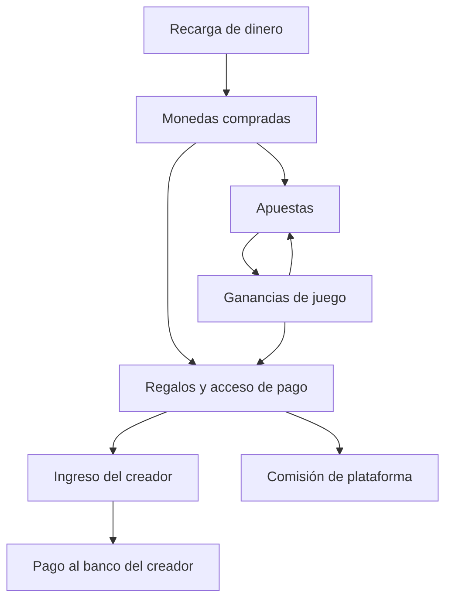

# Proyecto LIVE — definición inicial v0.33

Fecha de inicio: 9 de octubre de 2026, Colombia.
Actualización: 9 de octubre de 2026, Colombia.

Estado: base de descubrimiento revisable. El usuario ha elegido preparar el primer encargo de investigación para Claude: LIVE-001 v1.0 está listo para copiar y enviar, con base v0.33. La incorporación de nuevas ideas sigue abierta. En esta conversación se ha preparado el encargo; no se ha enviado a Claude ni se ha iniciado implementación. LIVE es un identificador provisional, no el nombre comercial. Este documento registra la visión del usuario; las recomendaciones y decisiones pendientes están indicadas por separado. No constituye una aprobación legal ni garantiza la aceptación de la aplicación por una tienda.

## 1. Objetivo y colaboración

Crear una plataforma móvil de transmisiones en vivo y monetización de creadores. La intención original es distribuirla en Android mediante Google Play y posiblemente en iOS después. La admisión deliberada de contenido sexual explícito, confirmada por el usuario, entra en conflicto con esa distribución; el usuario ha elegido web primero y una aplicación compatible con las tiendas posteriormente. BuzzCast, Tango y Bigo son referencias del usuario para la experiencia, no compromisos de equivalencia funcional ni evidencia de que cada función sea admisible en nuestra aplicación.

### Respuestas confirmadas

| Decisión | Respuesta del usuario | Precisión pendiente |
| --- | --- | --- |
| Primer mercado de recargas y retiros | Colombia | País de la empresa operadora y cobertura de cuentas bancarias de creadores residentes en los cuatro países elegidos. |
| Contenido permitido | También desnudos y contenido sexual explícito | Límites, condiciones de publicación y requisitos de edad de otros roles. |
| Mayoría de edad de espectadores | Verificarla durante el registro, antes de usar la plataforma | Método, proveedor, pruebas, revisión, reintentos, datos y conservación. |
| Referencia de presupuesto y criterio de ahorro | Antes indicó hasta US$3.000 mensuales aparte de Claude. Ahora aclara que el presupuesto no debe limitar la definición del producto; dispone de pocos recursos y desea alternativas equivalentes más económicas | Fondos efectivamente disponibles, duración, inversión inicial y financiación de campañas. |
| Capital inicial | Todavía no definido | Monto disponible para constitución, asesoría, integraciones y requisitos de operación. |
| Capacidad simultánea del piloto | Hasta 5 creadores y 50 espectadores en total dentro de nuestra plataforma | Ocupación media, días de operación y usuarios de juegos sin video. |
| Actividad diaria del piloto | Más de 8 horas al día con al menos una transmisión activa | Duración exacta, días por semana, rotación de creadores y ocupación media. |
| Canal inicial | Web primero; aplicación compatible con las tiendas posteriormente | Capacidades móviles de la web y alcance posterior de la app de tienda. |
| Casino | Imprescindible desde el lanzamiento con usuarios reales | Reglas exactas, operador y vía legal y contractual. |
| Disponibilidad de juegos | Con anfitrión social y también sin anfitrión conectado | Horario, jugadores sin video, acceso y atribución de ingresos. |
| Empresa | Todavía no existe; el usuario está dispuesto a constituirla | Jurisdicción, estructura, capital y responsables; no se asume una forma societaria. |
| Juegos iniciales | Dados y otros juegos rápidos, tragamonedas y ruleta | Selección exacta dentro de «juegos rápidos», reglas y disponibilidad del proveedor. |
| Ganancias de jugadores | Uso interno sin retiro al banco propio: regalos a creadores, nuevas apuestas, intervalos de salas, publicaciones y suscripciones | Conversión, movimientos de saldo y admisibilidad del circuito completo. |
| Papel del anfitrión | Social: presenta, comenta e interactúa mientras el juego funciona automáticamente | Atribución de apuestas a la sala, base y porcentaje de remuneración. |
| Reloj de acceso por intervalos | Contador individual desde la entrada; el intervalo pagado y el primer intervalo gratuito se pausan mientras el espectador está fuera y ante una desconexión temporal del creador | Detección de salida y desconexión, reanudación, concesión única de prueba gratuita y cambios de precio. |
| Desconexión temporal del creador | Pausar los contadores y permitir reconexión durante 1 minuto; si no reconecta, finalizar el directo y aplicar las devoluciones | Inicio del plazo, detección, confirmación de reconexión y reanudación. |
| Contenido exclusivo | Suscripción mensual y compra individual de publicaciones o paquetes; cada creador fija los precios de suscripciones y publicaciones | Unidad de precio, cambios para clientes existentes, tamaños, duración de videos y reglas de renovación. |
| Formatos exclusivos del perfil | Fotos y videos | Organización en publicaciones o paquetes, previews, calidad, límites y protección de archivos. |
| Mensajes privados en el lanzamiento | Texto gratuito; solo seguidores del creador pueden iniciar conversaciones privadas; habrá avisos de mensajes privados | Desseguir, respuesta o iniciativa del creador, límites, bloqueo, reporte, canal y contenido del aviso, preferencias y conservación. |
| Alta de creadores del piloto | Por invitación y con revisión previa | Gestión de invitaciones, responsables, requisitos, resolución y vínculo con captación por QR. |
| Residencia de creadores del piloto | Colombia, Estados Unidos, España y Venezuela | Documentos, ubicación de cuentas bancarias, monedas y cobertura contractual y de proveedores. |
| Solicitud de retiros por regalos y contenido | Diariamente; habrá un saldo mínimo de plataforma para solicitar el retiro, con importe por definir | Importe y moneda del mínimo, saldo elegible, número de solicitudes, horarios, comisiones, reservas y plazo de liquidación. |
| Descubrimiento de directos y perfiles | Recomendaciones personalizadas, categorías y filtros, búsqueda por nombre y creadores cercanos | Ponderación y orden de recomendaciones, señales de perfiles, categorías, coincidencias, combinación de filtros, precisión, radio y otros datos visibles del perfil. |
| Ubicación para creadores cercanos | Cada persona elige ciudad del perfil o ubicación aproximada del celular, con permiso | Configuración, cambio de elección, precisión, radio, actualización y conservación. |
| Visibilidad en «Cercanos» | La información de cercanía será solo un indicador; aparición del creador activada inicialmente, con opción de ocultarse | Umbral del indicador, ubicación no disponible, ocultación y reactivación, actualización de resultados y efecto sobre otras vías de descubrimiento. |
| Filtros del lanzamiento | País o ciudad e idioma | Catálogos, idioma de perfil o emisión, combinación de filtros, orden y resultados sin coincidencias. |
| Prioridad de la pantalla de inicio | Directos activos recomendados | Ponderación y orden, presentación, actualización y estado sin directos activos. |
| Señales para recomendar directos | Creadores seguidos, popularidad, historial de directos vistos e intereses elegidos; el valor de regalos recibidos será lo que más pese dentro de la popularidad | Pesos entre señales, fórmula y unidad de popularidad, ventana, regalos elegibles, ajustes, datos, conservación, intereses y orden. |
| Notificaciones del lanzamiento | Inicio de directos seguidos, mensajes privados y pagos, retiros y suscripciones, por navegador o celular con permiso; activar o desactivar todos los avisos en conjunto | Compatibilidad, proveedor, permiso, alcance por cuenta o dispositivo, valor inicial del control, eventos, contenido, frecuencia, entrega, reintentos y estados sin permiso. |
| Administración y revisión de reportes del piloto | Solo el usuario del proyecto | Horarios, capacidad, herramientas, permisos, procesos de revisión y registro de decisiones. |
| Canales de soporte del lanzamiento | Tickets y chat con soporte dentro de la plataforma | Tiempos de respuesta, estado fuera de atención, formatos, evidencias, límites, estados y avisos de respuestas. |
| Atención humana del chat de soporte | Según la disponibilidad del usuario del proyecto, sin horario fijo | Horas disponibles, presentación de disponibilidad, consultas sin atención y tiempos de respuesta. |
| Trabajo siguiente elegido | Preparar el primer encargo de investigación para Claude | Ejecutar LIVE-001 y revisar su resultado antes de decidir arquitectura e implementación. |
| Formato de directo en la primera versión | Un creador por transmisión | Audio, calidad y latencia; invitados y duelos no elegidos para esta versión. |
| Moderación de cada sala | El creador y los moderadores que designe pueden moderar el chat y expulsar espectadores, además de la supervisión general de la plataforma | Nombramiento, revocación, acciones concretas, sanciones y reingreso. |
| Expulsión con tiempo pagado restante | Devolución proporcional salvo infracción comprobada por la plataforma, revisando las pruebas | Evidencias, proceso, plazos, revisión de decisiones, liquidación, crédito y autorización automática. |
| Grabación de directos para el perfil | Opcional: el creador activa la grabación y puede publicarla después en su perfil | Captura, avisos, conservación, edición y publicación. |
| Acceso a la grabación publicada | Pagar un intervalo del directo no concede acceso a la grabación; rigen las condiciones del perfil | Clasificación en catálogo, permisos y estados de publicación. |
| Pago de suscripciones y publicaciones | Solo saldo interno | Saldo elegible, equivalencias, recargas, devoluciones y liquidación al creador. |
| Renovación mensual de perfiles | Manual o automática, a elección del usuario | Autorización por perfil, vencimiento, saldo insuficiente, cancelación y cambios de condiciones. |
| Pago de aportes directos | Dinero mediante un pago independiente | Proveedor, moneda, comisión, confirmación, liquidación al banco, devoluciones y disputas. |
| Catálogo de la suscripción | El creador elige todo el contenido exclusivo del perfil o un catálogo incluido con publicaciones de pago aparte | Cambios de catálogo y condiciones para suscriptores existentes. |
| Acceso a compra individual | Sin vencimiento mientras la publicación siga disponible | Retirada de contenido, cierre del perfil, reembolsos y disponibilidad de paquetes. |
| Multistream prioritario | BuzzCast, TikTok Live y Bigo Live | Emisión, datos de chat y eventos de regalos por destino; permisos y contenido. |
| Dispositivo para emitir en el piloto | Multistream desde un solo celular, sin computador | Prueba en Android, navegadores, calidad, red, interrupciones y funcionamiento del panel. |
| Primer intervalo de una sala de pago | El creador puede elegir entre pago antes de entrar y primer intervalo gratuito | Cuándo se configura, tratamiento de reingresos y aviso al espectador. |
| Renovación de intervalos | Regalos manuales y opción automática con autorización del espectador | Reglas de faltantes, cancelación, saldo insuficiente y cambios de condiciones. |
| Regalos que califican para acceso | El creador elige regalo específico o suma del valor de cualquier regalo hasta alcanzar el precio | Ventana de acumulación, aplicación de crédito y faltante al renovar. |
| Aporte parcial al vencer | En el modo de suma, lo aportado que no alcanza el precio permanece como regalo al creador | Ventana de progreso, momento de cierre y si el progreso cuenta para un intento posterior. |
| Excedente de regalos | En suma, el valor que supera el precio se acumula para siguientes intervalos del directo; al terminar, el crédito vence y permanece como regalo al creador | Aplicación del crédito y cambios de condiciones. |
| Tiempo pagado restante al cerrar el directo | Devolver en monedas el valor proporcional del tiempo no consumido | Base del cálculo, redondeo, origen del saldo y ajuste de ingresos. |
| Financiación de devolución proporcional | Se reparte entre plataforma y creador | Porcentajes o fórmula, disponibilidad de fondos, liquidación, reservas y ajustes de comisión. |
| Paso de directo público a sala exclusiva | Finalizar la emisión externa | Verificación del cierre por destino y comportamiento ante fallos. |
| Promoción remunerada | Módulo de tareas físicas para atraer usuarios y emisores a la propia plataforma mediante QR y pruebas | Participantes, reglas, importes, formatos de materiales, permisos y verificación. |
| Ciudades de campaña inicial | Bogotá y Medellín | Zonas concretas, lugares y condiciones por formato en cada ciudad. |
| Tareas y pago relativo | Pegar QR: menor pago; caminar con una prenda con QR: pago mayor; sostener cartel con QR y pruebas en vivo por video: pago máximo | Importes, duración, lugares y validación; unidad de pago de adhesivos pendiente. |
| Pago base de prenda y cartel | Monto fijo por tarea de duración definida | Duración e importe por actividad, tareas incompletas y validación del tiempo. |
| Modalidad de remuneración publicitaria | El participante elige dinero o monedas de la plataforma | Medio de entrega del dinero, equivalencia y momento de elección. |
| Usos de monedas de publicidad | Regalos a creadores, apuestas de casino, intervalos de salas, publicaciones y suscripciones | Conversión, circuito admisible y liquidación. Convertirlas posteriormente a dinero fue una opción no seleccionada; queda fuera del alcance confirmado. |
| Estructura de remuneración publicitaria | Pago base por tarea más bono por captación de usuarios o creadores válidos mediante su QR | Importes, verificación concreta, atribución, plazo y liquidación de los bonos. |
| Usuario captado válido para bono | Registrarse y completar la verificación | Qué incluye la verificación, unicidad, cuentas preexistentes y atribución del QR. |
| Creador captado válido para bono | Verificar su identidad y tener el perfil aprobado | Proceso de aprobación, unicidad, atribución y si una persona puede generar ambos tipos de bono. |
| Costo de materiales publicitarios | El participante cubre adhesivos, prendas y carteles sin reembolso | Formatos y especificaciones, acceso a diseños y gasto que debe informarse al aceptar. |
| Cobertura de la prueba de cartel | Video en vivo continuo durante toda la tarea | Duración, calidad, conexiones interrumpidas, revisión, grabación y conservación. |
| Estado de las ideas | La incorporación de ideas sigue abierta; el usuario ha elegido preparar el primer encargo de investigación | Incorporar nuevas ideas con registro de cambios y revisar sus efectos; la investigación inicial puede comenzar con la base vigente. |

Decisión confirmada en v0.24: los espectadores deben verificar su mayoría de edad durante el registro, antes de usar la plataforma. Método, proveedor, evidencias, revisión, reintentos y conservación todavía no están elegidos; no se da por suficiente una simple declaración de edad ni se impone un método documental concreto. La propuesta para la versión adulta es acceso exclusivo de mayores de 18 años para todos los roles, verificación de creadores y de las personas que aparezcan, consentimiento documentado, reportes y moderación con capacidad de interrumpir directos. Los requisitos específicos de creadores, promotores y otros roles siguen pendientes; la verificación previa del espectador ya es una decisión confirmada.

El usuario dirige el producto y define las prioridades. Claude, con la configuración indicada por el usuario, participará en la implementación. ChatGPT ayudará a concretar requisitos, redactar prompts, organizar versiones y revisar resultados y evidencias. Cualquier resultado de una IA será una propuesta hasta ser contrastado con requisitos, código y validaciones disponibles.

## 2. Funciones solicitadas

| ID | Función | Descripción de la visión del usuario | Pendiente de precisar |
| --- | --- | --- | --- |
| LIVE-F01 | Directos | Un creador por transmisión; creadores del piloto por invitación y revisión previa. Desconexión temporal con pausa y espera de 1 minuto; sin reconexión, cierre y devoluciones. Creador y moderadores designados gestionan chat y expulsiones. Grabación opcional activada por el creador para publicar después en el perfil. Espectadores ven, participan en el chat y envían regalos. | Detección y reanudación, permisos y sanciones, revisión, audio, conservación, publicación, calidad y latencia. |
| LIVE-F02 | Multistream | Transmitir en nuestra plataforma y en BuzzCast, TikTok Live y Bigo Live desde un solo celular, sin computador. Finalizar las emisiones externas al pasar a una sala exclusiva. | Soporte autorizado por destino, capacidad móvil y cierre verificable. |
| LIVE-F03 | Chat y regalos externos | El creador puede consultar mensajes y regalos mientras transmite en varias plataformas. | Datos que cada destino permite obtener y presentar; identidad y permisos. |
| LIVE-F04 | Perfil con contenido exclusivo | Fotos y videos, incluidos directos grabados si el creador activa la grabación y los publica después. El pago de intervalos no concede acceso a la grabación: rigen las condiciones del perfil. Suscripción mensual con catálogo elegido por el creador y renovación manual o automática elegida por el usuario; compra individual sin vencimiento mientras siga disponible. Precios fijados por cada creador y pago solo con saldo interno. | Organización, previews, calidad, catálogo, unidad de precio, conversión, cambios, autorización, fallos de renovación y retirada. |
| LIVE-F05 | Sala con acceso por intervalos | Contador individual con pausa al salir, incluido el gratuito; pausa también ante desconexión temporal del creador, con 1 minuto para reconectar antes del cierre. Configuración de duración, precio, entrada y regalos por creador; renovación manual y automática autorizada. Parciales insuficientes permanecen como regalos; excedentes sirven durante el directo y vencen al cerrar. Al cerrar, devolución proporcional del tiempo pagado restante en monedas, compartida por plataforma y creador. Al expulsar, devolución proporcional salvo infracción comprobada por la plataforma al revisar pruebas. | Presencia, inicio del plazo y detección, reanudación, evidencias, revisión, crédito, faltantes, cambios, redondeo y reparto. |
| LIVE-F06 | Monedas y regalos | Recargas de dinero para comprar monedas y usarlas en regalos. Los creadores podrán solicitar diariamente retiros de ingresos acumulados por regalos y contenido; habrá un saldo mínimo de plataforma, con importe por definir. | Equivalencias, comisiones, saldo elegible, importe y moneda del mínimo, solicitudes, reservas, devoluciones y liquidación. |
| LIVE-F07 | Aportes directos | Dinero mediante un pago independiente, con comisión de plataforma menor que la de los regalos y abono al banco del creador. | Proveedor y ruta admisible, moneda, porcentajes, países, confirmación, tiempos, costos, devoluciones y disputas. |
| LIVE-F08 | Juegos de casino | Dados y otros juegos rápidos, tragamonedas y ruleta, con anfitrión social o sin anfitrión. Ganancias para nuevas apuestas, regalos, intervalos, publicaciones y suscripciones; sin retiro al banco del jugador. | Juego rápido concreto, reglas, operador, movimientos admisibles y capacidad sin video. |
| LIVE-F09 | Creadores como anfitriones de juegos | Anfitrión social que presenta, comenta e interactúa mientras el juego funciona automáticamente; remuneración deseada como porcentaje de lo apostado. | Admisibilidad, porcentaje, fórmula final, atribución a la sala y responsabilidades del anfitrión. |
| LIVE-F10 | Seguridad y administración | Proteger pagos, saldos, cuentas y contenido exclusivo. Los espectadores verifican mayoría de edad al registrarse antes de usar la plataforma. Administración y revisión de reportes del piloto a cargo únicamente del usuario del proyecto. | Verificación, identidad por rol, recuperación, permisos de administración, registro de acciones, horarios, herramientas, capacidad y procesos de revisión. |
| LIVE-F11 | Promoción remunerada con QR | Bogotá y Medellín; tres niveles de pago relativo, elegible en dinero o monedas, con pago base y bono. Prenda y cartel: monto fijo por tarea de duración definida. Monedas para regalos, casino y acceso de pago. Usuario válido: registro y verificación; creador válido: identidad verificada y perfil aprobado. Materiales a cargo del participante sin reembolso. Cartel con video en vivo continuo durante toda la tarea. | Zonas, formatos de materiales, permisos, importes, duración concreta, verificación, atribución, pruebas, revisión, fraude y entrega. |
| LIVE-F12 | Mensajes privados de texto | Texto gratuito en el lanzamiento; solo seguidores del creador pueden iniciar conversaciones privadas. Avisos de mensajes mediante LIVE-F14. | Desseguir, respuesta o iniciativa del creador, límites, canal y contenido de avisos, preferencias, bloqueo, reporte y conservación. |
| LIVE-F13 | Descubrimiento de creadores | Inicio con directos activos recomendados por creadores seguidos, popularidad, historial e intereses elegidos. El valor de regalos recibidos pesa más dentro de popularidad. Categorías, búsqueda y filtros de país o ciudad e idioma. Cercanía por ciudad o ubicación móvil aproximada con permiso, a elección de cada persona; solo indicador, aparición inicial activada y opción de ocultarse. | Pesos entre señales, fórmula de popularidad, regalos elegibles, ajustes, datos, intereses, señales de perfiles, orden, estado sin directos, categorías, búsqueda, filtros, precisión, umbral, actualización, conservación y ocultación. |
| LIVE-F14 | Notificaciones | Avisos de inicio de directos seguidos, mensajes privados y pagos, retiros y suscripciones, por navegador o celular con permiso. El usuario solo podrá activarlos o desactivarlos en conjunto. | Compatibilidad, proveedor, permiso, alcance por cuenta o dispositivo, estado inicial del control, eventos, contenido, frecuencia, entrega, lectura cuando corresponda, reintentos, conservación y estados sin permiso. |
| LIVE-F15 | Soporte de la plataforma | Tickets y chat dentro de la plataforma desde el lanzamiento. Atención humana del chat según disponibilidad del usuario del proyecto, sin horario fijo. El mismo usuario administrará el piloto y revisará reportes sin equipo administrativo adicional. | Horas disponibles, tiempos de respuesta, chat no atendido, formatos, evidencias, estados, prioridad, herramientas, acceso y avisos de respuestas. |

## 3. Hallazgos iniciales que condicionan el producto

### Pagos y aportes

Google Play exige, como regla general y con excepciones regionales y programáticas, su sistema de facturación para compras digitales dentro de la aplicación, incluidas monedas y acceso a contenido. La excepción descrita para propinas requiere que el 100 % llegue al creador y que no otorgue contenido ni servicios digitales. Una comisión de plataforma impide asumir esa excepción. La ruta concreta se decidirá según país y programas aplicables; llamarla «donación» no la determina.

Fuente: [Understanding Google Play’s Payments policy](https://support.google.com/googleplay/android-developer/answer/10281818?hl=en).

Usaremos «comisión de plataforma» para la parte retenida por la aplicación. Impuestos y retenciones fiscales son conceptos distintos. Los porcentajes y el importe neto al creador quedan pendientes; se calcularán considerando la tienda, el procesador, devoluciones y costos de operación. «Directamente al banco» tampoco implica liquidación inmediata garantizada.

Decisión confirmada en v0.16: los aportes directos o donaciones se harán con dinero mediante un pago independiente. El objetivo de una comisión de plataforma menor que la de los regalos se conserva; no se ha fijado porcentaje ni se deduce un costo total menor del procesador. La compra de publicaciones y suscripciones continúa usando solo saldo interno. Canal de pago, confirmación, moneda, liquidación al creador y devoluciones aún se definirán en LIVE-001.

### Solicitudes de retiro del creador

Decisión confirmada en v0.25: los creadores podrán solicitar retiros diariamente de sus ingresos acumulados por regalos y contenido. En v0.26 se confirma que habrá un saldo mínimo de plataforma para solicitar el retiro; su importe sigue por definir. La frecuencia se refiere a presentar solicitudes; el plazo de entrega del dinero está pendiente. Faltan saldo elegible, equivalencias, importe y moneda del mínimo, cantidad de solicitudes por día, horarios, comisiones, reservas, revisión y resolución de fallos. Los aportes directos conservan su flujo independiente; la frecuencia de sus pagos no queda decidida por estas respuestas. No se presupone que el mínimo elegido por la plataforma coincida con las condiciones de un proveedor.

Se propone que el panel del creador distinga ingreso pendiente, saldo disponible para solicitar retiro, importe solicitado y estado de liquidación. Cada solicitud reservaría su importe para evitar solicitudes concurrentes sobre el mismo saldo, con confirmación y resolución de fallos propuestas; reintentos no deben duplicar pagos. LIVE-001 definirá alternativas de disponibilidad y reservas que permitan financiar las devoluciones ya confirmadas. Este flujo es del creador y no concede retiro bancario a las ganancias del jugador.

### Apuestas y monedas con valor económico

Google Play restringe apostar dinero o artículos comprados con dinero para obtener premios con valor económico. Sus excepciones para juegos de azar requieren licencias, aprobación y restricciones territoriales y de edad. En esta propuesta, las ganancias pueden convertirse en regalos que generan ingresos al creador: esto plantea un problema de clasificación que necesita revisión específica. No se asume que las monedas lo resuelvan ni que cumplir la política de la tienda sustituya la autorización legal local.

Fuente: [Real-Money Gambling, Games, and Contests](https://support.google.com/googleplay/android-developer/answer/9877032?hl=en).

Decisión vigente: el casino es imprescindible en el lanzamiento con usuarios reales. Esta condición se incorpora al alcance. El diseño económico, la cobertura regulatoria y los contratos pasan a ser dependencias del lanzamiento; el desarrollo de documentación, pruebas de concepto y demostraciones con saldos ficticios puede avanzar durante la evaluación. Ya se han seleccionado las familias de juegos y el papel social del anfitrión; la vía de operación y los productos concretos del proveedor siguen pendientes.

### Contenido y moderación

Google Play exige moderación continua, condiciones de uso y mecanismos de reporte y bloqueo para contenido generado por usuarios. Prohíbe pornografía y contenido o servicios destinados a la gratificación sexual; las excepciones limitadas no equivalen a autorizar una plataforma de contenido sexual por marcarla como 18+. El usuario ha confirmado que desea permitir también desnudos y contenido sexual explícito.

Fuentes: [User Generated Content](https://support.google.com/googleplay/android-developer/answer/9876937?hl=en) y [Inappropriate Content](https://support.google.com/googleplay/android-developer/answer/9878810?hl=en&ref_topic=9877466).

La excepción de contenido sexual incidental de Google Play requiere contenido principalmente no sexual y ausencia de promoción; la política identifica como infracción funciones pagadas que fomentan principalmente contenido sexual explícito objetable. No es una base para esta oferta deliberada. Apple también restringe material abiertamente sexual o pornográfico y servicios usados principalmente para pornografía; véanse las secciones 1.1.4 y 1.2 de sus [App Review Guidelines](https://developer.apple.com/app-store/review/guidelines/).

### Distribución elegida y etapas

| Etapa | Decisión del usuario | Precisión pendiente |
| --- | --- | --- |
| Lanzamiento inicial | Web móvil, con contenido explícito y casino. | Instalación, video en celulares, proveedores, cobros, retiros y vía de operación. |
| Etapa posterior | Aplicación compatible con las tiendas. | Contenido y funciones que realmente puedan ofrecerse; no se presupone equivalencia con la web. |

Chrome permite instalar aplicaciones web en Android; eso no garantiza las capacidades concretas de video, segundo plano, notificaciones o integraciones de este producto. Fuente: [Usar aplicaciones web en Android](https://support.google.com/chrome/answer/9658361?co=GENIE.Platform%3DAndroid&hl=es).

### Pagos y casino en Colombia

El cambio a web modifica las reglas de distribución aplicables, pero conserva las obligaciones legales y contractuales. La aceptación de pagos no se da por supuesta: por ejemplo, Stripe incluye contenido adulto y determinadas funciones adultas en sus negocios prohibidos. No se ha elegido ni confirmado un proveedor para recaudar en Colombia o liquidar a creadores. Habrá que comprobar la aceptación explícita del modelo completo, países admitidos, saldos virtuales, pagos a terceros, reservas, contracargos y plazos. Fuente: [Prohibited and Restricted Businesses de Stripe](https://stripe.com/legal/restricted-businesses).

Coljuegos explica que la operación legal de apuestas por internet se realiza mediante contrato de concesión y exige condiciones financieras, técnicas y jurídicas. Falta determinar la clasificación y ruta aplicable al circuito de apuestas, monedas, regalos e ingresos propuesto. Desarrollar el software o distribuirlo por web no sustituye esa evaluación ni habilita por sí solo operar apuestas. Fuentes: [Cómo ser operador de juegos por internet](https://www.coljuegos.gov.co/publicaciones/301519/juegos_operados_por_internet) y [Operadores autorizados](https://coljuegos.gov.co/publicaciones/301841/juegosonline/).

El usuario ha confirmado que el casino estará en la primera versión pública. Constituir una empresa es un paso diferente de obtener la habilitación para operar. La página oficial del trámite de Coljuegos, modificada en mayo de 2026, enumera documentación financiera, certificación técnica por laboratorio autorizado y garantías para premios y devolución de fondos. No se han determinado los importes, costos ni requisitos completos aplicables a nuestra propuesta. Fuente: [Cómo ser operador — información de 2026](https://www.coljuegos.gov.co/publicaciones/301519/juegos_operados_por_internet/index.php).

Rutas a comparar: operación mediante concesión propia, o un posible acuerdo con un operador autorizado cuya cobertura y admisibilidad para nuestra marca, flujos y servicios se confirme. La segunda ruta es una línea de investigación, no un modelo aprobado ni una licencia que se transfiera automáticamente. No hay socio, proveedor ni acuerdo identificado o contratado. Debe evaluarse además la aceptación de la combinación de contenido adulto, creadores, regalos y juegos.

Como hipótesis de diseño, describiremos por separado las monedas de consumo de la plataforma, el saldo de juego que corresponda al operador y los importes pendientes de pago a creadores y anfitriones. Esta separación conceptual ayuda a revisar los flujos; no demuestra que esté permitido transferir dinero entre ellos ni impone todavía una arquitectura. El usuario había indicado hasta US$3.000 mensuales aparte de Claude. En v0.11 aclara que el presupuesto no debe limitar la definición del producto: tiene recursos limitados y quiere conocer alternativas que logren el mismo resultado con menor costo. Ese importe queda como referencia previa, no como límite obligatorio de diseño. El capital inicial y el fondo de campañas no están definidos. La flexibilidad del alcance tampoco confirma fondos disponibles para gastos, garantías u obligaciones.

### Presupuesto y dimensión del piloto

| Parámetro | Confirmado | Uso en la planificación |
| --- | --- | --- |
| Referencia mensual previa | Hasta US$3.000, aparte de Claude; no constituye un tope de diseño tras la aclaración de v0.11. | Mostrar costos y necesidades de financiación sin eliminar requisitos para forzar ese importe. |
| Preferencia de ahorro | Buscar resultados equivalentes a menor costo. | Comparar capacidades, calidad, seguridad, carga operativa y costos de alternativas; señalar cualquier diferencia. |
| Fondo de publicidad | Pendiente. | Separar pagos base y bonos, dinero y monedas, preparación de campañas, revisión y video continuo. El participante paga adhesivos, prendas y carteles sin reembolso; ese gasto se muestra por separado. La elección de monedas no implica costo económico cero. |
| Capital inicial | Todavía no definido. | Separar gastos iniciales, reservas y requisitos de operación del presupuesto mensual. |
| Creadores simultáneos | Hasta 5, con un creador por transmisión en la primera versión. | Dimensionar fuentes individuales, rotación y anfitriones que no emiten; las pruebas de promoción tienen concurrencia propia. |
| Espectadores simultáneos | Hasta 50 en total. | Se distribuyen entre todas las salas; no son 50 por creador. |
| Audiencias externas | Sin cifra definida. | No se suman a los 50 espectadores de nuestra plataforma; las salidas externas sí deben aparecer en el cálculo de costos. |
| Actividad diaria | Más de 8 horas con alguna transmisión activa. | Duración exacta y ocupación media pendientes; el uso de cada creador se dimensionará por separado. |
| Días de actividad | Pendiente. | Necesarios para convertir capacidad y actividad diaria en consumo mensual. |

Estas cifras son objetivos para el piloto, no usuarios ya captados ni una medición de carga. Con cinco creadores usando a la vez los tres destinos prioritarios habría hasta quince salidas externas; es un escenario condicionado a permisos e integraciones disponibles. El número de salidas no determina por sí solo su tarifa.

Ejemplos de carga actualizados, sin precios: para explorar la actividad confirmada de más de ocho horas, se comparan 12 y 24 horas diarias. Se asumen 30 días y ocupación máxima durante toda la ventana diaria. Son escenarios de cálculo, no horarios elegidos por el usuario ni una previsión de ocupación.

| Ventana diaria supuesta | Horas mensuales de emisión: 5 creadores | Horas mensuales de visualización: 50 espectadores |
| --- | --- | --- |
| 12 horas | 1.800 | 18.000 |
| 24 horas | 3.600 | 36.000 |

Fórmulas: horas de emisión = creadores simultáneos × horas diarias × días; horas de visualización = espectadores simultáneos × horas diarias × días. Una estimación real usará ocupación media además del pico. La grabación de directos será opcional, activada por el creador. Faltan calidad y tasa de video, proporción de directos grabados, duración, conservación, almacenamiento, frecuencia de transacciones y tiempo de moderación; no se fijan esos datos silenciosamente.

La evaluación económica incluirá video y salidas externas, servidor, datos, almacenamiento, verificación, moderación, soporte, cobros, juegos y promoción remunerada. Separará ingresos, gasto operativo y fondos debidos a creadores o promotores. Comparará alternativas económicas y otras con más capacidad, indicando qué ofrece cada una. La referencia mensual previa ayuda a mostrar diferencias y financiación necesaria; no autoriza reducir requisitos ni asumir fondos ilimitados. Toda reducción que cambie calidad, seguridad o resultado se identificará como un cambio de alcance, conservando el casino como requisito del lanzamiento público.

Para las pruebas de cartel se dimensionarán horas de video continuo por número de tareas y duración, concurrencia máxima, transmisión, visualización por revisores, procesamiento y almacenamiento si se decide grabar. Fórmula de consumo de entrada: horas de prueba = tareas realizadas × duración media en horas. Las horas de revisión humana y de almacenamiento dependen del modelo de revisión y conservación, todavía pendientes. Estas tareas no quedan incluidas automáticamente en los cinco directos de creadores ni en los cincuenta espectadores del piloto.

Hipótesis de ahorro a comparar: reutilizar componentes de video y cuentas con acceso privado, y ajustar resolución y tasa de video tras comprobar que permiten verificar QR, persona y actividad durante toda la tarea. Se evaluarán costos y carga operativa con mediciones; no se ofrece ahorro cuantificado todavía. La cobertura continua confirmada se conserva. Los pagos base y bonos en monedas se estimarán según sus usos y la obligación económica que puedan generar; no se contabilizarán como remuneración gratuita.

### Reglas funcionales del casino confirmadas y propuestas

| Elemento | Estado | Regla o decisión |
| --- | --- | --- |
| Familias de juegos | Confirmado | Dados y otros juegos rápidos, tragamonedas y ruleta. |
| Retiro para jugadores | Confirmado | El usuario quiere que las ganancias se usen dentro de la plataforma, sin retiro al banco del jugador. |
| Uso de ganancias | Destinos de producto confirmados; circuito pendiente de validación | Regalos a creadores, nuevas apuestas, intervalos de salas, publicaciones y suscripciones. Los aportes directos tienen un pago independiente en dinero, confirmado en v0.16. |
| Anfitrión | Confirmado | Papel social: presenta, comenta e interactúa; el juego funciona automáticamente. |
| Disponibilidad sin anfitrión | Confirmado | También se podrá jugar sin un creador anfitrión conectado. Horario y acceso concreto están pendientes. |
| Resultados | Propuesta coherente con el papel social | El anfitrión no controla ni modifica resultados, probabilidades o liquidaciones; los produce el sistema de juego que se seleccione y valide. |
| Remuneración del anfitrión | Visión del usuario, fórmula pendiente | El usuario desea un porcentaje de lo apostado; porcentaje, base final, topes, costos y momento de devengo requieren cálculo y revisión. |
| Visibilidad | Propuesta de producto | Identificar la participación remunerada del anfitrión y explicar al jugador reglas y costos aplicables. |

La ausencia de retiro bancario para jugadores expresa el funcionamiento deseado; no determina por sí sola la clasificación jurídica. En la visión del usuario, los regalos pueden producir ingresos bancarios para los creadores, por lo que el circuito completo continúa pendiente de revisión. El usuario ha precisado que quiere usar ganancias para nuevas apuestas, intervalos de salas, publicaciones y suscripciones, además de regalar a creadores. La elección de esos destinos es una decisión de producto; su admisibilidad, equivalencias y liquidación aún requieren revisión.

Escenario de seguridad a resolver: una persona que actúe como jugador y creador podría ganar saldo y enviarse regalos o comprar su propio contenido y acceso para generar un importe retirable como creador. Controles propuestos: impedir autorregalos y compras remuneradas a sí mismo, excluir apuestas propias de la remuneración del anfitrión, identificar cuentas vinculadas, conservar el origen del saldo y revisar movimientos y liquidaciones. Estas son propuestas; no impiden automáticamente acuerdos entre personas diferentes y su alcance se concretará al diseñar la economía.

### Acceso al casino con y sin anfitrión

Decisión confirmada: el casino estará disponible tanto en una experiencia con anfitrión social como sin anfitrión conectado. Propuesta de interfaz para concretar: una sección de juegos accesible sin entrar en un directo y salas que combinan juego automático con interacción del creador.

La disponibilidad del juego independiente se definirá por su propio horario y condiciones. Las más de ocho horas diarias confirmadas describen transmisiones activas; todavía no establecen un horario del casino. Los usuarios que juegan sin ver video necesitan su propia estimación de capacidad; no se asume que todos estén incluidos en los 50 espectadores simultáneos ya definidos.

Reglas pendientes: qué apuestas se atribuyen a un anfitrión, cambio entre sala y juego independiente, interrupción del directo durante una ronda y liquidación de operaciones aceptadas. La propuesta es conservar el identificador de apuesta y la atribución elegida, evitar liquidaciones duplicadas y resolver las apuestas aceptadas según las reglas del juego aunque cambie el estado del directo. La remuneración del anfitrión y cualquier atribución que continúe fuera de su sala deberán justificarse en LIVE-001.

### Recorrido económico deseado

El siguiente esquema resume los destinos solicitados para evaluar en LIVE-001. Representa funciones de producto; no fija cuentas contables, conversión, comisiones, pasarelas ni movimientos autorizados.



El acceso de pago agrupa intervalos, publicaciones y suscripciones. La remuneración del anfitrión se analizará como flujo adicional con fórmula aún pendiente. Los aportes directos tendrán un pago independiente en dinero: su ruta hasta el banco del creador y su comisión se definirán aparte. No se fija paridad entre monedas compradas y saldo ganado ni se presupone conversión automática entre saldos.

Propuesta para el análisis: conservar origen, operación y destino de cada movimiento; determinar qué obligación económica genera una ganancia cuando termina como compra o regalo a un creador; distinguir movimientos internos de fondos exigibles y cobros del proveedor. Las devoluciones deberán definir qué saldo restituyen y qué ingreso revocan. Son reglas por diseñar y contrastar, no una solución contractual ya aprobada.

### Salas por intervalos y contenido exclusivo

Decisión confirmada: cada espectador tiene un contador personal que comienza desde su entrada. En v0.17 se confirma que el contador del intervalo pagado se pausa mientras está fuera de la sala; al regresar conserva el tiempo no consumido. En v0.18 se extiende esa pausa al primer intervalo gratuito. El creador define el intervalo y el valor requerido del regalo. Ejemplo ilustrativo con presencia continua, sin fijar una duración de producto: en intervalos de cinco minutos, una entrada a las 17:00 vence a las 17:05 y una entrada a las 17:02 vence a las 17:07. Si el primer espectador consume dos minutos, sale durante tres y regresa a las 17:05, conserva tres minutos pagados y, si permanece dentro, vence a las 17:08. El creador puede exigir pago inicial o conceder un primer intervalo gratuito. Ambos contadores se pausan mientras el espectador está fuera. En v0.20 se confirma que una pérdida temporal de conexión del creador también pausa los contadores y permite reconectar. Durante esa pausa no se da el directo por terminado. En v0.21 se fija una espera de 1 minuto: si no hay reconexión, finalizar el directo y aplicar las reglas de cierre, incluida la devolución proporcional del tiempo pagado restante. El inicio técnico de ese plazo y la condición de reconexión confirmada aún necesitan especificación.

| Modalidad elegida por el creador | Entrada del espectador | Primer vencimiento |
| --- | --- | --- |
| Pago antes de entrar | Se confirma el pago requerido y se habilita el acceso. | Al consumir el tiempo del intervalo dentro de la sala; pausa al estar fuera o ante desconexión temporal del creador. |
| Primer intervalo gratuito | Se habilita el acceso inicial sin ese pago. | Al consumir el tiempo gratuito dentro de la sala; pausa al estar fuera o ante desconexión temporal del creador. Continuar requiere el regalo definido. |

Propuesta para evitar cobros o acceso inconsistentes: en la modalidad de pago inicial, no iniciar el contador mientras el espectador espera el cobro o la autorización. La prueba gratuita se concedería una vez por espectador y sesión del directo; cerrar y volver a entrar conservaría el estado. La pausa y conservación del tiempo al reingresar están confirmadas para intervalos pagados y el primero gratuito. La definición operativa de entrada y salida, y la regla propuesta de prueba gratuita única por espectador y directo, necesitan especificación antes de implementar.

Decisiones confirmadas sobre renovación y regalos:

| Regla | Elección confirmada |
| --- | --- |
| Renovación manual | El espectador puede enviar regalos para continuar. |
| Renovación automática | Existirá como opción con autorización del espectador. |
| Regalo específico | El creador puede exigir un regalo concreto para habilitar el intervalo. |
| Valor acumulado | El creador puede permitir que regalos diferentes sumen su valor hasta alcanzar el precio del intervalo. |
| Pausa de intervalos pagados y gratuito inicial | El contador se pausa mientras el espectador está fuera y conserva el tiempo al regresar. |
| Desconexión temporal del creador | Pausar los contadores y permitir reconexión durante 1 minuto; sin reconexión, finalizar el directo y aplicar las reglas de cierre. |
| Parcial insuficiente al vencer | En el modo de suma, permanece como regalo al creador. |
| Excedente de precio | En el modo de suma, se acumula para siguientes intervalos del mismo directo. |
| Cierre con tiempo pagado restante | Devolución en monedas proporcional al tiempo no consumido. |
| Cierre con crédito excedente restante | El crédito vence y permanece como regalo al creador. |
| Expulsión con tiempo pagado restante | Devolución proporcional salvo infracción comprobada por la plataforma mediante revisión de pruebas; proceso y plazos pendientes. |

Ejemplo funcional con cifras ficticias: si el creador elige valor acumulado y el precio es 100 monedas, regalos de 40 y 60 alcanzan ese precio. Si solo se aportan 40 al vencer, permanecen como regalo al creador y no bastan para renovar. Si se aportan 160, se cubre un intervalo y las 60 excedentes se acumulan para los siguientes. Son ejemplos de la regla confirmada, sin fijar precio, conversión ni comisión. En el modo de regalo específico, el criterio sigue siendo el regalo elegido. Quedan pendientes la ventana de acumulación, el destino del progreso insuficiente en un intento posterior, cuándo se aplica el excedente y la acumulación anticipada de tiempo. Al terminar el directo, el tiempo pagado no consumido se devuelve proporcionalmente en monedas; el crédito excedente sin aplicar vence y permanece como regalo al creador.

Ejemplo ilustrativo de cierre y fórmula candidata, sujetos a las reglas de valoración y redondeo: intervalo de cinco minutos por 100 monedas; tras consumir dos minutos quedan tres. La restitución proporcional sería 100 × 3 / 5 = 60 monedas. Si además quedan 60 de crédito excedente sin aplicar, ese crédito vence como regalo; no se suma a las 60 restituidas por tiempo. La valoración de tiempo comprado con crédito de regalos, de periodos anticipados y de promociones todavía necesita especificación.

Propuesta de cálculo por derecho pagado: valor atribuido al intervalo × tiempo restante / duración del intervalo. Cada tramo conservaría sus condiciones de adquisición y el origen del saldo usado. Base y redondeo no se dan por aprobados. La devolución se financiará entre plataforma y creador, según v0.19; LIVE-001 propondrá porcentaje o fórmula, disponibilidad de fondos y corrección del ingreso del creador y comisión. No se presume reparto igualitario. El cierre y la devolución deben registrarse una sola vez incluso con espectadores fuera de la sala o eventos repetidos.

Reglas propuestas para revisar antes de implementar:

- La plataforma verificará sesión, pagos, tiempo consumido y estado dentro o fuera; el reloj del dispositivo representará ese estado. Debe conservar tiempo restante durante la pausa y retomarlo al regresar, tanto en intervalos pagados como en el primero gratuito. Definir cómo se detectan salida, pérdida de red, cierre de página y uso de varios dispositivos.
- La renovación automática estará desactivada hasta una autorización explícita que muestre sala, creador, duración, valor y regla de regalo. La autorización se vinculará a la sesión del directo.
- El espectador podrá desactivar la opción y ver su estado. La propuesta es conservar el tiempo ya pagado al cancelarla y detener las renovaciones futuras.
- El cobro automático usará monedas disponibles. Ante saldo insuficiente, se avisará y se aplicará la regla de vencimiento; una recarga de dinero tendrá su propio flujo de compra.
- Cada intervalo se liquidará una sola vez. Un regalo manual que ya habilitó ese intervalo impedirá un segundo cobro automático para el mismo acceso. Eventos repetidos, reintentos y acciones simultáneas conservarán un único débito y una única extensión.
- En valor acumulado, conservar el excedente como crédito para próximos intervalos y registrar su aplicación una sola vez. Se propone considerar crédito y regalos que califican antes de calcular un faltante. Falta definir cómo completarlo en renovación automática y cuándo consumir el crédito; no se presume un segundo cobro por valor ya aplicado. Un parcial insuficiente al vencer permanece como regalo; su posible progreso en un intento posterior aún necesita regla.
- La autorización automática respetará las condiciones aceptadas. La propuesta es solicitar una autorización nueva si cambia el precio o la duración; la regla de cambio durante una sesión está pendiente.
- La pausa al salir y conservación del tiempo pagado están confirmadas. Se propone que estar fuera no permita seguir recibiendo video exclusivo ni active renovaciones automáticas mientras el contador está pausado. Definir salida y reconexión del espectador, estado de la autorización al regresar y cambio de sala. Al terminar el directo, devolver proporcionalmente en monedas el tiempo pagado restante y vencer el crédito excedente sin aplicarlo a otro directo; este permanece como regalo.
- Ante una desconexión temporal del creador, la pausa de contadores y posibilidad de reconexión están confirmadas. La espera será de 1 minuto; si no reconecta, se finalizará el directo y se aplicarán las reglas de cierre confirmadas: restitución proporcional en monedas del tiempo pagado restante, financiada entre plataforma y creador, y vencimiento del crédito excedente como regalo. Se propone conservar tiempo, progreso, crédito y autorizaciones de la misma sesión durante la espera, sin renovaciones automáticas. Reconectar no debe por sí solo reiniciar la prueba gratuita ni consumir tiempo de espectadores que siguen fuera. El inicio técnico del plazo, la detección de la caída, la confirmación de reconexión y las condiciones de reanudación quedan pendientes. La espera de reconexión no activa por sí sola la devolución final ni el vencimiento del crédito.
- El creador y los moderadores que designe podrán expulsar espectadores. En v0.22 se confirma la devolución proporcional del tiempo pagado restante salvo infracción comprobada; ante esa excepción, no se devuelve ese tiempo. En v0.23 se confirma que la plataforma comprobará la infracción revisando las pruebas. Evidencias necesarias, proceso, plazos, posibilidad de revisar la decisión y tratamiento del acceso y saldo mientras se resuelve siguen pendientes. La facultad del creador o moderador de expulsar no le concede la decisión de negar la devolución. También faltan reglas de crédito excedente, regalos, autorización automática, reingreso y financiación específica de esta devolución. La expulsión de un espectador no finaliza el directo de los demás ni implica confiscar el saldo general de su cuenta.
- Antes del vencimiento se mostrarán precio, tiempo restante, estado de pausa, progreso, crédito excedente y renovación. Mostrar que un aporte insuficiente al vencer permanece como regalo, que el excedente vence al terminar el directo y que el tiempo pagado restante se devuelve proporcionalmente en monedas. La propuesta es bloquear el video exclusivo al agotar el tiempo sin renovación confirmada; pausar un contador no concede acceso mientras está fuera.
- El usuario ha confirmado que quiere pagar intervalos con ganancias de casino. El origen del saldo, la conversión, los movimientos admisibles y la liquidación se resolverán en LIVE-001 antes de concretar ese flujo.

Decisiones confirmadas para perfiles exclusivos: suscripción mensual y compra individual; el creador elige el alcance del catálogo incluido y fija los precios de suscripciones y publicaciones, según v0.20. La renovación mensual será manual o automática, a elección del usuario. Una compra individual no vence por el paso del tiempo mientras la publicación siga disponible. Las suscripciones y publicaciones se pagan únicamente con saldo interno. Recargas y aportes directos conservan sus flujos propios; estos últimos se pagan mediante un cobro independiente en dinero.

| Modalidad | Decisión confirmada | Detalle pendiente |
| --- | --- | --- |
| Suscripción con todo el exclusivo | El creador puede elegir incluir todo el contenido exclusivo del perfil. | Inclusión de nuevas publicaciones y cambios de catálogo o precio. |
| Suscripción con catálogo parcial | El creador puede elegir un catálogo incluido y otras publicaciones con pago aparte. | Identificación de cada publicación y condiciones para suscriptores existentes. |
| Compra individual | Sin vencimiento mientras la publicación siga disponible. | Retirada, cierre del perfil, reembolsos y alcance de los paquetes. |
| Renovación mensual | Manual o automática a elección del usuario, con saldo interno. | Autorización por perfil, vencimiento, cambios de condiciones, cancelación y saldo insuficiente. |
| Fijación de precios | Cada creador fija los precios de suscripciones y publicaciones. | Unidad, validaciones técnicas y cambios de precio para compradores y suscriptores existentes. |

Propuestas de funcionamiento:

- Mantener derechos separados para suscripción y compra individual. La propuesta es conservar una compra individual aunque el comprador cancele su suscripción, mientras la publicación siga disponible.
- Mostrar antes del pago si la publicación está incluida en una suscripción activa y qué derecho se obtiene al comprarla por separado. Así puede distinguirse acceso por suscripción de una compra sin vencimiento.
- Conservar una referencia a las condiciones de cada operación y mostrar al usuario las compras y suscripciones activas.
- La fijación de precios por cada creador está confirmada. Se propone registrar los cambios y conservar las condiciones de cada compra o periodo ya adquirido. El efecto de un nuevo precio sobre renovaciones automáticas, avisos y autorizaciones todavía requiere una regla. No se han elegido precios comunes, mínimos, máximos ni equivalencias.
- Proponer los derechos al finalizar un periodo, una cancelación o un fallo de renovación. Las modalidades manual y automática a elección del usuario están confirmadas. Se propone una autorización propia para cada perfil y sus condiciones; la autorización de salas por intervalos no sustituye esta elección.
- Diferenciar dejar de vender una publicación y retirar su acceso. El efecto sobre compradores existentes, las retiradas por moderación y los reembolsos necesita una política expresa.
- El perfil se paga solo con saldo interno y el deseo de usar ganancias de casino está confirmado. Unidad de precio, saldo elegible, conversión y liquidación siguen pendientes de concretar y validar.
- Propuesta ante saldo insuficiente: mostrar lo que falta y ofrecer una recarga voluntaria con su propio consentimiento; al volver, confirmar la compra del perfil y sus condiciones actuales. La renovación automática de intervalos no autoriza una recarga.

### Directos, perfiles y comunicación privada — alcance inicial

Decisiones confirmadas hasta v0.32:

| Área | Alcance confirmado | Pendiente |
| --- | --- | --- |
| Directos — LIVE-F01 | Un creador por transmisión; desconexión temporal con pausa y espera de 1 minuto antes del cierre si no reconecta. | Detección, inicio del plazo y reanudación; audio, calidad y latencia. |
| Grabación de directos | Opcional, si el creador la activa; puede publicar después en su perfil. Pagar intervalos no concede acceso al video publicado; rigen las condiciones del perfil. | Captura, avisos, conservación, edición, publicación y catálogo. |
| Moderación de sala | Creador y moderadores designados gestionan chat y expulsiones, con supervisión general de plataforma. Devolución proporcional salvo infracción comprobada por la plataforma, revisando pruebas. | Asignación, revocación, sanciones, reingreso, evidencias, plazos y revisión de decisiones. |
| Perfil exclusivo — LIVE-F04 | Fotos y videos; cada creador fija los precios de suscripciones y publicaciones. | Unidad y cambios de precio, organización en publicaciones o paquetes, límites, duración, resolución y previews. |
| Comunicación privada — LIVE-F12 | Texto gratuito; solo seguidores del creador pueden iniciar conversaciones. Avisos de mensajes mediante LIVE-F14. | Desseguir, respuesta o iniciativa del creador, límites, canal y contenido del aviso, preferencias, conservación y moderación. |
| Registro de espectadores | Verificación de mayoría de edad durante el registro, antes de usar la plataforma. | Método, proveedor, evidencias, revisión, reintentos, datos y conservación. |
| Alta de creadores del piloto | Por invitación y revisión previa; residentes en Colombia, Estados Unidos, España y Venezuela. | Invitaciones, documentos, cuentas de cobro, cobertura por país, criterios, revisores y reclamaciones. |
| Solicitudes de retiro del creador | Diarias para ingresos acumulados por regalos y contenido; se exigirá un saldo mínimo de plataforma, con importe por definir. | Saldo elegible, importe y moneda del mínimo, solicitudes por día, horarios, costos, reservas y liquidación. |
| Descubrimiento — LIVE-F13 | Inicio con directos activos recomendados por creadores seguidos, popularidad, historial e intereses; popularidad principalmente por valor de regalos recibidos. Categorías, búsqueda, filtros de país o ciudad e idioma y cercanía con fuente elegible, solo indicador y opción de ocultarse. | Pesos entre señales, fórmula de popularidad, regalos elegibles, ajustes, datos, intereses, señales de perfiles, orden, categorías, búsqueda, filtros, umbral, actualización y ocultación. |
| Notificaciones — LIVE-F14 | Inicio de directos seguidos, mensajes privados y pagos, retiros y suscripciones, por navegador o celular con permiso; activación o desactivación conjunta. | Compatibilidad, proveedor, permiso, alcance por cuenta o dispositivo, estado inicial del control, eventos, contenido, frecuencia, entrega, reintentos, conservación y estados sin permiso. |
| Administración del piloto | Solo el usuario del proyecto administra la plataforma y revisa reportes. | Horarios, herramientas, capacidad, permisos, registro de decisiones y procesos de revisión. |
| Soporte — LIVE-F15 | Tickets y chat dentro de la plataforma desde el lanzamiento. Chat humano según disponibilidad del usuario del proyecto, sin horario fijo. | Horas disponibles, tiempos de respuesta, consultas no atendidas, formatos, evidencias, estados, límites y avisos. |

El formato de directo elegido se incorpora a la planificación del piloto de hasta cinco creadores simultáneos y cincuenta espectadores internos totales. Invitados y duelos fueron opciones no seleccionadas para esta versión; no se registra una prohibición permanente de añadirlos. El número de creadores por transmisión no determina por sí solo cuántas personas pueden aparecer en una foto o video; la verificación y consentimiento de participantes siguen requiriendo especificación.

Moderación confirmada en v0.21: cada creador y los moderadores que designe podrán gestionar el chat y expulsar espectadores de su sala. La supervisión general de la plataforma se conserva. Se propone delimitar el rol a las salas autorizadas, registrar nombramientos, revocaciones y acciones, y distinguir expulsión de sala de suspensión de cuenta en toda la plataforma. En v0.22 se confirma devolución proporcional del tiempo pagado restante al expulsar, salvo infracción comprobada. La plataforma comprobará la infracción revisando las pruebas, según v0.23. Permisos concretos, sanciones, reingreso, evidencias, plazos y revisión de esa decisión quedan pendientes. Se propone conservar motivo, evidencia necesaria y resolución de cada incidente; una acusación por sí sola no se trata como comprobación. Nombrar un moderador de chat no define permisos sobre mensajes privados, pagos, saldos o cuentas bancarias.

Grabación confirmada en v0.22: los creadores podrán grabar sus directos si activan la opción y publicarlos después en el perfil. No se ha elegido grabación automática de todos los directos ni publicación automática. Se propone mostrar el estado de grabación y gestionar el video resultante como un archivo privado del creador hasta publicar con condiciones de acceso definidas. Avisos, permisos, edición, conservación antes de publicar y eliminación están pendientes. En v0.23 se confirma que pagar intervalos del directo no concede acceso a la grabación publicada: rigen las condiciones del perfil. El acceso podrá depender de una suscripción que incluya el video o de su compra individual, conforme al catálogo elegido por el creador; si ya existe un derecho válido del perfil, no se presupone otra compra. Un video que atraviese tramos públicos y exclusivos necesita una regla de publicación y previews que preserve la protección del contenido. La opción de grabar directos no decide si se almacenan las pruebas de video de tareas publicitarias ni confirma capturar chat, mensajes privados o eventos de regalos dentro del archivo.

Fotos y videos se ofrecerán mediante las modalidades de perfil ya confirmadas: suscripción mensual y compra individual. Los textos descriptivos, etiquetas o mensajes de interfaz no se confunden con la venta de publicaciones de texto como formato adicional. Se propone distinguir archivos originales, previews y el derecho de acceso; previews, calidad, marcas de agua y límites de carga todavía no están elegidos.

Los mensajes privados son una función distinta del chat visible en el directo. Serán gratuitos, según v0.16, y solo seguidores del creador podrán iniciarlos, según v0.19. El permiso se refiere a iniciar una conversación; no se ha definido el efecto de dejar de seguir sobre una conversación existente ni la iniciativa del creador. No se añade una condición de suscripción pagada. Propuestas revisables: acceso restringido a participantes, reglas para iniciar una conversación, bloqueo y reporte, límites contra spam, estados de entrega y política de conservación. Los permisos de revisión de mensajes se definirán por finalidad y rol; no se promete cifrado de extremo a extremo ni revisión ilimitada. Para las estimaciones se separarán almacenamiento de fotos y videos de perfil, entrega de medios y mensajería de texto.

Propuesta para el alta de creadores: invitación registrada → solicitud e identidad → revisión previa → aprobación o rechazo motivado → permisos de creador habilitados. Responsables, criterios, datos, caducidad de invitaciones y reclamaciones están pendientes. La campaña QR puede captar interesados; registrarse como candidato no sustituye la invitación ni la revisión y no activa por sí solo el bono de creador. El bono conserva sus hitos: identidad verificada y perfil aprobado. No se añade una primera emisión o ingreso como condición.

### Descubrimiento de directos y perfiles — LIVE-F13

Decisión confirmada en v0.26: los usuarios descubrirán directos y perfiles mediante recomendaciones personalizadas, categorías y filtros, búsqueda por nombre y creadores cercanos. En v0.27 se concreta la ubicación: cada persona podrá elegir ciudad del perfil o ubicación aproximada del celular, con permiso. Los filtros seleccionados para el lanzamiento son país o ciudad e idioma. En v0.28 se confirma que la información de cercanía mostrada al espectador será solo un indicador de cercanía y que la aparición del creador en «Cercanos» estará activada inicialmente, con opción de ocultarse.

| Vía | Alcance confirmado | Decisiones pendientes |
| --- | --- | --- |
| Recomendaciones personalizadas | Sugerir directos y perfiles; inicio con directos activos. Señales: creadores seguidos, popularidad, historial e intereses; dentro de popularidad pesa más el valor de regalos recibidos, según v0.31. | Pesos entre señales, fórmula de popularidad, unidad, ventana, regalos elegibles, ajustes, datos, intereses, señales de perfiles, orden y estados sin historial o sin directos. |
| Categorías y filtros | Navegación por categorías; filtros iniciales de país o ciudad e idioma. | Catálogo y asignación de categorías, listas de países, ciudades e idiomas, combinación de filtros y resultados vacíos. |
| Búsqueda por nombre | Encontrar creadores por su nombre. | Nombre visible o identificador, coincidencias parciales, nombres repetidos y orden. |
| Creadores cercanos | Ciudad del perfil o ubicación móvil aproximada con permiso, a elección de cada persona; solo indicador de cercanía. Aparición inicial del creador activada y opción de ocultarse. | Precisión, umbral, actualización, cambio de fuente, ubicación no disponible, reactivación, conservación y efecto sobre otras vías de descubrimiento. |

Prioridad del inicio confirmada en v0.29: directos activos recomendados. En v0.30 se confirman las cuatro señales para recomendar directos: creadores que sigue el usuario, popularidad de cada directo, historial de directos vistos e intereses elegidos por el usuario. En v0.31 se confirma que lo que más pesará al medir popularidad dentro de nuestra plataforma será el valor de los regalos recibidos. Los pesos entre las cuatro señales, fórmula de popularidad, orden, presentación y actualización siguen pendientes. Los módulos ya solicitados, incluido el casino desde el lanzamiento, mantienen su alcance; su ubicación en la navegación requiere diseño. Falta decidir qué mostrar si no hay directos activos y cómo presentar condiciones de acceso de una sala recomendada. Una recomendación no concede acceso al contenido de pago ni sustituye la verificación de mayoría de edad previa al uso.

Señales de directos confirmadas en v0.30:

| Señal | Alcance confirmado | Decisiones pendientes |
| --- | --- | --- |
| Creadores seguidos | Usar los creadores que sigue el usuario para recomendar directos. | Ponderación, cambios de seguimiento y relación con las otras señales. |
| Popularidad de cada directo | El valor de regalos recibidos será lo que más pese al medir popularidad dentro de nuestra plataforma. | Fórmula, unidad de valor, ventana, regalos elegibles, ajustes, otros factores y revisión de actividad manipulada. |
| Historial de directos vistos | Usar ese historial para recomendar directos. | Eventos registrados, datos, duración de conservación, controles y estado sin historial. |
| Intereses elegidos por el usuario | Usar intereses declarados por el propio usuario. | Catálogo, elección, modificación, obligatoriedad o carácter opcional y ponderación. |

La selección de estas señales no elige un algoritmo, proveedor o proporciones fijas. El valor de regalos recibidos es el factor principal confirmado para popularidad; espectadores conectados, permanencia y participación no se seleccionaron como factor que más pese. La fórmula exacta y la posible contribución de otros factores siguen abiertas. Esta prioridad dentro de popularidad no fija el peso de popularidad frente a creadores seguidos, historial e intereses en la recomendación final. Se propone comparar una combinación de reglas con otras soluciones según utilidad y costo, incluyendo el inicio sin historial y el piloto de cinco creadores y cincuenta espectadores totales. Qué datos se guardan, por cuánto tiempo y qué controles tendrá el usuario siguen pendientes. Las señales se confirmaron para directos; las reglas específicas de recomendación de perfiles y publicaciones requieren definición propia.

La navegación por categorías conserva su alcance confirmado; su lista está por definir. Otras dimensiones de filtro, incluida categoría de contenido o condición de directo gratuito o de pago, fueron opciones no seleccionadas para los filtros iniciales. Eso no establece una prohibición permanente de incorporarlas después. Falta definir si el idioma filtrado corresponde al perfil, al directo, a una selección del creador o a varias de esas fuentes, y cómo se combinan país, ciudad e idioma.

Propuestas para revisión: distinguir perfil, directo activo y publicación; aplicar el requisito confirmado de verificación de mayoría de edad antes de usar estas funciones. Aparecer en un resultado no concede acceso a una sala pagada ni a archivos exclusivos. Los previews y los datos visibles del perfil necesitan una regla propia que respete sus derechos de acceso.

La habilitación inicial de «Cercanos» conserva la elección individual de fuente y el permiso para utilizar ubicación aproximada del celular. Falta definir el estado cuando todavía no se haya elegido fuente o no exista una ubicación utilizable. No se toma la activación inicial como permiso para obtener automáticamente datos del celular. Se propone permitir configurar y cambiar la fuente, retirar el permiso cuando corresponda y mantener disponible la opción de ciudad.

El indicador confirmado comunica cercanía sin añadir ciudad, distancia numérica ni coordenadas como información de cercanía en esa presentación. Su umbral, significado y texto están por definir. Esta decisión no elimina los filtros de país o ciudad e idioma; la información visible en otros apartados del perfil todavía requiere reglas. Precisión interna, radio, frecuencia de actualización y conservación de ubicación siguen pendientes; mapa, rastreo continuo y contacto presencial no se han seleccionado.

El creador puede ocultarse de «Cercanos». La regla sobre aparecer en búsqueda, recomendaciones o categorías al hacerlo aún no está elegida. Como propuesta, separar el control de cercanía de otros permisos del perfil y actualizar los resultados al ocultarse o reactivar. Se propone comprobar que un creador oculto no reaparezca en esa sección por resultados desactualizados y que el resultado mostrado contenga únicamente el indicador como información de cercanía, sin exponer datos internos utilizados para calcularlo.

Para el modo ciudad se propone identificar coincidencia de ciudad. Para la ubicación aproximada deben concretarse umbral, precisión y comparación entre personas que usan fuentes distintas. Denegación de permiso, ausencia de ciudad, datos antiguos, cambio de fuente, ocultación y reactivación necesitan reglas por revisar. La ciudad de descubrimiento es un dato distinto de la residencia verificada del creador y de la ubicación de su banco; tampoco define territorios de acceso al casino.

LIVE-001 deberá incluir estimaciones de búsqueda, categorías, recomendaciones, filtros de país o ciudad e idioma y las dos fuentes elegibles de cercanía, comparando soluciones más económicas que mantengan los resultados requeridos. Un sistema inicial basado en reglas o índices es una alternativa por evaluar; no queda seleccionado ni demuestra por sí solo una personalización satisfactoria. El contrato específico de LIVE-F13 concretará pesos entre señales, datos, fórmula de popularidad con prioridad del valor de regalos, catálogo de intereses, umbral de cercanía, actualización, control de ocultación y criterios de aceptación. LIVE-001 deberá proponer la unidad de valor y cómo tratar regalos elegibles, devoluciones, créditos de intervalos y operaciones disputadas sin contar dos veces el mismo regalo. Ventana temporal y normalización siguen pendientes; los regalos de destinos externos no se añaden al cálculo interno como requisito confirmado.

### Notificaciones del lanzamiento — LIVE-F14

Decisión confirmada en v0.29: habrá avisos de inicio de directos de creadores seguidos, mensajes privados y pagos, retiros y suscripciones. En v0.30 se elige el canal: notificaciones del navegador o celular, con permiso. En v0.31 se confirma que el usuario solo podrá activar o desactivar los avisos en conjunto. Avisos dentro de la plataforma y correo electrónico fueron opciones no seleccionadas como canales de notificación del lanzamiento. Los avisos de nuevas publicaciones de creadores seguidos tampoco se seleccionaron; incorporarlos después requerirá una decisión adicional.

| Grupo | Alcance confirmado | Decisiones pendientes |
| --- | --- | --- |
| Directos de creadores seguidos | Avisar cuando un creador seguido inicia un directo, por navegador o celular con permiso. | Destinatarios, momento, frecuencia, directos restringidos, cambios de seguimiento y destino al abrir. |
| Mensajes privados | Avisos por navegador o celular con permiso y control conjunto; la conversación continúa gratuita y solo de texto. | Contenido visible, frecuencia, bloqueo, avisos acumulados y destino al abrir. |
| Pagos, retiros y suscripciones | Avisos sobre estas operaciones y estados, por navegador o celular con permiso. | Eventos concretos, destinatarios por rol, confirmación, fallo, vencimiento, renovación, revisión y contenido. |

La elección del canal es un requisito de producto; compatibilidad por navegador y dispositivo, proveedor y pruebas de entrega siguen pendientes. Se requiere evaluar la versión web inicial y Android, permisos, configuración de dispositivo y estados relevantes. No se registra una garantía de entrega universal o inmediata, ni se elige silenciosamente tecnología o proveedor. Una prueba deberá documentar los dispositivos y condiciones que efectivamente cubra.

Control confirmado: activar o desactivar conjuntamente las tres clases de avisos seleccionadas. La configuración por tipo fue una opción no elegida; no se añade como requisito de lanzamiento. Alcance por cuenta o dispositivo y estado inicial del control siguen pendientes. Propuestas para revisión: autorización y revocación, estados de permiso y entrega, reintentos y manejo de eventos duplicados. Faltan el momento de solicitar permiso y el comportamiento si se deniega, se revoca o el canal no está disponible. Se conservará el requisito de permiso del canal elegido; no se añade automáticamente correo o una bandeja como sustituto. Los datos y estados consultables en mensajes, compras o retiros son parte de sus recorridos y no quedan eliminados por no elegir una bandeja de notificaciones.

El contenido de un aviso y los datos visibles en el dispositivo requieren una regla, especialmente para mensajes y operaciones económicas. Lectura cuando pueda comprobarse, frecuencia, horarios, estado inicial del control conjunto y conservación siguen pendientes. Se propone comprobar permiso y control conjunto antes de programar o entregar un aviso; tratamiento de avisos ya encolados, reactivación y varios dispositivos está por definir. La activación inicial de «Cercanos» no decide preferencias de notificación.

Los eventos de avisos financieros se coordinarán con LIVE-001. Se propone distinguir una solicitud de retiro de su aprobación y liquidación bancaria; la frecuencia diaria de solicitudes no promete entrega diaria del dinero. Los avisos de suscripciones no autorizan cargos ni cambian la elección entre renovación manual y automática. Se conserva el pago de publicaciones y suscripciones exclusivamente con saldo interno y el flujo independiente en dinero de aportes directos.

El destino al abrir un aviso debe comprobar el estado vigente y los derechos de acceso. Haber recibido un aviso no concede una sala, publicación o suscripción ni confirma por sí solo una operación económica. Se distinguen avisos a personas de los eventos técnicos que validan movimientos de saldo.

LIVE-001 incluirá estimaciones de volumen, almacenamiento y entrega para el canal elegido, comparando costos con supuestos explícitos y cobertura verificable. LIVE-F14 necesitará un contrato propio de eventos, destinatarios, permiso, control conjunto, contenido y entrega, con estados propuestos de permiso pendiente, denegado, concedido y revocado, disponibilidad del canal y avisos activados o desactivados. El control de la plataforma y el permiso del navegador o celular son condiciones distintas; activar el control no sustituye un permiso requerido.

### Administración y soporte del piloto — LIVE-F15

Decisiones confirmadas en v0.32: el usuario del proyecto será la única persona encargada de administrar la plataforma y revisar reportes durante el piloto. Los usuarios podrán pedir ayuda mediante tickets y chat con soporte dentro de la plataforma. Correo electrónico fue una opción no seleccionada como canal inicial de soporte.

Decisión confirmada en v0.33: el chat tendrá atención humana según la disponibilidad del usuario del proyecto, sin horario fijo. Tiempo de respuesta, horas efectivamente disponibles y presentación del estado sin atención siguen por concretar.

| Área | Alcance confirmado | Decisiones pendientes |
| --- | --- | --- |
| Administración y reportes | El usuario del proyecto, sin equipo administrativo adicional durante el piloto. | Horarios, capacidad, herramientas, permisos, revisión, registro de acciones y continuidad de atención. |
| Tickets | Consultas de ayuda dentro de la plataforma. | Campos, tipos, estados, prioridades, evidencias, respuesta, cierre, reapertura y conservación. |
| Chat de soporte | Conversación dentro de la plataforma, con atención humana según disponibilidad del usuario del proyecto y sin horario fijo. | Horas disponibles, presentación de disponibilidad, tiempos de respuesta, formatos, límites, consultas sin atención y relación con tickets. |

El creador y sus moderadores designados conservan las facultades confirmadas de moderación de chat y expulsión en sus salas. Administración única se refiere al trabajo de la plataforma y revisión de reportes; no elimina esos roles de sala. El proceso para comprobar una infracción y decidir la excepción a una devolución continúa siendo de la plataforma, revisando pruebas. Horarios, plazos y revisión de decisiones no quedan resueltos por nombrar al administrador.

El soporte es una función propia de la plataforma, distinta de los mensajes privados entre seguidores y creadores. La restricción de iniciar mensajes a un creador solo por seguidores no se extiende automáticamente al soporte. El formato solo de texto confirmado para esas conversaciones tampoco decide por sí solo formatos y adjuntos de tickets o chat de ayuda. Campos, evidencias admitidas, límites y acceso del administrador a datos necesarios requieren especificación.

Propuestas revisables: una vista de pendientes para tickets y reportes, identificación de cada caso, estados, historial de respuesta y resolución, criterios de prioridad y relación con operaciones o contenido cuando corresponda. Recepción de un ticket no confirma una infracción ni ordena por sí sola un reembolso. Las decisiones económicas se coordinarán con LIVE-001 y las reglas de acceso con LIVE-003 y LIVE-004. Permisos de revisión, pruebas necesarias y conservación siguen pendientes.

La atención humana del chat será según disponibilidad, sin horario fijo. Deben concretarse cómo se muestra esa disponibilidad y qué ocurre con las consultas cuando el administrador no atienda, considerando actividad de directos superior a ocho horas y tareas publicitarias con video continuo. El volumen de trabajo y las horas que el usuario pueda dedicar aún no se conocen. La cobertura continua de video de cartel sigue siendo un requisito; no determina vigilancia humana continua ni permite sustituirla por pruebas puntuales. Automatización de consultas o revisión, conversión a ticket y equipo adicional pueden presentarse como propuestas, sin darlas por seleccionadas ni inventar personal disponible.

Los avisos de respuesta o estado de soporte necesitan una decisión dentro de LIVE-F14; no se amplían automáticamente los grupos ya seleccionados. Se preservan navegador o celular con permiso y control conjunto. Consulta de tickets y conversaciones dentro de la plataforma es parte del soporte y no confirma una bandeja general de notificaciones.

LIVE-001 deberá estimar volumen de consultas y reportes, tiempo de atención y revisión, concurrencia de chat, almacenamiento, evidencias y herramientas, con escenarios explícitos. La carga administrativa se dimensionará para una persona; faltan horas disponibles y volumen real. LIVE-F15 necesitará un contrato propio de solicitud, conversación, evidencias, estados, acceso, disponibilidad y resolución.

### Registro y alcance internacional de creadores

Verificación del espectador confirmada: ocurre durante el registro y antes de usar la plataforma. Se propone separar registro iniciado, verificación pendiente, verificado y revisión o rechazo, y comprobar el estado en cada función protegida. Una pantalla o declaración por sí sola no se asume como verificación suficiente. Método, proveedor, pruebas de edad, datos, reintentos, revisión y conservación siguen pendientes; el momento elegido no fija por sí solo el alcance de identificación requerido para jugar, recargar o cobrar.

Los creadores del piloto podrán residir en COLOMBIA, ESTADOS UNIDOS, ESPAÑA Y VENEZUELA, según v0.25. Continúan el alta por invitación y revisión previa y la capacidad total de hasta cinco creadores simultáneos. Se registrarán por separado residencia, documentos y país de la cuenta bancaria. LIVE-001 deberá evaluar verificación, cobro, liquidación, moneda y cobertura contractual por cada país propuesto. Esta ampliación de residencia de creadores no decide nuevos países de recarga, residencia de espectadores o territorios del casino; esos ámbitos requieren decisiones y validación propias.

El bono de usuario captado conserva sus hitos de registro y verificación completa; ahora se incorpora la comprobación de mayoría de edad durante el registro. Qué otros controles integran la verificación y la atribución válida sigue pendiente. La verificación del creador y su aprobación previa son un proceso distinto, con documentos y cobertura por país todavía por concretar.

### Multistream y acceso exclusivo

Destinos prioritarios confirmados: BuzzCast, TikTok Live y Bigo Live. Hay tres capacidades distintas: enviar video, recibir chat y recibir eventos de regalos. El estado siguiente registra la investigación documental inicial, no una prueba de integración con cuentas reales.

| Destino | Evidencia inicial de emisión externa | Chat en nuestra interfaz | Regalos en nuestra interfaz |
| --- | --- | --- | --- |
| Bigo Live | Su guía oficial de PC describe Streamer, Connector y OBS. La compatibilidad de nuestra emisión y los permisos de las cuentas siguen pendientes. | Sin confirmar mediante una integración autorizada. | Sin confirmar mediante una integración autorizada. |
| TikTok Live | La ayuda oficial indexada menciona LIVE Studio y OBS para creadores que cumplen requisitos. La integración desde nuestra web requiere comprobar acceso y permisos. | No se confirmó acceso general a eventos LIVE en la documentación pública revisada. | No se confirmó acceso general a eventos LIVE en la documentación pública revisada. |
| BuzzCast | Se localizó la ficha del editor y su canal de soporte; no se obtuvo documentación oficial suficiente para confirmar emisión externa. | Pendiente. | Pendiente. |

Fuentes consultadas el 9 de octubre de 2026: [guía oficial de Bigo para PC](https://www.bigo.tv/blog/bigo-live-pc), [ayuda de moderación de TikTok LIVE](https://support.tiktok.com/es/live-gifts-wallet/tiktok-live/moderating-on-tiktok-live?invalid_lang=ja), [referencia pública de permisos de TikTok](https://developers.tiktok.com/docs/en/tiktok-api-scopes) y [ficha de BuzzCast publicada por su editor](https://play.google.com/store/apps/details?hl=en&id=com.guochao.faceshow). La ayuda de TikTok se obtuvo mediante el índice de búsqueda; el acceso directo estuvo bloqueado por robots. El canal de soporte de BuzzCast se identificó, pero no se ha enviado ninguna consulta.

La ausencia de confirmación en esta revisión no demuestra que una capacidad sea imposible ni que no exista un convenio privado. Cada destino necesita evidencia de permisos, condiciones de contenido y una prueba reproducible; OBS o una API de videos publicados no demuestran acceso al chat o a regalos en vivo. La documentación de portabilidad de TikTok tampoco prueba un flujo de eventos LIVE en tiempo real.

Decisiones confirmadas: el piloto debe permitir multistream desde un solo celular, sin computador del creador; al pasar de un directo público a una sala exclusiva se finalizarán las emisiones externas.

Hipótesis técnica para investigar: capturar cámara y micrófono una sola vez en la web móvil, enviar una señal al servidor y distribuirla desde allí a nuestra plataforma y a los destinos externos que permitan esa entrada. El servidor remoto forma parte del servicio y no requiere que el creador tenga computador. Esta es una propuesta de arquitectura, no una integración probada ni una selección de proveedor. La documentación de captura web describe acceso a cámara y micrófono con permisos y un contexto seguro; por sí sola no confirma compatibilidad móvil completa ni multistream. Fuente consultada el 9 de octubre de 2026: [MediaDevices.getUserMedia — MDN](https://developer.mozilla.org/en-US/docs/Web/API/MediaDevices/getUserMedia).

La evidencia de emisión por PC recogida arriba no satisface el nuevo requisito móvil. La prueba deberá usar el mismo teléfono para emitir y consultar el panel de chat y regalos; identificará modelo, sistema, navegador, red, duración, calidad y capacidades disponibles por destino. Se deberán observar batería, temperatura, cambio de red, llamadas entrantes y suspensión de la página. Cualquier condición necesaria para mantener el directo se mostrará al creador y se documentará. El alcance del piloto para iPhone no se ha confirmado.

Transición propuesta a sala exclusiva:

1. El creador solicita el cambio y ve el estado de cierre de cada destino externo.
2. La plataforma corta las salidas externas y verifica su cierre con la evidencia disponible para cada integración.
3. Se habilita la señal exclusiva únicamente después de comprobar ese cierre. Ninguna trama del contenido exclusivo debe enviarse a las salidas externas.
4. Si un destino no puede cerrarse o el estado queda desconocido, se mantiene pendiente la transición y se ofrecen reintento o finalización segura del directo.

El usuario ha elegido finalizar las emisiones externas; una pantalla promocional no cumple esa elección. Faltan los mecanismos concretos de cierre y confirmación por plataforma. Un destino puede conservar temporalmente contenido público ya recibido; la prueba debe distinguir ese búfer anterior de un envío indebido de contenido exclusivo. No se ha solicitado reanudar automáticamente las emisiones externas al salir del modo exclusivo.

Los regalos externos se mostrarían como eventos de su plataforma de origen. Su visualización no demuestra que exista un ingreso liquidable por nuestra plataforma ni autoriza acreditar nuestras monedas; cualquier vínculo económico adicional requeriría un requisito y una integración aparte.

La protección del contenido buscará impedir acceso sin autorización y reducir filtraciones mediante controles de acceso, sesiones y medidas de disuasión. No puede prometerse impedir toda copia, por ejemplo con una cámara externa.

### Promoción remunerada mediante tareas físicas — LIVE-F11

Decisión del usuario: incorporar un módulo de promoción de la propia aplicación. Se plantea inicialmente como campaña para captar usuarios y emisores ante una posible dificultad de entrada en Google Play. No se interpreta como una red de anuncios de terceros. La campaña no modifica la distribución web elegida ni demuestra por sí sola resultados de captación.

| Actividad confirmada | Prueba solicitada por el usuario | Pago relativo confirmado | Detalle pendiente |
| --- | --- | --- | --- |
| Pegar QR en distintos puntos de una ciudad | Adjuntar pruebas. | El menor de los tres. | Lugares, autorizaciones, permanencia, cantidad, materiales y tipo de prueba. |
| Caminar por zonas de la ciudad con una prenda que lleve QR pegado o impreso | Adjuntar pruebas. | Mayor que el anterior; monto fijo por tarea de duración definida. | Importe y duración concreta, recorrido, materiales y verificación de uso y desplazamiento. |
| Sostener un cartel con QR en un lugar de la ciudad | Video en vivo continuo durante toda la tarea. | El mayor de los tres; monto fijo por tarea de duración definida. | Importe y duración concreta, ubicación, calidad, interrupciones, revisor, grabación y conservación. |

Decisiones confirmadas hasta v0.14:

| Regla | Confirmado | Pendiente |
| --- | --- | --- |
| Ciudades iniciales | Bogotá y Medellín. | Zonas y condiciones de cada formato por ciudad. |
| Entrega de remuneración | El participante elige dinero o monedas de la plataforma. | Canal de pago del dinero, moneda, equivalencia, cuándo se elige y si una elección aplica a la tarea y sus bonos juntos. |
| Usos de monedas publicitarias | Enviar regalos, apostar en el casino y pagar intervalos de salas, publicaciones y suscripciones. | Conversión entre unidades, circuito y liquidación; el retiro posterior de estas monedas no fue seleccionado. |
| Pago base y bono | Pago base por la tarea aprobada más bono por usuarios o creadores válidos captados mediante su QR. Prenda y cartel: pago base fijo por tarea de duración definida. | Verificación concreta, importes, duración, atribución, plazo, tareas incompletas y correcciones; unidad de pago de adhesivos pendiente. |
| Usuario válido para bono | Nuevo usuario registrado que completa la verificación. | Alcance de verificación, unicidad y atribución. |
| Creador válido para bono | Nuevo creador con identidad verificada y perfil aprobado. | Aprobación, unicidad, atribución y combinación de bonos si empieza como usuario. |
| Materiales físicos | El participante paga adhesivos, prendas y carteles sin reembolso. | Diseños, formatos, especificaciones y comunicación del gasto antes de aceptar. |
| Prueba de cartel | Transmisión en vivo continua durante toda la tarea. | Duración, calidad mínima, conectividad, revisión, grabación y conservación. |

La remuneración publicitaria y las ganancias de casino tienen orígenes distintos. La ausencia de retiro bancario de las ganancias de casino se mantiene; no elimina la remuneración en dinero elegida para promoción. Se propone conservar el origen y obligaciones de cada movimiento sin fijar aún una arquitectura de saldos. En v0.14 se confirman los usos deseados de las monedas de publicidad: regalos a creadores, apuestas y pago de intervalos, publicaciones y suscripciones. La opción de convertir esas monedas posteriormente en dinero no fue seleccionada, por lo que no se incorpora como flujo confirmado ni se deduce una prohibición definitiva. Su eventual incorporación requeriría una decisión adicional. Las equivalencias y el circuito completo se revisarán en LIVE-001.

Flujo de producto propuesto: campaña publicada → tarea aceptada → ejecución → entrega o sesión de prueba → revisión → aprobación o rechazo motivado → pago base registrado → entrega en dinero o monedas conforme a la elección. Los bonos seguirían una evaluación de captación y atribución propia; podrían confirmarse después de terminar la tarea. Antes de aceptar se mostrarían actividad, lugar admisible, prueba, duración, pago base, criterios e importe de cada bono, condiciones de entrega y materiales a cargo del participante sin reembolso. El momento de elección y los plazos siguen pendientes. Son propuestas revisables; no se exige una captación mínima para el pago base sin una decisión adicional del usuario.

Los hitos de captación confirmados son registro y verificación para el usuario, e identidad verificada y perfil aprobado para el creador. En v0.24 se fija la comprobación de mayoría de edad del espectador durante el registro; la definición completa de verificación para el bono sigue pendiente. No se ha elegido una primera recarga, compra, emisión o ingreso como condición adicional del bono. La definición concreta de verificación, las comprobaciones de captación real y el proceso de aprobación del perfil todavía se especificarán. Se propone un registro por captación y tipo de bono; la regla para una persona que obtenga ambos roles está pendiente.

Propuesta de información al promotor: mostrar el importe bruto de la remuneración, los materiales necesarios y que sus costos no se reembolsan. El gasto en materiales se distinguirá del costo financiado por la plataforma al evaluar el resultado económico de la tarea. La elección de dinero o monedas no modifica por sí sola quién paga los materiales.

Reglas y componentes propuestos:

- QR vinculado a campaña, promotor y tarea, con enlace a la web de la plataforma. Registrar escaneos y conversiones por separado; un escaneo no equivale a un nuevo usuario ni a un nuevo emisor.
- Creatividades y ubicaciones definidas por campaña; registro de permisos cuando corresponda. Las ciudades iniciales son Bogotá y Medellín. Definir zonas, sitios y condiciones por formato en cada una; no se ha confirmado extensión a otras ciudades.
- Revisión de pruebas por tarea. Prenda y cartel tienen pago base fijo para una duración definida; especificar cómo se verifica el cumplimiento y qué ocurre con una tarea incompleta. La respuesta no fija aún esa duración ni una regla de pago parcial. Fotos, ubicación y fecha aportan señales, pero no demuestran por sí solas duración, autorización o ausencia de fraude.
- Mantener video en vivo continuo desde el inicio hasta el fin de la tarea del cartel. Definir cómo acredita el servicio la cobertura y qué ocurre ante pérdida de red, suspensión de la página o interrupción de cámara. Un reto de sesión y marcas de tiempo son controles propuestos de autenticidad; no sustituyen la continuidad elegida. Definir quién revisa, si se graba y cuánto se conserva: video en vivo continuo no confirma por sí solo grabación completa ni vigilancia humana continua.
- Detectar pruebas repetidas, uso del mismo material para tareas diferentes, cuentas vinculadas, escaneos propios y conversiones falsas. Los controles reducirán fraude; no se promete detección perfecta.
- Registrar cada pago base y cada bono aprobado una sola vez; conservar tarea o captación, elección de dinero o monedas, importe, estado y operación de entrega. Reintentos y pagos fallidos deben evitar duplicados. Debe existir una vía para corregir pruebas o disputar un rechazo; devoluciones o correcciones de captaciones necesitan reglas aún por definir.
- Fondos por campaña y obligaciones de tareas aceptadas se concretarán con la financiación disponible. La preferencia por ampliar el producto no constituye autorización para prometer pagos sin financiación.
- Definir quién puede participar, qué tareas pueden coexistir con roles de espectador o creador y qué reglas de verificación y edad se aplican. Se propone participación adulta para promocionar este servicio. El costo de materiales ya está confirmado a cargo del participante sin reembolso; quedan diseños, formatos, calidad y condiciones de uso.
- Aplicar los hitos de captación confirmados: registro y verificación para el nuevo usuario; identidad verificada y perfil aprobado para el nuevo creador. Definir atribución al QR, ventana temporal y momento del bono. Resolver identidades repetidas, cuentas preexistentes, uso de varios QR y captación propia o simulada. Conservar como pendiente la posibilidad de ambos bonos para una misma persona. Un escaneo no activa por sí solo un bono.
- Medir costo por tarea aprobada y por usuario o creador válido adquirido, incluyendo pago base, bonos, preparación de campañas y revisión. Para prenda y cartel, usar importe fijo por tarea aprobada y duración definida; cantidades e importes aún pendientes. Identificar dinero y monedas, sus usos confirmados y la obligación económica asociada. Mostrar por separado el gasto de materiales asumido por el participante, además del resultado de captación.
- Comparar reutilización de cuentas, notificaciones, carga de pruebas y video privado con soluciones separadas. Presentar costos medidos o supuestos; reutilizar componentes es una hipótesis de ahorro, no una garantía.
- Las pruebas de campaña serían de acceso restringido a revisión; su presentación no implica publicarlas como directos de entretenimiento ni distribuirlas por multistream.

Investigación inicial, consultada el 9 de octubre de 2026: ANLA explica el marco de publicidad exterior visual y la facultad de municipios y distritos para establecer normas locales. La Ley 140 incluye restricciones de ubicación y exige consentimiento del propietario o poseedor para publicidad en propiedad privada. La aplicación exacta a adhesivos, prendas y carteles debe revisarse por municipio y formato; no se presupone permiso general para pegarlos en infraestructura o espacio público. Fuentes: [ANLA — marco de publicidad exterior visual](https://www.anla.gov.co/wanla/eureka/normativa/leyes/ley-140-de-1994-publicidad-exterior-visual-pev-contaminacion-visual) y [Ley 140 en el sistema jurídico de Bogotá](https://www.alcaldiabogota.gov.co/sisjur/normas/Norma1.jsp?i=328).

La SIC publica criterios sobre fotografías como datos personales y autorización para su tratamiento. Pruebas con personas identificables requieren concretar finalidades, acceso, conservación y tratamiento de imágenes de terceros. Fuentes: [guía de fotografías de la SIC](https://sedeelectronica.sic.gov.co/noticias/sic-expide-guia-para-el-correcto-tratamiento-de-las-fotografias-como-datos-personales) y [boletín sobre autorización para fotografías](https://sedeelectronica.sic.gov.co/publicaciones/boletin-juridico/boletin/tratamiento-de-fotografias-con-fines-publicitarios-se-viola-cuando-no-se-obtiene-la-autorizacion-previa). Se consultaron mediante resultados indexados oficiales; el acceso directo devolvió 403.

Pendiente: comprobar regulación publicitaria vigente de juegos por internet, cobertura de la marca y operador, mensajes y público de la campaña, además de la normativa municipal de Bogotá y Medellín por formato y la relación contractual con promotores. Las nuevas respuestas fijan ciudades; no se han investigado sus reglas específicas en esta actualización. Se localizó una [compilación oficial de la Resolución 20244000022654 de Coljuegos](https://compilacionjuridica.antioquia.gov.co/compilacion/compilacion/docs/resolucion_coljuegos_22654_2024.htm); su texto íntegro y modificaciones no se validaron en esta revisión. Un QR no sustituye esa comprobación.

## 4. Orden propuesto para la primera fase

| Paso | Resultado concreto | Criterio para cerrarlo |
| --- | --- | --- |
| LIVE-D01 | Mercado, público y contenido permitido | Mercado inicial, países de residencia de creadores, edades por rol y límites de contenido definidos. |
| LIVE-D02 | Diferenciación y alcance inicial | Una razón principal para elegir la aplicación y funciones de la primera versión. |
| LIVE-D03 | Reglas de monetización | Flujos de compra, regalo, acceso, ingreso del creador, retiro y devolución descritos con ejemplos. |
| LIVE-D04 | Viabilidad de tienda, pagos e integraciones | Evidencia por país, función y proveedor; vacíos identificados. |
| LIVE-D05 | Pantallas y recorridos | Registro, inicio y descubrimiento, emisión, visualización, pago, avisos, soporte, administración y gestión del creador descritos y revisables. |
| LIVE-D06 | Arquitectura y costos | Tecnologías propuestas con razones, límites y estimación según audiencia y horas de uso. |
| LIVE-D07 | Backlog y primer prompt de Claude | Tareas pequeñas, dependencias y aceptación verificable; ninguna decisión crítica oculta. |

Condiciones confirmadas de la primera versión pública: canal web, admisión de contenido explícito, presencia de casino, un creador por transmisión, mensajes privados de texto y contenido exclusivo en fotos y videos. Funciones solicitadas con alcance que requiere detalle: cuentas y perfiles, seguimiento, recomendaciones personalizadas, categorías y filtros, búsqueda por nombre, creadores cercanos, directos, chat, mensajes privados, notificaciones, tickets y chat de soporte, administración, moderación, monedas y regalos, sala por intervalos, contenido exclusivo, aportes directos, multistream y promoción remunerada. El casino deja de ser un módulo posterior en el plan de lanzamiento. Su cobertura regulatoria y contractual y los flujos económicos deben quedar resueltos para lanzar apuestas con dinero real. Se ha confirmado el papel social de los anfitriones; su alcance exacto en la primera versión y remuneración todavía deben precisarse.

## 5. Organización y versiones propuestas

Repositorio propio para este proyecto. Documentación organizada en visión y requisitos, reglas de negocio, decisiones de arquitectura, planificación, seguridad, prompts y registro de cambios. La estructura de código se decidirá al seleccionar tecnologías; habrá alcance explícito para la app móvil, el servidor y las herramientas de administración.

Cada tarea tendrá un identificador LIVE-xxx y una rama de trabajo. La documentación de descubrimiento empezará en v0.1; eso no significa que exista una aplicación ejecutable v0.1. Las versiones de software se asignarán a entregas integradas y verificadas. Los requisitos cambiarán mediante un registro de decisiones, no mediante ediciones implícitas de Claude.

Cada prompt de implementación incluirá:

1. Objetivo y contexto imprescindible.
2. Estado de base: rama y commit cuando exista repositorio.
3. Requisitos y decisiones ya resueltas.
4. Alcance y exclusiones de esa tarea.
5. Criterios de aceptación con casos normales y fallos relevantes.
6. Validación apropiada y evidencias que debe devolver.
7. Archivos modificados, diff o commit, dependencias nuevas, limitaciones y decisiones pendientes.

Revisión: contrastar el cambio con su tarea; inspeccionar código y dependencias; reproducir las validaciones disponibles; revisar fallos relevantes; registrar el resultado; integrar cuando corresponda. Una pantalla atractiva, una cifra de pruebas o la declaración «seguro» no sustituyen esa revisión. Si ChatGPT no recibe código o no puede ejecutar una validación, se distinguirá la revisión documental de la verificación ejecutada.

Para pagos y acceso pagado, la aceptación deberá incluir situaciones como eventos de confirmación de compra repetidos, regalos simultáneos, saldo insuficiente, desconexiones y devoluciones. Son escenarios propuestos para proteger la economía, no una arquitectura ya elegida.

## 6. Preguntas pendientes

Primera ronda completada: Colombia, contenido explícito permitido y presupuesto mensual superior a US$1.000, aparte de Claude.

Segunda ronda completada: web primero y app compatible después; casino imprescindible desde el lanzamiento; empresa aún no constituida y disposición a constituirla.

Tercera ronda completada: dados y otros juegos rápidos, tragamonedas y ruleta; ganancias de jugadores destinadas al uso interno, sin retiro a su banco; anfitrión social con juego automático. La fórmula de remuneración del anfitrión sigue pendiente.

Cuarta ronda completada: contador individual desde la entrada; suscripción mensual y compra individual; BuzzCast, TikTok Live y Bigo Live como destinos prioritarios.

Quinta ronda completada: multistream desde un solo celular sin computador; el creador elige pago inicial o primer intervalo gratuito; al pasar a una sala exclusiva se finalizan las emisiones externas.

Sexta ronda completada: techo mensual de US$3.000 aparte de Claude; capital inicial todavía no definido; hasta 5 creadores y 50 espectadores simultáneos en total dentro de nuestra plataforma.

Séptima ronda completada: actividad diaria superior a ocho horas; renovación manual y automática con autorización del espectador; el creador elige regalo específico o suma de valores para habilitar un intervalo.

Octava ronda completada: el creador elige suscripción con todo el exclusivo o catálogo incluido y publicaciones de pago aparte; compras individuales sin vencimiento mientras sigan disponibles; ganancias de casino también para volver a apostar, pagar intervalos y comprar publicaciones o suscripciones.

Novena ronda completada: suscripciones y publicaciones se pagan solo con saldo interno; los juegos también estarán disponibles sin anfitrión conectado.

Ampliación de ideas en v0.11: el usuario confirma que aún no ha terminado de aportar ideas y añade promoción remunerada con QR y tres actividades físicas. Aclara que el presupuesto no debe limitar el diseño y solicita alternativas de ahorro con resultados equivalentes. El envío de encargos a Claude se aplaza hasta incorporar las ideas y revisar la base.

Décima ronda completada en v0.12: el participante elige dinero o monedas para la remuneración publicitaria; habrá pago base más bono por usuarios o creadores válidos captados mediante su QR; la tarea de cartel exige video en vivo continuo durante toda su duración. El alcance de grabación y revisión todavía no está confirmado.

Undécima ronda completada en v0.13: un usuario captado genera el bono al registrarse y completar la verificación; un creador captado, al verificar su identidad y tener el perfil aprobado. El participante paga adhesivos, prendas y carteles sin reembolso. El alcance de la verificación y el proceso de aprobación siguen pendientes.

Duodécima ronda completada en v0.14: las campañas comenzarán en Bogotá y Medellín; caminar con la prenda o sostener el cartel tendrá un pago base fijo por tarea de duración definida. Las monedas de publicidad podrán usarse para regalos, casino e intervalos, publicaciones y suscripciones. La opción de conversión posterior a dinero no fue seleccionada y no se incorpora al alcance confirmado.

Decimotercera ronda completada en v0.15: los perfiles exclusivos ofrecerán fotos y videos; la comunicación privada inicial será solo de texto; los directos de la primera versión tendrán un creador por transmisión. El costo de mensajería y las reglas de envío todavía no se han definido.

Decimocuarta ronda completada en v0.16: mensajes privados gratuitos; renovación de suscripciones manual o automática a elección del usuario; aportes directos al creador en dinero mediante un pago independiente. Se conserva la comisión de plataforma menor que en regalos como objetivo, con porcentaje y costos pendientes.

Decimoquinta ronda completada en v0.17: el intervalo pagado se pausa mientras el espectador está fuera; en suma de regalos, el parcial insuficiente al vencer permanece como regalo al creador y el excedente se acumula para los siguientes intervalos. La detección de salida, ventana de progreso, periodo gratuito y destino de tiempo o crédito al terminar el directo siguen pendientes.

Decimosexta ronda completada en v0.18: la pausa también aplica al primer intervalo gratuito. Cuando el creador termina el directo, el tiempo pagado restante se devuelve proporcionalmente en monedas, mientras el crédito excedente vence y permanece como regalo al creador. Financiación, redondeo, origen de la restitución y tratamiento de interrupciones temporales siguen pendientes.

Decimoséptima ronda completada en v0.19: solo seguidores pueden iniciar mensajes privados a un creador; alta de creadores del piloto por invitación y revisión previa; devolución proporcional del tiempo no usado financiada entre plataforma y creador. Porcentaje o fórmula del reparto todavía no definidos.

Decimoctava ronda completada en v0.20: ante una desconexión temporal del creador se pausan los contadores y se permite la reconexión; cada creador fija los precios de suscripciones y publicaciones. El plazo máximo de reconexión, la detección y los cambios de precio para clientes existentes siguen pendientes.

Decimonovena ronda completada en v0.21: el plazo de reconexión del creador será de 1 minuto; si no reconecta, se finalizará el directo y se aplicarán las devoluciones. El creador y los moderadores que designe podrán moderar el chat y expulsar espectadores, además de la supervisión general de la plataforma.

Vigésima ronda completada en v0.22: al expulsar a un espectador, devolver proporcionalmente el tiempo pagado restante salvo infracción comprobada; los creadores podrán grabar sus directos si activan la opción y publicarlos posteriormente en su perfil. Responsable, pruebas y revisión de la infracción, conservación y acceso a grabaciones siguen pendientes.

Vigésima primera ronda completada en v0.23: la plataforma comprobará la infracción revisando las pruebas para decidir la excepción a la devolución; pagar intervalos del directo no concede acceso a la grabación publicada, para la que rigen las condiciones del perfil.

Vigésima segunda ronda completada en v0.24: los espectadores verificarán mayoría de edad durante el registro, antes de usar la plataforma; los creadores del piloto residirán en Colombia y otros países. Método de verificación, países adicionales y cuentas bancarias admitidas siguen pendientes.

Vigésima tercera ronda completada en v0.25: países de residencia de creadores del piloto — Colombia, Estados Unidos, España y Venezuela; solicitudes de retiro diarias de ingresos acumulados por regalos y contenido. Bancos, cobertura de proveedores, saldo elegible, mínimo, horarios, reservas y plazo de liquidación siguen pendientes.

Vigésima cuarta ronda completada en v0.26: habrá un saldo mínimo de plataforma para solicitar retiros, con importe por definir. Descubrimiento mediante recomendaciones personalizadas, categorías y filtros, búsqueda por nombre y creadores cercanos. Importe y moneda del mínimo, señales de recomendación, filtros concretos y ubicación para cercanía siguen pendientes.

Vigésima quinta ronda completada en v0.27: cada persona podrá elegir ciudad del perfil o ubicación aproximada del celular, con permiso, para la función de creadores cercanos. Filtros del lanzamiento: país o ciudad e idioma. Precisión, radio, información visible y participación del creador en cercanos siguen pendientes; las categorías de navegación conservan su alcance por concretar.

Vigésima sexta ronda completada en v0.28: «Cercanos» mostrará solo un indicador de cercanía. La aparición del creador estará activada inicialmente, con opción de ocultarse; se conserva la elección de ciudad o ubicación aproximada con permiso. Umbral, precisión, actualización, estados sin ubicación y efecto de ocultarse sobre otras vías de descubrimiento siguen pendientes.

Vigésima séptima ronda completada en v0.29: el inicio destacará directos activos recomendados. Avisos del lanzamiento: inicio de directos de creadores seguidos, mensajes privados y pagos, retiros y suscripciones. Señales de recomendación, canales, permisos, preferencias y eventos concretos siguen pendientes; nuevas publicaciones no fueron seleccionadas como aviso inicial.

Vigésima octava ronda completada en v0.30: canal de avisos por navegador o celular con permiso. Para recomendar directos se usarán creadores seguidos, popularidad, historial de directos vistos e intereses elegidos por el usuario. Métrica y ponderación, datos y conservación, catálogo de intereses, compatibilidad y preferencias de avisos siguen pendientes; correo y avisos dentro de la plataforma no fueron seleccionados.

Vigésima novena ronda completada en v0.31: el valor de regalos recibidos será lo que más pese al medir popularidad de un directo dentro de la plataforma. Los avisos solo se podrán activar o desactivar en conjunto, manteniendo permiso del navegador o celular. Pesos entre señales, fórmula, unidad, ventana, regalos elegibles y ajustes; estado inicial y alcance por cuenta o dispositivo del control conjunto siguen pendientes.

Trigésima ronda completada en v0.32: solo el usuario del proyecto administrará la plataforma y revisará reportes durante el piloto. Soporte del lanzamiento por tickets y chat dentro de la plataforma. Horarios, tiempos de respuesta, consultas sin atención, herramientas, capacidad, formatos y evidencias siguen pendientes; correo no fue seleccionado.

Trigésima primera ronda completada en v0.33: la atención humana del chat será según disponibilidad del usuario del proyecto, sin horario fijo. El usuario elige preparar el primer encargo de investigación para Claude. LIVE-001 v1.0 se entrega listo para copiar; la realización y revisión del estudio serán el siguiente paso. Nuevas ideas podrán incorporarse después sin dar por cerrada toda la definición.

Decisiones abiertas para después de LIVE-001 o nuevas ideas del usuario: tamaños y organización de fotos y videos, reglas de comunicación privada, permisos concretos, pruebas y revisión de sanciones de moderación; avisos, conservación y publicación de grabaciones de directos; zonas y condiciones de campañas en Bogotá y Medellín; participantes, formatos de materiales, remuneración y verificación publicitaria; atribución y posible combinación de bonos de usuario y creador; método de verificación de espectadores y requisitos de edad por otros roles; función diferencial prioritaria; creadores iniciales y captación de audiencia; reglas de faltantes, ventana de progreso, aplicación del excedente, cancelación, detección de salida, concesión de prueba gratuita, cálculo y reparto de devoluciones, efectos de expulsión, inicio y confirmación de reconexión dentro del minuto de espera y cambios de precio; unidad y efectos de cambios de precios de perfiles; autorización, fallos y cancelación de la renovación de suscripciones, cambios de catálogo y retirada de compras individuales; permisos e integraciones por destino; empresa operadora, documentos y cobertura de verificación y pagos para los cuatro países elegidos; porcentajes, equivalencias, importe y moneda del mínimo, horarios y liquidación de retiros; señales de recomendación, categorías de navegación, catálogos y combinación de filtros de país o ciudad e idioma, búsqueda, umbral, precisión, actualización, conservación y efectos de ocultación de cercanía; presentación y estado sin directos en el inicio, ponderación de señales, datos y conservación, fórmula de popularidad con prioridad del valor de regalos e intereses; compatibilidad, permiso, estado y alcance del control conjunto, eventos y entrega de avisos; horas y capacidad de administración única, procesos de revisión, presentación de disponibilidad y estados de tickets y chat de soporte, herramientas, equipo futuro y plazos de respuesta. El chat humano según disponibilidad sin horario fijo, el dispositivo de emisión y los destinos prioritarios ya están confirmados.

No están decididos el nombre, requisitos de edad de otros roles, método de verificación, cobertura de pagos por país de creador, tecnologías, proveedores, modalidad de operación del casino, costos concretos, calendario, comisiones, requisitos legales locales ni alcance detallado de la primera versión. La distribución inicial web y la presencia del casino sí están decididas. Antes de asignar porcentajes se estimará el costo total de cobro, video, almacenamiento, verificación, moderación, soporte y devoluciones, con escenarios de uso.

## 7. Primer encargo de investigación para Claude — LIVE-001

Estado: preparado para enviar como LIVE-001 v1.0, con base de requisitos v0.33. El usuario ha elegido trabajar en este primer encargo. Su resultado será un informe de investigación y no una implementación. Las decisiones todavía abiertas quedan identificadas para que Claude investigue sin convertirlas en requisitos aprobados.

Archivo autónomo: [LIVE-001-investigacion-viabilidad-v1.0.md](sandbox:/workspace/scratch/1d347bc0b7c0/proyecto-live/LIVE-001-investigacion-viabilidad-v1.0.md). Copiar su contenido completo en Claude; contiene el contexto necesario. A continuación se conserva el mismo texto para revisión de versiones. LIVE-002, LIVE-003 y LIVE-004 siguen como encargos posteriores sujetos al resultado revisado.

```text
# LIVE-001 — Investigación de viabilidad — v1.0

Base de requisitos: Proyecto LIVE, definición v0.33.
Fase: investigación previa a arquitectura definitiva e implementación.
Idioma de la respuesta: español.
Identificador del resultado: LIVE-001-resultado-v1.0.

Actúa como investigador principal de producto, tecnología, pagos y operación. Investiga la viabilidad del piloto descrito aquí y entrega un informe que permita decidir la ruta de construcción. Trabaja con fuentes primarias vigentes, evidencia verificable y supuestos explícitos. El resultado de este encargo es documentación para revisión.

Este mensaje contiene el contexto necesario: comienza la investigación con él. El producto podrá recibir nuevas ideas después. Las decisiones pendientes se registran; no hace falta cerrar ahora todos los detalles de interfaz, precios o reglas para investigar los obstáculos fundamentales.

## 1. Objetivo y forma de investigar

Debes responder estas preguntas, en este orden:

1. ¿Existe una ruta legal, contractual y financiera para operar en Colombia este circuito que combina contenido sexual explícito, monedas compradas, casino, monetización de creadores y pagos bancarios?
2. ¿Qué entidades y proveedores podrían cubrir cada tramo, qué aceptan públicamente y qué exigiría aprobación contractual o revisión profesional?
3. ¿Puede ofrecerse el multistream solicitado desde un solo celular, con emisión, chat y regalos de cada destino y cierre externo antes de la transición a una sala exclusiva?
4. ¿Qué infraestructura y operación necesita el piloto, cuánto costarían y qué capital previo tendría que financiarse?
5. ¿Qué decisiones conviene resolver antes de encargar código y qué pruebas pequeñas reducirían primero la incertidumbre?

Clasifica cada conclusión con una de estas etiquetas:

- Requisito confirmado: procede de este encargo.
- Evidencia pública: respaldada por una fuente primaria aplicable, con cita.
- Propuesta: recomendación tuya, todavía no aprobada.
- Confirmación contractual pendiente: requiere aceptación escrita, contrato o documentación privada del proveedor.
- Revisión profesional pendiente: interpretación o trámite que debe validar un profesional competente.
- No comprobado: información insuficiente, inaccesible o contradictoria.

Una política pública favorable permite investigar un candidato; no confirma que admitirá nuestra empresa ni este modelo completo. La falta de documentación pública tampoco demuestra por sí sola una prohibición.

Usa navegación real si la tienes. Indica fecha de consulta, fecha o versión de las fuentes y ámbito territorial. Distingue normas vigentes, proyectos, noticias y documentos históricos. Para una conclusión crítica incluye la página o cláusula precisa, su aplicación al caso y sus límites. Prioriza reguladores, textos oficiales, documentación de desarrolladores, contratos y políticas del propio proveedor. Las páginas de terceros solo sirven para encontrar fuentes primarias o como contexto identificado.

Si no tienes navegación o una fuente resulta inaccesible, decláralo y marca las conclusiones afectadas como no comprobadas. No inventes consultas, citas, licencias, permisos de API, porcentajes, precios ni confirmaciones comerciales. Evita citas extensas: resume y enlaza.

## 2. Base de producto confirmada

LIVE es un identificador provisional. BuzzCast, Tango y Bigo son referencias de experiencia; no implican equivalencia de funciones ni derechos de integración.

### Mercado, lanzamiento y recursos

- Primer mercado de recargas y retiros: Colombia. El país de constitución de la operadora todavía está pendiente.
- Se permitirá desnudez y contenido sexual explícito. Límites detallados y controles concretos deben investigarse.
- Los espectadores deben verificar su mayoría de edad al registrarse, antes de usar la plataforma. Método y proveedor pendientes. Los requisitos de otros roles y personas que aparezcan deben investigarse; todavía no se ha elegido su procedimiento.
- Lanzamiento como web móvil; después una aplicación compatible con las tiendas, inicialmente Android y posiblemente iOS. Hay que identificar qué alcance podría admitirse en esa app posterior.
- El casino es imprescindible desde el lanzamiento con clientes reales. Una propuesta que lo posponga o sustituya sus monedas económicas por puntos ficticios cambia el producto y debe indicarlo.
- La empresa todavía no está constituida; el promotor está dispuesto a constituirla. Capital inicial sin definir.
- Referencia anterior: hasta US$3.000 mensuales aparte de Claude. El usuario aclaró después que no quiere usar esa cifra como límite de diseño. Tiene recursos limitados y desea opciones más económicas que conserven el resultado requerido. No se presumen fondos ilimitados.
- Piloto: hasta 5 creadores y 50 espectadores simultáneos EN TOTAL dentro de nuestra plataforma, no por sala.
- Más de 8 horas diarias con al menos un directo activo. Horas exactas, días de operación y ocupación media pendientes.
- Los espectadores externos, jugadores sin video y participantes de pruebas publicitarias son cargas distintas; no están incluidos automáticamente en esos 50 espectadores.

### LIVE-F01, F02 y F03: directos y multistream

- Un creador por transmisión en la primera versión.
- Multistream y consulta de chats y regalos externos desde UN SOLO CELULAR, SIN COMPUTADOR del creador. Destinos prioritarios: BuzzCast, TikTok Live y Bigo Live.
- Emitir simultáneamente en nuestra plataforma y los destinos externos. Deben investigarse por separado captura y envío de video, lectura de chat y lectura de eventos de regalos.
- Al pasar de un directo público a una sala exclusiva, finalizar las emisiones externas. La comprobación del cierre antes de enviar imágenes exclusivas es una condición técnica por diseñar.
- Desconexión temporal del creador: pausar los contadores de espectadores y dar 1 minuto de reconexión. Sin reconexión, terminar el directo y aplicar las reglas de cierre. Inicio y detección del plazo pendientes.
- Creador y moderadores que designe pueden moderar el chat y expulsar espectadores, además de la supervisión general de la plataforma.
- Expulsión con tiempo pagado restante: devolución proporcional salvo infracción comprobada POR LA PLATAFORMA, revisando pruebas. La expulsión decidida por el creador o moderador no prueba por sí sola la infracción. Proceso, plazos y revisión pendientes.
- Grabación opcional si el creador la activa; podrá publicar la grabación posteriormente en su perfil. No se ha elegido grabar ni publicar todos los directos.
- Pagar un intervalo del directo no concede acceso a esa grabación publicada. Rigen los derechos del perfil; una suscripción que la incluya o una compra válida pueden dar acceso.

### LIVE-F04 y F05: contenido exclusivo y salas por intervalos

- Perfiles con fotos y videos; suscripción mensual y compra individual de publicaciones o paquetes.
- Cada creador fija los precios de suscripciones y publicaciones.
- El creador elige entre incluir todo el contenido exclusivo en la suscripción o incluir un catálogo y vender otras publicaciones aparte.
- Compra individual sin vencimiento mientras siga disponible la publicación; no es garantía de conservación indefinida.
- Publicaciones y suscripciones se pagan SOLO con saldo interno.
- Renovación mensual manual o automática, a elección del usuario.
- Salas con regalo de valor definido cada intervalo de duración definida por el creador. Cada espectador tiene un contador propio desde su entrada.
- El creador elige entre pagar antes de entrar o disfrutar de un primer intervalo gratuito.
- El creador elige entre exigir un regalo específico o acumular el valor de regalos hasta cubrir el intervalo.
- Renovación con regalos manuales y opción automática autorizada por el espectador.
- El contador pagado y el primer contador gratuito se pausan mientras el espectador está fuera y se conservan al volver.
- En el modo de suma, lo aportado que no alcance el precio al vencer permanece como regalo al creador; por sí solo no concede la renovación.
- El excedente se acumula para siguientes intervalos del MISMO directo. Al terminar el directo, el crédito excedente vence y permanece como regalo al creador.
- Al terminar el directo, el tiempo pagado no usado se devuelve proporcionalmente EN MONEDAS.
- Esa devolución por cierre se financia entre plataforma y creador. Fórmula o porcentajes pendientes; no se ha acordado un reparto 50/50.
- Cálculo, redondeo, origen de monedas devueltas, ventana de acumulación, aplicación de crédito y cambios de condiciones requieren un contrato funcional posterior.
- La financiación de devoluciones por expulsión debe precisarse por separado. No extiendas automáticamente una regla de cierre a todos los supuestos.

### LIVE-F06 y F07: recargas, ingresos y aportes directos

- Recargas de dinero para comprar monedas y enviar regalos.
- Creadores del piloto por invitación y revisión previa, residentes en Colombia, Estados Unidos, España y Venezuela.
- Esos cuatro países describen RESIDENCIA DE CREADORES. No amplían automáticamente los mercados de jugadores, espectadores, recargas o campañas.
- Creadores pueden solicitar diariamente retiros de ingresos acumulados por regalos y contenido. Solicitud diaria no significa liquidación bancaria diaria.
- Habrá saldo mínimo de plataforma para solicitar el retiro, con importe por definir.
- País del banco, nacionalidad, residencia, monedas, verificación, saldo elegible, reservas, comisiones y tiempos de entrega pendientes.
- Aportes directos o donaciones con dinero mediante un pago independiente y abono al banco del creador.
- Objetivo: comisión de plataforma menor que la de los regalos. Porcentajes pendientes. Comisión, impuesto, retención fiscal y costo del procesador son conceptos diferentes.
- No está confirmada una entrega bancaria inmediata ni un costo total menor. La liquidación de aportes directos requiere investigar su propia ruta.

### LIVE-F08 y F09: casino y anfitriones

- Juegos iniciales: dados y otros juegos rápidos, tragamonedas y ruleta. Títulos, reglas y proveedor pendientes.
- Funcionamiento automático del juego. El creador puede ser anfitrión SOCIAL: presenta, comenta e interactúa.
- Remuneración deseada para el anfitrión: porcentaje de lo apostado. Base, porcentaje, atribución y admisibilidad pendientes.
- También habrá juegos sin anfitrión conectado.
- El jugador NO retirará ganancias a su propia cuenta bancaria. Podrá volver a apostar, enviar regalos, pagar intervalos, publicaciones y suscripciones.
- Los creadores sí podrán recibir ingresos y retirarlos a su banco. Debe analizarse el circuito completo: dinero → monedas → apuestas → ganancias → regalos o contenido → ingresos del creador → banco.
- No se ha aprobado todavía un operador, una licencia, una separación técnica de saldos ni transferencias permitidas entre saldos.

### LIVE-F11: promoción física remunerada con QR

- Campañas iniciales en Bogotá y Medellín para captar usuarios y creadores.
- Pegar QR y adjuntar pruebas: menor pago. Caminar con una prenda con QR y adjuntar pruebas: pago mayor. Sostener cartel con QR y prueba por video EN VIVO CONTINUO durante TODA la tarea: pago máximo.
- Prenda y cartel: pago base fijo por tarea de duración definida. Importes y duraciones pendientes; unidad de pago de adhesivos pendiente.
- El participante elige remuneración inicial en dinero o monedas.
- Pago base por tarea más bono por captación válida mediante su QR.
- Usuario captado válido: registro y verificación completados. Creador captado válido: identidad verificada y perfil aprobado.
- El participante cubre adhesivos, prendas y carteles SIN reembolso.
- Monedas recibidas por publicidad: regalos, casino, intervalos, publicaciones y suscripciones. No se eligió convertir posteriormente esas monedas en dinero al propio participante.
- La prueba continua no significa que se haya elegido grabarla entera, conservarla indefinidamente ni mantener un revisor humano conectado todo el tiempo.
- Zonas, permisos, materiales, aprobación de tareas, atribución, unicidad de captados, combinación de bonos, interrupciones, fraude y financiación de la campaña pendientes.

### LIVE-F10, F12, F13, F14 y F15: seguridad, experiencia y operación

- Seguridad para dinero, saldos, cuentas y contenido exclusivo.
- Mensajes privados gratuitos, solo de texto. Solo seguidores pueden iniciar conversaciones privadas con un creador. Reglas de respuesta, bloqueo, límites y conservación pendientes.
- Descubrimiento por recomendaciones, categorías, filtros, búsqueda por nombre y creadores cercanos. Filtros iniciales: país o ciudad e idioma.
- Inicio centrado en directos activos recomendados. Cuatro señales: creadores seguidos, popularidad, historial de directos vistos e intereses elegidos por el usuario.
- Dentro de POPULARIDAD, el valor de regalos recibidos tendrá el mayor peso. Esto no decide el peso de popularidad frente a las otras tres señales. Ventana, unidad, regalos elegibles, ajustes y fórmula pendientes.
- Para cercanía, cada persona elige ciudad del perfil o ubicación aproximada del celular con permiso. Se muestra SOLO un indicador de cercanía. Aparición del creador activada inicialmente, con opción de ocultarse.
- Umbral de cercanía, precisión, conservación y efecto de ocultarse en otras formas de descubrimiento pendientes. La aparición inicial no autoriza obtener ubicación móvil sin permiso.
- Avisos del lanzamiento: inicio de directos de creadores seguidos, mensajes privados y pagos, retiros y suscripciones.
- Canal elegido: notificaciones del navegador o celular, con permiso. Único control del usuario: activarlas o desactivarlas en conjunto. Compatibilidad, alcance por cuenta o dispositivo y estado inicial pendientes.
- El promotor será la ÚNICA persona que administre la plataforma y revise reportes durante el piloto. Esto conserva los moderadores de cada sala.
- Soporte por tickets y chat dentro de la plataforma. CHAT HUMANO SEGÚN SU DISPONIBILIDAD, SIN HORARIO FIJO.
- Tiempos de respuesta, estado sin atención, adjuntos, evidencias, prioridad y avisos de respuestas de soporte pendientes. No hay un equipo adicional ni atención inmediata permanente confirmados.

## 3. Investigación prioritaria: modelo económico y responsabilidades

Describe y evalúa al menos estas rutas como alternativas de investigación:

A. Empresa operadora propia con las autorizaciones y contratos necesarios.
B. Integración con un operador autorizado, si existe una estructura que permita nuestro producto y sus movimientos de valor.

Para cada ruta identifica quién contrata con el jugador, vende las monedas, custodia fondos o saldos, ejecuta apuestas, reconoce premios, remunera creadores y anfitriones, paga retiros, atiende disputas y asume obligaciones regulatorias. Una marca blanca, un proveedor de juegos o la licencia de otra empresa no demuestran por sí solos que LIVE esté cubierto. Exige evidencia del alcance y distribuye responsabilidades.

Investiga en Colombia la clasificación aplicable del casino y del circuito completo, permisos, requisitos de empresa, costos y capital de entrada, garantías, certificaciones, fiscalidad y obligaciones de control. Señala qué exige interpretación profesional. Si las cifras dependen de unidades o reglas variables, enlaza la norma, fecha, fórmula y supuesto; evita convertir una cifra histórica en requisito actual.

Evalúa específicamente:

- Ganancias internas utilizadas en regalos, contenido y acceso que luego generan retiros bancarios de creadores.
- Monedas de campañas utilizadas para apostar y remuneración a anfitriones por apuestas.
- Riesgos de cuentas vinculadas, compras al propio perfil, regalos circulares, auto-regalos y uso de un creador como salida de valor de un jugador.
- Diferencia entre regalo, compra digital, aporte directo, ingreso de anfitrión y pago por tarea publicitaria.
- Uso y alcance territorial del servicio; qué podría requerir restricciones geográficas. No presupongas que residencia del creador equivale a residencia del jugador.
- Protección al consumidor, reglas de acceso, vencimiento de excedentes, devoluciones, renovaciones automáticas y exposición clara del costo.
- Conflictos entre incentivar apuestas, pagar a anfitriones y obligaciones aplicables de juego responsable o publicidad.

Que no haya retiro bancario al propio jugador NO prueba una exención. Separar saldos tampoco prueba que se permita transferir valor entre ellos. Concluye con evidencia y límites, sin dar por aprobada la operación por elegir nombres distintos para los pagos.

## 4. Investigación de cobros, aportes y pagos a creadores

Busca candidatos reales, con cobertura documentada, para cada tramo. Evalúa al menos dos candidatos por tramo cuando encuentres fuentes suficientes; si no los hay, reporta el vacío en lugar de completar una lista ficticia.

Entrega una matriz con estas columnas:

Tramo | entidad/proveedor | contenido adulto | casino | combinación concreta solicitada | país y monedas | recargas/saldos/aportes/pagos admitidos | precio publicado o cotización pendiente | reservas y contracargos | evidencia | confirmación pendiente.

Un proveedor que admite contenido adulto no queda confirmado para casino. Un proveedor que admite apuestas no queda confirmado para contenido sexual explícito ni para pagos a estos creadores. Evalúa el alcance exacto de cada producto y el contrato, no solo el nombre del proveedor.

Incluye una tabla de cobertura para creadores residentes en Colombia, Estados Unidos, España y Venezuela. Distingue residencia, nacionalidad, país de la cuenta bancaria y país de la operadora. Investiga limitaciones pertinentes a las rutas concretas y su fuente; no deduzcas una prohibición universal por nacionalidad. Marca lo que no pueda confirmarse públicamente.

Reconstruye todos los recorridos económicos, incluyendo:

1. Dinero → recarga → monedas compradas → regalo → ingreso del creador → solicitud de retiro → banco.
2. Dinero/monedas → apuesta → resultado → ganancias → nueva apuesta, regalo o compra de acceso/contenido → eventual ingreso del creador → banco.
3. Aporte directo con pago independiente → comisión y costos → banco del creador.
4. Tarea publicitaria y bono → remuneración elegida en dinero o monedas → usos internos de las monedas.
5. Regalo que habilita intervalo → consumo de tiempo → pausa/reanudación → cierre o expulsión → devolución correspondiente.

Para cada recorrido señala titularidad, obligaciones pendientes, comisiones, reservas, liquidación y reversos. Describe a nivel conceptual los registros necesarios para evitar doble gasto y doble conteo de regalos, crédito de intervalos e ingresos. Una separación conceptual de saldos es una propuesta; documenta si los movimientos serían admisibles.

Usa uno o dos ejemplos numéricos ficticios, claramente etiquetados, para mostrar conciliación y devolución. No fijes precios, equivalencias, mínimo de retiro ni porcentajes de negocio. Mantén separadas las monedas del consumidor, los ingresos pagables del creador y las obligaciones de devolución que propongas registrar.

## 5. Viabilidad tecnológica e integraciones móviles

Haz una evaluación documental inicial; la prueba de concepto detallada de multistream será LIVE-002.

Para BuzzCast, TikTok Live y Bigo Live entrega una fila por capacidad: emitir video, recibir chat, recibir eventos de regalos y finalizar la emisión externa. Incluye API/SDK/protocolo oficial, acceso o programa requerido, elegibilidad de cuenta y región, condiciones de contenido, respaldo documental y estado de comprobación.

No supongas que disponer de una clave RTMP da acceso a chat o regalos. Distingue integración oficial, programa privado documentado, capacidad de una cuenta concreta e integración no comprobada. No presentes scraping, extracción de credenciales o eludir restricciones como una ruta autorizada.

Propón una arquitectura mínima para captura desde un solo celular, envío a nuestra plataforma, posible redistribución desde servidor y panel integrado de chat/regalos. Compara web móvil con alternativas de cliente cuando ayude a resolver una limitación, señalando si cambian el canal acordado. Aceptar video por servidor no elimina requisitos de cada destino.

Identifica qué falta probar en teléfonos Android: cámara/micrófono, segundo plano, interrupciones, red, calidad, latencia, temperatura, consumo y uso del panel. Trata iPhone como alcance posterior por definir. Investiga el cierre externo y los fallos de confirmación para que el diseño proteja el paso a contenido exclusivo.

Evalúa a alto nivel directo interno, entrega de fotos/videos exclusivos, grabación opcional, notificaciones web/móviles, permisos, aislamiento entre cuentas y administración. Señala la aceptación contractual del contenido por proveedores de infraestructura. La protección de acceso debe describirse con límites reales; no prometas impedir cualquier captura de pantalla o grabación ajena.

Para el casino identifica responsabilidades del motor/proveedor, resultados, certificación o verificación exigible, conciliación y disponibilidad. No diseñes todavía algoritmos de apuestas para producción ni selecciones reglas comerciales de los juegos.

## 6. Operación, seguridad, privacidad y promoción

Evalúa los controles necesarios y distingue requisitos respaldados de propuestas:

- Verificación de edad e identidad, creadores y personas que aparezcan, consentimiento, contenido prohibido, reportes y respuesta ante material ilícito.
- Protección de datos personales, documentos, biometría si se propone, geolocalización, mensajes, pruebas de tareas y transferencias internacionales. Minimización, acceso, conservación y borrado.
- Autorización de pagos y renovaciones, controles de cuentas, trazabilidad, conciliación, fraude, contracargos y recuperación ante errores.
- Revisión de infracciones para negar devoluciones: pruebas, decisión de plataforma, registro, revisión y tratamiento de fondos mientras se resuelve.
- Juego responsable y controles que resulten aplicables a la ruta concreta.
- Administración por una persona: carga estimada de reportes, verificación, soporte, aprobaciones, pagos y tareas de promoción. Hay chat sin horario fijo, no cobertura humana continua asegurada.
- Propuesta para mostrar disponibilidad y recibir consultas cuando no se atienda. Automatización, conversión a ticket o equipo adicional son opciones por evaluar, no decisiones tomadas.
- Permisos y reglas de publicidad exterior o uso de espacios en Bogotá y Medellín, diferenciando adhesivos, prendas y carteles, lugares públicos/privados y publicidad de una plataforma adulta con casino.
- Condiciones de participación remunerada, información del costo de materiales no reembolsable, atribución por QR, bonos, unicidad y prevención de fraude.
- Viabilidad de prueba EN VIVO CONTINUA de cartel durante toda la tarea. Separa transmisión, eventual grabación, retención y revisión humana; estima cada decisión pendiente sin sustituir la cobertura por videos puntuales.
- Proveedores y exigencias relevantes de distribución web y futura tienda. Una app compatible posterior debe describirse con su alcance; no asumas que bastará ocultar funciones o enlazar al mismo servicio.

No resuelvas una falta de personal inventando disponibilidad del promotor. Si la cobertura necesaria supera la operación de una persona, cuantifica la brecha y plantea opciones con costos y efectos sobre el producto.

## 7. Costos y ahorro con resultados comparables

Separa inversión inicial, gasto mensual, costos variables y fondos que respaldan obligaciones.

Incluye constitución/asesoría, autorizaciones y garantías cuando correspondan, integración, pagos, reservas, saldos de creadores, devoluciones, liquidez del casino, campañas, video, almacenamiento/CDN, grabaciones opcionales, verificación, notificaciones, herramientas de moderación y soporte, bases de datos y seguridad. Una reserva o garantía no es necesariamente un gasto consumido; identifica liquidez, recuperabilidad y condición.

Para cada cifra: moneda, unidad, tarifa y fuente/fecha o supuesto, fórmula, uso estimado y qué no incluye. Separa impuestos y conversiones. Cuando requiera cotización, usa “pendiente de cotización”; si haces una sensibilidad hipotética, identifícala y evita presentarla como precio del mercado.

Usa como escenarios de carga, sin convertirlos en previsiones del usuario:

- 12 horas/día × 30 días, con los 5 creadores y 50 espectadores totales durante toda esa ventana.
- 24 horas/día × 30 días, con la misma ocupación máxima.
- Añade un escenario de ocupación media declarado y editable si ayuda a dimensionar el piloto. No lo presentes como dato confirmado.

Distingue horas de creador, horas de espectador, ingreso de video, salida interna y redistribución externa. Incluye bitrate/rendiciones asumidos; convierte unidades con precisión. No contabilices 50 espectadores para cada uno de los 5 creadores. Contabiliza por separado los juegos sin video y las transmisiones de prueba publicitaria, cuya concurrencia y duración aún no conocemos.

Calcula carga humana con volúmenes y minutos por caso explícitos. Las horas de actividad del servicio no equivalen a horas de atención disponibles del promotor. Presenta el costo de trabajo externo solo como alternativa cuando corresponda.

Compara rutas de ahorro indicando qué resultado conservan, sus límites, dependencia operativa y costo total. Infraestructura compartida, servicios administrados o alojamiento propio son hipótesis a contrastar con políticas y carga. Si una opción reduce funciones, calidad, territorios o controles requeridos, muestra el cambio; no la vendas como equivalente.

Presenta qué puede cubrir la referencia de US$3.000 y qué la supera bajo los supuestos. No ajustes números para forzar esa cifra ni financies obligaciones con ingresos futuros supuestos. El fondo de campaña y el capital inicial siguen pendientes.

## 8. Entregables y orden del informe

Entrega un informe autónomo titulado “LIVE-001-resultado-v1.0”, con base v0.33 y fecha real de investigación. Incluye:

1. Conclusión ejecutiva: ruta mejor respaldada, principales obstáculos, condiciones para avanzar y nivel de evidencia. Si ninguna ruta permite acreditar todo el modelo, dilo y precisa qué falta.
2. Matriz de viabilidad por componente: estado, evidencia, responsable, decisión o prueba necesaria y dependencia.
3. Comparación de operador propio e integración autorizada: responsabilidades, cobertura del circuito, entrada económica y confirmaciones pendientes.
4. Diagrama del dinero y saldos, acompañado de las diferencias entre regalo, acceso, ganancias, aportes, promoción e ingresos pagables. Puede ser Mermaid vertical; mantenlo legible.
5. Matrices de proveedores, cobertura de pagos a creadores y capacidades de los tres destinos externos.
6. Arquitectura conceptual del piloto y dependencias fundamentales. Tecnologías propuestas con motivos y límites, sin fijarlas como aprobadas.
7. Tabla de costos iniciales, mensuales y fondos necesarios, con escenarios, unidades, fórmulas y opciones de ahorro comparables.
8. Plan de operación para una persona, brechas de cobertura y controles prioritarios; evaluación inicial de campañas y prueba continua.
9. Lista priorizada de bloqueos y dudas. Distingue incompatibilidad documentada de permiso, cotización o evidencia pendiente.
10. Máximo 8 preguntas de decisión que realmente cambien la viabilidad o el orden de construcción, explicando la decisión que habilita cada una. Las demás dudas de detalle pueden quedar en un anexo.
11. Próximos encargos pequeños, con objetivo, dependencia y criterio de aceptación: LIVE-002 para prueba de multistream; LIVE-003 para reglas de intervalos; LIVE-004 para perfiles. Propón otros solo cuando se justifiquen. No los ejecutes en este encargo.
12. Fuentes enlazadas, con ID, fecha/versiones, ámbito y conclusión que respaldan; supuestos y limitaciones; propuestas que cambiarían un requisito confirmado.

Para los estados de viabilidad usa:

- Respaldado: hay evidencia suficiente para la afirmación concreta; especifica alcance.
- Condicionado: ruta plausible con requisitos o aprobaciones identificados.
- Incompatible según la fuente: describe exactamente qué regla entra en conflicto.
- No comprobado: falta evidencia para concluir.

Estos estados no sustituyen la aceptación contractual ni una evaluación profesional cuando se necesiten. Una conclusión técnica no prueba admisión comercial.

Prioriza las decisiones críticas. Como referencia de extensión, busca un cuerpo principal de 3.000–5.000 palabras más tablas y anexo de fuentes; ajusta cuando haga falta para conservar la evidencia esencial. Evita rellenar con explicaciones generales de cómo funcionan apps o casinos.

## 9. Fuentes oficiales de partida

Estas páginas son puntos de partida; vuelve a consultarlas, localiza la documentación precisa y comprueba vigencia. Su presencia en el encargo no confirma compatibilidad ni aprobación:

- Coljuegos — juegos operados por internet: https://www.coljuegos.gov.co/publicaciones/301519/juegos_operados_por_internet
- Coljuegos — portal institucional: https://www.coljuegos.gov.co/
- Stripe — negocios restringidos/prohibidos, como ejemplo de política de proveedor a comprobar: https://stripe.com/legal/restricted-businesses
- Google Play — contenido restringido: https://support.google.com/googleplay/android-developer/answer/9878810?hl=en
- Google Play — apuestas y juegos con dinero real: https://support.google.com/googleplay/android-developer/answer/9877032?hl=en
- Google Play — pagos: https://support.google.com/googleplay/android-developer/answer/10281818?hl=en
- Apple — App Review Guidelines: https://developer.apple.com/app-store/review/guidelines/
- TikTok — portal de desarrolladores: https://developers.tiktok.com/
- BIGO LIVE — sitio oficial: https://www.bigo.tv/
- BuzzCast — ficha del desarrollador en Google Play: https://play.google.com/store/apps/details?id=com.guochao.faceshow
- MDN — captura de cámara/micrófono en web: https://developer.mozilla.org/en-US/docs/Web/API/MediaDevices/getUserMedia
- SIC — autoridad colombiana de protección de datos: https://www.sic.gov.co/
- Bogotá — portal oficial: https://bogota.gov.co/
- Medellín — portal oficial: https://www.medellin.gov.co/

Busca fuentes primarias adicionales para constitución, obligaciones fiscales, regulación local y pagos transfronterizos. Una noticia de un trámite no reemplaza la norma ni un anuncio comercial reemplaza el contrato.

## 10. Control antes de entregar

Comprueba que tu informe:

- Conserva casino desde el lanzamiento, contenido explícito, web inicial y multistream desde un solo celular.
- Evalúa el circuito completo hasta pagos bancarios al creador y también las monedas publicitarias.
- Separa residencia del creador de territorio de apuestas y país bancario.
- Mantiene 50 espectadores totales y cuenta cargas adicionales explícitamente.
- Respeta pausas, 1 minuto de reconexión, devoluciones proporcionales y diferencia entre tiempo pagado y excedente que vence.
- Conserva compras de perfil con saldo interno y aportes directos con pago independiente.
- No promete liquidación diaria por permitir solicitudes diarias.
- Preserva un único administrador y chat según disponibilidad, sin horario fijo.
- No cambia la prueba continua de cartel por evidencias puntuales.
- No convierte decisiones pendientes, cotizaciones o hipótesis de proveedor en hechos.
- Incluye fuentes que permiten comprobar cada conclusión crítica.

Termina el trabajo con el informe y su lista de decisiones. En esta fase no se encarga programar la aplicación, abrir cuentas, contratar, contactar entidades ni mover dinero. La siguiente fase se decidirá después de revisar este resultado.
```

## 8. Investigación de multistream para Claude — LIVE-002

Estado: encargo de investigación y diseño de una prueba de concepto; todavía no garantiza integración con los tres destinos.

```text
Tarea LIVE-002: viabilidad de multistream y panel de chat y regalos.

Usa la ficha «Proyecto LIVE — definición inicial v0.33». Los destinos prioritarios son
BuzzCast, TikTok Live y Bigo Live. El producto empezará como web móvil. El piloto debe
permitir emitir y consultar chat y regalos desde UN SOLO CELULAR, SIN COMPUTADOR
DEL CREADOR. Android es la prioridad inicial; el alcance para iPhone sigue pendiente.
En la primera versión cada transmisión tendrá UN SOLO CREADOR; invitados y duelos
no forman parte del formato elegido. El creador elige si el primer intervalo de una
sala se paga antes de entrar o es gratuito. Una desconexión temporal del creador
PAUSA LOS CONTADORES y permite reconectar DURANTE 1 MINUTO. Si no reconecta,
FINALIZAR EL DIRECTO y aplicar las devoluciones. Inicio y detección del plazo pendientes.
Coordina el estado de la fuente con LIVE-003 y documenta por separado qué ocurre
con cada destino externo; no supongas que todos tienen el mismo estado de conexión.
Al pasar del directo público a una sala exclusiva, se FINALIZAN las emisiones externas.
Capacidad objetivo: hasta 5 creadores y 50 espectadores simultáneos EN TOTAL en nuestra
plataforma. Referencia previa de operación: hasta US$3.000 mensuales aparte de Claude;
el usuario ahora pide que el presupuesto no limite el diseño y quiere alternativas
con resultados equivalentes a menor costo. Distingue costos y capacidades, sin asumir
fondos ilimitados ni asignar toda la referencia al multistream.
Capital inicial pendiente. Habrá más de 8 horas diarias con alguna transmisión activa;
duración exacta, días de actividad y ocupación media todavía no definidos.

Para cada destino, documenta por separado:
1. Envío de video desde una fuente externa: mecanismos oficiales, permisos de cuenta,
   claves de emisión cuando existan, dispositivos y restricciones de simultaneidad.
2. Lectura de chat en tiempo real con consentimiento y acceso autorizado.
3. Lectura de eventos de regalos: identidad del evento, duplicados, retrasos, reconexión
   y relación con lo que realmente liquida la plataforma externa.
4. Compatibilidad de contenido y promoción para una plataforma que admite contenido
   adulto y casino. Identifica qué señales, anuncios o enlaces podrían estar limitados.

Entrega una matriz: documentado, por verificar, requiere convenio o no admitido según
una fuente concreta. Distingue falta de evidencia de imposibilidad. Usa fuentes oficiales
actuales cuando tengas navegación; incluye enlaces y fecha. Si no puedes comprobar un
punto, déjalo pendiente. El material de OBS, videos publicados y portabilidad de datos
no prueba por sí solo una API de eventos LIVE.

Investiga como hipótesis una captura única desde el celular y distribución desde un
servidor remoto, si cada destino ofrece una entrada autorizada. No presupongas que
se pueden abrir varias aplicaciones con la misma cámara ni que claves para OBS
habilitan automáticamente nuestra web. Una demostración basada en un computador
del creador no cumple el requisito. Si un destino exige un convenio, deja explícita
esa dependencia; no elimines silenciosamente destinos ni cambies el requisito móvil.

Propón una prueba reproducible con cuentas autorizadas, el mismo celular como fuente
y panel, y criterios separados para video, chat y regalos. Identifica modelo, versión
del sistema y navegador, calidad, red, latencia y duración. Evalúa interrupciones,
reconexión, cambio de red, llamadas, batería, temperatura y suspensión de la página.
Explica qué condiciones necesita el creador para mantener el directo y el coste medible.
Describe cómo evitar duplicados y mostrar pérdida de conexión por destino.
Analiza la compatibilidad con GRABACIÓN OPCIONAL ACTIVADA POR EL CREADOR para
publicar luego en su perfil. Captura, avisos y conservación están pendientes;
compara opciones justificadas y su impacto en emisión, reconexión y uso del único
celular. La grabación no autoriza nuevas salidas externas de contenido exclusivo.
Los datos simulados deberán identificarse como tales.

Diseña la transición público → exclusivo según la decisión confirmada:
- Detener las salidas externas y comprobar el cierre por destino.
- Habilitar contenido exclusivo después de esa comprobación.
- Verificar que ninguna trama del contenido exclusivo se envíe a destinos externos.
- Si falla el cierre o no puede comprobarse, mantener pendiente la transición,
  con reintento o finalización segura. No sustituir el cierre por una promoción.
- Distinguir el búfer de contenido público ya enviado de una filtración nueva.
  Documentar qué significa «cerrado» y cómo se verifica en cada destino.

Incluye costos y límites con supuestos verificables. Distingue costes del envío desde
el celular, distribución en nuestra plataforma y salidas externas. Considera hasta
5 fuentes simultáneas, 50 espectadores internos totales y, como escenario sujeto a
integraciones, hasta 15 salidas externas si los 5 creadores usan los 3 destinos.
Presenta unidades de consumo según horas y ocupación: la actividad diaria será
superior a 8 horas, pero su duración exacta y ocupación aún no están confirmadas. Indica cuánto presupuesto consumiría el multistream y qué costos de otras
funciones quedan fuera de esa cifra. Evita fijar proveedores o tecnologías sin
justificación. No supongas reanudación externa automática.

El resultado de esta tarea será documentación y un plan de prueba. Identifica qué
permisos o convenios faltan; no asumas que observar un evento externo acredita dinero
ni monedas en nuestra plataforma. Mantén las credenciales fuera de las evidencias.
```

## 9. Reglas de acceso por intervalos para Claude — LIVE-003

Estado: encargo de diseño funcional y criterios de validación. Las decisiones confirmadas se preservan; los detalles de cobro, acceso y fallos se presentarán como propuestas revisables.

```text
Tarea LIVE-003: contrato funcional de salas por intervalos y renovación.

Usa la ficha «Proyecto LIVE — definición inicial v0.33». Produce una especificación
revisable de negocio y experiencia; esta tarea no requiere implementar cobros reales.

Decisiones confirmadas:
- La ADMINISTRACIÓN Y REVISIÓN DE REPORTES DEL PILOTO corresponde SOLO AL USUARIO
  DEL PROYECTO. Creador y moderadores conservan sus facultades en sala; la plataforma
  revisa pruebas para decidir la excepción a devolución. Tiempos de revisión pendientes.
  Habrá TICKETS Y CHAT DE SOPORTE DENTRO DE LA PLATAFORMA en LIVE-F15. Propón cómo
  vincular una reclamación con el caso y las pruebas, sin devolver o negar por
  presentar un ticket ni confundir recepción de consulta con resolución.
- Cada espectador tiene su contador desde su entrada. El INTERVALO PAGADO y el
  PRIMER INTERVALO GRATUITO SE PAUSAN MIENTRAS ESTÁ FUERA y conservan el tiempo al
  regresar. La detección de salida todavía requiere definición.
- Ante DESCONEXIÓN TEMPORAL DEL CREADOR, PAUSAR LOS CONTADORES Y PERMITIR RECONEXIÓN
  DURANTE 1 MINUTO. Si no reconecta, FINALIZAR EL DIRECTO Y APLICAR LAS DEVOLUCIONES
  y vencimiento de crédito confirmados. La espera no equivale a cierre definitivo;
  detección, inicio del plazo, confirmación de reconexión y reanudación pendientes.
  No activar durante la espera la devolución final ni el vencimiento del crédito.
- El creador define duración y valor, y elige pago inicial o primer intervalo gratuito.
- El creador elige regalo específico o suma de valores de regalos hasta alcanzar el precio.
- En suma de regalos, un PARCIAL INSUFICIENTE AL VENCER PERMANECE COMO REGALO al creador.
  El EXCEDENTE SE ACUMULA PARA LOS SIGUIENTES INTERVALOS DEL MISMO DIRECTO; al terminar,
  el CRÉDITO VENCE Y PERMANECE COMO REGALO al creador. Ventana de progreso y aplicación
  del crédito todavía están pendientes.
- Si el creador TERMINA EL DIRECTO, DEVOLVER EN MONEDAS EL VALOR PROPORCIONAL DEL
  TIEMPO PAGADO RESTANTE. La financiación SE REPARTE ENTRE PLATAFORMA Y CREADOR;
  fórmula o porcentajes, base de cálculo, redondeo y ajustes de ingresos pendientes.
  Separa este tiempo del crédito que todavía no se convirtió en acceso.
- Hay regalos manuales y renovación automática con autorización del espectador.
- EL CREADOR Y LOS MODERADORES QUE DESIGNE podrán MODERAR EL CHAT Y EXPULSAR
  ESPECTADORES. Al expulsar, DEVOLUCIÓN PROPORCIONAL DEL TIEMPO PAGADO RESTANTE
  SALVO INFRACCIÓN COMPROBADA POR LA PLATAFORMA AL REVISAR LAS PRUEBAS; en esa
  excepción no se devuelve ese tiempo. La expulsión por creador o moderador no
  determina por sí sola la excepción. Evidencias, proceso, plazos, revisión de decisión,
  financiación, crédito, autorización automática y reingreso pendientes.
  No confundir expulsión con cierre del directo.
- La emisión externa se finaliza al pasar de un directo público a sala exclusiva.
- El lanzamiento es web móvil y la emisión debe funcionar desde un solo celular.
- Los espectadores VERIFICAN MAYORÍA DE EDAD DURANTE EL REGISTRO, ANTES DE USAR
  LA PLATAFORMA. Método y datos pendientes; el pago o prueba gratuita de sala no
  sustituyen la verificación de entrada a la plataforma.
- Existen recargas de monedas y regalos que generan ingresos para creadores.
  El usuario quiere usar ganancias de casino para pagar intervalos. El circuito,
  conversión, saldo admisible y liquidación siguen pendientes de LIVE-001.

Entregables:
1. Matriz de decisiones confirmadas, reglas propuestas y preguntas abiertas.
2. Modelo de una sesión de espectador: entrada, primer intervalo, progreso y crédito
   de regalos, autorización automática, renovación, cancelación, saldo insuficiente,
   salida, pausa, reingreso y finalización. Preserva tiempo pagado no consumido al salir.
   Identifica detección de presencia y eventos que pausan o reanudan ambos tipos de
   intervalo. Preserva pausa del gratuito y reglas de cierre confirmadas. Incluye la
   desconexión temporal del creador como estado con pausa de contadores y posibilidad
   de reconexión. Propón conservación de sesión, tiempo, progreso y crédito, ausencia
   de renovación automática durante la pausa y reanudación según presencia; marca
   como pendientes detección, inicio del plazo y confirmación de reconexión.
   Preserva el plazo confirmado de 1 minuto: si se agota sin reconexión, cerrar y
   aplicar devoluciones y vencimiento de crédito una sola vez. Propón resolución
   de reconexión concurrente con el cierre y tratamiento de eventos tardíos.
3. Reglas de acumulación: preserva parcial insuficiente como regalo y excedente para
   próximos intervalos. Propón ventana de envío, progreso tras un intento fallido,
   aplicación del crédito, anticipación, acumulación de tiempo y faltante al renovar.
   Distingue regalo registrado, crédito de acceso y tiempo pagado; evita duplicar
   ingresos, débito de monedas o uso del crédito. Preserva al terminar el directo:
   devolución proporcional en monedas de tiempo pagado no usado y vencimiento del
   crédito excedente como regalo. Propón cálculo, redondeo, origen del saldo restituido,
   reparto entre plataforma y creador y ajustes de ingreso. El reparto compartido está
   confirmado; su fórmula todavía será una propuesta, sin asumir 50/50.
   Expón alternativas de cambios de condiciones; no devuelvas parciales por defecto.
4. Flujo de autorización automática: condiciones visibles, consentimiento explícito,
   ámbito de sala y sesión, desactivación y cambios de precio o duración.
   Propón usar saldo disponible y tratar una recarga como compra independiente.
5. Contrato entre saldo, regalo, remuneración y derecho de acceso: cada intervalo
   obtiene una sola liquidación. Un regalo manual que ya lo habilitó no genera
   otro cobro automático para ese mismo acceso. Los mensajes repetidos, reintentos
   y operaciones simultáneas deben conservar el resultado y el saldo coherentes.
   No inventes conversión, comisiones ni disponibilidad del saldo de juego.
6. Recorridos y textos breves para creador y espectador: tiempo restante y pausa,
   precio, progreso, crédito, autorización, vencimiento y fallo de pago. Presenta
   antes del regalo la regla de parcial insuficiente, excedente y cierre del directo;
   muestra la devolución de tiempo pagado separada del vencimiento de crédito.
7. Tratamiento de expulsiones por creador o moderador: preserva devolución proporcional
   del tiempo pagado restante salvo infracción comprobada por LA PLATAFORMA AL
   REVISAR PRUEBAS. Propón evidencias necesarias, roles internos de revisión, proceso,
   plazos, revisión de la decisión y estado del acceso y liquidación mientras se
   resuelve. No delegues al creador o moderador la decisión de negar la devolución;
   una acusación no equivale por sí sola a comprobación. Define como propuestas financiación, crédito,
   autorización automática, sanción y reingreso, con requisitos económicos y contractuales.
   Distingue devolución individual de cierre del directo y evita duplicar restituciones
   si una expulsión y el cierre ocurren juntos.
8. Casos de validación con estado inicial, acción y resultado esperado:
   - Espectador con verificación de mayoría de edad pendiente: sin uso de la sala;
     estado y mensajes según el proceso de registro propuesto.
   - Dos espectadores que entran en momentos diferentes.
   - Pago inicial y primer intervalo gratuito, ambos con pausa al salir.
   - Regalo específico y suma de regalos distintos.
   - Parcial insuficiente que permanece como regalo y no renueva por sí solo el acceso.
   - Exceso de valor, crédito aplicado una sola vez y varios intervalos sucesivos.
   - Regalo manual y renovación automática al mismo vencimiento.
   - Eventos repetidos, reintentos y pérdida de conexión durante una liquidación.
   - Saldo insuficiente, desactivación de la opción y cambio de condiciones.
   - Salida con tiempo pagado restante, pausa y reingreso que conserva ese tiempo.
   - Intento de pausar el contador manteniendo acceso al video.
   - Cambio de sala y uso de varios dispositivos, según reglas propuestas.
   - Cierre por el creador con tiempo pagado restante: devolución proporcional única.
   - Cierre con crédito excedente: vence y permanece como regalo, sin doble ingreso.
   - Cierre con tiempo gratuito restante: no confundirlo con tiempo pagado restituible.
   - Desconexión temporal del creador: contadores pagados y gratuitos pausados, reconexión
     permitida y espera diferenciada del cierre definitivo.
   - Reconexión con espectadores dentro y fuera: reanudación según la regla propuesta.
   - Espera de 1 minuto agotada sin reconexión: cierre, devolución proporcional de
     tiempo pagado y vencimiento del crédito aplicados una sola vez.
   - Reconexión antes del cierre y reconexión concurrente con el vencimiento, según
     la definición técnica propuesta; eventos tardíos sin liquidación duplicada.
   - Expulsión con tiempo pagado restante sin infracción comprobada: devolución proporcional.
   - Expulsión con infracción comprobada por la plataforma al revisar pruebas:
     excepción a esa devolución de tiempo pagado.
   - Creador o moderador expulsa y solicita negar devolución: decisión reservada a
     la plataforma, con estado provisional según la propuesta de revisión.
   - Infracción discutida y revisión: estados y resolución según las reglas propuestas.
   - Expulsión y cierre concurrentes: sin duplicar la restitución del mismo tiempo.
   - Crédito, autorización automática y reingreso tras expulsión: efectos propuestos.
   - Acceso vencido que intenta seguir recibiendo video exclusivo.
   Distingue casos con requisito confirmado de los que prueban una regla propuesta.

Usa cifras ficticias para ejemplos. No presupongas que observar un regalo externo
habilita acceso o acredita monedas en nuestra plataforma. Describe la comprobación
de derechos por la plataforma y los datos necesarios, sin elegir silenciosamente
tecnología, pasarela o arquitectura. Identifica dependencias de LIVE-001 y LIVE-002.

El resultado será documentación y criterios verificables. Una pantalla simulada o
un contador del navegador por sí solos no prueban un cobro coherente ni acceso seguro.
```

## 10. Reglas de perfiles exclusivos para Claude — LIVE-004

Estado: encargo de diseño de catálogo, derechos de acceso y compras. Los destinos de saldo deseados por el usuario se distinguen de su validación económica y contractual.

```text
Tarea LIVE-004: contrato funcional de perfiles exclusivos.

Usa la ficha «Proyecto LIVE — definición inicial v0.33». Produce documentación de
producto y criterios verificables para compras y acceso desde la web móvil.

Decisiones confirmadas:
- La ADMINISTRACIÓN Y REVISIÓN DE REPORTES DEL PILOTO estará a cargo SOLO DEL
  USUARIO DEL PROYECTO. Habrá TICKETS Y CHAT CON SOPORTE DENTRO DE LA PLATAFORMA
  mediante LIVE-F15. Chat humano según disponibilidad, sin horario fijo; tiempos
  de respuesta, estado sin atención, formatos, evidencias y permisos pendientes.
  Propón relación entre consultas, revisión de contenido y operaciones, preservando
  la diferencia entre una reclamación, una resolución y un derecho de acceso.
- Contenido exclusivo en FOTOS Y VIDEOS. Tamaños, duración, resolución, organización
  y previews siguen pendientes. No amplíes el alcance a otros formatos pagados.
- Los creadores podrán GRABAR SUS DIRECTOS SI ACTIVAN LA OPCIÓN y publicarlos después
  en su perfil. PAGAR INTERVALOS DEL DIRECTO NO CONCEDE ACCESO A SU GRABACIÓN
  PUBLICADA: rigen las condiciones del perfil. Captura, avisos, conservación, edición
  y publicación pendientes. No asumir publicación automática ni exigir otra compra
  a quien ya tenga un derecho válido por las condiciones del perfil.
- Suscripción mensual y compra individual de publicaciones o paquetes.
- CADA CREADOR FIJA LOS PRECIOS DE SUSCRIPCIONES Y PUBLICACIONES. Unidad de precio,
  validaciones y tratamiento de cambios para clientes existentes siguen pendientes.
- RENOVACIÓN MANUAL O AUTOMÁTICA A ELECCIÓN DEL USUARIO para las suscripciones,
  pagadas con saldo interno. Autorización concreta, fallos, cancelación y cambios de
  condiciones todavía se presentarán como reglas propuestas.
- El creador elige entre todo el exclusivo incluido o un catálogo incluido con
  publicaciones adicionales de pago aparte.
- La compra individual no vence mientras la publicación siga disponible.
- El usuario quiere gastar ganancias de casino en publicaciones y suscripciones.
- Suscripciones y publicaciones se pagan SOLO CON SALDO INTERNO. Unidad de precio,
  conversión y saldo elegible todavía requieren definición y validación.
- La plataforma admite contenido adulto; el primer mercado de recargas y retiros
  es Colombia. Los creadores del piloto residirán en Colombia, Estados Unidos,
  España y Venezuela; verificación y cobertura de cobro por país pendientes.
- Los ingresos del creador por regalos y contenido admiten SOLICITUDES DIARIAS DE
  RETIRO CON SALDO MÍNIMO DE PLATAFORMA, IMPORTE POR DEFINIR. Disponibilidad,
  importe y moneda del mínimo, reservas, horarios y liquidación se definirán en
  LIVE-001; no confundir la compra del usuario con un abono bancario inmediato.
- Los espectadores VERIFICAN SU MAYORÍA DE EDAD DURANTE EL REGISTRO, ANTES DE USAR
  LA PLATAFORMA. Método, proveedor y datos pendientes; comprobar estado antes del
  acceso a funciones del perfil, incluidos previews con contenido protegido.
- El perfil puede descubrirse por recomendaciones personalizadas, categorías,
  filtros de PAÍS O CIUDAD E IDIOMA, búsqueda por nombre y cercanía. Cada persona
  ELIGE CIUDAD DEL PERFIL O UBICACIÓN APROXIMADA DEL CELULAR, CON PERMISO.
  «Cercanos» mostrará SOLO UN INDICADOR DE CERCANÍA y la aparición del creador estará
  ACTIVADA INICIALMENTE, CON OPCIÓN DE OCULTARSE, conservando elección de fuente y
  permiso. Ponderación, categorías, combinación de filtros, precisión, umbral,
  actualización y efecto sobre otras vías de descubrimiento pendientes en LIVE-F13.
  Un resultado no concede acceso al contenido exclusivo.
- La prioridad del inicio será DIRECTOS ACTIVOS RECOMENDADOS, usando CREADORES
  SEGUIDOS, POPULARIDAD, HISTORIAL DE DIRECTOS VISTOS E INTERESES ELEGIDOS por el
  usuario. Dentro de POPULARIDAD, lo que más pesa es VALOR DE REGALOS RECIBIDOS.
  Fórmula, unidad, ventana, regalos elegibles y ajustes pendientes; esto no fija
  pesos entre las cuatro señales. Datos pendientes en LIVE-F13. La ubicación de
  perfiles, sus señales y el estado sin directos también requieren definición.
- Habrá avisos de PAGOS, RETIROS Y SUSCRIPCIONES en LIVE-F14, además de inicio de
  directos seguidos y mensajes privados, por NAVEGADOR O CELULAR CON PERMISO.
  Los avisos SOLO PODRÁN ACTIVARSE O DESACTIVARSE EN CONJUNTO. Compatibilidad,
  proveedor, permiso, estado inicial y alcance por cuenta o dispositivo, eventos
  y contenido pendientes; nuevas publicaciones no fueron seleccionadas
  como aviso inicial. Un aviso no autoriza renovación ni concede acceso.
- Cobros, conversión, comisiones y circuitos de saldo requieren validación de LIVE-001.

Entregables:
1. Matriz de decisiones confirmadas, propuestas y preguntas pendientes.
2. Modelo de catálogo y derechos para fotos y videos: qué concede una suscripción,
   una compra de publicación y una compra de paquete; fechas, disponibilidad y acceso.
   Propón tratamiento de carga de archivos, publicación, preview y acceso completo,
   con derechos coherentes y límites todavía revisables. Los previews y tamaños no
   se dan por decididos.
   Propón separar derechos por suscripción y por compra, conservando la compra individual
   tras cancelar una suscripción mientras la publicación siga disponible.
   Incluye videos procedentes de grabaciones de directos activadas por el creador:
   captura, preparación, conservación y publicación, con pasos y permisos propuestos.
   Separa el pago de intervalos en vivo del derecho sobre la grabación publicada:
   ese pago NO CONCEDE acceso al video. Resuelve acceso por condiciones del perfil,
   incluida suscripción con el video en su catálogo o compra individual válida.
   Pagar el directo no implica tener que comprar otra vez si ya existe un derecho
   válido del perfil; tampoco permite acceso si no existe ese derecho.
   Propón protección de grabaciones con tramos públicos y exclusivos y sus previews.
   Define la información visible del perfil y previews al aparecer en recomendaciones,
   categorías, filtros de país o ciudad e idioma, búsqueda o cercanía, sin conceder
   el archivo exclusivo por aparecer en un resultado. Preserva la elección individual
   entre ciudad del perfil y ubicación aproximada del celular con permiso. Mantén
   precisión, umbral, actualización y efectos sobre otras vías como pendientes.
   Conserva SOLO UN INDICADOR como información de cercanía y aparición del creador
   ACTIVADA INICIALMENTE CON OPCIÓN DE OCULTARSE. Define estados propuestos sin
   ubicación disponible, cambio de fuente, ocultación y reactivación; la habilitación
   de cercanía no sustituye la elección individual ni el permiso del celular.
   Conserva el requisito de mayoría de edad verificada antes de usar la plataforma.
3. Recorridos de compra, renovación manual y automática de suscripción, elección y
   cambio de modalidad, cancelación, fallo de pago, devolución y consulta de compras.
   Preserva la elección del usuario. Propón autorización explícita por perfil y condiciones,
   revocación y conservación del periodo ya pagado; no fijes esas reglas como confirmadas.
   Evita un doble débito si una renovación manual y una automática coinciden.
   Propón mostrar saldo insuficiente y ofrecer una recarga voluntaria independiente;
   al volver de esa recarga, confirmar condiciones y compra con saldo interno.
4. Diseño de fijación y actualización de precios por el creador. No impongas como
   confirmados tarifas comunes, mínimos o máximos. Propón validaciones y alternativas
   para cambios de precio, catálogo incluido, retirada de una publicación, cierre del
   perfil y retirada por moderación. Expón sus efectos sobre compradores
   y suscriptores existentes; no prometas disponibilidad perpetua ni fijes una política
   de reembolso sin identificar los requisitos económicos y contractuales.
5. Contrato de operación entre pago, derecho concedido e ingreso pendiente del creador,
   evitando duplicar compras o liquidaciones por mensajes repetidos y reintentos.
   Distingue saldo comprado y ganado, circuito deseado y circuito validado.
   Conserva el pago exclusivo con saldo interno. Marca como pendiente la unidad de precio,
   equivalencias y saldo elegible; recargas y aportes directos tienen flujos propios.
6. Recorridos y textos breves que permitan reconocer contenido incluido, pago aparte,
   derecho de compra individual y estado de suscripción; evita confundirlos.
   Coordina avisos de pagos, retiros y suscripciones con LIVE-F14: propón eventos y
   destinos de consulta de estado y acceso. Preserva el canal NAVEGADOR O CELULAR
   CON PERMISO y ACTIVACIÓN O DESACTIVACIÓN CONJUNTA. Compatibilidad, proveedor,
   estado inicial y alcance por cuenta o dispositivo están pendientes.
   Conserva la diferencia entre aviso, autorización de renovación, pago y derecho concedido.
7. Casos de validación con estado inicial, acción y resultado:
   - Suscriptor de catálogo completo y suscriptor de catálogo parcial.
   - Foto o video incluidos que también pueden comprarse por separado.
   - Acceso a preview y acceso al archivo completo, según la propuesta revisable.
   - Compra individual con posterior cancelación de la suscripción.
   - Vencimiento, renovación manual, renovación automática autorizada y cambio de modalidad.
   - Fijación y cambio de precio por el creador; compras o periodos ya adquiridos y
     renovaciones futuras, según las reglas propuestas.
   - Cancelación de renovación, saldo insuficiente y cambio de condiciones.
   - Renovación manual y automática concurrentes, reintentos y un único periodo concedido.
   - Compra repetida, eventos duplicados y pago que requiere resolución.
   - Saldo insuficiente, recarga voluntaria y regreso a una compra con condiciones actualizadas.
   - Compra al propio perfil y cuentas vinculadas, según la regla propuesta de revisión.
   - Grabación opcional activada por el creador y publicación posterior en su perfil.
   - Grabación con tramos públicos y exclusivos: acceso y previews según la propuesta.
   - Espectador que pagó intervalos y carece de derecho del perfil: ese pago no
     concede acceso a la grabación publicada.
   - Espectador que también tiene suscripción con el video incluido o compra válida:
     acceso según ese derecho, sin otro débito por el mero origen del video.
   - Paquete con publicaciones que cambian de disponibilidad.
   - Retirada de contenido, cierre del perfil y devolución.
   - Verificación de mayoría de edad pendiente frente a navegación, previews y
     compras: preservar el requisito previo de uso, con estados propuestos.
   - Intento de acceso sin derecho y revisión de un acceso anteriormente concedido.
   Separa requisitos confirmados de reglas propuestas.

La protección debe aplicar derechos de acceso en la plataforma y describir límites
de copia y disponibilidad. Describe datos y responsabilidades, sin elegir
silenciosamente tecnología, proveedor, porcentajes ni circuito de ganancias.
Usa ejemplos ficticios. El resultado de esta tarea es documentación para revisión.
```

Orden de trabajo elegido en v0.33: copiar el encargo autónomo LIVE-001 v1.0 a Claude y obtener el informe de investigación; revisar sus fuentes, supuestos, costos y flujos antes de fijar decisiones económicas o encargar implementación. La ficha completa conserva antecedentes y borradores; no es necesario adjuntarla para ejecutar el primer encargo autónomo. Después, según los resultados revisados, investigar LIVE-002 y concretar LIVE-003 y LIVE-004 con sus dependencias. El módulo LIVE-F11 necesitará un encargo propio cuando se definan pago, participantes, tareas y pruebas. La mensajería LIVE-F12 necesitará una especificación de acceso y reglas de conversación, preservando texto gratuito e inicio por seguidores. El descubrimiento LIVE-F13 necesitará concretar recomendaciones, categorías, filtros de país o ciudad e idioma, búsqueda y cercanía, preservando la elección individual de ciudad del perfil o ubicación aproximada del celular con permiso, el indicador de cercanía y aparición inicial activada con opción de ocultarse, con reglas de datos, umbral y actualización y directos activos recomendados como prioridad del inicio, con las cuatro señales elegidas, popularidad principalmente por valor de regalos y pesos entre señales, fórmula, datos e intereses por definir. LIVE-F14 necesitará una especificación de avisos de directos seguidos, mensajes privados y pagos, retiros y suscripciones por navegador o celular con permiso, con control conjunto de activación o desactivación y compatibilidad, estado inicial, alcance por cuenta o dispositivo, eventos y contenido por concretar. LIVE-F15 necesitará una especificación de tickets y chat de soporte dentro de la plataforma, con administración y revisión de reportes del piloto a cargo solo del usuario del proyecto y chat humano según disponibilidad, sin horario fijo; horas disponibles, presentación del estado, tiempos de respuesta, capacidad, evidencias y resolución pendientes. Cada respuesta llevará el ID del encargo, versión de base, propuestas, evidencias y puntos abiertos. Los resultados se revisarán antes de incorporarlos como requisitos confirmados o implementación.

## 11. Registro de cambios

| Versión | Fecha | Cambio |
| --- | --- | --- |
| v0.1 | 2026-10-09 | Registro de la visión inicial, primeras fuentes de Google Play, decisiones pendientes y proceso propuesto para trabajar con Claude. |
| v0.2 | 2026-10-09 | Incorporación de las tres respuestas del usuario; conflicto de distribución para contenido explícito, opciones pendientes de canal, restricciones de pagos y contexto de apuestas por internet en Colombia. |
| v0.3 | 2026-10-09 | Web primero y app compatible después confirmadas; casino requerido desde lanzamiento; empresa por constituir; comparación de vías de operación y primer encargo LIVE-001 para Claude. |
| v0.4 | 2026-10-09 | Familias de juegos, uso interno de ganancias y anfitrión social confirmados; reglas funcionales, escenario de autorregalos y actualización del encargo LIVE-001. |
| v0.5 | 2026-10-09 | Contador individual, dos modalidades de contenido y tres destinos de multistream confirmados; reglas propuestas de acceso, evidencia documental inicial y encargo LIVE-002. |
| v0.6 | 2026-10-09 | Multistream desde un solo celular, primer intervalo elegible por el creador y cierre externo al activar sala exclusiva; hipótesis de distribución desde servidor, criterios móviles y actualización de los encargos LIVE-001 y LIVE-002. |
| v0.7 | 2026-10-09 | Techo mensual de US$3.000, capital inicial aún sin definir y piloto de 5 creadores y 50 espectadores totales; escenarios de consumo y actualización de los prompts de economía y multistream. |
| v0.8 | 2026-10-09 | Actividad superior a ocho horas, renovación manual y automática autorizada, elección de regla de regalos; escenarios de 12 y 24 horas, propuestas contra cobros duplicados y encargo LIVE-003. |
| v0.9 | 2026-10-09 | Catálogo de suscripción elegible, compras individuales sin vencimiento condicionado a disponibilidad y usos adicionales de ganancias; recorrido económico deseado, derechos de perfil y encargo LIVE-004. |
| v0.10 | 2026-10-09 | Pago exclusivo con saldo interno para perfiles y juegos disponibles sin anfitrión; recorridos, capacidad independiente, atribución y prompts actualizados para iniciar LIVE-001. |
| v0.11 | 2026-10-09 | Ideas siguen abiertas; módulo LIVE-F11 de promoción física remunerada con QR y pruebas, tres niveles de pago y condiciones pendientes; presupuesto como referencia con preferencia por ahorro, no límite de diseño; borradores ajustados y envío a Claude aplazado. |
| v0.12 | 2026-10-09 | Remuneración publicitaria elegible en dinero o monedas, pago base más bono por captación válida y video en vivo continuo durante toda la tarea de cartel; revisión, atribución, materiales y conservación siguen pendientes; costos y borrador LIVE-001 actualizados. |
| v0.13 | 2026-10-09 | Bono de usuario por registro y verificación; bono de creador por identidad verificada y perfil aprobado; adhesivos, prendas y carteles a cargo del participante sin reembolso. Hitos, costos y borrador LIVE-001 actualizados; verificación concreta, atribución y nuevas ideas siguen abiertas. |
| v0.14 | 2026-10-09 | Campañas iniciales en Bogotá y Medellín; pago base fijo por tarea de duración definida para prenda y cartel; monedas publicitarias para regalos, casino e intervalos, publicaciones y suscripciones. Conversión posterior a dinero no seleccionada; importes, duración concreta y condiciones locales pendientes. |
| v0.15 | 2026-10-09 | Perfiles exclusivos en fotos y videos; nueva función LIVE-F12 de mensajes privados solo de texto; un creador por transmisión en la primera versión. Alcance, consumo de medios y borradores de economía, multistream y perfiles actualizados; reglas de mensajería y renovación pendientes. |
| v0.16 | 2026-10-09 | Mensajería privada gratuita, renovación mensual manual o automática a elección del usuario y aportes directos con dinero mediante un pago independiente. Perfiles y flujos de saldo diferenciados del aporte directo; borradores LIVE-001 y LIVE-004 actualizados. |
| v0.17 | 2026-10-09 | Pausa del intervalo pagado al salir y conservación de tiempo al regresar; en suma de regalos, parciales insuficientes permanecen como regalos y excedentes se acumulan para próximos intervalos. Ejemplos y borradores LIVE-001 y LIVE-003 actualizados; periodo gratuito, detección de presencia y finalización pendientes. |
| v0.18 | 2026-10-09 | Pausa también del primer intervalo gratuito; al cerrar el directo, devolución proporcional en monedas del tiempo pagado restante y vencimiento del crédito excedente como regalo. Ejemplo y borradores LIVE-001 y LIVE-003 actualizados; cálculo, financiación y desconexiones pendientes. |
| v0.19 | 2026-10-09 | Inicio de mensajes privados solo por seguidores, alta de creadores del piloto por invitación y revisión previa, y financiación de devolución proporcional compartida por plataforma y creador. Reparto sin porcentaje elegido, vínculo con captación QR y borradores actualizados. |
| v0.20 | 2026-10-09 | Desconexión temporal del creador con pausa de contadores y posibilidad de reconexión; precios de suscripciones y publicaciones fijados por cada creador. Pausa separada de cierre definitivo; plazo, detección, reanudación y efectos de cambios de precio pendientes. Funciones y borradores LIVE-001 a LIVE-004 actualizados. |
| v0.21 | 2026-10-09 | Espera de reconexión de 1 minuto; sin reconexión, cierre definitivo con devoluciones y reglas de crédito. Moderación de chat y expulsión por creador y moderadores designados, además de supervisión general de plataforma. Inicio técnico del plazo, permisos concretos y efectos de expulsiones pendientes; funciones y borradores actualizados. |
| v0.22 | 2026-10-09 | Devolución proporcional al expulsar salvo infracción comprobada; responsable, pruebas y revisión pendientes. Grabación opcional activada por el creador para publicar posteriormente en su perfil; conservación, publicación y acceso de espectadores que pagaron en vivo pendientes. Funciones, costos por dimensionar y borradores LIVE-001 a LIVE-004 actualizados. |
| v0.23 | 2026-10-09 | La plataforma comprueba infracciones revisando pruebas para decidir la excepción a la devolución. Pagar intervalos no concede acceso a la grabación publicada: se aplican condiciones del perfil, suscripción incluida o compra válida. Proceso, plazos y revisión pendientes; funciones y borradores actualizados. |
| v0.24 | 2026-10-09 | Verificación de mayoría de edad del espectador durante el registro, antes de usar la plataforma. Creadores del piloto residentes en Colombia y otros países aún por seleccionar; documentos y cuentas de cobro por concretar. Registro, captación QR, alcance territorial y borradores actualizados. |
| v0.25 | 2026-10-09 | Creadores del piloto en Colombia, Estados Unidos, España y Venezuela. Solicitudes diarias de retiro de ingresos acumulados por regalos y contenido; saldo elegible, mínimo, reservas y plazo de liquidación pendientes. Cobertura por país y distinción entre solicitud y pago incorporadas a funciones y borradores. |
| v0.26 | 2026-10-09 | Saldo mínimo de plataforma para solicitar retiros confirmado, con importe por definir. Descubrimiento mediante recomendaciones personalizadas, categorías y filtros, búsqueda por nombre y creadores cercanos; función LIVE-F13 y decisiones de datos, ubicación y visibilidad incorporadas. Borradores económicos y de perfiles actualizados sin elegir importes, algoritmos ni proveedor. |
| v0.27 | 2026-10-09 | Cercanía basada en ciudad del perfil o ubicación aproximada del celular con permiso, a elección de cada persona. Filtros iniciales: país o ciudad e idioma; categorías de navegación por definir. Función LIVE-F13 y borradores actualizados, con precisión y visibilidad pendientes. Fecha de v0.26 corregida al día local de Colombia. |
| v0.28 | 2026-10-09 | «Cercanos» muestra solo un indicador de cercanía; aparición del creador activada inicialmente, con opción de ocultarse. Se conservan fuente elegible y permiso para ubicación aproximada. Función LIVE-F13 y borradores actualizados; umbral, actualización, estados sin ubicación y efecto sobre otras vías de descubrimiento pendientes. |
| v0.29 | 2026-10-09 | Inicio centrado en directos activos recomendados. Notificaciones iniciales de directos de creadores seguidos, mensajes privados y pagos, retiros y suscripciones; nuevas publicaciones no seleccionadas. Función LIVE-F14 añadida y LIVE-F13, comunicación, costos y borradores actualizados; señales, canales, permisos, preferencias y eventos pendientes. |
| v0.30 | 2026-10-09 | Canal de avisos elegido: notificaciones del navegador o celular con permiso. Cuatro señales de recomendación de directos: creadores seguidos, popularidad, historial de directos vistos e intereses elegidos por el usuario. LIVE-F13, LIVE-F14 y borradores actualizados; métrica, pesos, datos, conservación, intereses, compatibilidad y preferencias pendientes. |
| v0.31 | 2026-10-09 | Valor de regalos recibidos como factor que más pesa dentro de popularidad de directos; pesos entre señales y fórmula pendientes. Notificaciones con activación o desactivación conjunta, conservando permiso del navegador o celular. LIVE-F13, LIVE-F14 y borradores actualizados; unidad, ventana, regalos elegibles, ajustes, estado inicial y alcance del control por definir. |
| v0.32 | 2026-10-09 | Administración y revisión de reportes del piloto a cargo solo del usuario del proyecto. Tickets y chat de soporte dentro de la plataforma; correo no seleccionado. Función LIVE-F15 añadida y seguridad, alcance, costos y borradores actualizados; horarios, capacidad, herramientas, consultas sin atención, formatos, pruebas y resolución pendientes. |
| v0.33 | 2026-10-09 | Chat humano de soporte según disponibilidad del usuario del proyecto, sin horario fijo. El usuario elige preparar el primer encargo de investigación. LIVE-001 v1.0 redactado como prompt autónomo listo para copiar, con base v0.33, fuentes primarias, flujos económicos, integraciones, costos y criterios de revisión; envío y ejecución no realizados en esta conversación. |

